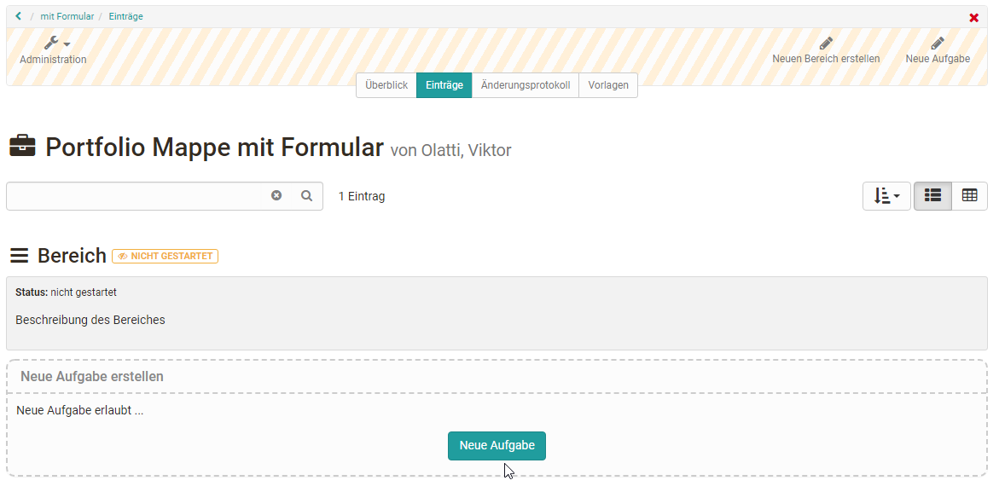
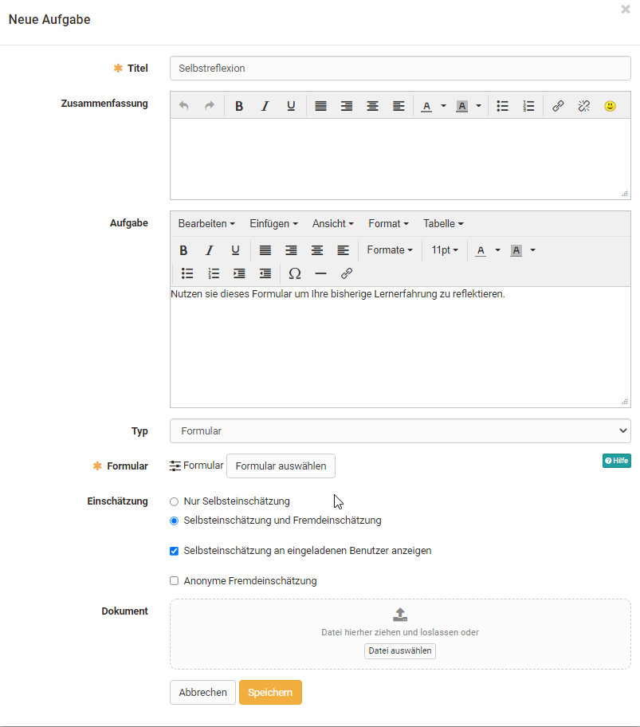
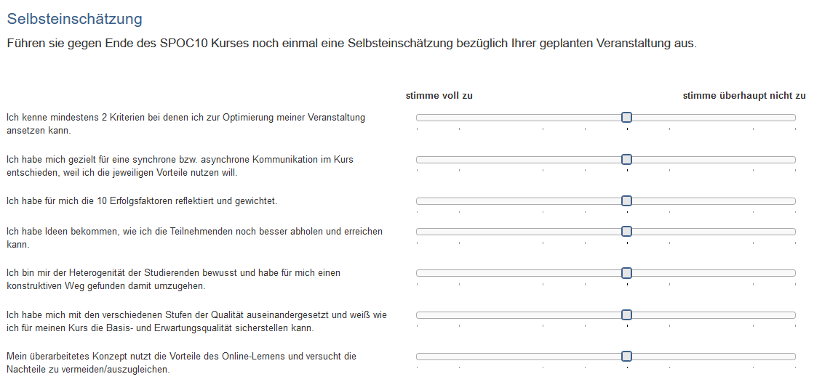

# Form in the Portfolio 2.0 template {: #eportfolio_template_forms}

With a form in the learning resource "[Portfolio 2.0 Template](Portfolio_template_Creation.md)", participants reflect on their work, assess their own achievements or answer a questionnaire.

For this, you need a Portfolio 2.0 template. Select or create a "Section" in it and select "New assignment". How you edit a Portfolio 2.0 template is described on the page [Portfolio template: Administration and editing](../learningresources/Portfolio_template_Administration_and_editing.md).

{ class="shadow lightbox" title="Tab Entries of a portfolio binder" }

For a form in a portfolio assignment, select the entry "Form" under "Type". With the button "Select a form", you then select a prepared form or create a new one.

{ class="shadow lightbox" title="Dialog New assignment" }

If you haven't created a form yet, you can create a new "Form" learning resource via the "Create" button or import an externally existing form. Afterwards, the just created or imported form also appears in the list and can be selected for the portfolio assignment.

A newly created form does not yet contain any elements. You add them directly in the learning resource in the [form editor](Form_Editor/index.md): 
`Form > Administration > Form editor`

A form that you create here is a learning resource "Form" of its own. You also find it in the [Authoring Area](../area_modules/Authoring/index.md) under "My entries" and can include it in further portfolio assignments, courses and course elements.

**Additional settings:**

Under "Evaluation", you set who fills in the form: "Only self evaluation" or "Self and external evaluation", in which invited people also fill in the form. With "Anonymous external evaluation", the external evaluation stays anonymous.

Via the course element "[Portfolio task](../learningresources/Creating_Portfolio_Tasks.md)", you include the Portfolio 2.0 template in a course.

## Example for a portfolio form

The following form shows a self-assessment as participants see it when filling it in.

{ class="shadow lightbox" title="Form when filling in" }

## Further information {: #further_information}

**Mentioned on this page** 
[Portfolio template: Creation >](Portfolio_template_Creation.md) 
[Portfolio template: Administration and editing >](../learningresources/Portfolio_template_Administration_and_editing.md) 
[The form editor >](Form_Editor/index.md) 
[Authoring - Overview >](../area_modules/Authoring/index.md) 
[Creating Portfolio Tasks >](../learningresources/Creating_Portfolio_Tasks.md)

[To the top of the page ^](#eportfolio_template_forms)
