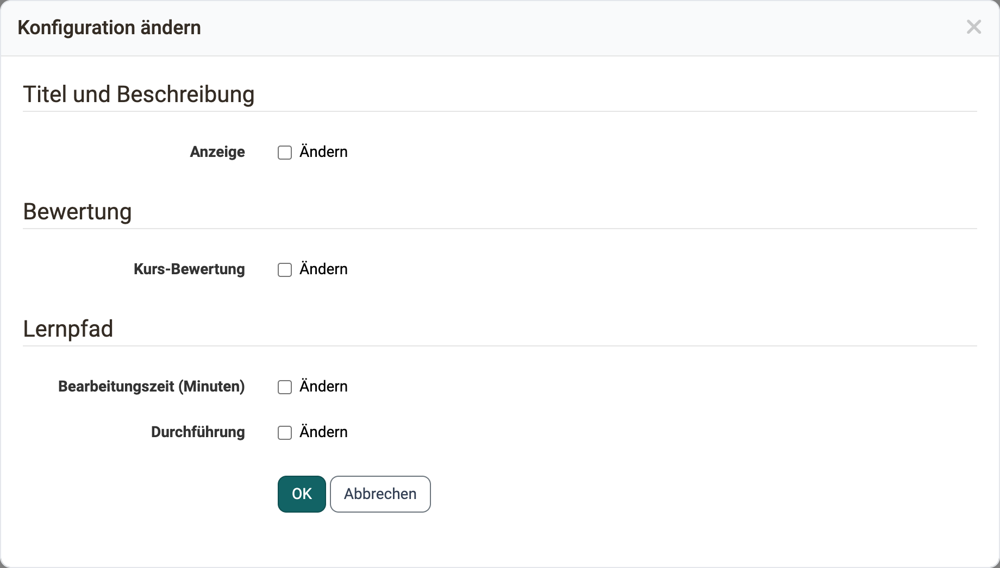
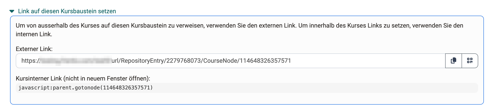
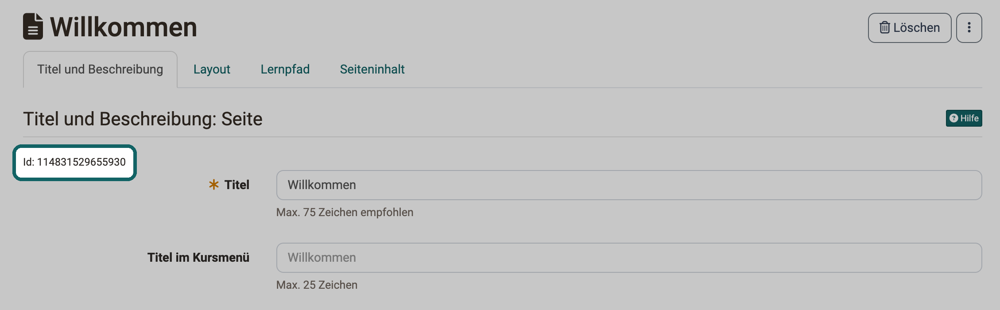
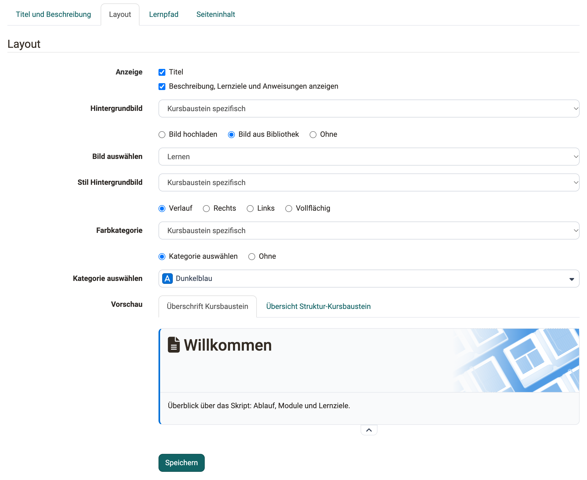

# Kursbausteine im Kurseditor {: #course_elements_course_editor}

:octicons-device-camera-video-24: **Video-Einführung**: [Kursbausteine einfügen](<https://www.youtube.com/embed/AJ76e3urdKA>){:target="_blank"}

:octicons-device-camera-video-24: **Video-Einführung**: [Kursbausteine konfigurieren](<https://www.youtube.com/embed/SAkzzoOQEoQ>){:target="_blank"}

## Übersicht der Konfiguration [:octicons-tag-16:{ title="ab Release 18.2 (OO-7496)" }](https://track.frentix.com/issue/OO-7496){:target="_blank"}

Die Konfigurationsübersicht zeigt auf einen Blick, wie der Kurs und seine Kursbausteine eingestellt sind. Sie steht im Kurseditor ganz oben in der linken Navigation.

Um einen Kursbaustein anzupassen, klicken Sie ihn an und gelangen direkt zu seiner Konfiguration. Wählen Sie mehrere Kursbausteine aus, erscheint der Button "Konfiguration ändern". Damit übernehmen Sie bestimmte Änderungen für alle gewählten Kursbausteine. Welche Änderungen möglich sind, hängt vom Kursbaustein und vom Kursdesign ab.

{ class="shadow lightbox" title="Dialog Konfiguration ändern in der Konfigurationsübersicht · 2026.11.10" }

!!! tip "Tipp"

    Blenden Sie nicht alle Spalten ein, sondern gezielt die, die Ihnen den gewünschten Überblick geben. So bleibt die Anzeige übersichtlich. Die Spalte "Beschreibung" lohnt sich nur, wenn die Kursbausteine dort keine langen Texte tragen. Die Spalte "Punkte" ist nur für bewertbare Kursbausteine relevant: Sie zeigt, ob der jeweilige Kursbaustein Punkte vergibt.

## Hinzufügen von Kursbausteinen

Einen Kurs bauen Sie aus Kursbausteinen auf. Sie können beliebig viele Kursbausteine einfügen, auch mehrere desselben Typs, und sie beliebig verschachteln. Achten Sie dabei auf einen didaktisch durchdachten Aufbau, in dem sich die Lernenden leicht zurechtfinden.

Um einen Kursbaustein dem Kurs hinzuzufügen, wählen Sie im Kurseditor "Kursbausteine einfügen" und klicken auf den gewünschten [Kursbaustein](Course_Elements/index.de.md). OpenOlat fügt ihn in der linken Navigation direkt nach dem Kursbaustein ein, den Sie vorher dort gewählt haben, auf derselben Ebene. Ist das oberste Element des Kurses gewählt, steht der neue Kursbaustein am Ende des Kurses. Mit Drag&Drop verschieben Sie Kursbausteine jederzeit an den gewünschten Ort.

Zwei Einträge im Dialog "Kursbausteine einfügen" legen mehrere Kursbausteine in einem Schritt an: [Mehrere HTML-Seiten](Course_Element_HTML_Page.de.md#multi) erzeugt aus den ausgewählten Dateien des Ablageordners je einen Kursbaustein "HTML-Seite", [Mehrere Checklisten](Course_Element_Checklist.de.md#multi) legt mehrere Checklisten nach derselben Vorlage an.

Wählen Sie vor dem Einfügen in der linken Navigation den Kursbaustein, hinter dem der neue stehen soll. Dann müssen Sie den neuen Kursbaustein nicht mehr verschieben. Alle Kursbausteine lassen sich verschieben, duplizieren und löschen. Wie das geht, beschreibt die Seite [Löschen, Verschieben und Kopieren von Kursbausteinen](../learningresources/Deleting_Moving_and_Copying_Course_Elements.de.md).

Nach dem Einfügen richten Sie den Kursbaustein in seinen Tabs ein.

## Konfigurationstabs von Kursbausteinen

Jeden Kursbaustein richten Sie in mehreren Tabs ein. Die Tabs "Titel und Beschreibung" und "Layout" hat jeder Kursbaustein. In herkömmlichen Kursen kommen die Tabs "Sichtbarkeit" und "Zugang" dazu, in [Lernpfadkursen](Learning_path_course/index.de.md) der Tab "Lernpfad".

Dazu kommen ein oder mehrere Tabs, in denen Sie die Funktion des jeweiligen Kursbausteins einrichten.

### Tab "Titel und Beschreibung" {: #desc}

Im Tab "Titel und Beschreibung" legen Sie fest, wie der Kursbaustein heisst und wofür er gedacht ist.

Das Feld "Titel" ist ein Pflichtfeld. Der Titel beschreibt den Kursbaustein genauer, empfohlen sind höchstens 75 Zeichen. Die Kursansicht zeigt ihn, wenn Sie im Tab "Layout" die Anzeige des Titels gewählt haben. In der Kursnavigation erscheint er, wenn Sie mit der Maus über den Eintrag fahren.

Der "Titel im Kursmenü" ist der Name des Kursbausteins in der linken Kursnavigation. Er ist auf 25 Zeichen beschränkt. Wählen Sie einen möglichst kurzen Text von ein bis zwei Wörtern, sonst wird die linke Navigation zu breit und unübersichtlich. Bleibt das Feld leer, zeigt die Kursnavigation den Titel, gekürzt auf 25 Zeichen.

Verwenden Sie in beiden Titelfeldern keine Schrägstriche und Punkte. Solche Sonderzeichen können beim Archivieren von Kursen zu Problemen führen.

Im Feld "Beschreibung" erläutern Sie, wofür der Kursbaustein gedacht ist. Drei bis vier Sätze genügen in der Regel. Für umfangreiche Inhalte, Aufgabenstellungen oder weitere Informationen ist das Feld nicht gedacht.

Wenn Sie den Bereich "Erweiterte Informationen eingeben" aufklappen, stehen drei weitere Felder zur Verfügung:

- **Lernziele:** Hier nennen Sie konkrete Lernziele für diesen Kursbaustein. Das lohnt sich besonders bei Kursbausteinen mit komplexeren Aktionen und bei Strukturbausteinen, die mehrere Kursbausteine und Aktivitäten bündeln.
- **Anweisungen:** Hier sagen Sie den Teilnehmenden, wie sie den Kursbaustein nutzen sollen.
- **Hinweise für die Betreuer:innen:** Hier stellen Sie Informationen für alle Betreuer:innen bereit. Teilnehmende sehen sie nicht.

Im Tab "Titel und Beschreibung" finden Sie auch die ID des jeweiligen
Kursbausteins. Möchten Sie direkt auf diesen Kursbaustein verweisen, etwa aus einer E-Mail oder aus einer Seite im Kurs, finden Sie die Links dazu ebenfalls hier: Klappen Sie den Bereich "Link auf diesen Kursbaustein setzen" auf.

{ class="shadow lightbox" title="Bereich Link auf diesen Kursbaustein setzen im Tab Titel und Beschreibung · 2026.11.09" }

**Externer Link:** Mit diesem Link verweisen Sie von einem anderen OpenOlat-Kurs oder von ausserhalb von OpenOlat auf diesen Kursbaustein, etwa in einer E-Mail oder auf einer HTML-Seite. Mit "In Zwischenablage kopieren" übernehmen Sie den Link. Mit "QR-Code anzeigen" zeigen Sie ihn als QR-Code, zum Beispiel auf einem Arbeitsblatt, das direkt zum Kursbaustein führt. Wie das geht, steht unter [Links kopieren und als QR-Code weitergeben](../basic_concepts/Navigation.de.md#url_field). [:octicons-tag-16:{ title="ab Release 21.1.2 (OO-9982)" }](https://track.frentix.com/issue/OO-9982){:target="_blank"}

**Kursinterner Link (nicht in neuem Fenster öffnen):** Mit diesem Link verweisen Sie aus einer HTML-Seite im selben Kurs auf diesen Kursbaustein. Setzen Sie ihn dort als href-Attribut. Der Link steht in einem einfachen Feld: Ein Klick hinein markiert ihn ganz, kopieren Sie ihn dann mit <kbd>Ctrl</kbd>+<kbd>C</kbd> oder unter macOS mit <kbd>Cmd</kbd>+<kbd>C</kbd>.

Die ID-Nummer links oben im Tab brauchen Sie, wenn Sie in den Regeln eines anderen Kursbausteins auf diesen verweisen, etwa im Expertenmodus der Sichtbarkeit. Jeder Kursbaustein hat eine eigene ID-Nummer.

{ class="shadow lightbox" title="Tab Titel und Beschreibung eines Kursbausteins · 2026.11.10" }

### Tab "Layout" [:octicons-tag-16:{ title="ab Release 16.0 (OO-5520)" }](https://track.frentix.com/issue/OO-5520){:target="_blank"} {: #layout}

Im Tab "Layout" bestimmen Sie, wie der Kursbaustein in der Kursansicht erscheint. Unter "Anzeige" legen Sie fest, ob die Kursansicht den "Titel" zeigt und ob sie "Beschreibung, Lernziele und Anweisungen anzeigen" soll.

Unter "Hintergrundbild" wählen Sie das Bild zur Überschrift des Kursbausteins. Zur Wahl stehen "Kurs Standard" (das Bild aus dem Tab "Layout" der Kurseinstellungen), "Vererbt" und "Kursbaustein spezifisch". Mit "Kursbaustein spezifisch" laden Sie ein eigenes Bild hoch ("Bild hochladen"), wählen eines aus der Bibliothek ("Bild aus Bibliothek") oder verzichten auf ein Bild ("Ohne"). Dieselbe Auswahl zwischen "Kurs Standard", "Vererbt" und "Kursbaustein spezifisch" haben Sie bei "Stil Hintergrundbild" und "Farbkategorie". Als Stil zeigt OpenOlat das Bild mit "Verlauf", "Rechts", "Links" oder "Vollflächig". Unter "Farbkategorie" wählen Sie eine Farbe ("Kategorie auswählen") oder schalten die Farbkennzeichnung ab ("Ohne").

Die "Vorschau" zeigt sofort, wie die Überschrift des Kursbausteins im Kurs aussieht und wie der Kursbaustein in der Übersicht eines Struktur-Kursbausteins erscheint.

{ class="shadow lightbox" title="Tab Layout eines Kursbausteins · 2026.11.10" }

### Tab "Sichtbarkeit" und "Zugang" der herkömmlichen Kurse {: #access}

Über die Tabs "Sichtbarkeit" und "Zugang" bestimmen Sie, wer einen Kursbaustein und alle untergeordneten Kursbausteine nutzen kann. Schränken Sie den Zugang ein, sehen alle Kursmitglieder den Kursbaustein, öffnen können ihn aber nur bestimmte Personen. Schränken Sie die Sichtbarkeit ein, sehen die ausgeschlossenen Personen den Kursbaustein gar nicht.

Ist ein Kursbaustein für Teilnehmende sichtbar, aber nicht zugänglich, ergänzen Sie im Tab "Sichtbarkeit" unter "Information wenn sichtbar und kein Zugang" eine Erläuterung. Sie erklärt allen ausgeschlossenen Personen, warum der Zugang gesperrt ist.

In den meisten Fällen genügt es, entweder die Sichtbarkeit oder den Zugang zu beschränken.

Folgende Einschränkungen stehen in beiden Tabs zur Wahl:

* Für Teilnehmende gesperrt
* Datumsabhängig
* Gruppenabhängig
* Bewertungsabhängig
* Attributsabhängig
* Nur im Prüfungsmodus

**Für Teilnehmende gesperrt**: Alle Personen, die ausschliesslich als Kurs- oder Gruppenteilnehmer:innen eingetragen sind, haben keinen Zugriff auf diesen Kursbaustein. So machen Sie bestimmte Bereiche zum Beispiel zunächst nur für die Lehrenden sichtbar.

**Datumsabhängig**: Hier legen Sie ein Start- und/oder Enddatum mit Uhrzeit für die Sichtbarkeit bzw. den Zugang fest. So schalten Sie zum Beispiel einen Fragebogen erst zum Ende des Kurses frei oder stellen Lehrmaterialien wöchentlich getaktet zur Verfügung.

**Gruppenabhängig**: Damit stellen Sie einen Kursbaustein nur einer bestimmten Gruppe zur Verfügung. Oft ist es sinnvoll, die Gruppenabhängigkeit auf einen Strukturbaustein anzuwenden und alle Kursbausteine für diese Gruppe darunter einzuordnen.

**Bewertungsabhängig**: Damit stellen Sie Kursbausteine oder Bereiche abhängig von anderen bewertbaren Kursbausteinen bereit, etwa von Tests, Aufgaben, Portfolioaufgaben, Checklisten oder Bewertungen. OpenOlat prüft dabei eine Mindestpunktzahl oder das Ergebnis "bestanden" eines anderen Kursbausteins. So schalten Sie zum Beispiel bestimmte Bereiche des Kurses erst frei, wenn eine Person einen bestimmten Test bestanden hat.

**Attributsabhängig**: Damit stellen Sie einen Kursbaustein nur Personen mit bestimmten Merkmalen ihrer Hochschule oder Institution zur Verfügung, zum Beispiel nur Angehörigen einer bestimmten Universität oder Studienrichtung. Jede Regel besteht aus einem "Attribut", einem "Operator" wie "hat exakt den Wert" oder "enthält den Wert" und einem "Wert". Mit "+" fügen Sie weitere Regeln hinzu. Unter "Regeln verknüpft mit" legen Sie fest, ob alle Regeln zutreffen müssen ("UND") oder ob eine genügt ("ODER"). Die Attribute übermittelt die Hochschule oder Institution, wenn sich die Person über Shibboleth (AAI) anmeldet. Die Regel greift deshalb nur bei Personen, die sich über Shibboleth anmelden. Die Option erscheint nur, wenn Ihre OpenOlat-Instanz die Anmeldung über Shibboleth anbietet und Attribute dafür eingerichtet sind. Für die Einrichtung wenden Sie sich an Ihre Organisation. Mehr zu den Attributen finden Sie im Abschnitt [Einsatz von AAI-Attributen](Access_Restrictions_in_the_Expert_Mode.de.md#einsatz-von-aai-attributen).

**Nur im Prüfungsmodus**: Wählen Sie diese Einstellung, wenn Kursbausteine nur während einer Prüfung im Prüfungsmodus sichtbar oder zugänglich sein sollen. Weitere Informationen finden Sie im Abschnitt [Prüfungsmodus](../learningresources/Assessment_mode.de.md).

**Regeln auch bei Besitzer:innen und Betreuer:innen anwenden**: Aktivieren Sie diese Option, damit eine Einschränkung auch für Besitzer:innen und Betreuer:innen gilt. Ohne Häkchen sehen Besitzer:innen, Betreuer:innen und Administrator:innen den Kursbaustein immer, unabhängig von den eingestellten Sichtbarkeitsregeln.

???+ info "Konfigurationsbeispiel zur Einschränkung der Sichtbarkeit"

    Die Sichtbarkeit eines Bausteins ist "Gruppenabhängig" für Gruppe "A" konfiguriert. Die (De-)Aktivierung der Option "Regeln auch bei Besitzer:innen und Betreuer:innen anwenden" wirkt sich für die verschiedenen Rollen wie folgt auf die Sichtbarkeit aus:

    Rolle | :fontawesome-regular-square: Regeln auch bei Besitzer:innen / Betreuer:innen anwenden | :fontawesome-regular-square-check: Regeln auch bei Besitzer:innen / Betreuer:innen anwenden
    ---------|----------|---------
    Teilnehmer:innen Gruppe "A" | :fontawesome-regular-eye: | :fontawesome-regular-eye:
    Betreuer:innen Gruppe "A" | :fontawesome-regular-eye: | :fontawesome-regular-eye:
    Teilnehmer:innen Gruppe "B"| :fontawesome-regular-eye-slash: | :fontawesome-regular-eye-slash:
    Betreuer:innen Gruppe "B" | :fontawesome-regular-eye: | :fontawesome-regular-eye-slash:
    Teilnehmer:innen des Kurses | :fontawesome-regular-eye-slash: | :fontawesome-regular-eye-slash:
    Betreuer:innen des Kurses | :fontawesome-regular-eye: | :fontawesome-regular-eye-slash:
    Besitzer:innen des Kurses | :fontawesome-regular-eye: | :fontawesome-regular-eye-slash:

!!! note "Hinweis"

    Bei Personen mit mehreren Rollen wirken sich die Zugangs- bzw. Sichtbarkeitsbeschränkungen entsprechend der aktuell ausgewählten Rolle aus.

Über den Button "Expertenmodus anzeigen" gelangen Sie zu einem Eingabefeld, in dem Sie komplexere Regeln nach Ihren Bedürfnissen festlegen. Die Syntax beschreibt die Seite [Zugriffsbeschränkungen im Expertenmodus](Access_Restrictions_in_the_Expert_Mode.de.md). Sie können auch zuerst eine Grundeinstellung im einfachen Modus festlegen und die Regel dann im Expertenmodus erweitern. Im Expertenmodus verknüpfen Sie verschiedene Einschränkungen sehr differenziert. Ein Beispiel: Ein Kursbaustein öffnet sich erst ab einem bestimmten Datum, und nur, wenn die Person zwei Tests bestanden hat, in einer Checkliste mindestens 10 Punkte erreicht hat oder Mitglied einer bestimmten Gruppe ist.

Alle Einschränkungen eines Kursbausteins gelten auch für seine untergeordneten Kursbausteine.

Beim [Kursbaustein "Struktur"](Course_Element_Structure.de.md) hinterlegen Sie im Tab "Zugang" zusätzlich ein Passwort. Den Strukturbaustein und alle untergeordneten Kursbausteine öffnen dann nur Personen, die das Passwort eingeben. So machen Sie zum Beispiel Zusatzinhalte nur Personen zugänglich, die dafür bezahlt haben, oder schalten Kursbausteine für bestimmte Level im Rahmen von Game-based Learning frei.

Diese Einschränkungen gibt es nur in herkömmlichen Kursen. Brauchen Sie solche gezielten Freigaben, verwenden Sie einen herkömmlichen Kurs. In Lernpfadkursen steuern Sie die Freigabe im Tab "Lernpfad", den die Seite [Lernpfadkurs - Kurseditor](../learningresources/Learning_path_course_Course_editor.de.md) beschreibt.

## Weiterführende Informationen {: #further_information}

**Auf dieser Seite erwähnt** 
[Kursbausteine im Überblick >](Course_Elements/index.de.md) 
[Kursbaustein "HTML-Seite" >](Course_Element_HTML_Page.de.md) 
[Kursbaustein "Checkliste" >](Course_Element_Checklist.de.md) 
[Löschen, Verschieben und Kopieren von Kursbausteinen >](Deleting_Moving_and_Copying_Course_Elements.de.md) 
[Lernpfadkurs - Überblick >](Learning_path_course/index.de.md) 
[Navigation >](../basic_concepts/Navigation.de.md) 
[Zugriffsbeschränkungen im Expertenmodus >](Access_Restrictions_in_the_Expert_Mode.de.md) 
[Prüfungsverwaltung: Prüfungsmodus >](Assessment_mode.de.md) 
[Kursbaustein "Struktur" >](Course_Element_Structure.de.md) 
[Lernpfadkurs - Kurseditor >](Learning_path_course_Course_editor.de.md)

**Weiterführend** 
[Kurseditorwerkzeuge >](Using_additional_Course_Editor_Tools.de.md) 
[Kurseinstellungen >](Course_Settings/index.de.md)

**youtube** 
[Kursbausteine einfügen](<https://www.youtube.com/embed/AJ76e3urdKA>) 
[Kursbausteine konfigurieren](<https://www.youtube.com/embed/SAkzzoOQEoQ>)

[Zum Seitenanfang ^](#course_elements_course_editor)
