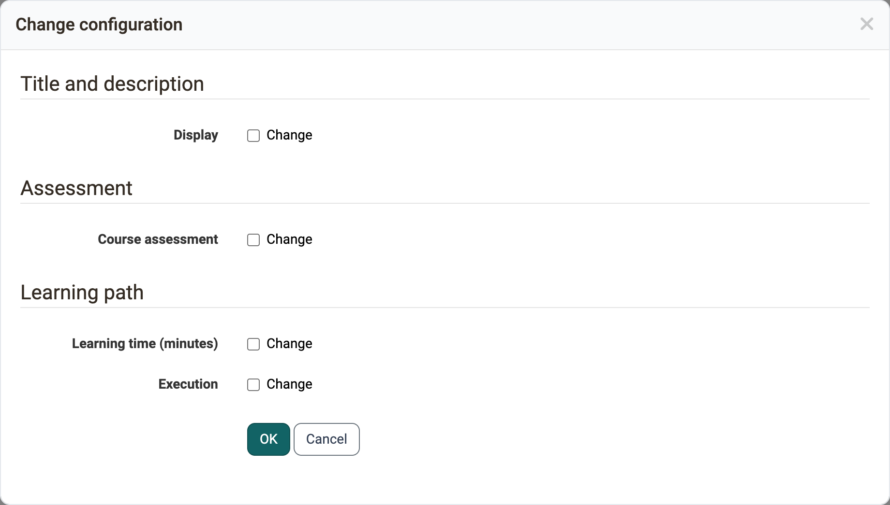
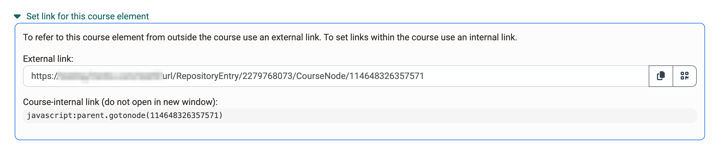
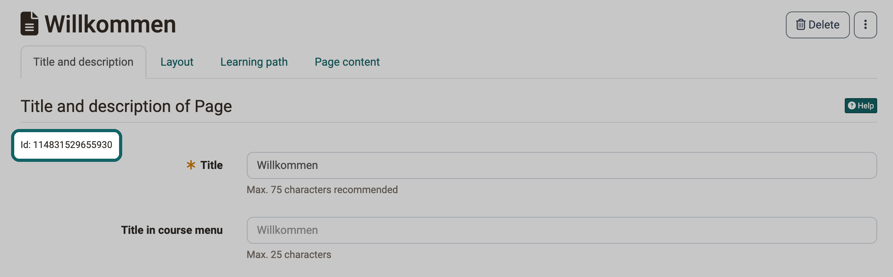
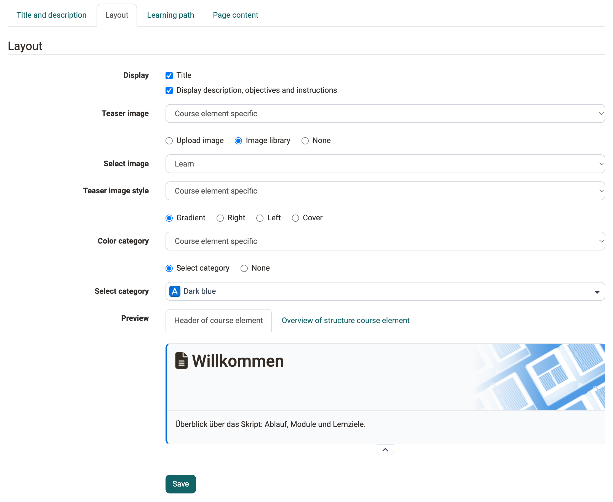

# Course elements in the Course editor {: #course_elements_course_editor}

:octicons-device-camera-video-24: **Video Introduction (German)**: [Inserting course elements](<https://www.youtube.com/embed/AJ76e3urdKA>){:target="_blank"}

:octicons-device-camera-video-24: **Video Introduction (German)**: [Configuring course elements](<https://www.youtube.com/embed/SAkzzoOQEoQ>){:target="_blank"}

## Overview of the Configuration [:octicons-tag-16:{ title="from Release 18.2 (OO-7496)" }](https://track.frentix.com/issue/OO-7496){:target="_blank"}

The configuration overview shows at a glance how the course and its course elements are set up. It is located in the course editor at the very top of the left navigation.

To adjust a course element, click it and you go directly to its configuration. If you select several course elements, the button "Change configuration" appears. With it, you apply certain changes to all selected course elements. Which changes are possible depends on the course element and the course design.

{ class="shadow lightbox" title="Dialog Change configuration in the configuration overview · 2026.11.10" }

!!! tip "Tip"

    Do not show all columns, but only the ones that give you the overview you need. This keeps the display clear. The column "Description" is only worthwhile if the course elements do not contain long texts there. The column "Points" is only relevant for assessable course elements: it shows whether the respective course element awards points.

## Adding Course Elements

You build a course from course elements. You can insert any number of course elements, including several of the same type, and nest them as you like. Make sure the structure is didactically well thought out and easy for the learners to find their way around.

To add a course element to the course, select "Insert course elements" in the course editor and click the desired [course element](Course_Elements/index.md). OpenOlat inserts it in the left navigation directly after the course element you selected there beforehand, on the same level. If the top element of the course is selected, the new course element is placed at the end of the course. With Drag&Drop, you move course elements to the desired position at any time.

Two entries in the dialog "Insert course elements" create several course elements in one step: [Multiple HTML pages](Course_Element_HTML_Page.md#multi) creates one course element "HTML page" for each selected file of the storage folder, [Multiple checklists](Course_Element_Checklist.md#multi) creates several checklists from the same template.

Before inserting, select the course element in the left navigation after which the new one is to be placed. Then you do not need to move the new course element afterwards. You can move, duplicate and delete all course elements. The page [Deleting, Moving and Copying Course Elements](../learningresources/Deleting_Moving_and_Copying_Course_Elements.md) describes how this works.

After inserting, you set up the course element in its tabs.

## Configuration tabs of course elements

You set up each course element in several tabs. Every course element has the tabs "Title and description" and "Layout". Conventional courses add the tabs "Visibility" and "Access", [learning path courses](Learning_path_course/index.md) add the tab "Learning path".

In addition, there are one or more tabs in which you set up the function of the respective course element.

### Tab "Title and description" {: #desc}

In the tab "Title and description" you define what the course element is called and what it is intended for.

The field "Title" is mandatory. The title describes the course element in more detail, a maximum of 75 characters is recommended. The course view shows it if you have chosen to display the title in the tab "Layout". In the course navigation, it appears when you move the mouse over the entry.

The "Title in course menu" is the name of the course element in the left course navigation. It is restricted to 25 characters. Choose as short a text as possible, one or two words, otherwise the left navigation becomes too wide and confusing. If the field remains empty, the course navigation shows the title, shortened to 25 characters.

Do not use slashes or periods in either title field. Such special characters can cause problems when archiving courses.

In the field "Description" you explain what the course element is intended for. Three to four sentences are usually enough. The field is not intended for extensive contents, tasks or other information.

When you expand the area "Insert additional information", three more fields are available:

- **Objectives:** Here you name concrete learning objectives for this course element. This is especially worthwhile for course elements with more complex actions and for structure elements that bundle several course elements and activities.
- **Instructions:** Here you tell the participants how they should use the course element.
- **Instructions for the coach:** Here you provide information for all coaches. Participants do not see it.

In the tab "Title and description" you will also find the ID of the respective
course element. If you want to refer directly to this course element, for example from an e-mail or from a page in the course, you find the links for this here as well: expand the area "Set link for this course element".

{ class="shadow lightbox" title="Area Set link for this course element in the tab Title and description · 2026.11.09" }

**External link:** With this link, you refer to this course element from another OpenOlat course or from outside OpenOlat, for example in an e-mail or on an HTML page. With "Copy to clipboard", you take over the link. With "Show QR code", you show it as a QR code, for example on a worksheet that leads directly to the course element. How this works is described under [Copy links and pass them on as a QR code](../basic_concepts/Navigation.md#url_field). [:octicons-tag-16:{ title="from Release 21.1.2 (OO-9982)" }](https://track.frentix.com/issue/OO-9982){:target="_blank"}

**Course-internal link (do not open in new window):** With this link, you refer to this course element from an HTML page in the same course. Set it there as href attribute. The link is shown in a simple field: a click into it selects it completely, then copy it with <kbd>Ctrl</kbd>+<kbd>C</kbd> or on macOS with <kbd>Cmd</kbd>+<kbd>C</kbd>.

You need the ID number in the upper left corner of the tab when you refer to this course element in the rules of another course element, for example in the expert mode of the visibility. Each course element has its own ID number.

{ class="shadow lightbox" title="Tab Title and description of a course element · 2026.11.10" }

### Tab "Layout" [:octicons-tag-16:{ title="from Release 16.0 (OO-5520)" }](https://track.frentix.com/issue/OO-5520){:target="_blank"} {: #layout}

In the tab "Layout" you determine how the course element appears in the course view. Under "Display" you define whether the course view shows the "Title" and whether it should "Display description, objectives and instructions".

Under "Teaser image" you choose the image for the heading of the course element. You can choose between "Course default" (the image from the tab "Layout" of the course settings), "Inherited" and "Course element specific". With "Course element specific" you upload your own image ("Upload image"), choose one from the library ("Image library") or do without an image ("None"). You have the same choice between "Course default", "Inherited" and "Course element specific" for "Teaser image style" and "Color category". As style, OpenOlat shows the image with "Gradient", "Right", "Left" or "Cover". Under "Color category" you choose a color ("Select category") or switch off the color coding ("None").

The "Preview" immediately shows what the heading of the course element looks like in the course and how the course element appears in the overview of a structure course element.

{ class="shadow lightbox" title="Tab Layout of a course element · 2026.11.10" }

### Tab "Visibility" and "Access" of conventional courses {: #access}

With the tabs "Visibility" and "Access" you determine who can use a course element and all subordinate course elements. If you restrict the access, all course members see the course element, but only certain persons can open it. If you restrict the visibility, the excluded persons do not see the course element at all.

If a course element is visible but not accessible for participants, add an explanation in the tab "Visibility" under "Information if visible and no access". It tells all excluded persons why the access is blocked.

In most cases, it is sufficient to restrict either the visibility or the access.

The following restrictions are available in both tabs:

* Blocked for participants
* Depending on date
* Depending on group
* Depending on assessment
* Depending on attribute
* Only in assessment mode

**Blocked for participants**: All persons who are exclusively registered as course or group participants do not have access to this course element. In this way, you make certain areas visible only to teachers at first, for example.

**Depending on date**: Here you define a start and/or end date with time for the visibility or the access. For example, you activate a questionnaire only at the end of the course or make teaching materials available on a weekly basis.

**Depending on group**: With this, you make a course element available only to a certain group. It often makes sense to apply the group dependency to a structure element and to place all course elements for this group beneath it.

**Depending on assessment**: With this, you provide course elements or areas depending on other assessable course elements, such as tests, tasks, portfolio tasks, checklists or assessments. OpenOlat checks a minimum score or the result "passed" of another course element. For example, you activate certain areas of the course only once a person has passed a certain test.

**Depending on attribute**: With this, you make a course element available only to persons with certain characteristics of their university or institution, for example only to members of a certain university or field of study. Each rule consists of an "Attribute", an "Operator" such as "has exactly the value" or "contains the value", and a "Value". Click "+" to add further rules. Under "Rules connected with" you define whether all rules must apply ("AND") or whether one is enough ("OR"). The university or institution transmits the attributes when the person logs in via Shibboleth (AAI). The rule therefore only applies to persons who log in via Shibboleth. The option only appears if your OpenOlat instance offers login via Shibboleth and attributes are set up for it. For the setup, contact your organization. For more information on the attributes, see the section [Use of AAI Attributes](Access_Restrictions_in_the_Expert_Mode.md#use-of-aai-attributes).

**Only in assessment mode**: Select this setting if course elements should be visible or accessible only during an exam in assessment mode. For more information, refer to the section [Assessment Mode](../learningresources/Assessment_mode.md).

**Apply rules also for owners and coaches**: Activate this option so that a restriction also applies to owners and coaches. Without the checkmark, owners, coaches and administrators always see the course element, regardless of the visibility rules set.

???+ info "Configuration example for restricting visibility"

    The visibility of a course element is configured "Depending on group" for group "A". (De)activating the option "Apply rules also for owners and coaches" affects the visibility for the different roles as follows:

    Role | :fontawesome-regular-square: Apply rules also for owners / coaches | :fontawesome-regular-square-check: Apply rules also for owners / coaches
    ---------|----------|---------
    Participants Group "A" | :fontawesome-regular-eye: | :fontawesome-regular-eye:
    Coaches Group "A" | :fontawesome-regular-eye: | :fontawesome-regular-eye:
    Participants Group "B" | :fontawesome-regular-eye-slash: | :fontawesome-regular-eye-slash:
    Coaches Group "B" | :fontawesome-regular-eye: | :fontawesome-regular-eye-slash:
    Participants of the course | :fontawesome-regular-eye-slash: | :fontawesome-regular-eye-slash:
    Coaches of the course | :fontawesome-regular-eye: | :fontawesome-regular-eye-slash:
    Owners of the course | :fontawesome-regular-eye: | :fontawesome-regular-eye-slash:

!!! note "Note"

    For people with multiple roles, the access/visibility restrictions take effect according to the currently selected role.

The button "Display expert mode" takes you to an input field where you define more complex rules according to your needs. The page [Access Restrictions in the Expert Mode](Access_Restrictions_in_the_Expert_Mode.md) describes the syntax. You can also first define a basic setting in the simple mode and then extend the rule in expert mode. In expert mode, you link different restrictions in a very differentiated way. An example: a course element opens only from a certain date, and only if the person has passed two tests, has reached at least 10 points in a checklist or is a member of a certain group.

All restrictions of a course element also apply to its subordinate course elements.

For the [course element "Structure"](Course_Element_Structure.md) you can additionally store a password in the tab "Access". The structure element and all subordinate course elements then only open for persons who enter the password. In this way, you make additional content accessible only to persons who have paid for it, for example, or activate course elements for certain levels in the context of game-based learning.

These restrictions only exist in conventional courses. If you need such targeted releases, use a conventional course. In learning path courses, you control the release in the tab "Learning path", which the page [Learning path course - Course editor](../learningresources/Learning_path_course_Course_editor.md) describes.

## Further information {: #further_information}

**Mentioned on this page** 
[Course elements at a glance >](Course_Elements/index.md) 
[Course Element "HTML page" >](Course_Element_HTML_Page.md) 
[Course Element "Checklist" >](Course_Element_Checklist.md) 
[Deleting, Moving and Copying Course Elements >](Deleting_Moving_and_Copying_Course_Elements.md) 
[Learning path course - Overview >](Learning_path_course/index.md) 
[Navigation >](../basic_concepts/Navigation.md) 
[Access Restrictions in the Expert Mode >](Access_Restrictions_in_the_Expert_Mode.md) 
[Assessment management: Assessment mode >](Assessment_mode.md) 
[Course Element "Structure" >](Course_Element_Structure.md) 
[Learning path course - Course editor >](Learning_path_course_Course_editor.md)

**Further reading** 
[Course editor tools >](Using_additional_Course_Editor_Tools.md) 
[Course Settings >](Course_Settings/index.md)

**youtube** 
[Inserting course elements](<https://www.youtube.com/embed/AJ76e3urdKA>) 
[Configuring course elements](<https://www.youtube.com/embed/SAkzzoOQEoQ>)

[To the top of the page ^](#course_elements_course_editor)
