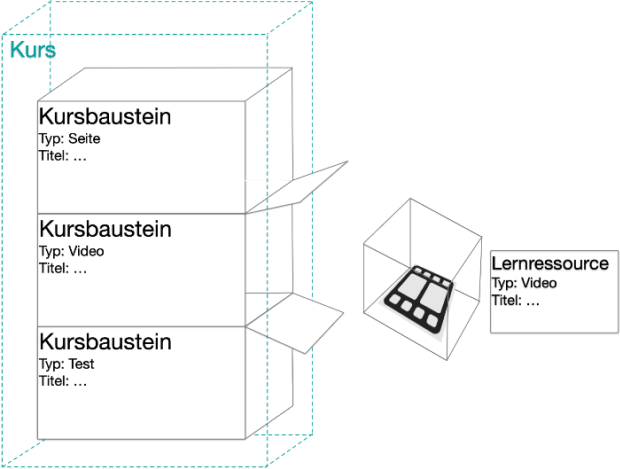
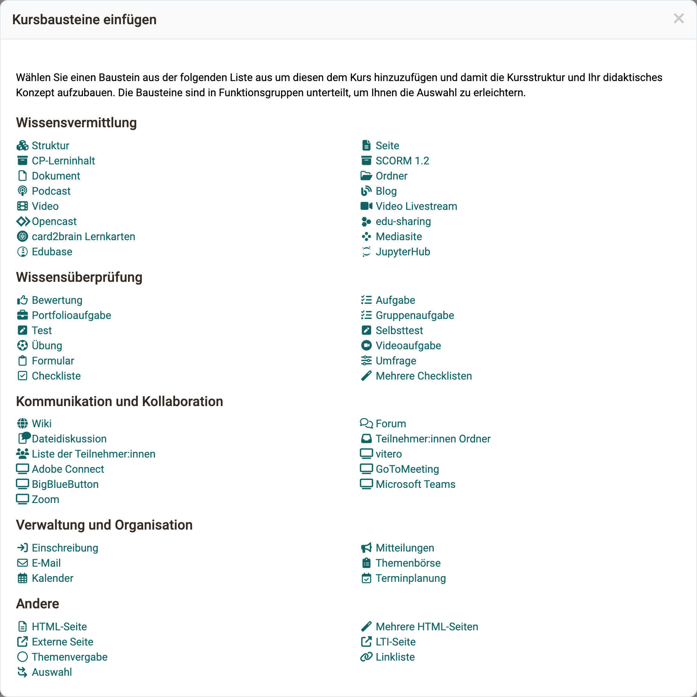
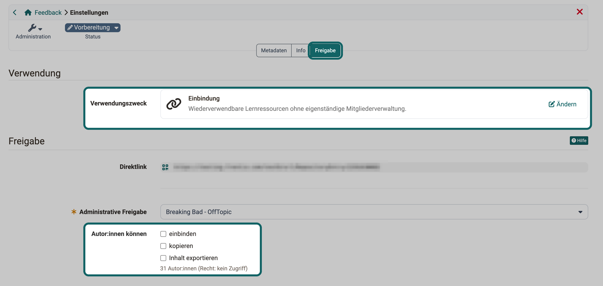
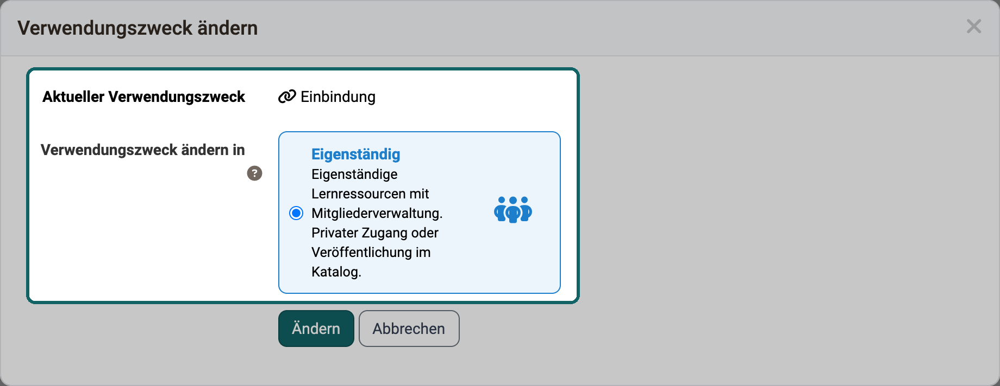

# Funktionskonzept Kurse und Lernressourcen {: #General_Functions_Concept}

## Was ist ein Kurs?

Ein OpenOlat-Kurs wird aus einzelnen Kursbausteinen zusammengesetzt. In den meisten Fällen ist jeder dieser Kursbausteine ein Behälter, in den eine Lernressource eingefügt wird.

Beispiel Kursbaustein "Video":

{ class="lightbox" title="Schema Kurs, Kursbausteine und Lernressource" }

## Kursbausteine

OpenOlat bietet Kursautor:innen viele Kursbausteintypen an, und jeder Typ hat andere Fähigkeiten.

**Beispiel 1:** 
Ein [Kursbaustein "Video"](../learningresources/Course_Element_Video.de.md) muss mit den Zusatzfunktionen für Videos (Annotationen, Quizzes, Kapitel, Kommentare, Segmente) umgehen können.

**Beispiel 2:** 
Ein [Kursbaustein "Test"](../learningresources/Course_Element_Test.de.md) muss mit Punkten und Auswertung von Fragen umgehen können. Diese Fähigkeiten benötigt z.B. ein Kursbaustein "BigBlueButton" (Videokonferenz) nicht.

**Beispiel 3:** 
Eine [Checkliste](../learningresources/Course_Element_Checklist.de.md) ist ein Beispiel für einen Kursbaustein ohne Lernressource. Alle Funktionen der Checkliste sind im Kursbaustein selbst eingebaut.

Autor:innen stehen je nach Konfiguration z.B. die folgenden Kursbausteintypen zur Verfügung:

{ class="shadow lightbox" title="Dialog Kursbausteine einfügen im Kurseditor · 2026.10.21" }

## Was ist eine Lernressource?

Lernressourcen sind Objekte, die in Kursbausteine eingefügt werden können.

!!! note "Ausnahme"

    Auch Kurse werden gelegentlich als Lernressource bezeichnet. Es kann jedoch kein Kurs in einen anderen Kurs eingefügt werden.

## Vorteile dieses Konzepts

Das Funktionskonzept mit den Kursbausteinen als Behälter für Lernressourcen hat wesentliche Vorteile:

* **Mehrfach nutzen:** Dieselbe Lernressource lässt sich in verschiedenen Kursbausteinen und Kursen einsetzen.
* **Auswechseln:** Eine Lernressource lässt sich austauschen, ohne dass die Kursstruktur verloren geht. Die Kursbausteine bilden die Kursstruktur weiter, vorübergehend als leere Behälter.
* **Eigenschaften behalten:** Eigenschaften des Kursbausteins wie der Titel bleiben unabhängig von der eingefügten Lernressource erhalten. Das gilt zum Beispiel, wenn Sie eine andere Video-Lernressource mit anderem Dateinamen einfügen oder ein Test für den konkreten Kurs eine andere Grundeinstellung erhält.

## Eigenständige Lernressourcen [:octicons-tag-16:{ title="ab Release 18.2.0 (OO-7277)" }](https://track.frentix.com/issue/OO-7277){:target="_blank"}

Im Normalfall binden Sie eine Lernressource ein, etwa in einen Kursbaustein (Verwendungszweck "Einbindung"). Manche Lernressourcen lassen sich auch eigenständig nutzen (Verwendungszweck "Eigenständig").

Eine eigenständige Lernressource behandelt OpenOlat in den Einstellungen ähnlich wie einen Kurs. So können Sie ihr zum Beispiel direkt Mitglieder zuweisen.

### Wann ist eine eigenständige Lernressource sinnvoll?

Ein Wiki oder ein Blog eignen sich als eigenständige Lernressource, weil sie gut ohne Kurs funktionieren.

Bei Test-Lernressourcen ist das eher nicht empfohlen, weil viele Auswertungsfunktionen im Kursbaustein "Test" liegen. In einen Kurs eingebunden, wird der Test Teil des Gesamtkurses und gibt seine Ergebnisse an den Kurs weiter. Bei mehreren bewertbaren Kursbausteinen führt das Bewertungswerkzeug den Test dann für Betreuer:innen auf, und sie können den Gesamtkurs bewerten. Wird diese Gesamtschau gebraucht, ist eine eigenständige Lernressource wenig sinnvoll.

### Eigenständige Lernressourcen in Kursen

!!! warning "Achtung"

    Auch eigenständige Lernressourcen können weiter in Kurse eingebunden werden.

    Wurden Mitglieder aber direkt in die Lernressource eingebucht, kann dies zu Problemen führen, wenn diese Lernressource nun in verschiedene Kurse eingebunden wird.

## Unterschiede: Lernressource im Kurs <-> eigenständige Lernressource

|                                   |Lernressource im Kurs "Einbindung"| eigenständige Lernressource "Eigenständig" |
|-------------------------------------------------|:-------------------:|:-------------------:|
| Besitzer:innen als Mitglieder                   | ja    | ja   |
| Betreuer:innen als Mitglieder                   | nein  | ja   |
| Teilnehmer:innen als Mitglieder                 | nein  | ja   |
| Private Mitgliederverwaltung                    | nein  | ja   |
| Buchbare und offene Angebote                    | nein  | ja   |
| im Katalog auflistbar (Angebote erstellbar)  | nein  | ja   |
| Status "Veröffentlicht" erforderlich            | nein  | ja   |
| bei Videos: in Video Collection auflistbar      | ja    | ja   |

## Verwendungszweck einer Lernressource vorsehen [:octicons-tag-16:{ title="ab Release 21.1.0 (OO-9805)" }](https://track.frentix.com/issue/OO-9805){:target="_blank"} {: #usage}

Der Verwendungszweck beantwortet eine einzige Frage: Woher kommen die Mitglieder einer Lernressource? Nur eine Lernressource mit dem Verwendungszweck "Eigenständig" hat eine eigene Mitgliederverwaltung. Bei "Einbindung" kommen die Mitglieder von der Stelle, an der die Lernressource eingebunden ist, bei "Verwendung im Course Planner" vom Course Planner, und ein "Template" dient nur als Vorlage für Kursinhalte.

In den Einstellungen einer Lernressource legen Sie unter anderem fest, ob sie an anderer Stelle eingebunden oder in erster Linie eigenständig genutzt wird. Eine neue Lernressource, die kein Kurs ist, erhält zunächst den Verwendungszweck "Einbindung".

Sie finden die Einstellung des Verwendungszwecks in der gewählten Lernressource unter: 
`Lernressource > Administration > Einstellungen > Tab "Freigabe" > Abschnitt "Verwendung"`

{ class="shadow lightbox" title="Tab Freigabe eines Formulars · 2026.10.21" }

Eine Lernressource mit dem Verwendungszweck "Einbindung" ist wiederverwendbar und wird an anderer Stelle eingebunden: in einen Kursbaustein eines Kurses oder, bei einem Formular, auch in eine Datenerhebung des Qualitätsmanagements und als [Formular für Buchungsaufträge](../area_modules/Course_Planner_Implementations.de.md#booking_order_forms) in eine Durchführung des Course Planner. Ein Kurs ist nur einer dieser Orte, deshalb nennt der Name des Verwendungszwecks keinen Ort. Damit andere Autor:innen Ihre Lernressource einbinden dürfen, setzen Sie im selben Tab unter "Autor:innen können" das Häkchen "einbinden".

Mit "Ändern" öffnen Sie den Dialog "Verwendungszweck ändern". Er zeigt unter "Aktueller Verwendungszweck" den heutigen Wert und darunter unter "Verwendungszweck ändern in" die Verwendungszwecke, zu denen Sie wechseln können. Bei Lernressourcen, die keine Kurse sind, gibt es nur "Einbindung" und "Eigenständig", der Dialog bietet deshalb genau eine Option an. Das Hilfesymbol neben "Verwendungszweck ändern in" führt zur Beschreibung aller Verwendungszwecke im [Abschnitt Verwendung des Tabs Freigabe](Course_Settings_Share.de.md#section_usage).

{ class="shadow lightbox" title="Dialog Verwendungszweck ändern bei einem Formular · 2026.10.21" }

Ein Kurs lässt sich nicht in einen anderen Kurs einbinden. Ist der Course Planner aktiviert, stehen für Kurse stattdessen die Verwendungszwecke "Eigenständig", "Verwendung im Course Planner" [:octicons-tag-16:{ title="ab Release 20.0 (OO-8104)" }](https://track.frentix.com/issue/OO-8104){:target="_blank"} und "Template" [:octicons-tag-16:{ title="ab Release 20.0 (OO-8422)" }](https://track.frentix.com/issue/OO-8422){:target="_blank"} zur Wahl. Beide haben keine eigenständige Mitgliederverwaltung: Bei "Verwendung im Course Planner" verwaltet der Course Planner die Mitglieder, ein "Template" dient als Vorlage für Kursinhalte. Details dazu finden Sie im Kapitel [Course Planner: Produkte](../area_modules/Course_Planner_Products.de.md).

!!! info "Hinweis zum Status"

    Bei Kursen und Video-Lernressourcen ist der Status "Veröffentlicht" erforderlich, damit sie durch Teilnehmer:innen genutzt werden können.

    Andere Lernressourcen können in Kurse eingebunden werden, auch wenn der Status noch "Vorbereitung" ist.

## Weiterführende Informationen {: #further_information}

**Auf dieser Seite erwähnt** 
[Kursbaustein "Video" >](../learningresources/Course_Element_Video.de.md) 
[Kursbaustein "Test" >](../learningresources/Course_Element_Test.de.md) 
[Kursbaustein "Checkliste" >](../learningresources/Course_Element_Checklist.de.md) 
[Course Planner: Durchführungen >](../area_modules/Course_Planner_Implementations.de.md) 
[Kurseinstellungen - Tab Freigabe >](../learningresources/Course_Settings_Share.de.md) 
[Course Planner: Produkte >](../area_modules/Course_Planner_Products.de.md)

**Weiterführend** 
[Detailansicht einer Lernressource >](../learningresources/Detailed_View_of_Learning_Resources.de.md) 
[Autorenbereich - Übersicht >](../area_modules/Authoring.de.md)

[Zum Seitenanfang ^](#General_Functions_Concept)
