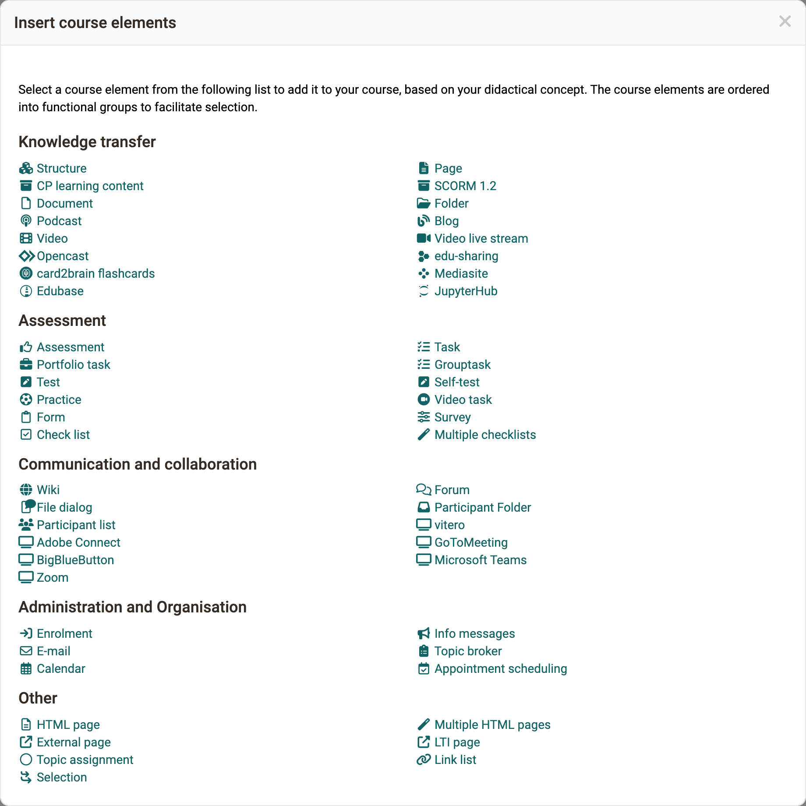
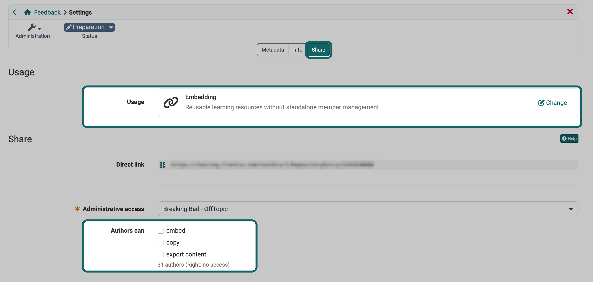
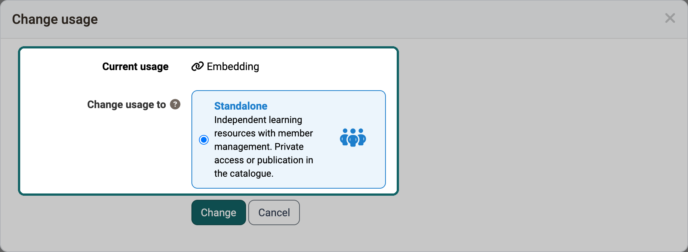

# Function concept courses and learning resources {: #General_Functions_Concept}

## What is a course?

An OpenOlat course is made up of individual course elements. In most cases, each of these course elements is a container into which a learning resource is inserted.

Example course element "Video":

{ class="lightbox" title="Diagram of course, course elements and learning resource" }

## Course elements

OpenOlat offers course authors many course element types, and each type has different capabilities.

**Example 1:** 
A [course element "Video"](../learningresources/Course_Element_Video.md) must be able to handle the additional functions for videos (annotations, quizzes, chapters, comments, segments).

**Example 2:** 
A [course element "Test"](../learningresources/Course_Element_Test.md) must be able to handle points and the evaluation of questions. A course element "BigBlueButton" (video conference), for example, does not need these capabilities.

**Example 3:** 
A [checklist](../learningresources/Course_Element_Checklist.md) is an example of a course element without a learning resource. All functions of the checklist are built into the course element itself.

Depending on the configuration, the following course element types, for example, are available to authors:

{ class="shadow lightbox" title="Insert course elements dialog in the course editor · 2026.10.21" }

## What is a learning resource?

Learning resources are objects that can be inserted into course elements.

!!! note "Exception"

    Courses are also sometimes referred to as learning resources. However, no course can be inserted into another course.

## Advantages of this concept

The function concept with the course elements as containers for learning resources has significant advantages:

* **Use multiple times:** The same learning resource can be used in different course elements and courses.
* **Replace:** A learning resource can be exchanged without losing the course structure. The course elements continue to form the course structure, temporarily as empty containers.
* **Keep properties:** Properties of the course element such as the title are retained independently of the inserted learning resource. This applies, for example, if you insert another video learning resource with a different file name or if a test is given a different basic setting for this specific course.

## Standalone learning resources [:octicons-tag-16:{ title="from Release 18.2.0 (OO-7277)" }](https://track.frentix.com/issue/OO-7277){:target="_blank"}

Normally, you embed a learning resource, for example in a course element (usage "Embedding"). Some learning resources can also be used on their own (usage "Standalone").

OpenOlat treats a standalone learning resource similarly to a course in the settings. For example, you can assign members to it directly.

### When is a standalone learning resource useful?

A wiki or a blog are suitable as standalone learning resources because they work well without a course.

For test learning resources, however, this is not recommended because many evaluation functions are located in the course element "Test". Embedded in a course, the test becomes part of the overall course and passes its results on to the course. If there are several assessable course elements, the assessment tool then lists the test for coaches, and they can assess the entire course. If this overall view is required, a standalone learning resource is of little use.

### Standalone learning resources in courses

!!! warning "Attention"

    Standalone learning resources can also be embedded in courses.

    However, if members were booked directly into the learning resource, this can lead to problems if this learning resource is then embedded in different courses.

## Differences: learning resource in a course <-> standalone learning resource

|                                   |Learning resource in a course "Embedding"| standalone learning resource "Standalone" |
|-------------------------------------------------|:-------------------:|:-------------------:|
| Owners as members                               | yes   | yes  |
| Coaches as members                              | no    | yes  |
| Participants as members                         | no    | yes  |
| Private members management                      | no    | yes  |
| Bookable and open offers                        | no    | yes  |
| Can be listed in the catalog (offers can be created)  | no    | yes  |
| Status "Published" required                     | no    | yes  |
| For videos: can be listed in the Video Collection | yes   | yes  |

## Provide for the usage of a learning resource [:octicons-tag-16:{ title="from Release 21.1.0 (OO-9805)" }](https://track.frentix.com/issue/OO-9805){:target="_blank"} {: #usage}

The usage answers one single question: where do the members of a learning resource come from? Only a learning resource with the usage "Standalone" has a member management of its own. With "Embedding", the members come from the place where the learning resource is embedded, with "Use in Course Planner" from the Course Planner, and a "Template" only serves as a template for course content.

In the settings of a learning resource you define, among other things, whether it is embedded elsewhere or primarily used on its own. A new learning resource that is not a course initially receives the usage "Embedding".

You can find the usage setting in the selected learning resource under: 
`Learning resource > Administration > Settings > Tab "Share" > Section "Usage"`

{ class="shadow lightbox" title="Share tab of a form · 2026.10.21" }

A learning resource with the usage "Embedding" is reusable and is embedded elsewhere: in a course element of a course or, for a form, also in a data collection of the quality management and as a [booking order form](../area_modules/Course_Planner_Implementations.md#booking_order_forms) in an implementation of the Course Planner. A course is only one of these places, which is why the name of the usage names no place. To allow other authors to embed your learning resource, tick "embed" under "Authors can" in the same tab.

"Change" opens the "Change usage" dialog. It shows the current value under "Current usage" and below it, under "Change usage to", the usages you can switch to. Learning resources that are not courses only have "Embedding" and "Standalone", so the dialog offers exactly one option. The help icon next to "Change usage to" leads to the description of all usages in the [Usage section of the Share tab](Course_Settings_Share.md#section_usage).

{ class="shadow lightbox" title="Change usage dialog for a form · 2026.10.21" }

A course cannot be embedded in another course. If the Course Planner is enabled, courses instead offer the usage options "Standalone", "Use in Course Planner" [:octicons-tag-16:{ title="from Release 20.0 (OO-8104)" }](https://track.frentix.com/issue/OO-8104){:target="_blank"} and "Template" [:octicons-tag-16:{ title="from Release 20.0 (OO-8422)" }](https://track.frentix.com/issue/OO-8422){:target="_blank"}. Neither has a standalone members management: with "Use in Course Planner", the Course Planner manages the members, and a "Template" serves as a template for course content. Details can be found in the chapter [Course Planner: Products](../area_modules/Course_Planner_Products.md).

!!! info "Note on status"

    For courses and video learning resources, the status "Published" is required so that they can be used by participants.

    Other learning resources can be embedded in courses even if the status is still "Preparation".

## Further information {: #further_information}

**Mentioned on this page** 
[Course Element "Video" >](../learningresources/Course_Element_Video.md) 
[Course Element "Test" >](../learningresources/Course_Element_Test.md) 
[Course Element "Checklist" >](../learningresources/Course_Element_Checklist.md) 
[Course Planner: Implementations >](../area_modules/Course_Planner_Implementations.md) 
[Course settings - Tab Share >](../learningresources/Course_Settings_Share.md) 
[Course Planner: Products >](../area_modules/Course_Planner_Products.md)

**Further reading** 
[Detailed View of Learning Resources >](../learningresources/Detailed_View_of_Learning_Resources.md) 
[Authoring - Overview >](../area_modules/Authoring.md)

[To the top of the page ^](#General_Functions_Concept)
