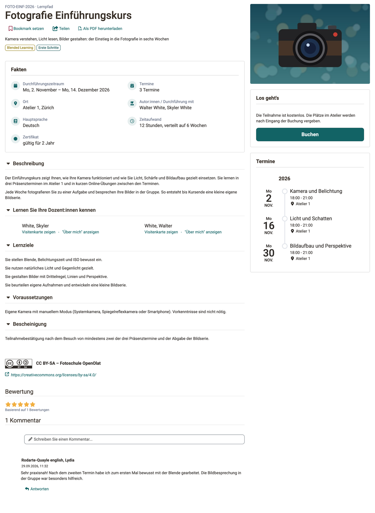
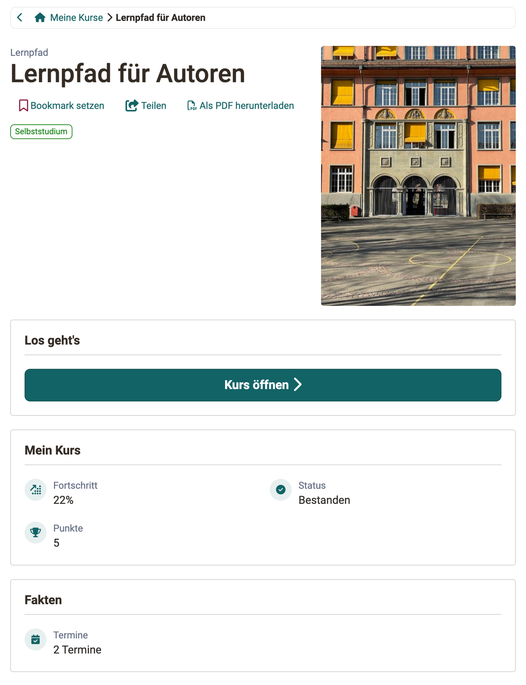
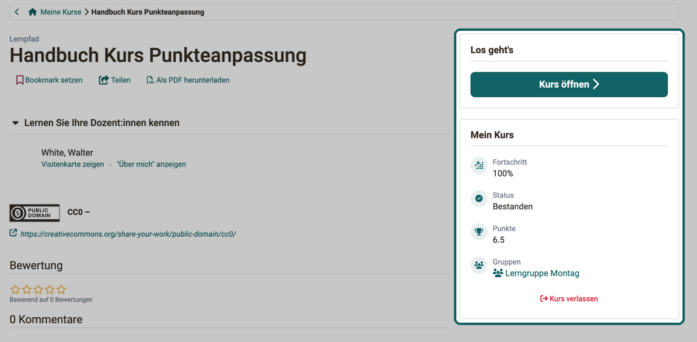
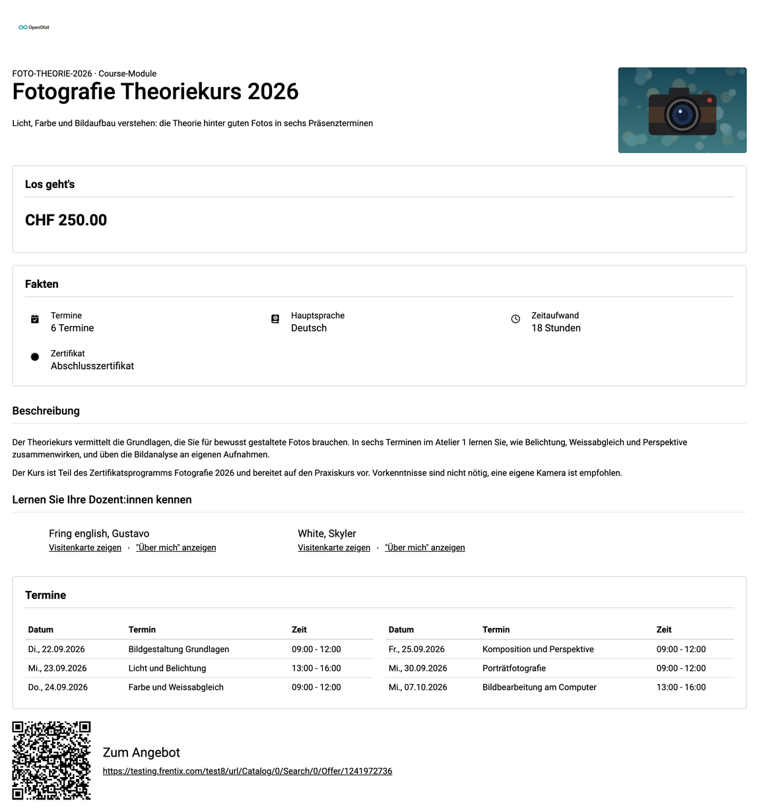
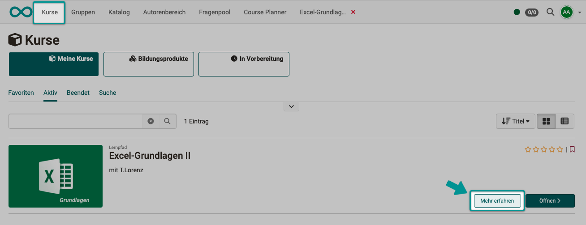
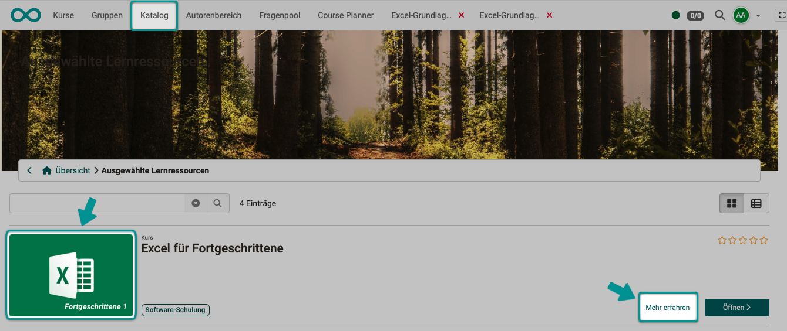
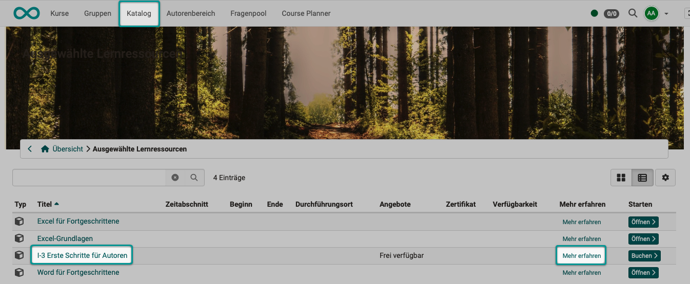
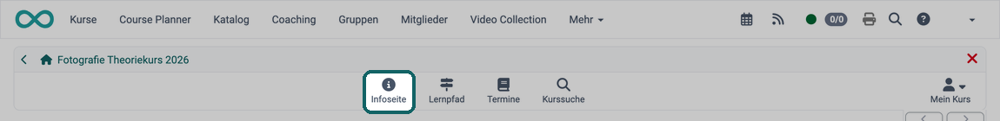

# Allgemeine Funktionen: Infoseite {: #general_functions_info}

## Wozu dient die Infoseite? [:octicons-tag-16:{ title="ab Release 10.0 (OO-984)" }](https://track.frentix.com/issue/OO-984){:target="_blank"} {: #purpose}

Wer überlegt, ob ein Kurs der richtige ist, findet auf der Infoseite alles, was vor dem Buchen oder Öffnen zählt: Beschreibung, Termine, Lernziele, Dozent:innen und den Preis. Jede Lernressource hat eine Infoseite, ebenso jede Durchführung im Course Planner. Einen Teil der Angaben erzeugt OpenOlat selbst, den Rest tragen Besitzer:innen der Lernressource in den Einstellungen ein. Nach der Veröffentlichung sehen Interessierte die Infoseite, auch ohne Buchung und bevor sie die Lernressource betreten. Das lohnt sich besonders, wenn Sie die Zielgruppe vorab informieren möchten, etwa bei einem kostenpflichtigen Kurs.

Sie rufen die Infoseite im Kurs über den Link "Infoseite" in der Toolbar auf, in der Kursübersicht und im Katalog über "Mehr erfahren". Die Aufrufwege finden Sie unter [Wo findet man die Infoseite?](#access).

{ class="shadow lightbox" title="Infoseite eines Kurses · 2026.09.29" }

[Zum Seitenanfang ^](#general_functions_info)

---

## Informationen der Infoseite [:octicons-tag-16:{ title="ab Release 21.1 (OO-8728)" }](https://track.frentix.com/issue/OO-8728){:target="_blank"} {: #content}

Die Infoseite trennt zwei Fragen in zwei Spalten. Links steht, worum es geht: Kopf, Fakten, Abschnitte, Lizenz und Bewertung. Rechts steht, was Sie betrifft und was Sie als Nächstes tun können: Titelbild, "Los geht's", "Mein Kurs" und Termine.

Die Tabelle zeigt, woraus die Infoseite besteht, von oben nach unten. Die Spalte "Im Bild" sagt, ob das Element im Bild oben zu sehen ist. Die Pfade beziehen sich auf die Einstellungen der Lernressource: `Kurs > Administration > Einstellungen`. "nur Kurs" heisst, dass andere Lernressourcen diese Einstellung nicht haben. Ein Element erscheint nur, wenn es einen Inhalt hat.

| Element | Im Bild | Als Autor:in einstellen unter | Nur mit Administration |
|---|---|---|---|
| **Kopf** | | | |
| Kennzeichen | ja | Tab "Metadaten" | nein |
| Typ | ja | automatisch | nein |
| Titel | ja | Tab "Metadaten" | nein |
| Bookmark setzen | ja | automatisch | nein |
| [Teilen](../basic_concepts/Navigation.de.md#share): teilt den Link auf die Infoseite, aus dem Katalog und bei einer Durchführung den Link auf das Angebot [:octicons-tag-16:{ title="ab Release 21.1 (OO-9693)" }](https://track.frentix.com/issue/OO-9693){:target="_blank"} | ja | automatisch | nein |
| Als PDF herunterladen | ja | automatisch | PDF Generator |
| Teaser | ja | Tab "Info" | nein |
| Durchführungsformat | ja | nur Kurs: Tab "Metadaten" | nein |
| Fachbereiche | ja | Tab "Metadaten" | Taxonomie |
| **Rechte Spalte** | | | |
| Titelbild oder Teaser-Film | ja | Tab "Info" | nein |
| [Los geht's](#get_started) mit Buchen, Öffnen oder [Buchung stornieren](#cancel_booking) [:octicons-tag-16:{ title="ab Release 20.2 (OO-9042)" }](https://track.frentix.com/issue/OO-9042){:target="_blank"} | ja | automatisch, Angebote unter Tab "Freigabe" | nein |
| [Mein Kurs](#my_course): Fortschritt, Status, Punkte, Note, Gruppen und [Kurs verlassen](#leave_course) | nein | automatisch für Mitglieder; Fortschritt, Status, Punkte und Note nur Kurs | nein |
| Termine | ja | nur Kurs: Tab "Info", "Auf Infoseite anzeigen" | Termine / Absenzen |
| **Fakten** | | | |
| Durchführungszeitraum | ja | nur Kurs: Tab "Durchführung" | nein |
| Termine | ja | nur Kurs: Tab "Info", "Auf Infoseite anzeigen" | Termine / Absenzen |
| Ort | ja | nur Kurs: Tab "Durchführung", Feld "Durchführungsort" | nein |
| Autor:innen / Durchführung mit | ja | Tab "Info" | nein |
| Hauptsprache | ja | Tab "Info" | nein |
| Zeitaufwand | ja | Tab "Info" | nein |
| Kreditpunkte | nein | nur Kurs: Tab "Info", "Auf Infoseite anzeigen" | Kreditpunkte |
| Zertifikat | ja | nur Kurs: Tab "Info", "Auf Infoseite anzeigen" | nein |
| Teilnehmer:innen | nein | nur Durchführung | nein |
| **Abschnitte** | | | |
| Beschreibung | ja | Tab "Info" | nein |
| Gliederung | nein | nur Durchführung | nein |
| Lernen Sie Ihre Dozent:innen kennen | ja | nur Kurs: Tab "Info", "Auf Infoseite anzeigen" | nein |
| Lernziele | ja | nur Kurs: Tab "Info", Abschnitt "Erweiterte Informationen" | nein |
| Voraussetzungen | ja | nur Kurs: Tab "Info", Abschnitt "Erweiterte Informationen" | nein |
| Bescheinigung | ja | nur Kurs: Tab "Info", Abschnitt "Erweiterte Informationen" | nein |
| Kategorien | nein | Tab "Katalog" | Katalog V1 |
| **Unten** | | | |
| Lizenz | ja | Tab "Metadaten" | Lizenzen |
| Bewertung | ja | automatisch | Bewertung |
| Kommentare | ja | automatisch | Kommentar |

Einige Elemente erscheinen erst, wenn Administrator:innen das zugehörige Modul in der System-Administration eingeschaltet haben. Die Schaltfläche "Als PDF herunterladen" braucht den [PDF Generator](../../manual_admin/administration/External_Tools_-_Administration.de.md#pdf_generator). Bewertung und Kommentare schalten Administrator:innen im [Modul Lernressource](../../manual_admin/administration/Modules_Learning_Resource.de.md) ein, Lizenzen unter [Lizenzen](../../manual_admin/administration/Licenses.de.md), Fachbereiche im [Modul Taxonomie](../../manual_admin/administration/Modules_Taxonomy.de.md). Termine setzen das [Modul Termine und Absenzen](../../manual_admin/administration/Modules_Events_and_Absences.de.md) voraus. Kreditpunkte richten Administrator:innen in der [e-Assessment Administration](../../manual_admin/administration/e-Assessment_Credit_Points.de.md) ein.

Technische Angaben wie die ID, den externen Link und die Verantwortlichen zeigt die Infoseite nicht. Sie stehen im Fenster "Über diesen Kurs", siehe [Über diesen Kurs: Fenster öffnen](../learningresources/Technical_Information_on_Resources_and_Usage.de.md#open).

!!! note "Hinweis"

    Finden Sie als Teilnehmer:in kaum Informationen auf der Infoseite, haben die Besitzer:innen der Lernressource die Seite noch nicht weiter eingerichtet. Sprechen Sie Ihre Betreuer:innen darauf an.

Auf dem Smartphone oder in einem Browserfenster, das schmaler als 992 Pixel ist, stehen alle Kästen in einer Spalte untereinander. Die Reihenfolge ist fest: Titelbild, Kopf, "Los geht's", "Mein Kurs", Fakten, Abschnitte, Termine, Lizenz und Bewertung. Ab 768 Pixel Breite steht das Titelbild neben dem Titel, wie im folgenden Bild.

{ class="shadow lightbox" title="Infoseite in schmalem Fenster · 2026.10.20" }

[Zum Seitenanfang ^](#general_functions_info)

---

## Los geht's und Mein Kurs {: #get_started_my_course}

In der rechten Spalte der Infoseite sehen Sie, was Sie als Nächstes tun können und wie weit Sie im Kurs sind. Der Kasten "Los geht's" führt Sie in den Kurs oder zur Buchung, der Kasten "Mein Kurs" zeigt Ihren eigenen Stand. Beide Kästen füllt OpenOlat selbst, je nach Ihrer Rolle und den Einstellungen des Kurses.

{ class="shadow lightbox" title="Infoseite eines Lernpfadkurses als Teilnehmer:in · 2026.10.20" }

Auf der Infoseite treten Sie auch wieder aus. Welche Schaltfläche Sie dafür sehen, hängt davon ab, worin Sie Mitglied sind: in einem einzelnen Kurs oder in einer Durchführung. Die Schaltfläche erscheint nur, wenn die Rollen in der letzten Spalte das Austreten zulassen:

| Sie sind Mitglied | Schaltfläche auf der Infoseite | Wer das Austreten zulässt |
|---|---|---|
| in einem einzelnen Kurs, gebucht oder eingetragen | [Kurs verlassen](#leave_course) im Kasten "Mein Kurs" des Kurses | Besitzer:innen des Kurses, Vorgabe durch Administrator:innen |
| in einer anderen Lernressource, etwa einem Wiki | "Wiki verlassen" im Kasten "Mein Kurs", siehe [Kurs verlassen](#leave_course) | Besitzer:innen der Lernressource, Vorgabe durch Administrator:innen |
| in einer Durchführung, die Sie gebucht haben oder in die Sie mit einem Angebot eingetragen wurden | [Buchung stornieren](#cancel_booking) im Kasten "Los geht's" der Durchführung | Kursplaner:innen, Produktbesitzer:innen und Elementbesitzer:innen |
| in einer Durchführung, ohne dass für Sie ein Buchungsauftrag besteht | keine | niemand; wer Sie eingetragen hat, trägt Sie auf Anfrage aus |

Eine Durchführung ist der konkrete Durchgang eines Bildungsangebots, mit Zeitraum, Ort, Mitgliedern und einem oder mehreren Kursen. Sind Sie Mitglied einer Durchführung, sind Sie auch Mitglied ihrer Kurse. Ihr Austritt läuft dann über die Durchführung, nicht über den einzelnen Kurs. Woran Sie eine Durchführung erkennen:

- **Infoseite ohne "Mein Kurs":** Die Infoseite einer Durchführung zeigt den Kasten "Mein Kurs" nie, auch wenn Sie Mitglied sind. Die Infoseite eines Kurses zeigt ihn, sobald es Angaben für Sie gibt.
- **Bereich unter "Kurse":** Unter `Kurse` steht neben "Meine Kurse" der Bereich "Bildungsprodukte" mit Ihren Durchführungen. Eine Durchführung, die Sie als Favorit markiert haben, steht zusätzlich mit ihrem Namen als eigener Bereich daneben. Eine Durchführung, die nur aus einem einzigen Kurs besteht, erscheint in keinem dieser Bereiche. Die Bereiche erscheinen nur, wenn Administrator:innen sie eingeschaltet haben, siehe [Produkte in "Kurse"](../../manual_admin/administration/Modules_Course_Planner.de.md#product_in_my_courses).
- **Buchungsauftrag:** Ob für Sie ein Buchungsauftrag besteht, sehen Sie in Ihren Buchungsaufträgen: `Persönliches Menü > Persönliche Werkzeuge > Buchungsaufträge`, siehe [Buchungsaufträge](../personal_menu/Bookings.de.md). Fehlt dort ein Eintrag zur Durchführung, wurden Sie ohne Buchungsauftrag eingetragen.

### Los geht's {: #get_started}

Der Kasten "Los geht's" zeigt die Aktion, die zu Ihrer Lage passt:

- **Ohne Mitgliedschaft:** die Angebote des Kurses und die Schaltfläche "Buchen". Wie die Buchung abläuft, beschreibt [Katalog 2.0 - Angebote](../area_modules/catalog2.0_angebote.de.md#offer_booking).
- **Als Mitglied:** die Schaltfläche "Kurs öffnen". Ist der Kurs noch nicht zugänglich, steht darüber ein Hinweis, etwa "Der Inhalt ist noch nicht verfügbar" oder "Buchung ausstehend", und die Schaltfläche ist ausgegraut.
- **Mit administrativer Rolle:** Sind Sie nicht Mitglied, aber Administrator:in, Lernressourcenverwalter:in, Principal oder Kursplaner:in, öffnen Sie den Kurs mit "Mit administrativer Rolle öffnen".
- **Ohne Anmeldung:** Wer die Infoseite über einen Link öffnet, ohne in OpenOlat angemeldet zu sein, sieht "Im Katalog ansehen", wenn der Kurs im Katalog buchbar ist, sonst "Zum Login".

Ist ein Kurs beendet und haben Teilnehmende im Status "Beendet" keinen Zugriff mehr, meldet der Kasten "Kurs beendet".

Haben Sie eine Durchführung gebucht, die noch nicht begonnen hat, zeigt der Kasten zusätzlich die Schaltfläche "Buchung stornieren", siehe [Buchung stornieren](#cancel_booking).

### Buchung stornieren [:octicons-tag-16:{ title="ab Release 20.0 (OO-8397)" }](https://track.frentix.com/issue/OO-8397){:target="_blank"} {: #cancel_booking}

Können Sie an einer gebuchten Durchführung doch nicht teilnehmen, stornieren Sie die Buchung selbst, solange die Durchführung noch nicht begonnen hat. Sie stornieren auf der Infoseite der Durchführung, die Sie über den Katalog erreichen: 
`Katalog > "Ihre Durchführung" > Mehr erfahren > Kasten "Los geht's" > Buchung stornieren`

Bestätigen Sie im Dialog mit "Buchung stornieren". Fällt eine Stornierungsgebühr an, heisst die Schaltfläche "Buchung kostenpflichtig stornieren", und der Bestätigungsdialog nennt die Gebühr. Nach der Stornierung erhalten Sie eine E-Mail, deren Betreff mit "Bestätigung Ihrer Stornierung" endet.

Haben Administrator:innen in der System-Administration unter `Administration > Module > Lernressource` den Bereich "In Vorbereitung" unter "Kurse" eingeschaltet, erreichen Sie dieselbe Infoseite auch unter `Kurse > In Vorbereitung > Mehr erfahren`. Dort steht eine Durchführung nur, solange sie noch nicht läuft. Die Einstellung beschreibt das Administrationshandbuch unter [Modul Lernressource](../../manual_admin/administration/Modules_Learning_Resource.de.md).

!!! info "Wichtig"

    Unter `Kurse > Aktiv` führt "Mehr erfahren" zur Infoseite des Kurses, nicht zur Infoseite der Durchführung. Dort fehlt "Buchung stornieren". Auch in den Bereichen "Bildungsprodukte" und mit dem Namen der Durchführung unter `Kurse` öffnet "Mehr erfahren" eine Infoseite ohne diese Schaltfläche. Unter [Buchungsaufträge](../personal_menu/Bookings.de.md) lässt sich eine Buchung nicht stornieren. Öffnen Sie die Durchführung im Katalog.

Die Schaltfläche erscheint nur, wenn die Durchführung die Stornierung zulässt und Ihre Buchung dazu passt. Was die Durchführung zulässt, stellen Kursplaner:innen und Produktbesitzer:innen ein, das Angebot auch Elementbesitzer:innen. Als Teilnehmer:in sehen Sie diese Einstellungen nicht; fehlt die Schaltfläche, fragen Sie Ihre Betreuer:innen. Alle vier Bedingungen müssen erfüllt sein:

- **Anfangsdatum in der Zukunft:** Im Durchführungszeitraum ist "Beginn- und Enddatum" oder "Eintägig" gewählt. Bei "Jederzeit" hat die Durchführung kein Anfangsdatum, und die Schaltfläche fehlt. Ab dem Tag des Beginns fehlt sie ebenfalls. Kursplaner:innen stellen den Durchführungszeitraum ein unter `Course Planner > Durchführungen > "Ihre Durchführung" > Tab "Einstellungen" > Unter-Tab "Durchführung"`, siehe [Durchführung in den Einstellungen](../area_modules/Course_Planner_Implementations.de.md#tab_settings_execution).
- **Buchung über ein Angebot:** Zu Ihrer Buchung besteht ein Buchungsauftrag im Status "Neu", "In Zahlungsprozess" oder "Bezahlt". Das trifft zu, wenn Sie im Katalog gebucht haben oder mit einem Angebot eingetragen wurden. Wurden Sie im Assistenten mit "Ohne Buchungsauftrag" eingetragen, fehlt die Schaltfläche, siehe [Mitglieder hinzufügen](../area_modules/Course_Planner_Implementations.de.md#add_members). Bitten Sie dann die Person, die Sie eingetragen hat, Sie auszutragen.
- **Stornierbares Angebot:** Jedes Angebot ist stornierbar. Nur beim Angebot "Rechnung" lässt sich die Stornierung mit dem Schalter "Stornierbar" ausschalten und eine Gebühr festlegen, siehe [Angebotskonzepte: Stornierungsbedingungen](../basic_concepts/Offer_Concepts.de.md#offer_invoice_cancellation).
- **Ihre Rolle:** Sie sind Teilnehmer:in der Durchführung, oder Ihre Buchung ist noch ausstehend.

### Mein Kurs {: #my_course}

Als Mitglied sehen Sie im Kasten "Mein Kurs" Ihren eigenen Stand, ohne den Kurs zu öffnen. Der Kasten zeigt nur die Angaben, die es für Sie gibt:

- **Fortschritt:** Ihr Fortschritt in Prozent. Nur in einem Lernpfadkurs und erst, wenn OpenOlat einen Fortschritt erfasst hat.
- **Status, Punkte und Note:** Ihr Ergebnis im Kurs. Dafür muss unter `Kurs > Administration > Einstellungen > Tab "Bewertung"` der Schalter "Leistungsnachweis den Teilnehmer:innen anzeigen" eingeschaltet sein, siehe [Kurseinstellungen - Tab Bewertung](Course_Settings_Assessment.de.md#section_evidence_of_achievements). Der Status erscheint, wenn der Kurs "Bestanden" oder "Nicht bestanden" vergibt, die Punkte, wenn er Punkte vergibt. Die Note setzt zusätzlich voraus, dass Administrator:innen die Noten in der System-Administration eingeschaltet haben: `Administration > e-Assessment > Einstufung/Noten`.
- **Gruppen:** die Gruppen des Kurses, in denen Sie Mitglied sind. Ein Klick auf den Namen öffnet die Gruppe.

Unten im Kasten steht die Schaltfläche "Kurs verlassen", siehe [Kurs verlassen](#leave_course).

Bei anderen Lernressourcen als Kursen zeigt der Kasten nur die Gruppen und die Schaltfläche zum Verlassen. Gibt es keine dieser Angaben, fehlt der Kasten "Mein Kurs" ganz.

### Kurs verlassen [:octicons-tag-16:{ title="ab Release 10.2 (OO-1405)" }](https://track.frentix.com/issue/OO-1405){:target="_blank"} {: #leave_course}

Brauchen Sie einen Kurs nicht mehr, tragen Sie sich selbst aus. Sie verlassen den Kurs auf seiner Infoseite: 
`Kurse > Aktiv > Mehr erfahren > Kasten "Mein Kurs" > Kurs verlassen`

Im geöffneten Kurs führt der Link "Infoseite" in der Toolbar auf dieselbe Seite. Den gleichen Weg bietet der Eintrag "Kurs verlassen" im Menü "Mein Kurs" der Kurs-Toolbar, siehe [Toolbar: Mein Kurs](Toolbar_My_Course.de.md#leave_course). Bei anderen Lernressourcen trägt die Schaltfläche den Typ im Namen, etwa "Wiki verlassen".

Die Schaltfläche erscheint nur für Teilnehmende und nur, wenn die Besitzer:innen des Kurses das Austreten zulassen. Sie stellen es ein unter: 
`Kurs > Administration > Einstellungen > Tab "Freigabe" > Teilnehmer:innen können austreten`

Steht die Einstellung auf "Nie", fehlt die Schaltfläche. Steht sie auf "Nach Kursenddatum oder Status "Beendet"", ist die Schaltfläche ausgegraut, bis das Kursenddatum vorbei ist oder der Kurs den Status "Beendet" hat. Die Optionen beschreibt [Zugangskonfiguration / Freigabe](Access_configuration.de.md#leave_learning_resource). Welche Option ein neuer Kurs mitbringt, geben Administrator:innen in der System-Administration vor: `Administration > Module > Lernressource`, siehe [Modul Lernressource](../../manual_admin/administration/Modules_Learning_Resource.de.md#allow_leaving_courses).

Die Schaltfläche fehlt auch in diesen Fällen:

- Sie sind über eine Durchführung Mitglied des Kurses, oder der Kurs gehört zu einer Durchführung. Woran Sie das erkennen, steht unter [Los geht's und Mein Kurs](#get_started_my_course). Dann stornieren Sie die Buchung der Durchführung, siehe [Buchung stornieren](#cancel_booking).
- Eine Gruppe hat Sie eingetragen, die das Austreten nicht erlaubt oder mit mehreren Kursen verknüpft ist.
- Ein Prüfungsmodus läuft.

[Zum Seitenanfang ^](#general_functions_info)

---

## Infoseite drucken oder als PDF herunterladen [:octicons-tag-16:{ title="ab Release 21.1 (OO-9299)" }](https://track.frentix.com/issue/OO-9299){:target="_blank"} {: #print}

Wer einen Kurs erst nach der Zustimmung einer vorgesetzten Person buchen darf, braucht die Kursangaben oft auf Papier. Die Infoseite lässt sich dafür als Flyer ausgeben: einspaltig, ohne Schaltflächen und mit einem QR-Code, der direkt zum Angebot führt.

Klicken Sie im Kopf der Infoseite auf "Als PDF herunterladen". Die Schaltfläche steht neben "Bookmark setzen" und "Teilen". OpenOlat erzeugt eine PDF-Datei mit dem Titel der Lernressource als Dateinamen. Den gleichen Ausdruck erhalten Sie über den Befehl "Drucken" Ihres Browsers, dann ohne Datei.

{ class="shadow lightbox" title="PDF einer Infoseite · 2026.09.29" }

Der Ausdruck enthält:

- oben das Logo der OpenOlat-Instanz, falls das Layout eines hinterlegt hat
- Titel, Teaser und Titelbild
- bei "Los geht's" nur die Angaben zum gewählten Angebot, zum Beispiel den Preis
- Fakten, alle Abschnitte in aufgeklapptem Zustand, Lizenz und Sternebewertung
- die Termine als Tabelle mit Datum, Termin und Zeit
- am Ende den QR-Code mit der Überschrift "Zum Angebot" und der Adresse des Angebots

Der Ausdruck lässt weg, was nur am Bildschirm Sinn ergibt: Bookmark setzen, Teilen und Als PDF herunterladen, die Schaltflächen "Buchen" und "Kurs öffnen", Hinweise und freie Plätze sowie die Kommentare. Sind Sie bereits Mitglied, entfällt "Los geht's" ganz. Der QR-Code zeigt auf dieselbe Adresse wie die Aktion "Teilen". Wo die Infoseite keine Aktion "Teilen" hat, fehlt auch der QR-Code.

!!! note "Hinweis"

    Die Schaltfläche "Als PDF herunterladen" erscheint nur, wenn Administrator:innen einen PDF-Dienst eingerichtet haben, siehe [Externe Werkzeuge: PDF Generator](../../manual_admin/administration/External_Tools_-_Administration.de.md#pdf_generator). Ohne PDF-Dienst drucken Sie die Infoseite über den Browser.

[Zum Seitenanfang ^](#general_functions_info)

---

## Infoseite einer Durchführung [:octicons-tag-16:{ title="ab Release 20.0 (OO-8286)" }](https://track.frentix.com/issue/OO-8286){:target="_blank"} {: #implementation}

Wer eine Durchführung im Katalog bucht, sieht vorher dieselbe Infoseite wie bei einem Kurs, mit Fakten, Abschnitten, Terminen und "Los geht's". Drucken und "Als PDF herunterladen" funktionieren gleich.

{ class="shadow lightbox" title="Infoseite einer Durchführung · 2026.09.29" }

Einige Elemente unterscheiden sich:

- **Es fehlen** Lizenz, Bewertung, Kommentare und "Mein Kurs".
- **Dazu kommen** der Abschnitt "Gliederung" und der Fakt "Teilnehmer:innen" mit der Zahl der Plätze.
- **Im Kopf** steht neben dem Kennzeichen der Elementtyp der Durchführung.

Sie stellen die Angaben nicht in einem Kurs ein, sondern in den Einstellungen der Durchführung, in den Unter-Tabs "Metadaten", "Infos" und "Durchführung": 
`Course Planner > Durchführungen > "Ihre Durchführung" > Tab "Einstellungen"`

Mehr dazu unter [Course Planner: Durchführungen](../area_modules/Course_Planner_Implementations.de.md#tab_settings).

[Zum Seitenanfang ^](#general_functions_info)

---

## Wo findet man die Infoseite? {: #access}

### Aufruf der Infoseite in der Kursübersicht {: #access_course_overview}

Öffnen Sie in der Hauptnavigation Ihre Kursübersicht durch Klick auf "Kurse". 
Dann wählen Sie den Link "Mehr erfahren" neben dem Button "Öffnen" eines Kurses.

{ class="shadow lightbox" title="Kursübersicht Kurse im Tab Aktiv" }

[Zum Seitenanfang ^](#general_functions_info)

---

### Aufruf der Infoseite im Katalog {: #access_catalog}

In der Kachelansicht des Katalogs finden Sie den Link "Mehr erfahren" zur Anzeige der Infoseite rechts unten. Sie können aber auch das Bild anklicken.

{ class="shadow lightbox" title="Kachel eines Kurses im Katalog" }

In der Listenansicht klicken Sie den Link "Mehr erfahren" oder den Titel der Lernressource.

{ class="shadow lightbox" title="Listenansicht des Katalogs" }

[Zum Seitenanfang ^](#general_functions_info)

---

### Aufruf der Infoseite innerhalb eines Kurses {: #access_within_a_course}

Haben Sie einen Kurs geöffnet, wählen Sie den Link "Infoseite" mit dem Info-Symbol in der Toolbar. Dieselbe Seite erreichen Sie auch in jeder anderen geöffneten Lernressource über die Toolbar.

{ class="shadow lightbox" title="Toolbar eines geöffneten Kurses · 2026.09.29" }

[Zum Seitenanfang ^](#general_functions_info)

---

### Aufruf der Infoseite zu sonstigen Lernressourcen {: #access_other_learning_resources}

Die Infoseite zu sonstigen Lernressourcen rufen Sie gleich auf wie die Infoseite der Kurse. Im Autorenbereich führt kein Link direkt zur Infoseite: Öffnen Sie die Lernressource und wählen Sie dort "Infoseite" in der Toolbar.

Die Angaben zur Verwendung, etwa in welchen Kursen die Lernressource eingebunden ist, stehen nicht auf der Infoseite, sondern im Fenster, das nach dem Typ der Lernressource heisst, zum Beispiel "Über diesen Test", siehe [Information zur Verwendung](../learningresources/Technical_Information_on_Resources_and_Usage.de.md#usage).

[Zum Seitenanfang ^](#general_functions_info)

---

## Weiterführende Informationen {: #further_information}

**Auf dieser Seite erwähnt** 
[Navigation >](../basic_concepts/Navigation.de.md) 
[Externe Werkzeuge: Übersicht >](../../manual_admin/administration/External_Tools_-_Administration.de.md) 
[Modul Lernressource >](../../manual_admin/administration/Modules_Learning_Resource.de.md) 
[Lizenzen >](../../manual_admin/administration/Licenses.de.md) 
[Modul Taxonomie >](../../manual_admin/administration/Modules_Taxonomy.de.md) 
[Modul Termine und Absenzen >](../../manual_admin/administration/Modules_Events_and_Absences.de.md) 
[e-Assessment Administration: Kreditpunkte >](../../manual_admin/administration/e-Assessment_Credit_Points.de.md) 
[Über diesen Kurs: Technische Informationen und Verwendung >](../learningresources/Technical_Information_on_Resources_and_Usage.de.md) 
[Modul Course Planner >](../../manual_admin/administration/Modules_Course_Planner.de.md) 
[Persönliche Werkzeuge: Buchungsaufträge >](../personal_menu/Bookings.de.md) 
[Katalog 2.0 - Angebote >](../area_modules/catalog2.0_angebote.de.md) 
[Course Planner: Durchführungen >](../area_modules/Course_Planner_Implementations.de.md) 
[Angebotskonzepte >](../basic_concepts/Offer_Concepts.de.md) 
[Kurseinstellungen - Tab Bewertung >](../learningresources/Course_Settings_Assessment.de.md) 
[Toolbar: Mein Kurs >](../learningresources/Toolbar_My_Course.de.md) 
[Zugangskonfiguration / Freigabe >](../learningresources/Access_configuration.de.md)

**Weiterführend** 
[Kurseinstellungen >](../learningresources/Course_Settings.de.md) 
[Kurseinstellungen - Tab Freigabe >](../learningresources/Course_Settings_Share.de.md)

[Zum Seitenanfang ^](#general_functions_info)
