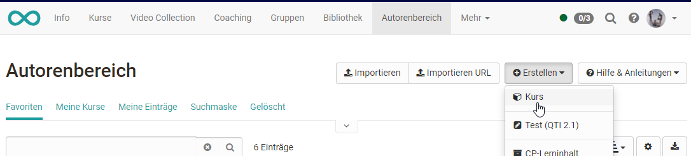
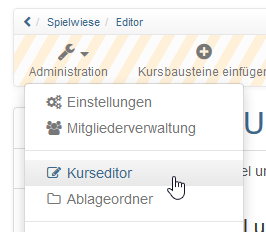
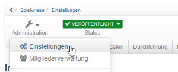
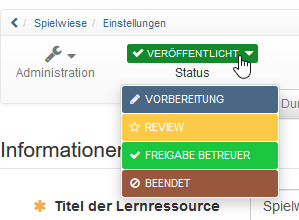
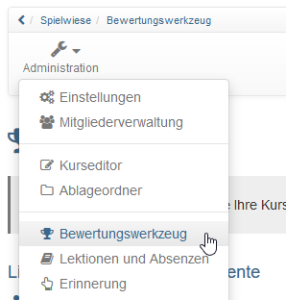
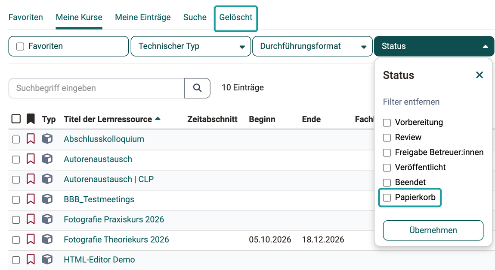
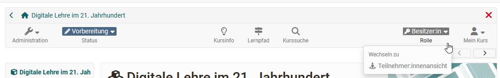

# Allgemeines {: #general_information}

:octicons-device-camera-video-24: **Video-Einführung**: [OpenOlat Funktionsprinzipien](<https://www.youtube.com/embed/M-JkSAFN298>){:target="_blank"}

Mit OpenOlat-Kursen bilden Sie verschiedene Veranstaltungsformate ab, zum Beispiel Vorlesungen, Seminare, Online-Tutorien oder Gruppenpuzzle. Ebenso setzen Sie verschiedene Arten des Lernens um, zum Beispiel problembasiertes, kooperatives oder selbstorganisiertes Lernen. Dafür setzen Sie beliebig viele [Kursbausteine](Course_Elements.de.md) in frei wählbarer Reihenfolge ein und richten den Kurs so nach Ihrem didaktischen Konzept aus.

Um Kurse zu erstellen, brauchen Sie Autorenrechte. Diese erhalten Sie bei Ihrer OpenOlat-Supportstelle oder bei den Administrator:innen Ihrer OpenOlat-Instanz.

## Der Kurszyklus im Überblick {: #course_lifecycle}

### 1. Kurs anlegen {: #stage1}

Erstellen Sie die Lernressource Kurs über `Autorenbereich > Erstellen > Kurs` und wählen Sie das gewünschte Kursdesign: "Mit Lernpfad" oder "Mit Lernfortschritt" für einen Lernpfadkurs, "Klassisch" für einen herkömmlichen Kurs.

{ class="shadow lightbox" title="Autorenbereich" }

!!! note "Weitere Informationen"
    * [Kurse erstellen](../learningresources/Creating_Course.de.md)
    * [Mein erster Kurs](../../manual_how-to/my_first_course/my_first_course.de.md)
    * [Lernpfadkurse erstellen](Creating_learning_path_courses.de.md)

### 2. Kurs einrichten, gestalten, publizieren {: #stage2}

Im Kurseditor setzen Sie Ihren Kurs um: Sie wählen die passenden
Kursbausteine aus, erstellen bei Bedarf Lernressourcen und konfigurieren alles
wie gewünscht. Den Kurseditor öffnen Sie über `Kurs > Administration > Kurseditor`.

{ class="shadow lightbox" title="Kurs-Toolbar" }

!!! note "Weitere Informationen"
    * [Kursbausteine](Course_Elements.de.md)
    * [Verwendung von Kurseditorwerkzeugen](Using_additional_Course_Editor_Tools.de.md)
    * [Lernpfadkurs - Kurseditor](../learningresources/Learning_path_course_Course_editor.de.md)
    * [Lernressourcen](../learningresources/index.de.md)
    * [Allgemeine Konfiguration von Kursbausteinen](General_Configuration_of_Course_Elements.de.md)
    * [Kurseinstellungen](Course_Settings.de.md)

### 3. Zugang einrichten {: #stage3}

Den Zugang legen Sie in der Kurs-Administration fest: `Kurs > Administration > Einstellungen`. Wichtig ist dabei vor allem der Tab "Freigabe".

{ class="shadow lightbox" title="Kurs-Toolbar" }

!!! note "Weitere Informationen"
    * [Zugangskonfiguration](Access_configuration.de.md)
    * [Kurseinstellungen](Course_Settings.de.md)

In Lernpfadkursen ist es teilweise möglich, den Teilnehmer:innen einen zeitlich limitierten Zugang auf einen Kurs zu geben:

* auf Ebene Kursbaustein: ja, über `Kurs > Administration > Kurseditor > Tab "Lernpfad"` mit relativem Datum
* auf Strukturbausteinen: nein
* auf dem obersten Knoten (Gesamtkurs): nein

### 4. Kurs veröffentlichen {: #stage4}

Setzen Sie in der Kurs-Toolbar den Status auf "Veröffentlicht". Damit wird der
Kurs auch für die Teilnehmenden sichtbar.

{ class="shadow lightbox" title="Kurs-Toolbar" }

!!! note "Weitere Informationen"
    * [Zugangskonfiguration](Access_configuration.de.md)

### 5. Kurs durchführen und bewerten {: #stage5}

Im Bewertungswerkzeug bewerten Sie die Teilnehmenden und geben Feedback.
Daneben betreuen Sie den Kurs, zum Beispiel mit Beiträgen im Forum oder bei
der Organisation der Absenzen.

{ class="shadow lightbox" title="Kurs-Toolbar" }

!!! note "Weitere Informationen"
    * [Kursbetrieb](../learningresources/Administration.de.md)

### 6. Kurs beenden {: #stage6}

Ist der Kurs vorbei, setzen Sie den Status auf "Beendet".

{ class="shadow lightbox" title="Kurs-Toolbar" }

!!! note "Weitere Informationen"
    * [Zugangskonfiguration](Access_configuration.de.md)

### 7. Kurs löschen {: #stage7}

Der Kurs wird über `Kurs > Administration > Löschen` gelöscht. Gelöschte Kurse stehen im Autorenbereich im Tab "Gelöscht". In den übrigen Tabs blendet der Filter "Status" mit der Option "Papierkorb" sie ein oder aus.

{ class="shadow lightbox" title="Tab Meine Kurse im Autorenbereich" }

!!! note "Weitere Informationen"
    * [Zugangskonfiguration](Access_configuration.de.md)

## Tipp {: #tip}

!!! tip "Bevor Sie Ihren OpenOlat Kurs erstellen"

    Überlegen Sie zunächst, was Sie mit dem Kurs erreichen wollen.

    Der Aufbau Ihres Kurses hängt von Ihrem didaktischen Konzept, den Zielen
    und den Rahmenbedingungen ab. Auf dieser Basis entscheiden Sie, ob ein
    herkömmlicher Kurs oder ein Lernpfadkurs für Sie die passende Wahl ist.
    Wählen Sie im Zweifelsfall den herkömmlichen Kurs: Über
    `Kurs > Administration > Als Lernpfad duplizieren` erstellen Sie später
    daraus eine Kopie als Lernpfadkurs, sofern der Lernpfadkurs alle enthaltenen
    Kursbausteine unterstützt. Der herkömmliche Kurs bleibt dabei erhalten. Diese
    Umwandlung führt nur vom herkömmlichen Kurs zum Lernpfadkurs.

    Wählen Sie nach dem Entscheid für ein Kursdesign die Kursbausteine aus, mit
    denen Sie Ihr Ziel erreichen und Ihr Kurskonzept umsetzen. Bündeln Sie
    zusammengehörende Inhalte, damit sich die Teilnehmenden im Kurs gut
    zurechtfinden. Wenn der Aufbau klar ist, bereiten Sie die Lerninhalte, weitere
    Dateien ([HTML-Seiten, PDF-Dateien, CP-Lerninhalte](../learningresources/index.de.md) usw.)
    und alles vor, was Sie für den Einsatz in der Lernplattform benötigen.

[Zum Seitenanfang ^](#general_information)

---

## Rollenwechsel {: #role_change}

In der Toolbar wird Ihnen angezeigt, in welcher Rolle Sie gerade den Kurs betrachten. Als Autor:in eines Kurses wird dies in der Regel die Rolle "Besitzer:in" sein. Über das Rollenmenü wechseln Sie jederzeit in die "Teilnehmer:innenansicht".

{ class="shadow lightbox" title="Kurs-Toolbar" }

Sofern Sie noch weitere Rollen im Kurs besitzen werden diese ebenfalls angezeigt und Sie können zur entsprechenden Ansicht wechseln.

Bei den Rollen wird aber nicht zwischen Betreuer:innen und Gruppenbetreuer:innen oder Teilnehmer:innen und Gruppenteilnehmer:innen unterschieden, sondern die Möglichkeiten innerhalb der Rolle Betreuer:in bzw. Teilnehmer:in zusammengefasst.

Der Rollenwechsel bietet sich z.B. an, wenn man als Kursbesitzer:in die Teilnehmendenrolle einnehmen möchte. Auch kann man sich so den Ablauf der Kursbausteine Aufgabe, Gruppenaufgabe, Checkliste oder des Teilnehmer:innenordners aus der Teilnehmendensicht gut anschauen.

### Initiale Rolle bei Kursaufruf {: #initial_role}

Benutzer:innen mit administrativen Rechten (wie Administrator:in oder Lernressourcenverwalter:in) können Kurse öffnen, obwohl sie kein Mitglied des Kurses sind. Dieses Recht entspricht der Rolle, stört aber, wenn die Benutzer:in explizit Teilnehmer:in in einem Kurs sein soll.

Deshalb: Ist eine Person mit administrativen Rechten Teilnehmer:in in einem Kurs, wird der Kurs initial immer in der Rolle "Teilnehmer:in" geöffnet. (Die Rolle kann aber wie gewohnt gewechselt werden.)

Dies gilt nicht für Kursbesitzer:innen oder Betreuer:innen. Denn für diese Rollen ist es sinnvoll, beim Betreten des Kurses sofort in der Rolle "Besitzer:in" bzw. "Betreuer:in" zu sein. (Auf die Teilnehmer:innenansicht kann dann umgestellt werden.)

    
Spezialfall: Verhalten bei Einschreibung in eine Gruppe (Kursbaustein "Einschreibung")

    <b>Situation:</b>  
    - Sie erstellen einen Kurs mit dem Kursbaustein "Einschreibung". 
    - Sie wechseln in die Teilnehmer:innenansicht und nehmen eine Einschreibung vor. 
    <b>-></b> OpenOlat wechselt danach ungewollt in die Besitzer:innenrolle. 
    - Bei erneutem Wechsel in die Teilnehmer:innenansicht wird der sinnvolle Warndialog ("Sie sind in der Rolle Teilnehmer:in") mit Löschoption für Daten nicht mehr angezeigt. 
    - Erst nach einem erneuten Aufruf des Kurses wird die Teilnehmer:innenansicht mit Warndialog wieder korrekt angezeigt.
      
    <b>Erklärung:</b>  
    Die Teilnehmer:innenansicht ist analog zur Kurs-Freigabe "Ohne Buchung" umgesetzt - man ist in dieser Ansicht nicht in der Kurs-Mitgliederverwaltung eingebucht.
    Es passiert deshalb nun Folgendes: 
    - Trägt man sich im Kursbaustein "Einschreibung" in eine Gruppe ein, so wird man in diesem Moment Gruppenteilnehmer:in und ist in der Mitgliederverwaltung des Kurses eingetragen. 
    - Sobald man im Kurs eine eingetragene Mitgliedschaft "Teilnehmer:in" (Kurs oder Gruppe oder Curriculum) besitzt, steht die "Teilnehmer:innenansicht" nicht mehr zur Verfügung. Diese ist nur vorhanden, wenn man nicht in der Kurs-Mitgliederverwaltung als Teilnehmer:in aufgeführt ist. 
    <b>-></b> Schreibe ich mich aus der Teilnehmer:innenansicht in eine Gruppe ein, existiert danach die Teilnehmer:innenansicht für mich nicht mehr, sondern ich bin als Gruppenteilnehmer:in in der Mitgliederverwaltung des Kurses aufgeführt. Deshalb wechselt die Rolle von der Teilnehmer:innenansicht in die Besitzer:innenrolle. 
    - Klappt man nun bei den Rollen die Auswahl aus, sieht man anstelle der Teilnehmer:innenansicht nun die Rolle "Teilnehmer:in" aufgeführt. 
    - Trägt man sich aus der Gruppe wieder aus (und lädt den Kurs neu), so ist die Rolle "Teilnehmer:in" wieder weg und stattdessen die Teilnehmer:innenansicht wieder verfügbar.  

## Weiterführende Informationen {: #further_information}

**Weiterführend** 
[Lernpfadkurs - Überblick >](Learning_path_course.de.md) 
[Mitgliederverwaltung >](Members_management.de.md) 
[Kurs-Administration: Übersicht >](Administration.de.md)

[Zum Seitenanfang ^](#general_information)
