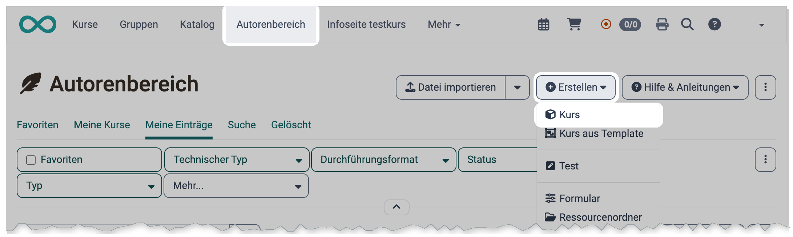
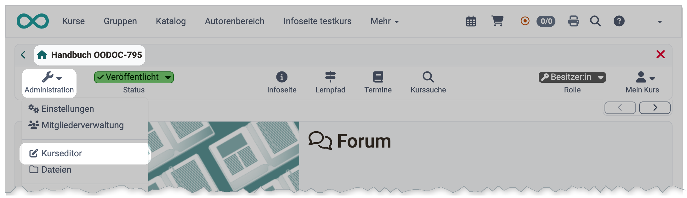
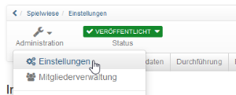
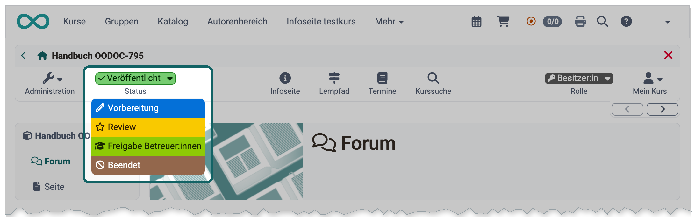
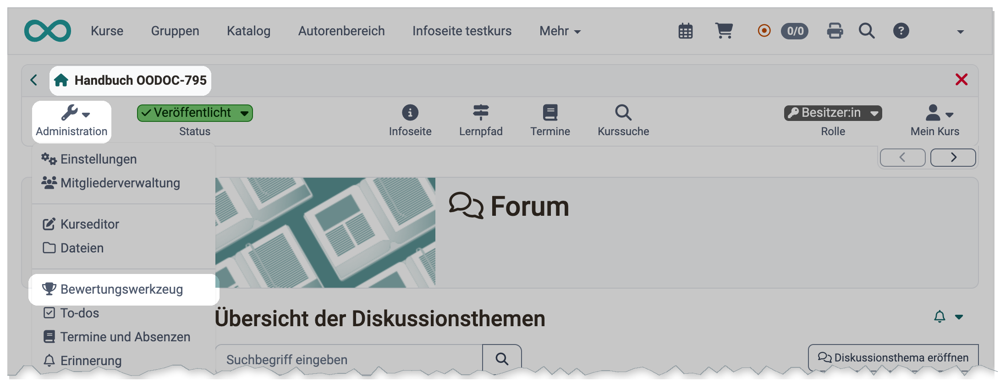
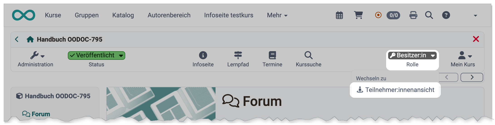

# Allgemeines {: #general_information}

:octicons-device-camera-video-24: **Video-Einführung**: [OpenOlat Funktionsprinzipien](<https://www.youtube.com/embed/M-JkSAFN298>){:target="_blank"}

Mit OpenOlat-Kursen bilden Sie verschiedene Veranstaltungsformate ab, zum Beispiel Vorlesungen, Seminare, Online-Tutorien oder Gruppenpuzzle. Ebenso setzen Sie verschiedene Arten des Lernens um, zum Beispiel problembasiertes, kooperatives oder selbstorganisiertes Lernen. Dafür setzen Sie beliebig viele [Kursbausteine](../Course_Elements/index.de.md) in frei wählbarer Reihenfolge ein und richten den Kurs so nach Ihrem didaktischen Konzept aus.

## Steckbrief

Name | Kurs
---------|----------
Icon | :o_icon_o_CourseModule_icon:
Verfügbar seit | Release 7.1 oder früher
Zweck | Lerninhalte, Aktivitäten und Bewertungen in einer Struktur aus Kursbausteinen zusammenführen

Um Kurse zu erstellen, brauchen Sie die [Rolle](../../basic_concepts/Roles/index.de.md) "Autor:in". Fehlt sie Ihnen, wenden Sie sich an Ihre Organisation.

## Der Kurszyklus im Überblick {: #course_lifecycle}

Ein Kurs durchläuft sieben Schritte, vom Anlegen bis zum Löschen. Jeder Schritt nennt den Ort, an dem Sie in OpenOlat handeln, und die Seite mit den Einzelheiten.

### 1. Kurs anlegen {: #stage1}

Am Anfang steht die Lernressource Kurs. Sie erstellen sie im Autorenbereich über `Autorenbereich > Erstellen > Kurs` und wählen dabei das Kursdesign. "Mit Lernpfad" führt die Teilnehmenden in einer festen Reihenfolge durch den Kurs, "Mit Lernfortschritt" zeigt ihren Fortschritt ohne feste Reihenfolge. Beide ergeben einen [Lernpfadkurs](../Learning_path_course/index.de.md). "Klassisch" ergibt einen herkömmlichen Kurs, ohne Lernfortschritt und ohne feste Reihenfolge. Haben Sie oder Ihre Organisation Templates vorbereitet, wählen Sie im selben Menü stattdessen "Kurs aus Template". Ein Template ist ein vorbereiteter Kurs mit dem Verwendungszweck "Template", eine Vorlage für Kursinhalte ohne eigene Mitgliederverwaltung. Den Verwendungszweck wählen Sie beim Erstellen eines Kurses im selben Dialog wie das Kursdesign. OpenOlat legt Ihren Kurs als Kopie davon an, das Template selbst bleibt unverändert. [:octicons-tag-16:{ title="ab Release 20.2 (OO-8897)" }](https://track.frentix.com/issue/OO-8897)

{ class="shadow lightbox" title="Menü Erstellen im Autorenbereich · 2026.11.18" }

Mehr dazu finden Sie auf den Seiten [Kurs erstellen](../Creating_Course.de.md), [Mein erster Kurs](../../../manual_how-to/my_first_course/my_first_course.de.md), [Lernpfadkurse erstellen](../Creating_learning_path_courses.de.md) und [Lernressourcen](../index.de.md#course).

### 2. Kurs einrichten, gestalten, publizieren {: #stage2}

Im Kurseditor setzen Sie Ihren Kurs um: Sie wählen die passenden Kursbausteine aus, erstellen bei Bedarf Lernressourcen und konfigurieren alles wie gewünscht. Den Kurseditor öffnen Sie über `Kurs > Administration > Kurseditor`. Ihre Änderungen übernehmen Sie mit "Publizieren" in der Toolbar des Kurseditors in den Kurs. Die Teilnehmenden sehen sie, sobald der Kurs den Status "Veröffentlicht" hat (Schritt 4).

{ class="shadow lightbox" title="Menü Administration in der Kurs-Toolbar · 2026.11.18" }

Mehr dazu finden Sie auf den Seiten [Kursbausteine im Überblick](../Course_Elements/index.de.md), [Kurseditorwerkzeuge](../Using_additional_Course_Editor_Tools.de.md), [Lernpfadkurs - Kurseditor](../Learning_path_course_Course_editor.de.md), [Lernressourcen](../index.de.md), [Kursbausteine im Kurseditor](../General_Configuration_of_Course_Elements.de.md) und [Kurseinstellungen](../Course_Settings/index.de.md).

### 3. Zugang einrichten {: #stage3}

Wer Ihren Kurs öffnen darf, legen Sie in den Einstellungen des Kurses fest, vor allem im Tab "Freigabe": 
`Kurs > Administration > Einstellungen > Tab "Freigabe"`

{ class="shadow lightbox" title="Menü Administration in der Kurs-Toolbar" }

In Lernpfadkursen geben Sie einzelne Kursbausteine zeitlich begrenzt frei: Sie wählen den Kursbaustein im Kurseditor aus und legen in seinem Tab "Lernpfad" ein "Freigabedatum" und eine Frist "Zu bearbeiten bis" fest. Mit dem Kontrollkästchen "Relatives Datum" legen Sie beide Daten in Tagen nach einem Ereignis fest, etwa nach dem ersten Kursbesuch oder nach der Einschreibung der Teilnehmenden. Sie finden den Tab, sobald Sie im Kurseditor den Kursbaustein angeklickt haben: 
`Kurs > Administration > Kurseditor > "Titel des Kursbausteins" > Tab "Lernpfad"` 
Die Datumsfelder gibt es bei den einzelnen Kursbausteinen, nicht beim Kursbaustein "Struktur". Auch der oberste Eintrag im Kurseditor ist ein Kursbaustein "Struktur" und trägt keine Datumsfelder.

Mehr dazu finden Sie auf den Seiten [Zugangskonfiguration / Freigabe](../Access_configuration.de.md) und [Kurseinstellungen](../Course_Settings/index.de.md).

### 4. Kurs veröffentlichen [:octicons-tag-16:{ title="ab Release 13.0 (OO-3584)" }](https://track.frentix.com/issue/OO-3584) {: #stage4}

Ist der Kurs bereit, setzen Sie in der Kurs-Toolbar, der Leiste über dem Kursinhalt, den Status auf "Veröffentlicht". Damit öffnen alle Mitglieder den Kurs, also Besitzer:innen, Betreuer:innen und Teilnehmende. Ein neu angelegter Kurs hat den Status "Vorbereitung". In diesem Status und im Status "Review" haben von den Mitgliedern nur die Besitzer:innen Zugriff, zum Beispiel Sie als Person, die den Kurs erstellt hat. Den Status "Review" setzen Sie, wenn die Vorbereitung abgeschlossen ist und die Inhalte geprüft werden. Im Status "Freigabe Betreuer:innen" haben zusätzlich die Betreuer:innen Zugriff. Wer Mitglied wird, legen Sie im Tab "Freigabe" (Schritt 3) und in der [Mitgliederverwaltung](../Members_management.de.md) fest.

{ class="shadow lightbox" title="Menü Status in der Kurs-Toolbar · 2026.11.18" }

Mehr dazu finden Sie auf der Seite [Zugangskonfiguration / Freigabe](../Access_configuration.de.md).

### 5. Kurs durchführen und bewerten {: #stage5}

Während der Kurs läuft, bewerten Sie die Teilnehmenden im Bewertungswerkzeug und geben ihnen Feedback: `Kurs > Administration > Bewertungswerkzeug`. Daneben betreuen Sie den Kurs, zum Beispiel mit Beiträgen im Forum. Termine und Absenzen der Teilnehmenden verwalten Sie im selben Menü unter "Termine und Absenzen". Den Eintrag zeigt das Menü, sobald Sie im Kurs die "Termin- und Absenzenverwaltung" eingeschaltet haben: 
`Kurs > Administration > Einstellungen > Tab "Durchführung"`

{ class="shadow lightbox" title="Menü Administration in der Kurs-Toolbar · 2026.11.18" }

Mehr dazu finden Sie auf den Seiten [Kursbetrieb](../Administration/index.de.md) und [Termine und Absenzen](../Events_and_absences.de.md).

### 6. Kurs beenden {: #stage6}

Ist der Kurs vorbei, setzen Sie den Status auf "Beendet". Besitzer:innen und Betreuer:innen öffnen den Kurs danach nur noch lesend, Änderungen sind nicht mehr möglich. Was die Teilnehmenden sehen, regelt die Einstellung "Zugriff für Teilnehmende im Status "Beendet"": Bei "Nur-Lese-Zugriff" öffnen sie den Kurs ebenfalls lesend, bei "Kein Zugriff" öffnen sie ihn nicht mehr. In der Grundeinstellung gilt "Nur-Lese-Zugriff", die System-Administration kann eine andere Vorgabe festlegen. Für Ihren Kurs ändern Sie die Einstellung unter: 
`Kurs > Administration > Einstellungen > Tab "Optionen"` [:octicons-tag-16:{ title="ab Release 21.0 (OO-9298)" }](https://track.frentix.com/issue/OO-9298)

{ class="shadow lightbox" title="Status in der Kurs-Toolbar" }

Mehr dazu finden Sie auf den Seiten [Zugangskonfiguration / Freigabe](../Access_configuration.de.md) und [Kurseinstellungen - Tab Optionen](../Course_Settings_Options.de.md).

### 7. Kurs löschen {: #stage7}

Einen Kurs, den Sie nicht mehr brauchen, löschen Sie über `Kurs > Administration > Löschen`. OpenOlat entfernt dabei die Personendaten aus dem Kurs, Zugriff haben danach nur noch die Besitzer:innen. Gelöschte Kurse haben den Status "Papierkorb" und stehen im Autorenbereich im Tab "Gelöscht". Dort stellen Sie einen Kurs bei Bedarf wieder her. In den übrigen Tabs blendet der Filter "Status" mit der Option "Papierkorb" sie ein oder aus.

{ class="shadow lightbox" title="Tab Meine Kurse im Autorenbereich" }

Mehr dazu finden Sie auf den Seiten [Zugangskonfiguration / Freigabe](../Access_configuration.de.md) und [Autorenbereich - Übersicht](../../area_modules/Authoring/index.de.md#authoring-deleted).

## Kurs planen {: #tip}

!!! tip "Bevor Sie Ihren OpenOlat-Kurs erstellen"

    Überlegen Sie zunächst, was Sie mit dem Kurs erreichen wollen.

    Der Aufbau Ihres Kurses hängt von Ihrem didaktischen Konzept, den Zielen
    und den Rahmenbedingungen ab. Auf dieser Basis entscheiden Sie, ob ein
    herkömmlicher Kurs oder ein Lernpfadkurs für Sie die passende Wahl ist.
    Wählen Sie im Zweifelsfall den herkömmlichen Kurs: Über
    `Kurs > Administration > Als Lernpfad duplizieren` erstellen Sie später
    daraus eine Kopie als Lernpfadkurs, sofern der Lernpfadkurs alle enthaltenen
    Kursbausteine unterstützt. Der herkömmliche Kurs bleibt dabei erhalten. Diese
    Kopie gibt es nur in eine Richtung: vom herkömmlichen Kurs zum Lernpfadkurs.

    Wählen Sie nach dem Entscheid für ein Kursdesign die Kursbausteine aus, mit
    denen Sie Ihr Ziel erreichen und Ihr Kurskonzept umsetzen. Bündeln Sie
    zusammengehörende Inhalte, damit sich die Teilnehmenden im Kurs gut
    zurechtfinden. Wenn der Aufbau klar ist, bereiten Sie die Lerninhalte, weitere
    Dateien (HTML-Seiten, PDF-Dateien, [CP-Lerninhalte](../index.de.md#cp-content) usw.)
    und alles vor, was Sie für den Einsatz in der Lernplattform benötigen.

[Zum Seitenanfang ^](#general_information)

---

## Rollenwechsel [:octicons-tag-16:{ title="ab Release 15.0 (OO-4285)" }](https://track.frentix.com/issue/OO-4285) {: #role_change}

Wie Teilnehmende Ihren Kurs erleben, prüfen Sie mit dem Rollenwechsel selbst: Sie sehen den Kurs aus ihrer Sicht, etwa den Ablauf der Kursbausteine "Aufgabe", "Gruppenaufgabe", "Checkliste" oder "Teilnehmer:innen Ordner". Das Menü "Rolle" rechts in der Toolbar, der Leiste über dem Kursinhalt, zeigt, in welcher Rolle Sie den Kurs gerade sehen. Haben Sie den Kurs erstellt, ist das die Rolle "Besitzer:in". Als Besitzer:in, Betreuer:in oder CPL Klassenlehrer:in, also als Klassenlehrer:in einer Durchführung im Course Planner (CPL), wechseln Sie im selben Menü unter "Wechseln zu" in die "Teilnehmer:innenansicht", solange Sie im Kurs nicht selbst Teilnehmer:in sind. Sind Sie zugleich Teilnehmer:in, wählen Sie stattdessen unter "Rollen" die Rolle "Teilnehmer:in". Mit dem Button "Teilnehmer:innenansicht verlassen" unter der Toolbar kehren Sie in Ihre vorherige Rolle zurück.

{ class="shadow lightbox" title="Menü Rolle in der Kurs-Toolbar · 2026.11.18" }

In der Teilnehmer:innenansicht sind Sie nicht als Teilnehmer:in eingetragen. Was Sie in den Kursbausteinen bearbeiten, etwa einen Test, speichert OpenOlat trotzdem unter Ihrem Namen. Im Bewertungswerkzeug erscheinen diese Einträge, wenn Sie unter "Teilnehmer:innen" den Schalter "Aus Teilnehmer:innenansicht" einschalten (siehe [Bewertungswerkzeug: Teilnehmer:innen](../Assessment_tool_tab_Users.de.md)). Betreuer:innen sehen dort nur ihre eigenen Einträge. Geben Sie Ihre Mitgliedschaft im Kurs später auf, bleiben die Einträge erhalten und stehen unter dem Schalter "Nichtmitglied".

Haben Sie im Kurs weitere Rollen, als Mitglied oder als administrative Rolle wie Administrator:in (siehe Abschnitt [Initiale Rolle bei Kursaufruf](#initial_role)), stehen sie im selben Menü unter "Rollen", und Sie wechseln in die entsprechende Ansicht.

Mitglied eines Kurses sind Sie als Besitzer:in, Betreuer:in oder Teilnehmer:in. Eingetragen werden Sie direkt im Kurs oder über eine Durchführung im [Course Planner](../../area_modules/Course_Planner/index.de.md), als Betreuer:in oder Teilnehmer:in auch über eine [Gruppe](../../groups/index.de.md). Eine Durchführung ist der konkrete Durchgang eines Bildungsangebots mit Zeitraum, Mitgliedern und Kursen. Das Menü zeigt je einen Eintrag "Betreuer:in" und "Teilnehmer:in", gleich auf welchem dieser Wege Sie eingetragen sind.

### Initiale Rolle bei Kursaufruf [:octicons-tag-16:{ title="ab Release 19.1 (OO-8231)" }](https://track.frentix.com/issue/OO-8231) {: #initial_role}

Beim Öffnen eines Kurses wählt OpenOlat Ihre Rolle selbst. Ihre Rollen als Mitglied gehen dabei allen anderen Rollen vor, in der Grundeinstellung in der Reihenfolge Besitzer:in, Betreuer:in, Teilnehmer:in. Wer einen Kurs besitzt oder betreut, sieht ihn beim Öffnen deshalb in dieser Rolle und stellt bei Bedarf auf die Teilnehmer:innenansicht um. Sind Sie im Kurs nur als Teilnehmer:in eingetragen, öffnet OpenOlat ihn in der Rolle "Teilnehmer:in", auch wenn Sie zusätzlich eine administrative Rolle haben. So erleben Sie den Kurs, wie er für Sie als Teilnehmer:in gedacht ist.

Die Reihenfolge der drei Mitgliedsrollen legen Administrator:innen für alle Kurse fest, in der System-Administration im [Modul Lernressource](../../../manual_admin/administration/Modules_Learning_Resource.de.md), Abschnitt "Standard-Rollenpriorität": 
`Administration > Module > Lernressource > Tab "Einstellungen"`

Ohne Mitgliedschaft öffnen Sie einen Kurs, wenn Sie eine der folgenden Rollen für ihn haben. Die Organisationsrollen gelten für die Kurse der Organisation, in der Sie die Rolle haben. Haben Sie mehrere dieser Rollen, wählt OpenOlat die erste in dieser Reihenfolge. Diese Reihenfolge ist fest, die "Standard-Rollenpriorität" ordnet nur die Mitgliedsrollen.

1. **Principal**: Organisationsrolle mit demselben Umfang wie Administrator:in, aber nur lesend.
2. **Kursplaner:in**: Organisationsrolle für den Course Planner, das Werkzeug, mit dem eine Organisation ihr Bildungsangebot in Produkten und Durchführungen plant. Produktbesitzer:innen und Elementbesitzer:innen des Course Planner öffnen den Kurs ebenfalls in dieser Rolle, wenn der Kurs zu ihrem Produkt oder Element gehört.
3. **Lernressourcenverwalter:in**: Organisationsrolle für die Verwaltung der Kurse und Lernressourcen der Organisation.
4. **CPL Klassenlehrer:in**: Klassenlehrer:innen betreuen eine ganze Durchführung im Course Planner (CPL), über alle Kurse der Durchführung hinweg. Sie öffnen den Kurs ab dem Status "Freigabe Betreuer:innen".
5. **Administrator:in**: Organisationsrolle mit Zugriff auf alle Bereiche der Organisation.

Sind Sie zum Beispiel Lernressourcenverwalter:in und Administrator:in, öffnet OpenOlat den Kurs in der Rolle "Lernressourcenverwalter:in". Im Kurs haben beide Rollen dieselben Rechte wie Besitzer:innen. In den Rollen "Principal", "Kursplaner:in" und "CPL Klassenlehrer:in" sehen Sie Inhalte und Mitglieder des Kurses, ändern aber nichts. Einstellungen und Kurseditor öffnen Besitzer:innen, Lernressourcenverwalter:innen und Administrator:innen. In eine andere Ihrer Rollen wechseln Sie über das Menü "Rolle". Was die einzelnen Rollen dürfen, beschreiben die Seiten [Rollen](../../basic_concepts/Roles/index.de.md#org) und [Course Planner](../../area_modules/Course_Planner/index.de.md#roles_rights).

Die "Teilnehmer:innenansicht" bietet das Menü "Rolle" nur Besitzer:innen, Betreuer:innen und CPL Klassenlehrer:innen an. Öffnen Sie einen Kurs als Administrator:in oder Lernressourcenverwalter:in ohne Mitgliedschaft, steht sie deshalb nicht im Menü. Um einen solchen Kurs zu sehen, wie Teilnehmende ihn sehen, tragen Sie sich als Besitzer:in oder Betreuer:in ein:

1. Zeigt das Menü "Rolle" eine Rolle, die nur lesend öffnet, etwa "Principal", wechseln Sie dort zuerst in die Rolle "Administrator:in" oder "Lernressourcenverwalter:in". Von Ihren administrativen Rollen fügen nur diese beiden Mitglieder hinzu.
2. Tragen Sie sich in der Mitgliederverwaltung mit "Mitglied hinzufügen" als Besitzer:in oder Betreuer:in ein: `Kurs > Administration > Mitgliederverwaltung` 
   Im letzten Schritt des Assistenten ist die "E-Mail-Benachrichtigung" eingeschaltet, die Mail geht an Sie selbst. Brauchen Sie sie nicht, schalten Sie sie aus. Als Betreuer:in sehen Teilnehmende Sie im Kursbaustein "Liste der Teilnehmer:innen" unter "Betreuer:innen". Besitzer:innen führt der Kursbaustein unter der Bezeichnung "Kursadministrator:innen", wenn das in seiner Konfiguration eingeschaltet ist.
3. Schliessen Sie den Kurs und öffnen Sie ihn neu. OpenOlat zeigt ihn jetzt in Ihrer neuen Mitgliedsrolle, und das Menü "Rolle" bietet unter "Wechseln zu" die "Teilnehmer:innenansicht" an.

Brauchen Sie die Mitgliedschaft nicht mehr, entfernen Sie sich in der Mitgliederverwaltung wieder. Auch dabei ist die Benachrichtigung "Mitglied benachrichtigen" vorausgewählt. Sind Sie die einzige Besitzer:in, lässt OpenOlat das Entfernen nicht zu, denn jeder Kurs braucht mindestens eine Besitzer:in.

    
Spezialfall: Verhalten bei Einschreibung in eine Gruppe (Kursbaustein "Einschreibung")

    <b>Situation:</b>  
    - Ihr Kurs enthält den Kursbaustein "Einschreibung". Als Besitzer:in wechseln Sie über das Menü "Rolle" in die Teilnehmer:innenansicht. Unter der Toolbar erscheint dann der Hinweis "Sie befinden sich in der Teilnehmer:innenansicht. Aktivitäten in den Kursbausteinen werden gespeichert." mit dem Button "Teilnehmer:innenansicht verlassen". 
    - Sie schreiben sich im Kursbaustein "Einschreibung" in eine Gruppe ein und belegen damit einen Platz in der Gruppe. 
    <b>-></b> OpenOlat wechselt sofort in die Rolle "Besitzer:in", und der Hinweis verschwindet (Erklärung unten). Im Menü "Rolle" steht anstelle der Teilnehmer:innenansicht jetzt die Rolle "Teilnehmer:in". Wechseln Sie in diese Rolle, erscheint kein Hinweis, denn Sie sind nun tatsächlich Teilnehmer:in des Kurses. 
    - Rufen Sie den Kurs erneut auf, bleibt es dabei: OpenOlat öffnet ihn in der Rolle "Besitzer:in", und die Teilnehmer:innenansicht fehlt im Menü "Rolle". 
    - Die Teilnehmer:innenansicht steht erst wieder zur Verfügung, wenn Sie nicht mehr Mitglied der Gruppe sind und den Kurs erneut aufrufen. Aus der Gruppe tragen Sie sich im Kursbaustein "Einschreibung" mit "Austragen" aus, sofern das Kontrollkästchen "Austragen erlaubt" gesetzt ist: <code>Kurs > Administration > Kurseditor > Kursbaustein "Einschreibung" > Tab "Konfiguration"</code> 
    Andernfalls entfernen Sie Ihre Mitgliedschaft in der Gruppe in der Mitgliederverwaltung des Kurses: <code>Kurs > Administration > Mitgliederverwaltung</code> 
    Ist die Zahl der Teilnehmenden einer Gruppe begrenzt und die Gruppe voll, tragen sich weitere Personen auf ihre Warteliste ein, sofern die Gruppe eine Warteliste anbietet. Ob danach jemand von der Warteliste nachrückt, legt die Gruppe selbst fest, mit den Optionen "Warteliste" und "Automatisches Nachrücken": <code>Kurs > Administration > Mitgliederverwaltung > Gruppen > "Name der Gruppe" > Administration > Tab "Beschreibung"</code> 
    In der Tabelle der Gruppen öffnet der Link "Ändern" in der Zeile der Gruppe direkt den Tab "Beschreibung".
      
    <b>Erklärung:</b>  
    In der Teilnehmer:innenansicht sehen Sie den Kurs wie Teilnehmende, ohne in der Mitgliederverwaltung als Teilnehmer:in eingetragen zu sein. Mit der Einschreibung werden Sie Teilnehmer:in der Gruppe und stehen damit in der Mitgliederverwaltung des Kurses. Die Teilnehmer:innenansicht gibt es aber nur, solange Sie im Kurs nicht Teilnehmer:in sind, weder direkt noch über eine Gruppe oder eine Durchführung im Course Planner. Deshalb wechselt OpenOlat nach der Einschreibung in die Rolle, in der Sie den Kurs auch beim Öffnen sehen, in der Grundeinstellung "Besitzer:in" (siehe Abschnitt <a href="#initial_role">Initiale Rolle bei Kursaufruf</a>).  

## Weiterführende Informationen {: #further_information}

**Weiterführend** 
[Lernpfadkurs - Überblick >](../Learning_path_course/index.de.md) 
[Mitgliederverwaltung >](../Members_management.de.md) 
[Kursbaustein "Einschreibung" >](../Course_Element_Enrolment.de.md) 
[Kurs-Administration: Übersicht >](../Administration/index.de.md)

[Zum Seitenanfang ^](#general_information)
