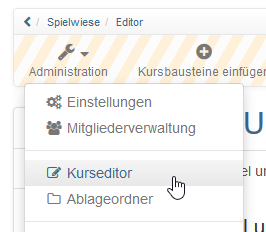
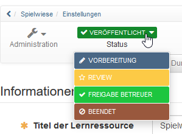
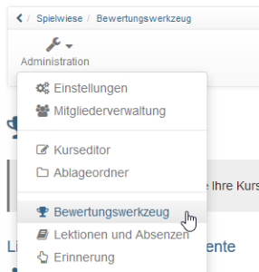
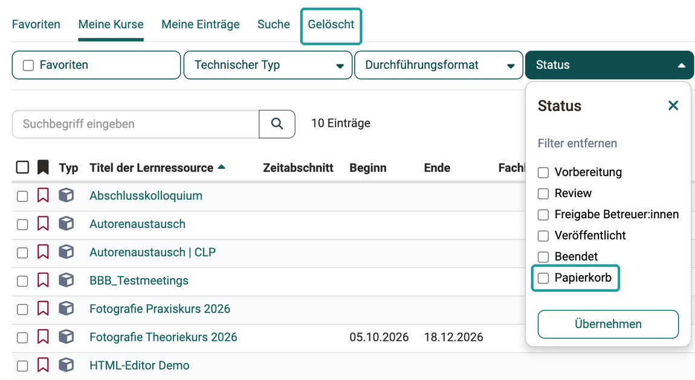
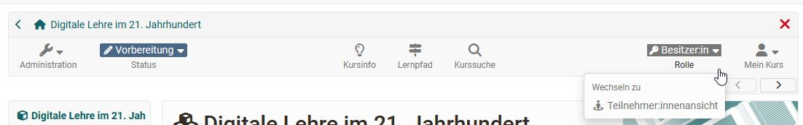

# Allgemeines {: #general_information}

:octicons-device-camera-video-24: **Video-Einführung**: [OpenOlat Funktionsprinzipien](<https://www.youtube.com/embed/M-JkSAFN298>){:target="_blank"}

Mit OpenOlat-Kursen bilden Sie verschiedene Veranstaltungsformate ab, zum Beispiel Vorlesungen, Seminare, Online-Tutorien oder Gruppenpuzzle. Ebenso setzen Sie verschiedene Arten des Lernens um, zum Beispiel problembasiertes, kooperatives oder selbstorganisiertes Lernen. Dafür setzen Sie beliebig viele [Kursbausteine](../Course_Elements/index.de.md) in frei wählbarer Reihenfolge ein und richten den Kurs so nach Ihrem didaktischen Konzept aus.

## Steckbrief

Name | Kurs
---------|----------
Icon | :o_icon_o_CourseModule_icon:
Verfügbar seit | Release 7.1 oder früher
Zweck | Lerninhalte, Aktivitäten und Bewertungen in einer Struktur aus Kursbausteinen zusammenführen

Um Kurse zu erstellen, brauchen Sie die [Rolle](../../basic_concepts/Roles/index.de.md) "Autor:in". Fehlt sie Ihnen, wenden Sie sich an Ihre Organisation.

## Der Kurszyklus im Überblick {: #course_lifecycle}

### 1. Kurs anlegen {: #stage1}

Am Anfang steht die Lernressource Kurs. Sie erstellen sie im Autorenbereich über `Autorenbereich > Erstellen > Kurs` und wählen dabei das Kursdesign. "Mit Lernpfad" führt die Teilnehmenden in einer festen Reihenfolge durch den Kurs, "Mit Lernfortschritt" zeigt ihren Fortschritt ohne feste Reihenfolge. Beide ergeben einen [Lernpfadkurs](../Learning_path_course/index.de.md). "Klassisch" ergibt einen herkömmlichen Kurs.

{ class="shadow lightbox" title="Menü Erstellen im Autorenbereich" }

Mehr dazu finden Sie auf den Seiten [Kurs erstellen](../Creating_Course.de.md), [Mein erster Kurs](../../../manual_how-to/my_first_course/my_first_course.de.md) und [Lernpfadkurse erstellen](../Creating_learning_path_courses.de.md).

### 2. Kurs einrichten, gestalten, publizieren {: #stage2}

Im Kurseditor setzen Sie Ihren Kurs um: Sie wählen die passenden Kursbausteine aus, erstellen bei Bedarf Lernressourcen und konfigurieren alles wie gewünscht. Den Kurseditor öffnen Sie über `Kurs > Administration > Kurseditor`. Ihre Änderungen übernehmen Sie mit "Publizieren" in der Toolbar des Kurseditors in den Kurs. Die Teilnehmenden sehen sie, sobald der Kurs den Status "Veröffentlicht" hat (Schritt 4).

{ class="shadow lightbox" title="Menü Administration in der Kurs-Toolbar" }

Mehr dazu finden Sie auf den Seiten [Kursbausteine im Überblick](../Course_Elements/index.de.md), [Kurseditorwerkzeuge](../Using_additional_Course_Editor_Tools.de.md), [Lernpfadkurs - Kurseditor](../Learning_path_course_Course_editor.de.md), [Lernressourcen](../index.de.md), [Kursbausteine im Kurseditor](../General_Configuration_of_Course_Elements.de.md) und [Kurseinstellungen](../Course_Settings/index.de.md).

### 3. Zugang einrichten {: #stage3}

Den Zugang legen Sie in der Kurs-Administration fest: `Kurs > Administration > Einstellungen`. Wichtig ist dabei vor allem der Tab "Freigabe".

{ class="shadow lightbox" title="Menü Administration in der Kurs-Toolbar" }

In Lernpfadkursen geben Sie einzelne Kursbausteine zeitlich begrenzt frei: Sie wählen den Kursbaustein im Kurseditor aus und legen in seinem Tab "Lernpfad" ein "Freigabedatum" und eine Frist "Zu bearbeiten bis" fest. Mit dem Kontrollkästchen "Relatives Datum" legen Sie beide Daten in Tagen nach einem Ereignis fest, etwa nach dem ersten Kursbesuch oder nach der Einschreibung der Teilnehmenden. Sie finden den Tab unter `Kurs > Administration > Kurseditor > Tab "Lernpfad"`. Die Datumsfelder gibt es bei den einzelnen Kursbausteinen, nicht beim Kursbaustein "Struktur" und nicht beim obersten Knoten des Kurses.

Mehr dazu finden Sie auf den Seiten [Zugangskonfiguration / Freigabe](../Access_configuration.de.md) und [Kurseinstellungen](../Course_Settings/index.de.md).

### 4. Kurs veröffentlichen {: #stage4}

Ist der Kurs bereit, setzen Sie in der Kurs-Toolbar den Status auf "Veröffentlicht". Damit öffnen alle Mitglieder den Kurs, auch die Teilnehmenden. Wer Mitglied wird, legen Sie in der Freigabe (Schritt 3) und in der [Mitgliederverwaltung](../Members_management.de.md) fest.

{ class="shadow lightbox" title="Menü Status in der Kurs-Toolbar" }

Mehr dazu finden Sie auf der Seite [Zugangskonfiguration / Freigabe](../Access_configuration.de.md).

### 5. Kurs durchführen und bewerten {: #stage5}

Während der Kurs läuft, bewerten Sie die Teilnehmenden im Bewertungswerkzeug und geben ihnen Feedback: `Kurs > Administration > Bewertungswerkzeug`. Daneben betreuen Sie den Kurs, zum Beispiel mit Beiträgen im Forum oder bei der Organisation der Absenzen.

{ class="shadow lightbox" title="Menü Administration in der Kurs-Toolbar" }

Mehr dazu finden Sie auf der Seite [Kursbetrieb](../Administration/index.de.md).

### 6. Kurs beenden {: #stage6}

Ist der Kurs vorbei, setzen Sie den Status auf "Beendet". Alle Mitglieder öffnen den Kurs danach nur noch lesend, Änderungen sind nicht mehr möglich.

{ class="shadow lightbox" title="Status in der Kurs-Toolbar" }

Mehr dazu finden Sie auf der Seite [Zugangskonfiguration / Freigabe](../Access_configuration.de.md).

### 7. Kurs löschen {: #stage7}

Einen Kurs, den Sie nicht mehr brauchen, löschen Sie über `Kurs > Administration > Löschen`. OpenOlat entfernt dabei die Personendaten aus dem Kurs, Zugriff haben danach nur noch die Besitzer:innen. Gelöschte Kurse haben den Status "Papierkorb" und stehen im Autorenbereich im Tab "Gelöscht". Dort stellen Sie einen Kurs bei Bedarf wieder her. In den übrigen Tabs blendet der Filter "Status" mit der Option "Papierkorb" sie ein oder aus.

{ class="shadow lightbox" title="Tab Meine Kurse im Autorenbereich" }

Mehr dazu finden Sie auf den Seiten [Zugangskonfiguration / Freigabe](../Access_configuration.de.md) und [Autorenbereich - Übersicht](../../area_modules/Authoring/index.de.md#authoring-deleted).

## Kurs planen {: #tip}

!!! tip "Bevor Sie Ihren OpenOlat-Kurs erstellen"

    Überlegen Sie zunächst, was Sie mit dem Kurs erreichen wollen.

    Der Aufbau Ihres Kurses hängt von Ihrem didaktischen Konzept, den Zielen
    und den Rahmenbedingungen ab. Auf dieser Basis entscheiden Sie, ob ein
    herkömmlicher Kurs oder ein Lernpfadkurs für Sie die passende Wahl ist.
    Wählen Sie im Zweifelsfall den herkömmlichen Kurs: Über
    `Kurs > Administration > Als Lernpfad duplizieren` erstellen Sie später
    daraus eine Kopie als Lernpfadkurs, sofern der Lernpfadkurs alle enthaltenen
    Kursbausteine unterstützt. Der herkömmliche Kurs bleibt dabei erhalten. Diese
    Kopie gibt es nur in eine Richtung: vom herkömmlichen Kurs zum Lernpfadkurs.

    Wählen Sie nach dem Entscheid für ein Kursdesign die Kursbausteine aus, mit
    denen Sie Ihr Ziel erreichen und Ihr Kurskonzept umsetzen. Bündeln Sie
    zusammengehörende Inhalte, damit sich die Teilnehmenden im Kurs gut
    zurechtfinden. Wenn der Aufbau klar ist, bereiten Sie die Lerninhalte, weitere
    Dateien (HTML-Seiten, PDF-Dateien, [CP-Lerninhalte](../index.de.md#cp-content) usw.)
    und alles vor, was Sie für den Einsatz in der Lernplattform benötigen.

[Zum Seitenanfang ^](#general_information)

---

## Rollenwechsel {: #role_change}

Wie Teilnehmende Ihren Kurs erleben, prüfen Sie mit dem Rollenwechsel selbst: Sie sehen den Kurs aus ihrer Sicht, etwa den Ablauf der Kursbausteine "Aufgabe", "Gruppenaufgabe", "Checkliste" oder "Teilnehmer:innen Ordner". In welcher Rolle Sie den Kurs gerade sehen, zeigt die Toolbar im Menü "Rolle". Haben Sie den Kurs erstellt, ist das die Rolle "Besitzer:in". Über das Menü "Rolle" wechseln Sie jederzeit in die "Teilnehmer:innenansicht".

{ class="shadow lightbox" title="Menü Rolle in der Kurs-Toolbar" }

Haben Sie im Kurs weitere Rollen, stehen sie ebenfalls im Menü, und Sie wechseln in die entsprechende Ansicht.

Das Menü unterscheidet nicht zwischen Betreuer:innen und Gruppenbetreuer:innen oder zwischen Teilnehmer:innen und Gruppenteilnehmer:innen. Es fasst die Möglichkeiten in den Rollen "Betreuer:in" und "Teilnehmer:in" zusammen.

### Initiale Rolle bei Kursaufruf [:octicons-tag-16:{ title="ab Release 19.1 (OO-8231)" }](https://track.frentix.com/issue/OO-8231) {: #initial_role}

Benutzer:innen mit administrativen Rollen, etwa Administrator:in oder Lernressourcenverwalter:in, öffnen Kurse auch dann, wenn sie nicht Mitglied sind. Sind sie in einem Kurs zusätzlich als Teilnehmer:in eingetragen, öffnet OpenOlat den Kurs in der Rolle "Teilnehmer:in". So erleben sie den Kurs, wie er für sie als Teilnehmer:in gedacht ist. Über das Menü "Rolle" wechseln sie wie gewohnt in eine andere Rolle.

Die Rollen als Mitglied gehen den administrativen Rollen immer vor. Unter den Mitgliedsrollen gilt in der Grundeinstellung: Besitzer:in vor Betreuer:in vor Teilnehmer:in. Wer einen Kurs besitzt oder betreut, sieht ihn beim Öffnen deshalb sofort in dieser Rolle und stellt bei Bedarf auf die Teilnehmer:innenansicht um. Die Reihenfolge der Mitgliedsrollen legen Administrator:innen in der System-Administration im [Modul Lernressource](../../../manual_admin/administration/Modules_Learning_Resource.de.md) fest, Abschnitt "Standard-Rollenpriorität": 
`Administration > Module > Lernressource > Tab "Einstellungen"`

    
Spezialfall: Verhalten bei Einschreibung in eine Gruppe (Kursbaustein "Einschreibung")

    <b>Situation:</b>  
    - Sie erstellen einen Kurs mit dem Kursbaustein "Einschreibung". 
    - Sie wechseln in die Teilnehmer:innenansicht und nehmen eine Einschreibung vor. 
    <b>-></b> OpenOlat wechselt danach in die Rolle "Besitzer:in". 
    - Wechseln Sie erneut in die Teilnehmer:innenansicht, erscheint der Warndialog ("Sie sind in der Rolle Teilnehmer:in") mit der Option, Daten zu löschen, nicht mehr. 
    - Erst wenn Sie den Kurs erneut aufrufen, zeigt OpenOlat die Teilnehmer:innenansicht wieder mit Warndialog.
      
    <b>Erklärung:</b>  
    Die Teilnehmer:innenansicht funktioniert wie die Freigabe "Ohne Buchung": In dieser Ansicht sind Sie nicht in der Mitgliederverwaltung des Kurses eingetragen.
    Daraus folgt: 
    - Tragen Sie sich im Kursbaustein "Einschreibung" in eine Gruppe ein, werden Sie in diesem Moment Gruppenteilnehmer:in und stehen in der Mitgliederverwaltung des Kurses. 
    - Die Teilnehmer:innenansicht gibt es nur, solange Sie in der Mitgliederverwaltung des Kurses nicht als Teilnehmer:in stehen. Sind Sie Teilnehmer:in des Kurses, einer Gruppe oder eines Curriculums, steht sie Ihnen nicht zur Verfügung. 
    <b>-></b> Nach der Einschreibung in eine Gruppe haben Sie deshalb keine Teilnehmer:innenansicht mehr, sondern stehen als Gruppenteilnehmer:in in der Mitgliederverwaltung des Kurses. OpenOlat wechselt darum von der Teilnehmer:innenansicht in die Rolle "Besitzer:in". 
    - Im Menü "Rolle" steht danach anstelle der Teilnehmer:innenansicht die Rolle "Teilnehmer:in". 
    - Tragen Sie sich aus der Gruppe wieder aus und laden den Kurs neu, verschwindet die Rolle "Teilnehmer:in", und die Teilnehmer:innenansicht steht wieder zur Verfügung.  

## Weiterführende Informationen {: #further_information}

**Weiterführend** 
[Lernpfadkurs - Überblick >](../Learning_path_course/index.de.md) 
[Mitgliederverwaltung >](../Members_management.de.md) 
[Kurs-Administration: Übersicht >](../Administration/index.de.md)

[Zum Seitenanfang ^](#general_information)
