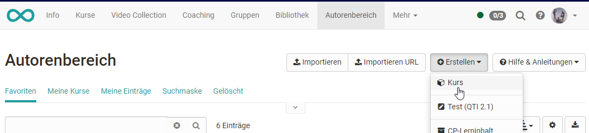
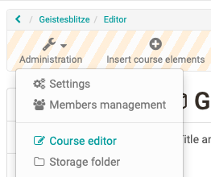
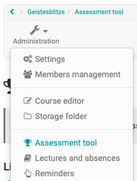
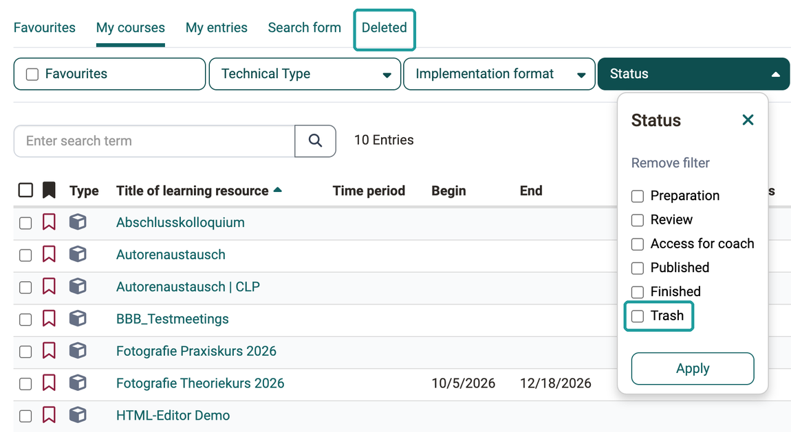

# General Information {: #general_information}

:octicons-device-camera-video-24: **Video introduction (German)**: [OpenOlat Funktionsprinzipien](<https://www.youtube.com/embed/M-JkSAFN298>){:target="_blank"}

With OpenOlat courses you map different event formats, for example lectures, seminars, online tutorials or group puzzles. You also implement different types of learning, for example problem-based, cooperative or self-organized learning. For this you use any number of [course elements](../Course_Elements/index.md) in any order and align the course with your didactic concept.

## Profile

Name | Course
---------|----------
Icon | :o_icon_o_CourseModule_icon:
Available since | Release 7.1 or earlier
Purpose | Bring learning content, activities and assessments together in a structure of course elements

To create courses, you need the [role](../../basic_concepts/Roles/index.md) "Author". If you do not have it, contact your organisation.

## The course cycle at a glance {: #course_lifecycle}

### 1. Create course {: #stage1}

Everything starts with the learning resource Course. You create it in the authoring area via `Authoring > Create > Course` and choose the course design. "With learning path" guides the participants through the course in a fixed sequence, "With learning progress" shows their progress without a fixed sequence. Both result in a [learning path course](../Learning_path_course/index.md). "Classic" results in a conventional course.

{ class="shadow lightbox" title="Create menu in the authoring area" }

For more information, see the pages [Creating Courses](../Creating_Course.md), [My first course](../../../manual_how-to/my_first_course/my_first_course.md) and [Creating learning path courses](../Creating_learning_path_courses.md).

### 2. Set up, design, publish course {: #stage2}

You implement your course in the course editor: you select the suitable course elements, create learning resources if necessary and configure everything as desired. You open the course editor via `Course > Administration > Course editor`. With "Publish" in the toolbar of the course editor, you transfer your changes to the course. Participants see them as soon as the course has the status "Published" (step 4).

{ class="shadow lightbox" title="Administration menu in the course toolbar" }

For more information, see the pages [Course elements at a glance](../Course_Elements/index.md), [Course editor tools](../Using_additional_Course_Editor_Tools.md), [Learning path course - Course editor](../Learning_path_course_Course_editor.md), [Various types of learning resources](../index.md), [Course elements in the Course editor](../General_Configuration_of_Course_Elements.md) and [Course Settings](../Course_Settings/index.md).

### 3. Set up access {: #stage3}

You define the access in the course administration: `Course > Administration > Settings`. The "Share" tab is particularly important here.

{ class="shadow lightbox" title="Administration menu in the course toolbar" }

In learning path courses, you release individual course elements for a limited time: select the course element in the course editor and set a "Release date" and a "Due date" in its "Learning path" tab. With the checkbox "Relative dates", you set both dates in days after an event, for example after the first course visit or after the enrolment of the participants. You find the tab under `Course > Administration > Course editor > Tab "Learning path"`. The date fields are available for the individual course elements, not for the course element "Structure" and not for the top node of the course.

For more information, see the pages [Access configuration](../Access_configuration.md) and [Course Settings](../Course_Settings/index.md).

### 4. Publish course {: #stage4}

When the course is ready, set the status to "Published" in the course toolbar. All members then open the course, including the participants. You define who becomes a member in the "Share" tab (step 3) and in the [members management](../Members_management.md).

{ class="shadow lightbox" title="Status menu in the course toolbar" }

For more information, see the page [Access configuration](../Access_configuration.md).

### 5. Run and assess the course {: #stage5}

While the course is running, you assess the participants in the assessment tool and give them feedback: `Course > Administration > Assessment tool`. In addition, you coach the course, for example with posts in the forum or by organising the absences.

{ class="shadow lightbox" title="Administration menu in the course toolbar" }

For more information, see the page [Course Operation](../Administration/index.md).

### 6. End course {: #stage6}

Once the course is over, set the status to "Finished". After that, all members open the course read-only, and changes are no longer possible.

{ class="shadow lightbox" title="Status in the course toolbar" }

For more information, see the page [Access configuration](../Access_configuration.md).

### 7. Delete course {: #stage7}

If you no longer need a course, delete it via `Course > Administration > Delete`. OpenOlat removes the personal data from the course, and afterwards only the owners have access. Deleted courses have the status "Trash" and are in the "Deleted" tab of the authoring area. There you restore a course if necessary. In the other tabs, the "Status" filter with the option "Trash" shows or hides them.

{ class="shadow lightbox" title="My courses tab in the authoring area" }

For more information, see the pages [Access configuration](../Access_configuration.md) and [Authoring - Overview](../../area_modules/Authoring/index.md#authoring-deleted).

## Plan the course {: #tip}

!!! tip "Before you create your OpenOlat course"

    First think about what you want to achieve with the course.

    The structure of your course depends on your didactic concept, the goals and the framework conditions. On this basis, you decide whether a conventional course or a learning path course is the right choice for you. If in doubt, choose the conventional course: via `Course > Administration > Duplicate as learning path` you later create a copy of it as a learning path course, provided that the learning path course supports all course elements it contains. The conventional course remains unchanged. This copy only works in one direction: from the conventional course to the learning path course.

    After deciding on a course design, choose the course elements with which you reach your goal and implement your course concept. Bundle content that belongs together so that participants find their way around the course easily. When the structure is clear, prepare the learning content, additional files (HTML pages, PDF files, [CP learning content](../index.md#cp-content), etc.) and everything else you need for use in the learning platform.

[To the top of the page ^](#general_information)

---

## Role change {: #role_change}

With the role change, you check yourself how participants experience your course: you see the course from their point of view, for example the flow of the course elements "Task", "Group task", "Check list" or "Participant folder". The toolbar shows in the "Role" menu in which role you are currently viewing the course. If you created the course, this is the "Owner" role. Via the "Role" menu you switch to the "Participant view" at any time.

{ class="shadow lightbox" title="Role menu in the course toolbar" }

If you have other roles in the course, they are also in the menu, and you switch to the corresponding view.

The menu does not distinguish between coaches and group coaches or between participants and group participants. It combines the options in the roles "Coach" and "Participant".

### Initial role when opening a course [:octicons-tag-16:{ title="from Release 19.1 (OO-8231)" }](https://track.frentix.com/issue/OO-8231) {: #initial_role}

Users with administrative roles, for example administrator or learning resource manager, open courses even if they are not members. If they are also entered as participant in a course, OpenOlat opens the course in the "Participant" role. This way they experience the course as it is intended for them as participant. Via the "Role" menu they switch to another role as usual.

Member roles always take precedence over administrative roles. Among the member roles, the default setting is: owner before coach before participant. Anyone who owns or coaches a course therefore sees it in this role immediately when opening it and switches to the participant view if necessary. Administrators define the order of the member roles in the system administration in the [module Learning resource](../../../manual_admin/administration/Modules_Learning_Resource.md), section "Default role priority": 
`Administration > Modules > Learning resource > Tab "Settings"`

    
Special case: Behaviour when enrolling in a group (course element "Enrolment")

    <b>Situation:</b>  
    - You create a course with the course element "Enrolment". 
    - You switch to the participant view and make an enrolment. 
    <b>-></b> OpenOlat then switches to the "Owner" role. 
    - If you switch to the participant view again, the warning dialogue ("You are in the participant role") with the option to delete data no longer appears. 
    - Only when you call up the course again does OpenOlat show the participant view with the warning dialogue again.
      
    <b>Explanation:</b>  
    The participant view works like the share option "Without booking": in this view you are not entered in the members management of the course.
    This results in the following: 
    - If you enrol in a group in the course element "Enrolment", you become a group participant at that moment and are listed in the members management of the course. 
    - The participant view is only available as long as you are not listed as participant in the members management of the course. If you are a participant of the course, of a group or of a curriculum, it is not available to you. 
    <b>-></b> After enrolling in a group, you therefore no longer have a participant view but are listed as group participant in the members management of the course. OpenOlat therefore switches from the participant view to the "Owner" role. 
    - The "Role" menu then shows the role "Participant" instead of the participant view. 
    - If you leave the group again and reload the course, the role "Participant" disappears, and the participant view is available again.  

## Further information {: #further_information}

**Further reading** 
[Learning path course - Overview >](../Learning_path_course/index.md) 
[Members management >](../Members_management.md) 
[Course Administration: Overview >](../Administration/index.md)

[To the top of the page ^](#general_information)
