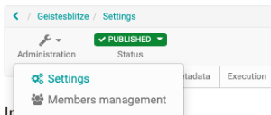
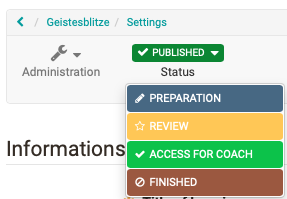

# General Information {: #general_information}

:octicons-device-camera-video-24: **Video introduction (German)**: [OpenOlat Funktionsprinzipien](<https://www.youtube.com/embed/M-JkSAFN298>){:target="_blank"}

With OpenOlat courses you map different event formats, for example lectures, seminars, online tutorials or group puzzles. You also implement different types of learning, for example problem-based, cooperative or self-organized learning. For this you use any number of [course elements](../Course_Elements/index.md) in any order and align the course with your didactic concept.

## Profile

Name | Course
---------|----------
Icon | :o_icon_o_CourseModule_icon:
Available since | Release 7.1 or earlier
Purpose | Bring learning content, activities and assessments together in a structure of course elements

To create courses, you need the [role](../../basic_concepts/Roles/index.md) "Author". If you do not have it, contact your organisation.

## The course cycle at a glance {: #course_lifecycle}

### 1. Create course {: #stage1}

Everything starts with the learning resource Course. You create it in the authoring area via `Authoring > Create > Course` and choose the course design. "With learning path" guides the participants through the course in a fixed sequence, "With learning progress" shows their progress without a fixed sequence. Both result in a [learning path course](../Learning_path_course/index.md). "Classic" results in a conventional course. If you or your organisation have prepared templates, choose "Course from template" in the same menu instead. A template is a prepared course with the usage "Template". OpenOlat creates your course as a copy of it, and the template itself remains unchanged. [:octicons-tag-16:{ title="from Release 20.2 (OO-8897)" }](https://track.frentix.com/issue/OO-8897)

{ class="shadow lightbox" title="Create menu in the authoring area · 2026.11.18" }

For more information, see the pages [Creating Courses](../Creating_Course.md), [My first course](../../../manual_how-to/my_first_course/my_first_course.md), [Creating learning path courses](../Creating_learning_path_courses.md) and [Various types of learning resources](../index.md#course).

### 2. Set up, design, publish course {: #stage2}

You implement your course in the course editor: you select the suitable course elements, create learning resources if necessary and configure everything as desired. You open the course editor via `Course > Administration > Course editor`. With "Publish" in the toolbar of the course editor, you transfer your changes to the course. Participants see them as soon as the course has the status "Published" (step 4).

{ class="shadow lightbox" title="Administration menu in the course toolbar · 2026.11.18" }

For more information, see the pages [Course elements at a glance](../Course_Elements/index.md), [Course editor tools](../Using_additional_Course_Editor_Tools.md), [Learning path course - Course editor](../Learning_path_course_Course_editor.md), [Various types of learning resources](../index.md), [Course elements in the Course editor](../General_Configuration_of_Course_Elements.md) and [Course Settings](../Course_Settings/index.md).

### 3. Set up access {: #stage3}

You define the access in the course administration: `Course > Administration > Settings`. The "Share" tab is particularly important here.

{ class="shadow lightbox" title="Administration menu in the course toolbar" }

In learning path courses, you release individual course elements for a limited time: select the course element in the course editor and set a "Release date" and a "Due date" in its "Learning path" tab. With the checkbox "Relative dates", you set both dates in days after an event, for example after the first course visit or after the enrolment of the participants. You find the tab under `Course > Administration > Course editor > Tab "Learning path"`. The date fields are available for the individual course elements, not for the course element "Structure" and not for the top node of the course.

For more information, see the pages [Access configuration](../Access_configuration.md) and [Course Settings](../Course_Settings/index.md).

### 4. Publish course [:octicons-tag-16:{ title="from Release 13.0 (OO-3584)" }](https://track.frentix.com/issue/OO-3584) {: #stage4}

When the course is ready, set the status to "Published" in the course toolbar. All members then open the course, including the participants. A newly created course has the status "Preparation". In this status and in the status "Review", only the owners among the members have access, for example you as the person who created the course. In the status "Access for coach", the coaches have access as well. You define who becomes a member in the "Share" tab (step 3) and in the [members management](../Members_management.md).

{ class="shadow lightbox" title="Status menu in the course toolbar" }

For more information, see the page [Access configuration](../Access_configuration.md).

### 5. Run and assess the course {: #stage5}

While the course is running, you assess the participants in the assessment tool and give them feedback: `Course > Administration > Assessment tool`. In addition, you coach the course, for example with posts in the forum. You manage the events and absences of the participants in the same menu under "Events and Absences". The menu shows this entry as soon as you have switched on the "Event & absence management" in the course: 
`Course > Administration > Settings > Tab "Execution"`

{ class="shadow lightbox" title="Administration menu in the course toolbar · 2026.11.18" }

For more information, see the pages [Course Operation](../Administration/index.md) and [Events and absences](../Events_and_absences.md).

### 6. End course {: #stage6}

Once the course is over, set the status to "Finished". After that, owners and coaches open the course read-only, and changes are no longer possible. What the participants see depends on the setting "Access for participants in status "Finished"": with "Read-only", they also open the course read-only; with "No access", they no longer open it. The system administration defines the default for this. For your course, you change the setting under: 
`Course > Administration > Settings > Tab "Options"` [:octicons-tag-16:{ title="from Release 21.0 (OO-9298)" }](https://track.frentix.com/issue/OO-9298)

{ class="shadow lightbox" title="Status in the course toolbar" }

For more information, see the pages [Access configuration](../Access_configuration.md) and [Course Settings - Tab Options](../Course_Settings_Options.md).

### 7. Delete course {: #stage7}

If you no longer need a course, delete it via `Course > Administration > Delete`. OpenOlat removes the personal data from the course, and afterwards only the owners have access. Deleted courses have the status "Trash" and are in the "Deleted" tab of the authoring area. There you restore a course if necessary. In the other tabs, the "Status" filter with the option "Trash" shows or hides them.

{ class="shadow lightbox" title="My courses tab in the authoring area" }

For more information, see the pages [Access configuration](../Access_configuration.md) and [Authoring - Overview](../../area_modules/Authoring/index.md#authoring-deleted).

## Plan the course {: #tip}

!!! tip "Before you create your OpenOlat course"

    First think about what you want to achieve with the course.

    The structure of your course depends on your didactic concept, the goals and the framework conditions. On this basis, you decide whether a conventional course or a learning path course is the right choice for you. If in doubt, choose the conventional course: via `Course > Administration > Duplicate as learning path` you later create a copy of it as a learning path course, provided that the learning path course supports all course elements it contains. The conventional course remains unchanged. This copy only works in one direction: from the conventional course to the learning path course.

    After deciding on a course design, choose the course elements with which you reach your goal and implement your course concept. Bundle content that belongs together so that participants find their way around the course easily. When the structure is clear, prepare the learning content, additional files (HTML pages, PDF files, [CP learning content](../index.md#cp-content), etc.) and everything else you need for use in the learning platform.

[To the top of the page ^](#general_information)

---

## Role change [:octicons-tag-16:{ title="from Release 15.0 (OO-4285)" }](https://track.frentix.com/issue/OO-4285) {: #role_change}

With the role change, you check for yourself how participants experience your course: you see the course from their point of view, for example the flow of the course elements "Task", "Group task", "Check list" or "Participant folder". The "Role" menu in the toolbar shows the role in which you are currently viewing the course. If you created the course, this is the "Owner" role. As owner, coach or CPL master coach, you switch in the same menu under "Switch to" to the "Participant view", as long as you are not a participant in the course yourself. In this view, you are not entered as participant. With the button "Leave participant view" below the toolbar, you return to your previous role.

{ class="shadow lightbox" title="Role menu in the course toolbar · 2026.11.18" }

If you have other roles in the course, they are also in the menu, and you switch to the corresponding view.

The menu shows one entry "Coach" and one entry "Participant", regardless of whether you are entered directly in the course, via a group or via an implementation in the Course Planner.

### Initial role when opening a course [:octicons-tag-16:{ title="from Release 19.1 (OO-8231)" }](https://track.frentix.com/issue/OO-8231) {: #initial_role}

If you have an administrative role, for example administrator or learning resource manager, you open courses even if you are not a member. If you are also entered as participant in a course and have no other member role there, OpenOlat opens the course in the "Participant" role. This way you experience the course as it is intended for you as participant.

If you are not a member of the course, OpenOlat opens it in your administrative role. If you have several of them, the first of your roles in this fixed order applies: "Principal", "Course planner", "Learning resource manager", "CPL master coach", "Administrator". For example, if you are learning resource manager and administrator, you see the course in the role "Learning resource manager". In the roles "Principal", "Course planner" and "CPL master coach", you see the course read-only. You switch to another of your roles via the "Role" menu. What the individual roles may do is described on the page [Roles](../../basic_concepts/Roles/index.md).

The "Role" menu offers the "Participant view" to owners, coaches and CPL master coaches, as long as they are not participants in the course. If you want to see a course as participants see it, enter yourself as owner or coach in the members management. You do this in the role "Administrator" or "Learning resource manager": `Course > Administration > Members management`. As soon as you leave the members management, the "Participant view" is available in the "Role" menu. The next time you open the course, OpenOlat shows it in this member role. If you no longer need the membership, remove yourself again in the members management.

Member roles always take precedence over administrative roles. Among the member roles, the default setting is: owner before coach before participant. Anyone who owns or coaches a course therefore sees it in this role immediately when opening it and switches to the participant view if necessary. Administrators define the order of the member roles in the system administration in the [module Learning resource](../../../manual_admin/administration/Modules_Learning_Resource.md), section "Default role priority": 
`Administration > Modules > Learning resource > Tab "Settings"`

    
Special case: Behaviour when enrolling in a group (course element "Enrolment")

    <b>Situation:</b>  
    - Your course contains the course element "Enrolment". As owner, you switch to the participant view via the "Role" menu. Below the toolbar, the note "You are in the participant view. Activities in the course elements are saved." then appears with the button "Leave participant view". 
    - You enrol in a group in the course element "Enrolment". 
    <b>-></b> OpenOlat immediately switches to the "Owner" role, and the note disappears (explanation below). The "Role" menu now shows the role "Participant" instead of the participant view. If you switch to this role, no note appears, because you are now actually a participant of the course. 
    - If you call up the course again, nothing changes: OpenOlat opens it in the "Owner" role, and the participant view is missing from the "Role" menu. 
    - The participant view is only available again when you are no longer a member of the group and call up the course again. You leave the group in the course element "Enrolment" with "Delist", provided that the checkbox "Delisting permitted" is selected in the configuration of the course element. Otherwise, you remove your membership in the group in the members management of the course: <code>Course > Administration > Members management</code>
      
    <b>Explanation:</b>  
    In the participant view, you see the course like participants without being entered as participant in the members management. This is similar to the offer type "Without booking": with this offer, users open the course without a membership. You find the offer types of a course under: 
    <code>Course > Administration > Settings > Tab "Share"</code> 
    With the enrolment, you become a group participant and are therefore listed in the members management of the course. However, the participant view is only available as long as you are not a participant in the course, neither directly nor via a group or an implementation in the Course Planner. This is why OpenOlat switches after the enrolment to the role in which you also see the course when you open it, by default "Owner" (see section <a href="#initial_role">Initial role when opening a course</a>).  

## Further information {: #further_information}

**Further reading** 
[Learning path course - Overview >](../Learning_path_course/index.md) 
[Members management >](../Members_management.md) 
[Course Administration: Overview >](../Administration/index.md)

[To the top of the page ^](#general_information)
