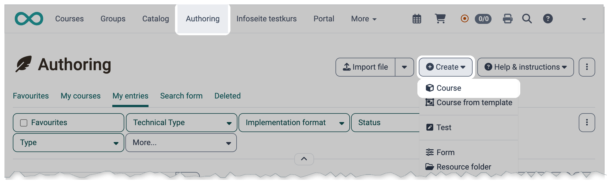
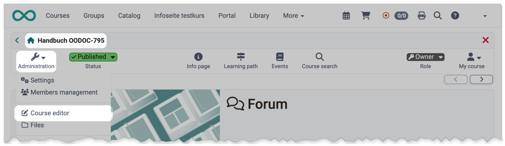
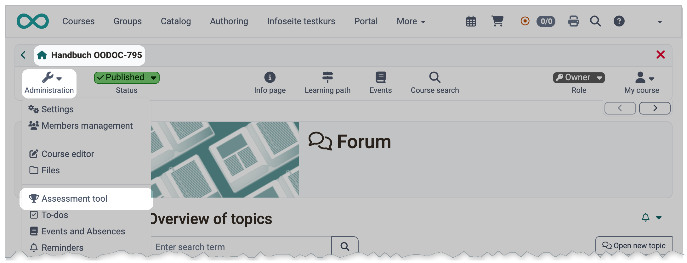
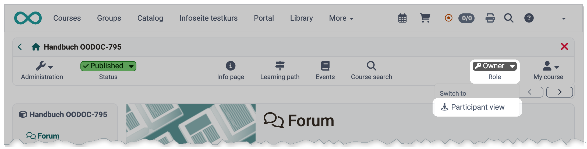

# General Information {: #general_information}

:octicons-device-camera-video-24: **Video introduction (German)**: [OpenOlat Funktionsprinzipien](<https://www.youtube.com/embed/M-JkSAFN298>){:target="_blank"}

With OpenOlat courses you map different event formats, for example lectures, seminars, online tutorials or group puzzles. You also implement different types of learning, for example problem-based, cooperative or self-organized learning. For this you use any number of [course elements](../Course_Elements/index.md) in any order and align the course with your didactic concept.

## Profile

Name | Course
---------|----------
Icon | :o_icon_o_CourseModule_icon:
Available since | Release 7.1 or earlier
Purpose | Bring learning content, activities and assessments together in a structure of course elements

To create courses, you need the [role](../../basic_concepts/Roles/index.md) "Author". If you do not have it, contact your organisation.

## The course cycle at a glance {: #course_lifecycle}

A course goes through seven steps, from creating to deleting. Each step names the place where you act in OpenOlat and the page with the details.

### 1. Create course {: #stage1}

Everything starts with the learning resource Course. You create it in the authoring area via `Authoring > Create > Course` and choose the course design. "With learning path" guides the participants through the course in a fixed sequence, "With learning progress" shows their progress without a fixed sequence. Both result in a [learning path course](../Learning_path_course/index.md). "Classic" results in a conventional course, without learning progress and without a fixed sequence. If you or your organisation have prepared templates, choose "Course from template" in the same menu instead. A template is a prepared course with the usage "Template", a template for course content without its own members management. You choose the usage when you create a course, in the same dialog as the course design. OpenOlat creates your course as a copy of it, and the template itself remains unchanged. [:octicons-tag-16:{ title="from Release 20.2 (OO-8897)" }](https://track.frentix.com/issue/OO-8897)

{ class="shadow lightbox" title="Create menu in the authoring area · 2026.11.18" }

For more information, see the pages [Creating Courses](../Creating_Course.md), [My first course](../../../manual_how-to/my_first_course/my_first_course.md), [Creating learning path courses](../Creating_learning_path_courses.md) and [Various types of learning resources](../index.md#course).

### 2. Set up, design, publish course {: #stage2}

You implement your course in the course editor: you select the suitable course elements, create learning resources if necessary and configure everything as desired. You open the course editor via `Course > Administration > Course editor`. With "Publish" in the toolbar of the course editor, you transfer your changes to the course. Participants see them as soon as the course has the status "Published" (step 4).

{ class="shadow lightbox" title="Administration menu in the course toolbar · 2026.11.18" }

For more information, see the pages [Course elements at a glance](../Course_Elements/index.md), [Course editor tools](../Using_additional_Course_Editor_Tools.md), [Learning path course - Course editor](../Learning_path_course_Course_editor.md), [Various types of learning resources](../index.md), [Course elements in the Course editor](../General_Configuration_of_Course_Elements.md) and [Course Settings](../Course_Settings/index.md).

### 3. Set up access {: #stage3}

Who may open your course is defined in the settings of the course, above all in the "Share" tab: 
`Course > Administration > Settings > Tab "Share"`

{ class="shadow lightbox" title="Administration menu in the course toolbar" }

In learning path courses, you release individual course elements for a limited time: select the course element in the course editor and set a "Release date" and a "Due date" in its "Learning path" tab. With the checkbox "Relative dates", you set both dates in days after an event, for example after the first course visit or after the enrolment of the participants. You find the tab as soon as you have clicked the course element in the course editor: 
`Course > Administration > Course editor > "Title of the course element" > Tab "Learning path"` 
The date fields are available for the individual course elements, not for the course element "Structure". The top entry in the course editor is also a course element "Structure" and has no date fields.

For more information, see the pages [Access configuration](../Access_configuration.md) and [Course Settings](../Course_Settings/index.md).

### 4. Publish course [:octicons-tag-16:{ title="from Release 13.0 (OO-3584)" }](https://track.frentix.com/issue/OO-3584) {: #stage4}

When the course is ready, set the status to "Published" in the course toolbar, the bar above the course content. All members then open the course, that is owners, coaches and participants. A newly created course has the status "Preparation". In this status and in the status "Review", only the owners among the members have access, for example you as the person who created the course. You set the status "Review" when the preparation is complete and the content is being checked. In the status "Access for coach", the coaches have access as well. You define who becomes a member in the "Share" tab (step 3) and in the [members management](../Members_management.md).

{ class="shadow lightbox" title="Status menu in the course toolbar" }

For more information, see the page [Access configuration](../Access_configuration.md).

### 5. Run and assess the course {: #stage5}

While the course is running, you assess the participants in the assessment tool and give them feedback: `Course > Administration > Assessment tool`. In addition, you coach the course, for example with posts in the forum. You manage the events and absences of the participants in the same menu under "Events and Absences". The menu shows this entry as soon as you have switched on the "Event & absence management" in the course: 
`Course > Administration > Settings > Tab "Execution"`

{ class="shadow lightbox" title="Administration menu in the course toolbar · 2026.11.18" }

For more information, see the pages [Course Operation](../Administration/index.md) and [Events and absences](../Events_and_absences.md).

### 6. End course {: #stage6}

Once the course is over, set the status to "Finished". After that, owners and coaches open the course read-only, and changes are no longer possible. What the participants see depends on the setting "Access for participants in status "Finished"": with "Read-only", they also open the course read-only; with "No access", they no longer open it. By default, "Read-only" applies, and the system administration can define a different default. For your course, you change the setting under: 
`Course > Administration > Settings > Tab "Options"` [:octicons-tag-16:{ title="from Release 21.0 (OO-9298)" }](https://track.frentix.com/issue/OO-9298)

{ class="shadow lightbox" title="Status in the course toolbar" }

For more information, see the pages [Access configuration](../Access_configuration.md) and [Course Settings - Tab Options](../Course_Settings_Options.md).

### 7. Delete course {: #stage7}

If you no longer need a course, delete it via `Course > Administration > Delete`. OpenOlat removes the personal data from the course, and afterwards only the owners have access. Deleted courses have the status "Trash" and are in the "Deleted" tab of the authoring area. There you restore a course if necessary. In the other tabs, the "Status" filter with the option "Trash" shows or hides them.

{ class="shadow lightbox" title="My courses tab in the authoring area" }

For more information, see the pages [Access configuration](../Access_configuration.md) and [Authoring - Overview](../../area_modules/Authoring/index.md#authoring-deleted).

## Plan the course {: #tip}

!!! tip "Before you create your OpenOlat course"

    First think about what you want to achieve with the course.

    The structure of your course depends on your didactic concept, the goals and the framework conditions. On this basis, you decide whether a conventional course or a learning path course is the right choice for you. If in doubt, choose the conventional course: via `Course > Administration > Duplicate as learning path` you later create a copy of it as a learning path course, provided that the learning path course supports all course elements it contains. The conventional course remains unchanged. This copy only works in one direction: from the conventional course to the learning path course.

    After deciding on a course design, choose the course elements with which you reach your goal and implement your course concept. Bundle content that belongs together so that participants find their way around the course easily. When the structure is clear, prepare the learning content, additional files (HTML pages, PDF files, [CP learning content](../index.md#cp-content), etc.) and everything else you need for use in the learning platform.

[To the top of the page ^](#general_information)

---

## Role change [:octicons-tag-16:{ title="from Release 15.0 (OO-4285)" }](https://track.frentix.com/issue/OO-4285) {: #role_change}

With the role change, you check for yourself how participants experience your course: you see the course from their point of view, for example the flow of the course elements "Task", "Group task", "Check list" or "Participant folder". The "Role" menu on the right of the toolbar, the bar above the course content, shows the role in which you are currently viewing the course. If you created the course, this is the "Owner" role. As owner, coach or CPL master coach, that is as master coach of an implementation in the Course Planner (CPL), you switch in the same menu under "Switch to" to the "Participant view", as long as you are not a participant in the course yourself. If you are also a participant, choose the role "Participant" under "Roles" instead. With the button "Leave participant view" below the toolbar, you return to your previous role.

{ class="shadow lightbox" title="Role menu in the course toolbar · 2026.11.18" }

In the participant view, you are not entered as participant. What you work on in the course elements, for example a test, OpenOlat still saves under your name. In the assessment tool, these entries appear when you switch on "From participant view" under "Participants" (see [Assessment tool: Participants](../Assessment_tool_tab_Users.md)). Coaches only see their own entries there. If you later give up your membership in the course, the entries remain and appear under "Non-member".

If you have other roles in the course, as member or as administrative role such as administrator (see section [Initial role when opening a course](#initial_role)), they are in the same menu under "Roles", and you switch to the corresponding view.

You are a member of a course as owner, coach or participant. You are entered directly in the course or via an implementation in the [Course Planner](../../area_modules/Course_Planner/index.md), as coach or participant also via a [group](../../groups/index.md). An implementation is the concrete run of an educational offering with a period, members and courses. The menu shows one entry "Coach" and one entry "Participant", regardless of which of these ways you are entered.

### Initial role when opening a course [:octicons-tag-16:{ title="from Release 19.1 (OO-8231)" }](https://track.frentix.com/issue/OO-8231) {: #initial_role}

When you open a course, OpenOlat chooses your role itself. Your roles as member take precedence over all other roles, by default in the order owner, coach, participant. Anyone who owns or coaches a course therefore sees it in this role when opening it and switches to the participant view if necessary. If you are entered in the course only as participant, OpenOlat opens it in the "Participant" role, even if you also have an administrative role. This way you experience the course as it is intended for you as participant.

Administrators define the order of the three member roles for all courses, in the system administration in the [module Learning resource](../../../manual_admin/administration/Modules_Learning_Resource.md), section "Default role priority": 
`Administration > Modules > Learning resource > Tab "Settings"`

Without a membership, you open a course if you have one of the following roles for it. The organisation roles apply to the courses of the organisation in which you have the role. If you have several of these roles, OpenOlat chooses the first one in this order. This order is fixed, the "Default role priority" only orders the member roles.

1. **Principal**: Organisation role with the same reach as administrator, but read only.
2. **Course planner**: Organisation role for the Course Planner, the tool with which an organisation plans its educational offering in products and implementations. Product owners and element owners of the Course Planner also open the course in this role if the course belongs to their product or element.
3. **Learning resource manager**: Organisation role for managing the courses and learning resources of the organisation.
4. **CPL master coach**: Master coaches look after a whole implementation in the Course Planner (CPL), across all courses of the implementation. They open the course from the status "Access for coach".
5. **Administrator**: Organisation role with access to all areas of the organisation.

For example, if you are learning resource manager and administrator, OpenOlat opens the course in the role "Learning resource manager". In the course, both roles have the same rights as owners. In the roles "Principal", "Course planner" and "CPL master coach", you see the contents and members of the course, but change nothing. Settings and course editor are opened by owners, learning resource managers and administrators. You switch to another of your roles via the "Role" menu. What the individual roles may do is described on the pages [Roles](../../basic_concepts/Roles/index.md#org) and [Course Planner](../../area_modules/Course_Planner/index.md#roles_rights).

The "Role" menu offers the "Participant view" only to owners, coaches and CPL master coaches. If you open a course as administrator or learning resource manager without a membership, it is therefore not in the menu. To see such a course as participants see it, enter yourself as owner or coach:

1. If the "Role" menu shows a role that opens read-only, for example "Principal", first switch there to the role "Administrator" or "Learning resource manager". Of your administrative roles, only these two add members.
2. Enter yourself as owner or coach in the members management with "Add member": `Course > Administration > Members management` 
   In the last step of the wizard, the "E-mail notification" is switched on, and the mail goes to yourself. If you do not need it, switch it off. As coach, participants see you in the course element "Participant list" under "Coach". The course element lists owners under the label "Course administrator" if this is switched on in its configuration.
3. Close the course and open it again. OpenOlat now shows it in your new member role, and the "Role" menu offers the "Participant view" under "Switch to".

If you no longer need the membership, remove yourself again in the members management. Here, too, the notification "Notify member" is preselected. If you are the only owner, OpenOlat does not allow the removal, because every course needs at least one owner.

    
Special case: Behaviour when enrolling in a group (course element "Enrolment")

    <b>Situation:</b>  
    - Your course contains the course element "Enrolment". As owner, you switch to the participant view via the "Role" menu. Below the toolbar, the note "You are in the participant view. Activities in the course elements are saved." then appears with the button "Leave participant view". 
    - You enrol in a group in the course element "Enrolment" and thereby take a place in the group. 
    <b>-></b> OpenOlat immediately switches to the "Owner" role, and the note disappears (explanation below). The "Role" menu now shows the role "Participant" instead of the participant view. If you switch to this role, no note appears, because you are now actually a participant of the course. 
    - If you call up the course again, nothing changes: OpenOlat opens it in the "Owner" role, and the participant view is missing from the "Role" menu. 
    - The participant view is only available again when you are no longer a member of the group and call up the course again. You leave the group in the course element "Enrolment" with "Delist", provided that the checkbox "Delisting permitted" is selected: <code>Course > Administration > Course editor > Course element "Enrolment" > Tab "Configuration"</code> 
    Otherwise, you remove your membership in the group in the members management of the course: <code>Course > Administration > Members management</code> 
    If the number of participants of a group is limited and the group is full, further persons enter themselves on its waiting list, provided that the group offers a waiting list. Whether someone then moves up from the waiting list is defined by the group itself, with the options "Waiting list" and "Moving up automatically": <code>Course > Administration > Members management > Groups > "Group name" > Administration > Tab "Description"</code> 
    In the table of groups, the link "Edit" in the row of the group opens the tab "Description" directly.
      
    <b>Explanation:</b>  
    In the participant view, you see the course like participants without being entered as participant in the members management. With the enrolment, you become a participant of the group and are therefore listed in the members management of the course. However, the participant view is only available as long as you are not a participant in the course, neither directly nor via a group or an implementation in the Course Planner. This is why OpenOlat switches after the enrolment to the role in which you also see the course when you open it, by default "Owner" (see section <a href="#initial_role">Initial role when opening a course</a>).  

## Further information {: #further_information}

**Further reading** 
[Learning path course - Overview >](../Learning_path_course/index.md) 
[Members management >](../Members_management.md) 
[Course Element "Enrolment" >](../Course_Element_Enrolment.md) 
[Course Administration: Overview >](../Administration/index.md)

[To the top of the page ^](#general_information)
