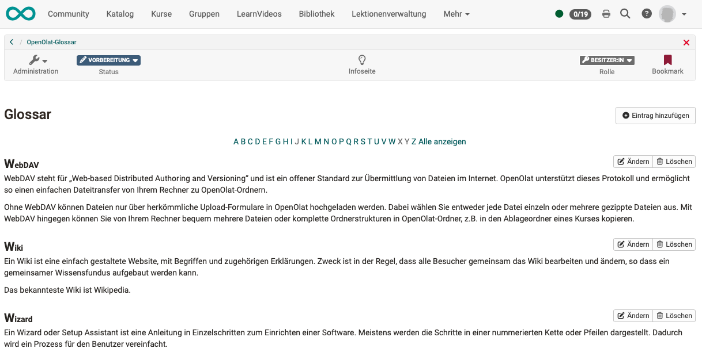
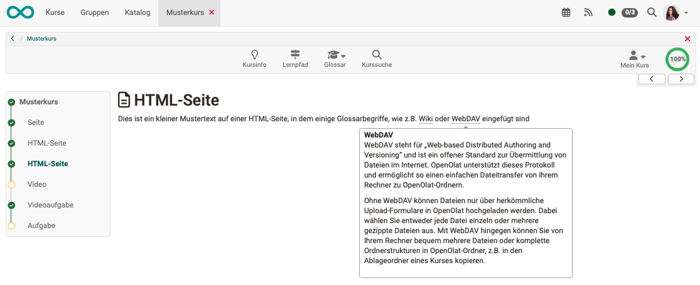

# Glossar {: #glossary}

Mit einem Glossar sammeln Sie Fachbegriffe und ihre Definitionen an einer Stelle. Im Kurs lesen Teilnehmende die Erklärung eines Begriffs direkt im Lerninhalt, ohne den Kurs zu verlassen. Glossare sind in OpenOlat Lernressourcen, die Sie eigenständig oder eingebunden in einen Kurs verwenden.

## Steckbrief

Name | Glossar
---------|----------
Icon | :o_icon_o_FileResource-GLOSSARY_icon:
Verfügbar seit | Release 7.1 oder früher
Zweck | Begriffe mit ihren Definitionen sammeln und im Kurs direkt im Text erklären
Im Kurs | `Kurs > Administration > Einstellungen > Optionen`, Anzeige in der Toolbar des Kurses

## Was ist und kann ein Glossar?

Ein Glossar ist eine einfache Tabelle, in der Begriffe und ihre Definitionen abgelegt und alphabetisch sortiert aufgelistet werden.

{ class="shadow lightbox" title="Lernressource Glossar" }

In einen Kurs bringen Sie ein Glossar in zwei Schritten: Wählen Sie es unter `Kurs > Administration > Einstellungen > Optionen` mit dem Button "Glossar wählen" aus. Schalten Sie danach unter `Kurs > Administration > Einstellungen > Toolbar` die Checkbox "Glossar" ein, damit es in der Toolbar des Kurses erscheint, der Leiste mit den Werkzeugen über dem Kursinhalt. Schritt für Schritt beschreibt das der Abschnitt [Glossar einbinden](../Glossary_create.de.md#integrate).

In der Toolbar erscheint dann das Menü "Glossar". Wählen Sie darin "Glossarbegriffe in Lerninhalt einblenden", markiert OpenOlat die Glossarbegriffe im Lerninhalt des Kurses, zum Beispiel in HTML-Seiten. Bewegen Sie den Mauszeiger über einen markierten Begriff, zeigt OpenOlat seine Definition aus dem Glossar.

{ class="shadow lightbox" title="Glossarbegriff in einer HTML-Seite des Kurses" }

Glossare lassen sich so konfigurieren, dass auch Teilnehmende Begriffe ergänzen, siehe [Glossar: Administration](../Glossary_administration.de.md#tab_write_permissions).

---

## Weiterführende Informationen {: #further_information}

[Glossar - Verwendung >](../Glossary_usage.de.md) 
[Kurseinstellungen - Tab Optionen >](../Course_Settings_Options.de.md) 
[Toolbar >](../Course_Settings_Toolbar.de.md)

[Zum Seitenanfang ^](#glossary)
