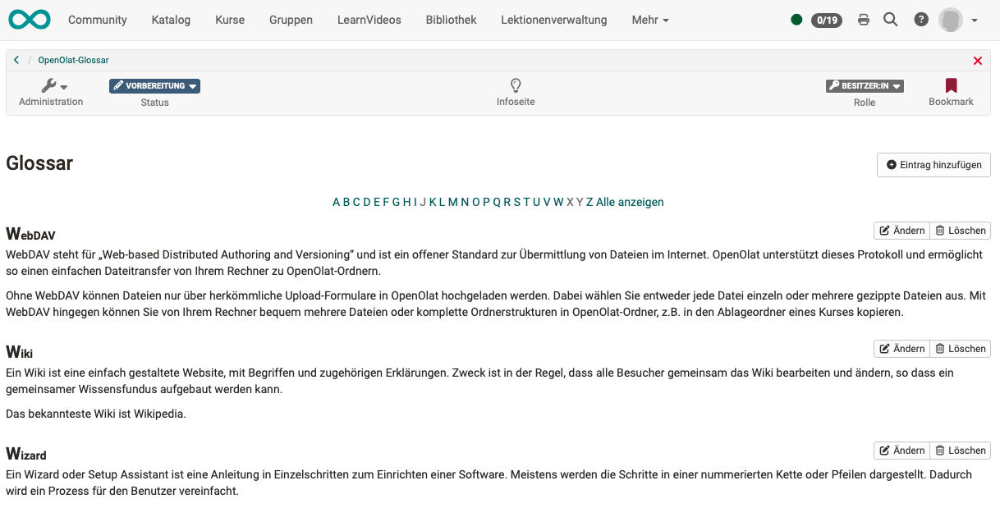
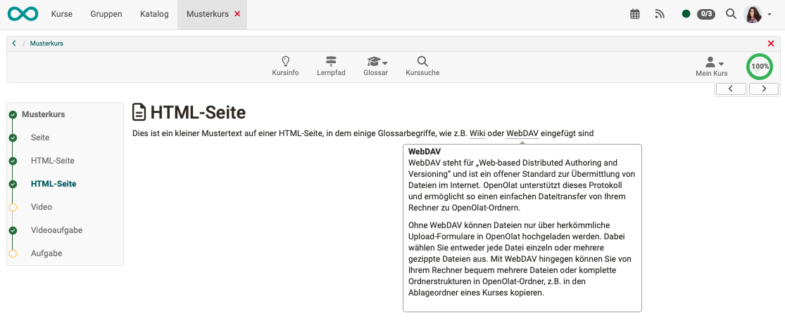

# Glossar {: #glossary}

## Was ist und kann ein Glossar?

Ein Glossar ist eine einfache Tabelle, in der Begriffe und ihre Definitionen abgelegt und alphabetisch sortiert aufgelistet werden.

{ class="shadow lightbox" title="Lernressource Glossar" }

Wird ein Glossar in einen OpenOlat Kurs eingebaut, können in HTML-Dateien dieses Kurses zu den Glossarbegriffen direkt die Erklärung des Glossareintrags angezeigt werden, wenn man den Mauszeiger im Text über den Schlüsselbegriff bewegt.

{ class="shadow lightbox" title="Glossarbegriff in einer HTML-Seite des Kurses" }

Es ist möglich Glossare so zu konfigurieren, dass auch Lernende ein Glossar inhaltlich befüllen können, siehe [Glossar: Administration](../Glossary_administration.de.md#tab_write_permissions).

Technisch betrachtet, ist in OpenOlat ein Glossar eine **Lernressource**.

---

## Weiterführende Informationen {: #further_information}

[Glossar verwenden >](../Glossary_usage.de.md) 
[Glossar erstellen >](../Glossary_create.de.md) 
[Glossar: Administration >](../Glossary_administration.de.md)

[Zum Seitenanfang ^](#glossary)