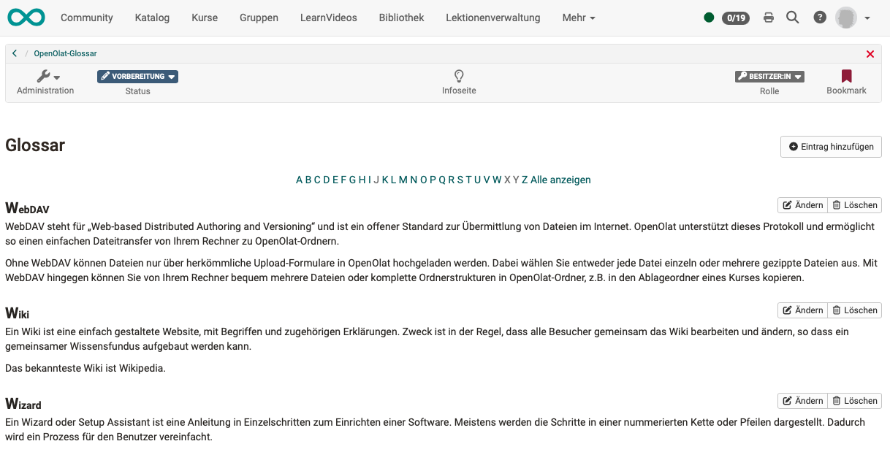
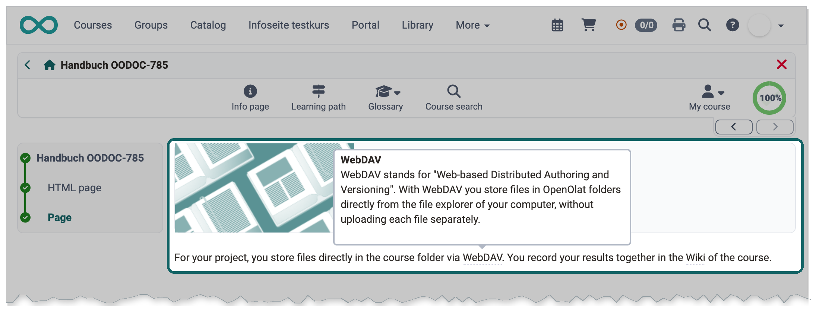

# Glossary {: #glossary}

With a glossary, you collect technical terms and their definitions in one place. In the course, participants read the explanation of a term directly in the learning content, without leaving the course. In OpenOlat, glossaries are learning resources that you use on their own or embedded in a course.

## Profile

Name | Glossary
---------|----------
Icon | :o_icon_o_FileResource-GLOSSARY_icon:
Available since | Release 7.1 or earlier
Purpose | Collect terms with their definitions and explain them directly in the text of the course
In the course | `Course > Administration > Settings > Options`, plus the "Glossary" checkbox under `Course > Administration > Settings > Toolbar`

## What is a glossary and what can it do?

A glossary lists terms with their definitions in alphabetical order. A click on a letter shows only the terms with this initial letter, "Show all" shows all terms again. You add new terms with "Add entry", see [Create glossary entries](../Glossary_create.md#create_entries).

{ class="shadow lightbox" title="Learning resource Glossary" }

You bring a glossary into a course in two steps: select it under `Course > Administration > Settings > Options` with the "Select glossary" button. Then switch on the "Glossary" checkbox under `Course > Administration > Settings > Toolbar` so that the glossary appears in the toolbar of the course, the bar with the tools above the course content. The section [Integrate glossary](../Glossary_create.md#integrate) describes this step by step.

The "Glossary" menu then appears in the toolbar. If you select "Show glossary terms in learning content" there, OpenOlat marks the glossary terms in the learning content of the course, for example in the course elements "Page" and "HTML page". If you move the mouse pointer over a marked term, OpenOlat shows its definition from the glossary. Each person switches the marking on for themselves, and OpenOlat remembers the choice per course.

{ class="shadow lightbox" title="Glossary term in the course element Page · 2026.11.18" }

Glossaries can be configured so that participants can also add terms, see [Glossary: Administration](../Glossary_administration.md#tab_write_permissions).

---

## Further information {: #further_information}

[Glossary - Usage >](../Glossary_usage.md) 
[Course Settings - Tab Options >](../Course_Settings_Options.md) 
[Toolbar >](../Course_Settings_Toolbar.md)

[To the top of the page ^](#glossary)
