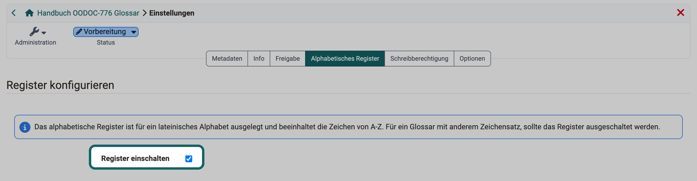
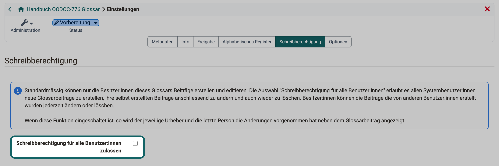

# Glossar: Administration {: #glossary_administration}

Ob nur Sie selbst oder alle Personen im Glossar Begriffe eintragen und ob das Glossar die Begriffe nach Anfangsbuchstaben gliedert, legen Sie einmal in den Einstellungen des Glossars fest. Diese Einstellungen gelten für die Lernressource Glossar und damit in jedem Kurs, der das Glossar einbindet.

Die Einstellungen öffnen Sie unter: 
`Glossar > Administration > Einstellungen`

Das Menü "Administration" sehen Besitzer:innen der Lernressource, Lernressourcenverwalter:innen und Administrator:innen. Wie Sie Einträge im Glossar erstellen, beschreibt die Seite [Glossar erstellen](Glossary_create.de.md#create_entries).

[Zum Seitenanfang ^](#glossary_administration)

---

## Tabs der Einstellungen {: #settings_tabs}

Die Einstellungen eines Glossars zeigen die Tabs in dieser Reihenfolge:

* **Metadaten**: Titel, Kennzeichen und Einordnung des Glossars. Die Felder beschreibt die Seite [Kurseinstellungen - Tab Metadaten](Course_Settings_Metadata.de.md).
* **Info**: die Angaben für die Infoseite des Glossars, beschrieben auf der Seite [Kurseinstellungen - Tab Info](Course_Settings_Info.de.md).
* **Freigabe**: Verwendungszweck und Zugang, beschrieben auf der Seite [Kurseinstellungen - Tab Freigabe](Course_Settings_Share/index.de.md).
* **Katalog**: nur wenn der Katalog in der Version 1 eingeschaltet ist und das Glossar den Verwendungszweck "Eigenständig" hat, siehe [Kurseinstellungen - Tab Katalog](Course_Settings_Catalog.de.md).
* **Alphabetisches Register**: siehe [unten](#tab_register).
* **Schreibberechtigung**: siehe [unten](#tab_write_permissions).
* **Optionen**: der Zugriff für Teilnehmende im Status "Beendet", beschrieben auf der Seite [Kurseinstellungen - Tab Optionen](Course_Settings_Options.de.md). Der Tab fehlt, wenn im Tab "Freigabe" der Verwendungszweck "Einbindung" gewählt ist.

Die Seiten zu den Kurseinstellungen gelten für alle Lernressourcen. Einzelne Felder dort gibt es nur bei Kursen, das steht jeweils beim Feld.

[Zum Seitenanfang ^](#glossary_administration)

---

## Tab "Alphabetisches Register" {: #tab_register}

Mit dem alphabetischen Register finden Lernende einen Begriff über seinen Anfangsbuchstaben. Über der Liste der Begriffe steht eine Leiste mit den Buchstaben A bis Z. Ein Klick auf einen Buchstaben zeigt die Begriffe mit diesem Anfangsbuchstaben, Buchstaben ohne Begriffe sind nicht anklickbar. "Alle anzeigen" zeigt wieder alle Begriffe.

Das Register kennt nur die Buchstaben des lateinischen Alphabets. Beginnen die Begriffe Ihres Glossars mit anderen Zeichen, etwa mit griechischen oder kyrillischen Buchstaben, schalten Sie die Checkbox "Register einschalten" aus. Das Glossar zeigt dann alle Begriffe in einer Liste.

{ class="shadow lightbox" title="Tab Alphabetisches Register in den Einstellungen eines Glossars · 2026.11.10" }

OpenOlat speichert die Einstellung, sobald Sie die Checkbox anklicken.

[Zum Seitenanfang ^](#glossary_administration)

---

## Tab "Schreibberechtigung" {: #tab_write_permissions}

Soll ein Glossar gemeinsam wachsen, etwa als Fachwortschatz, den Lernende selbst ergänzen, geben Sie allen Benutzer:innen das Schreibrecht. Standardmässig erstellen und bearbeiten nur die Besitzer:innen des Glossars Einträge, in einem Kurs zusätzlich die Besitzer:innen des Kurses und Personen mit dem Recht "Glossar-Werkzeug".

Schalten Sie die Checkbox "Schreibberechtigung für alle Benutzer:innen zulassen" ein, erstellen alle Personen, die das Glossar öffnen, neue Einträge. Ausgenommen sind Gäste. Ihre eigenen Einträge können diese Personen danach ändern und löschen. Die Besitzer:innen des Glossars ändern und löschen alle Einträge, auch die von anderen Personen.

Ist die Checkbox eingeschaltet, zeigt das Glossar neben jedem Eintrag, wer ihn erstellt und wer ihn zuletzt geändert hat.

{ class="shadow lightbox" title="Tab Schreibberechtigung in den Einstellungen eines Glossars · 2026.11.10" }

OpenOlat speichert die Einstellung, sobald Sie die Checkbox anklicken.

Soll nur ein Teil der Personen eines Kurses Einträge schreiben, etwa die Mitglieder einer Gruppe, vergeben Sie das Recht über die Mitgliederverwaltung des Kurses, siehe [Schreibrecht nur für ausgewählte Benutzer:innen](Glossary_create.de.md#write_selected_users).

[Zum Seitenanfang ^](#glossary_administration)

---

## Weiterführende Informationen {: #further_information}

**Auf dieser Seite erwähnt** 
[Glossar erstellen >](Glossary_create.de.md) 
[Kurseinstellungen - Tab Metadaten >](Course_Settings_Metadata.de.md) 
[Kurseinstellungen - Tab Info >](Course_Settings_Info.de.md) 
[Kurseinstellungen - Tab Freigabe >](Course_Settings_Share/index.de.md) 
[Kurseinstellungen - Tab Katalog >](Course_Settings_Catalog.de.md) 
[Kurseinstellungen - Tab Optionen >](Course_Settings_Options.de.md)

**Weiterführend** 
[Glossar >](Glossary/index.de.md) 
[Glossar verwenden >](Glossary_usage.de.md) 
[Mitgliederverwaltung >](Members_management.de.md)

[Zum Seitenanfang ^](#glossary_administration)
