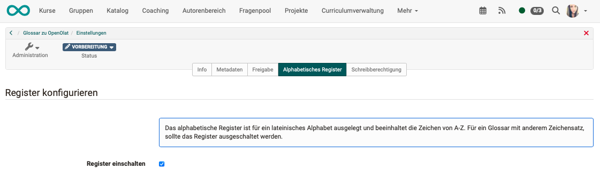
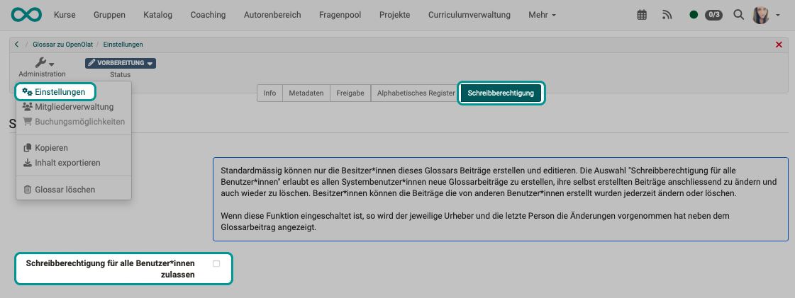

# Glossary: Administration {: #glossary_administration}

Whether only you or all persons enter terms in the glossary, and whether the glossary groups the terms by initial letter, is set once in the settings of the glossary. These settings apply to the glossary learning resource and therefore in every course that integrates the glossary.

You open the settings under: 
`Glossary > Administration > Settings`

The "Administration" menu is visible to owners of the learning resource, learning resource managers and administrators. How to create entries in the glossary is described on the page [Create glossary](Glossary_create.md#create_entries).

[To the top of the page ^](#glossary_administration)

---

## Tabs of the settings {: #settings_tabs}

The settings of a glossary show the tabs in this order:

* **Metadata**: title, reference and classification of the glossary. The fields are described on the page [Course Settings - Tab Metadata](Course_Settings_Metadata.md).
* **Info**: the details for the info page of the glossary, described on the page [Course Settings - Tab Info](Course_Settings_Info.md).
* **Share**: usage and access, described on the page [Course Settings - Tab Share](Course_Settings_Share/index.md).
* **Catalog**: only if the catalog in version 1 is enabled and the glossary has the usage "Standalone", see [Course Settings, Tab Catalog](Course_Settings/index.md#catalog).
* **Alphabetical index**: see [below](#tab_register).
* **Write permissions**: see [below](#tab_write_permissions).
* **Options**: the access for participants in status "Finished", described on the page [Course Settings - Tab Options](Course_Settings_Options.md). The tab is missing if the usage "Embedding" is selected in the "Share" tab.

The pages on the course settings apply to all learning resources. Some fields there only exist for courses, which is noted at the field.

[To the top of the page ^](#glossary_administration)

---

## Tab "Alphabetical index" {: #tab_register}

With the alphabetical index, learners find a term by its initial letter. Above the list of terms there is a bar with the letters A to Z. A click on a letter shows the terms with this initial letter, letters without terms cannot be clicked. "Show all" shows all terms again.

The index only knows the letters of the Latin alphabet. If the terms of your glossary begin with other characters, for example with Greek or Cyrillic letters, switch off the checkbox "Activate index". The glossary then shows all terms in one list.

{ class="shadow lightbox" title="Tab Alphabetical index in the settings of a glossary" }

OpenOlat saves the setting as soon as you click the checkbox.

[To the top of the page ^](#glossary_administration)

---

## Tab "Write permissions" {: #tab_write_permissions}

If a glossary is to grow collaboratively, for example as a technical vocabulary that learners add to themselves, give all users write permission. By default, only the owners of the glossary create and edit entries, in a course also the owners of the course and persons with the "Glossary tool" right.

If you switch on the checkbox "Enable write permissions for all users", all persons who open the glossary create new entries. Guests are excluded. These persons can then change and delete their own entries. The owners of the glossary change and delete all entries, including those of other persons.

If the checkbox is switched on, the glossary shows next to each entry who created it and who last changed it.

{ class="shadow lightbox" title="Tab Write permissions in the settings of a glossary" }

OpenOlat saves the setting as soon as you click the checkbox.

If only some of the persons in a course are to write entries, for example the members of a group, grant the right via the members management of the course, see [Writing permission for selected users](Glossary_create.md#write_selected_users).

[To the top of the page ^](#glossary_administration)

---

## Further information {: #further_information}

**Mentioned on this page** 
[Create glossary >](Glossary_create.md) 
[Course Settings - Tab Metadata >](Course_Settings_Metadata.md) 
[Course Settings - Tab Info >](Course_Settings_Info.md) 
[Course Settings - Tab Share >](Course_Settings_Share/index.md) 
[Course Settings >](Course_Settings/index.md) 
[Course Settings - Tab Options >](Course_Settings_Options.md)

**Further reading** 
[Glossary >](Glossary/index.md) 
[Usage of a glossary >](Glossary_usage.md) 
[Members management >](Members_management.md)

[To the top of the page ^](#glossary_administration)
