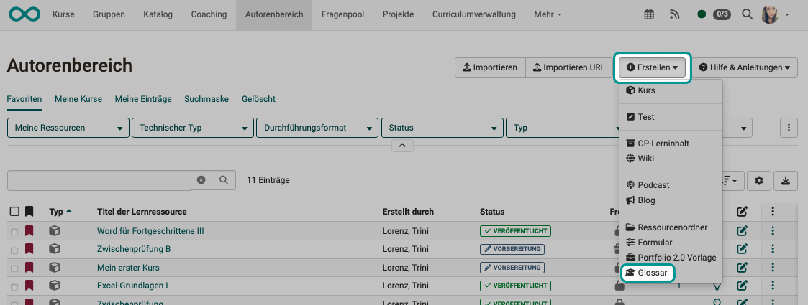
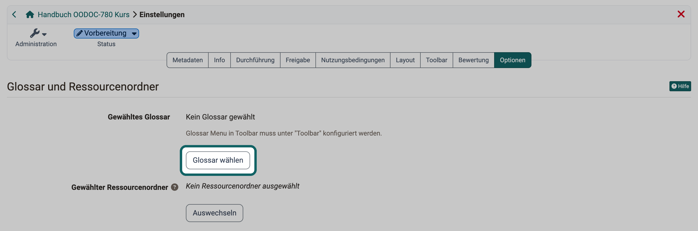
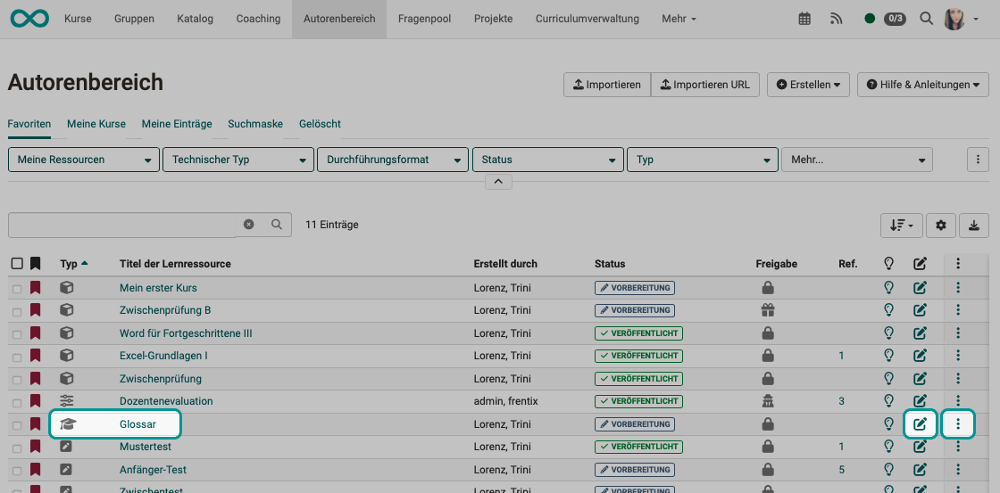
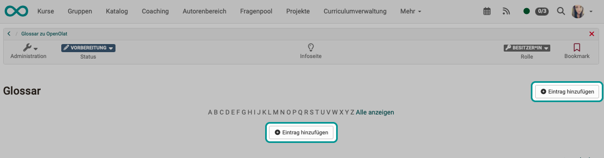
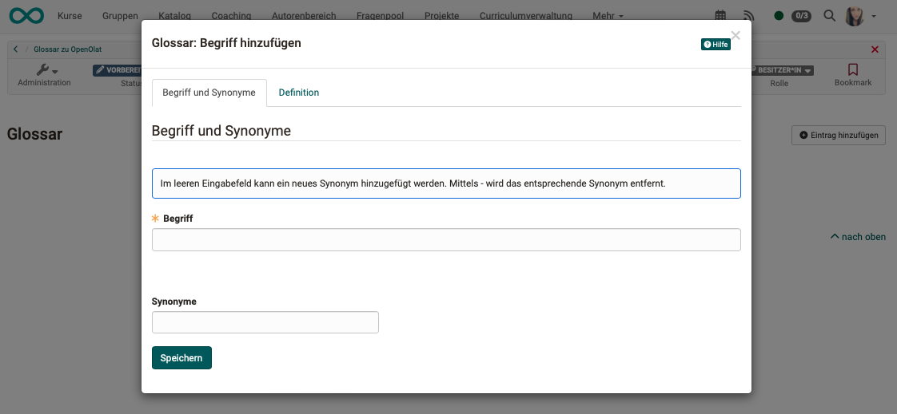
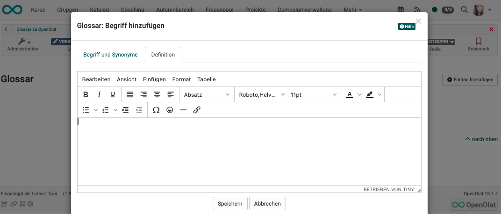
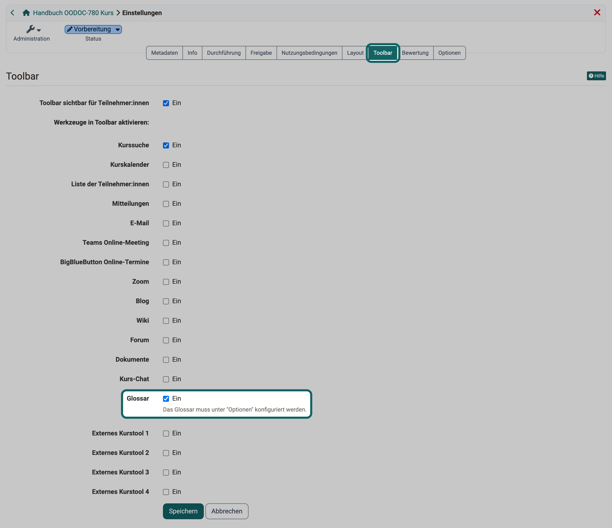

# Glossar erstellen {: #glossary_create}

## Wo wird ein neues Glossar erstellt? {: #where}

Ein Glossar erstellen Sie wie andere Lernressourcen im Autorenbereich: 
`Autorenbereich > Erstellen > Glossar`

{ class="shadow lightbox" title="Seite Autorenbereich" }

Sie können ein Glossar auch direkt im Kurs erstellen, unter `Kurs > Administration > Einstellungen > Tab "Optionen"`. Der Button "Glossar wählen" öffnet ein Fenster, in dem Sie ein vorhandenes Glossar auswählen oder ein neues Glossar erstellen.

{ class="shadow lightbox" title="Tab Optionen in den Kurseinstellungen · 2026.11.09" }

!!! note "Hinweis"

    Im Autorenbereich erstellen Sie beliebig viele Glossare. In einen Kurs binden Sie jeweils ein Glossar ein.

[Zum Seitenanfang ^](#glossary_create)

---

## Glossareinträge erstellen {: #create_entries}

``1.`` Öffnen Sie das Glossar im Autorenbereich: mit einem Klick auf den Titel, auf das Symbol Bearbeiten oder im Drei-Punkte-Menü der Zeile.

{ class="shadow lightbox" title="Liste im Autorenbereich" }

``2.`` Klicken Sie auf einen der beiden Buttons "Eintrag hinzufügen".

{ class="shadow lightbox" title="Seite Glossar" }

``3.`` Tragen Sie den Begriff ein. Sie können Synonyme ergänzen, zum Beispiel zum Begriff "Informationstechnologie" das Synonym "IT".

``4.`` Speichern Sie den Begriff. Danach lässt sich der Tab "Definition" öffnen.

{ class="shadow lightbox" title="Dialog Begriff hinzufügen" }

``5.`` Im Tab "Definition" erfassen Sie die Erklärung des Begriffs. Eingetragene Begriffe können Sie später ändern oder löschen.

{ class="shadow lightbox" title="Dialog Begriff hinzufügen" }

Auch Lernende können ein Glossar inhaltlich befüllen. Wie Sie allen Benutzer:innen das Schreibrecht geben, beschreibt die Seite [Glossar: Administration](Glossary_administration.de.md#tab_write_permissions).

### Schreibrecht nur für ausgewählte Benutzer:innen {: #write_selected_users}

Sollen nur bestimmte Personen das Glossar bearbeiten, zum Beispiel einige Teilnehmende eines Kurses, vergeben Sie das Schreibrecht über die Mitgliederverwaltung des Kurses. Erstellen Sie dort eine Gruppe und fügen Sie die Personen als Teilnehmer:innen der Gruppe hinzu. Setzen Sie anschliessend im Bereich "Rechte" der Mitgliederverwaltung bei den Teilnehmer:innen der Gruppe den Haken für das Recht "Glossar-Werkzeug". Danach fügen die Personen der Gruppe Glossareinträge hinzu und ändern sie. Was das Recht freigibt, beschreibt der Abschnitt [Glossar-Werkzeug](Members_management.de.md#right_glossary_tool).

!!! info "Wichtig"

    Die Besitzer:innen eines Kurses sind nicht automatisch auch Besitzer:innen der Lernressource "Glossar". Im Kurs bearbeiten sie das eingebundene Glossar trotzdem: Sie öffnen es über das Werkzeug "Glossar" in der Toolbar des Kurses und erstellen, ändern und löschen dort Einträge.

    Öffnen Sie das Glossar dagegen als Lernressource, zum Beispiel im Autorenbereich, bearbeiten nur die Besitzer:innen der Lernressource "Glossar" die Einträge. Sollen weitere Kursbesitzer:innen auch dort arbeiten, tragen Sie sie als Besitzer:innen der Lernressource "Glossar" ein.

[Zum Seitenanfang ^](#glossary_create)

---

## Glossar gestalten {: #design}

Die Definitionen bearbeiten Sie in einem einfachen Editor. Neben Text bietet er zum Beispiel

* Schriftartwahl
* Einrückungen
* Tabellen
* Links
* u.a.

Ob das Glossar die Begriffe über ein alphabetisches Register nach Anfangsbuchstaben gliedert, legen Sie in den Einstellungen des Glossars fest, siehe [Glossar: Administration](Glossary_administration.de.md#tab_register).

[Zum Seitenanfang ^](#glossary_create)

---

## Glossar einbinden {: #integrate}

Ein Glossar binden Sie meist in einen Kurs ein. Teilnehmende sehen die Begriffe dann im Kurs erklärt. Sie können ein Glossar auch eigenständig verwenden und zum Beispiel als eigenes Angebot im Katalog anbieten.

Systemadministrator:innen müssen die Glossarfunktion nicht eigens einschalten.

``1.`` Wählen Sie das Glossar mit dem Button "Glossar wählen" aus, unter `Kurs > Administration > Einstellungen > Tab "Optionen"`.

{ class="shadow lightbox" title="Tab Optionen in den Kurseinstellungen · 2026.11.09" }

``2.`` Damit Teilnehmende das Glossar in der Toolbar des Kurses sehen, schalten Sie es dort als Werkzeug ein: Checkbox "Glossar" unter `Kurs > Administration > Einstellungen > Tab "Toolbar"`.

{ class="shadow lightbox" title="Tab Toolbar in den Kurseinstellungen · 2026.11.09" }

!!! note "Hinweis"

    In einen Kurs binden Sie jeweils ein Glossar ein. Im Autorenbereich können mehrere Glossare bestehen, so dass verschiedene Kurse unterschiedliche Glossare verwenden.

Möchten Sie ein anderes Glossar in Ihren Kurs einbinden, wählen Sie es unter `Kurs > Administration > Einstellungen > Tab "Optionen"` mit "Glossar wählen" aus. Verwenden Sie kein Glossar mehr, entfernen Sie es dort mit "Auswahl löschen".

---

## Weiterführende Informationen {: #further_information}

**Auf dieser Seite erwähnt** 
[Glossar: Administration >](Glossary_administration.de.md) 
[Mitgliederverwaltung >](Members_management.de.md)

**Weiterführend** 
[Glossar verwenden >](../learningresources/Glossary_usage.de.md)

[Zum Seitenanfang ^](#glossary_create)
