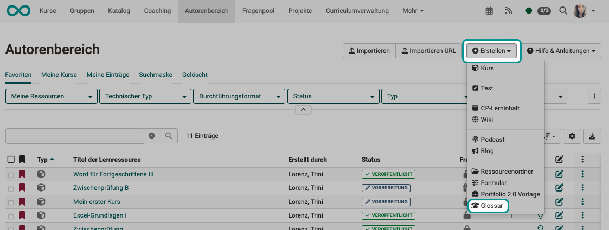
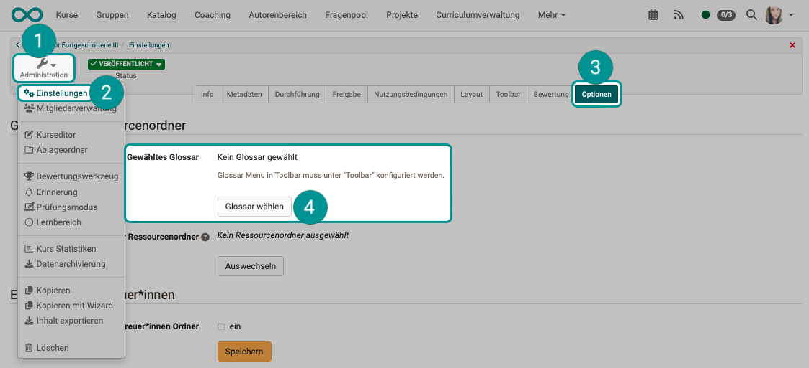
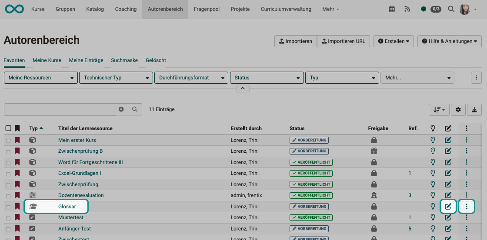
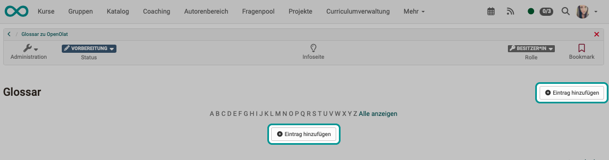
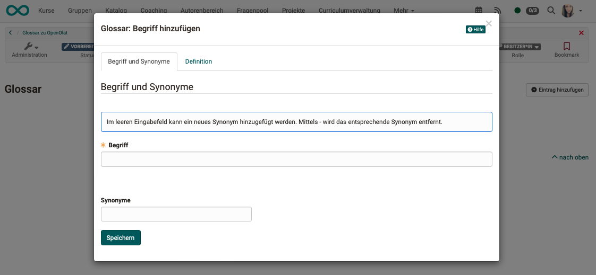
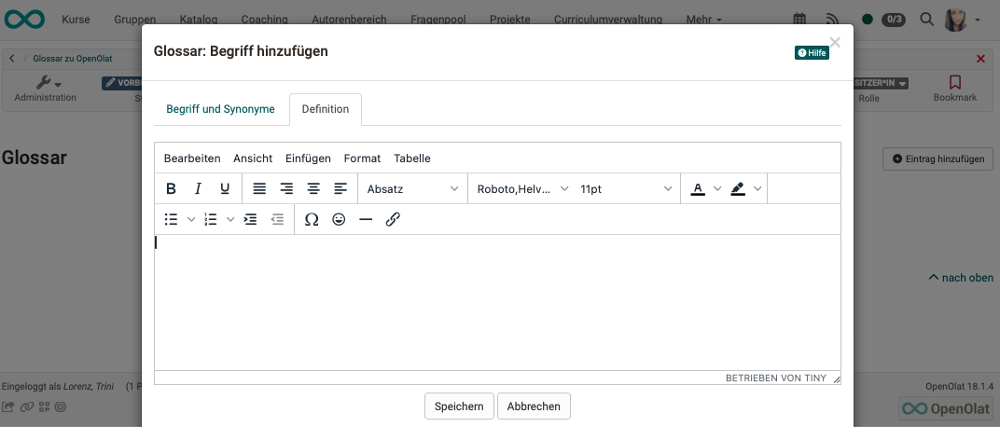
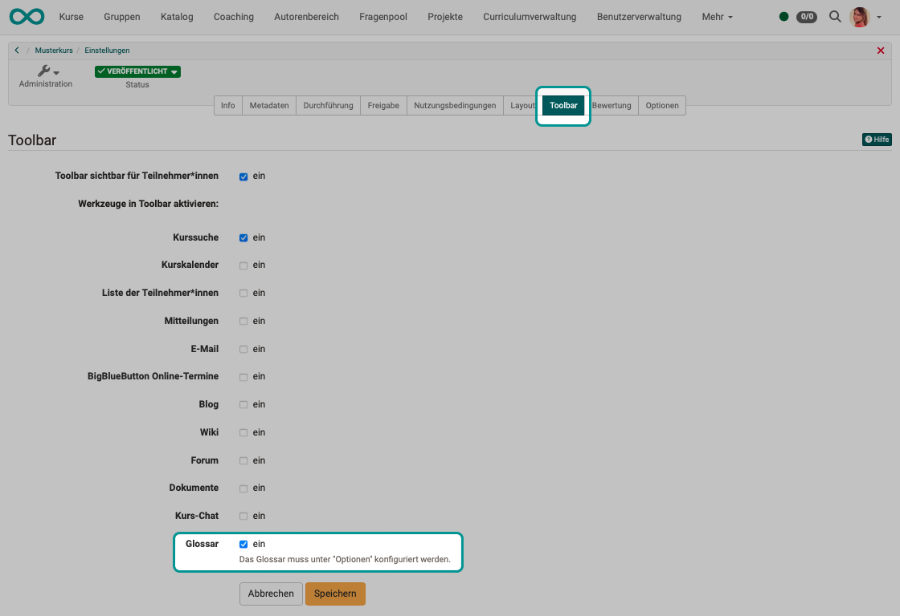

# Glossary - create {: #glossary_create}

## Where is a new glossary created? {: #where}

Glossaries can be created like other learning resources in the **Author area**.

{ class="shadow lightbox" title="Authoring area page" }

Alternatively, the creation can also be called up directly in the course under `Course > Administration > Settings > Tab "Options"`.
You will find the button (4) there, which opens a pop-up window in which an existing glossary can be selected or a new glossary learning resource can be created.

{ class="shadow lightbox" title="Course settings" }

!!! note "Note"

    Several glossaries can be created in the author area. However, only on glossary can be included per course.

[To the top of the page ^](#glossary_create)

---

## Create glossary entries {: #create_entries}

``1.`` Go to the **Authoring area** and open the glossary.  
(Click on the name or click on the edit button or "edit" under the icon with the three points.)

{ class="shadow lightbox" title="List in the authoring area" }

``2.`` Click on one of the buttons **"Add entry"**.

{ class="shadow lightbox" title="Glossary page" }

``3.`` Enter the desired technical term. You can also add synonyms. For example, the term "information technology" can be supplemented with the synonym "IT".

``4.`` Save the term. This enables the tab for entering the definition.

{ class="shadow lightbox" title="Add term dialog" }

``5.`` You can then add the specific definition of the term in the "Definition" tab. Terms entered can also be changed or deleted at a later date.

{ class="shadow lightbox" title="Add term dialog" }

Learners can also fill in the content of a glossary. How to give all users write permission is described on the page [Glossary: Administration](Glossary_administration.md#tab_write_permissions).

### Writing permission for selected users {: #write_selected_users}

If you only want to grant writing permission for a glossary to certain people (e.g. participants in a course), there is another way. The members management of a course is used for this. Create a new group there and add the desired persons as participants in this group. Then go to the "Rights" area in the course's members management and check the "Glossary tool" right for the course participants in the group. The people in the group can now add and change glossary entries. What the right enables is described in the section [Glossary tool](Members_management.md#right_glossary_tool).

!!! info "Important"

    The owners of a course are not automatically the owners of the "Glossary" learning resource. In the course, they edit the integrated glossary nevertheless: they open it via the "Glossary" tool in the course toolbar and create, change and delete entries there.

    If you open the glossary as a learning resource instead, for example in the authoring area, only the owners of the "Glossary" learning resource edit the entries. If further course owners are to work there as well, enter them as owners of the "Glossary" learning resource.

[To the top of the page ^](#glossary_create)

---

## Design glossary {: #design}

The explanations (definitions) can be edited with a simple editor that allows additions to be made alongside text, such as

* Font selection
* Indentation
* Tables
* links
* etc.

Whether the glossary groups the terms by initial letter with an alphabetical index is set in the settings of the glossary, see [Glossary: Administration](Glossary_administration.md#tab_register).

[To the top of the page ^](#glossary_create)

---

## Integrate glossary {: #integrate}

Glossaries are OpenOlat learning resources that are usually integrated into a course. They can also be used as stand-alone learning resources. In this case, the glossary can also be displayed as a stand-alone resource in the catalog, for example.

System administrators do not need to switch on the glossary function separately.

``1.`` To include a glossary in a course, first select the learning resource under `Course > Administration > Settings > Tab "Options"`.

{ class="shadow lightbox" title="Course settings" }

``2.`` In order for the integrated glossary to be visible in the course toolbar, the display as a tool must be selected. Select the corresponding checkbox under `Course > Administration > Settings > Tab "Toolbar"`.

{ class="shadow lightbox" title="Course settings" }

!!! note "Note"

    Only one glossary can be integrated per course. However, several glossary learning resources can be available in the authoring area so that different glossaries can be used in different courses.

If you no longer use the glossary or would like to include a different glossary in your course, you can select a different glossary learning resource under `Course > Administration > Settings > Tab "Options"`.

---

## Further information {: #further_information}

**Mentioned on this page** 
[Glossary: Administration >](Glossary_administration.md) 
[Members management >](Members_management.md)

**Further reading** 
[Usage of a glossary >](../learningresources/Glossary_usage.md)

[To the top of the page ^](#glossary_create)

