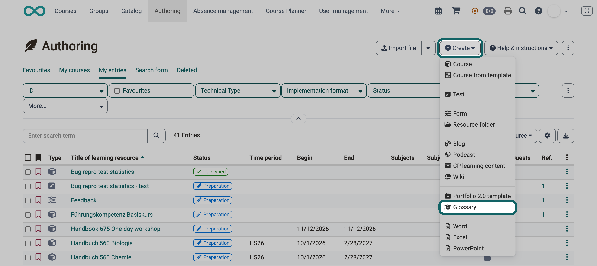
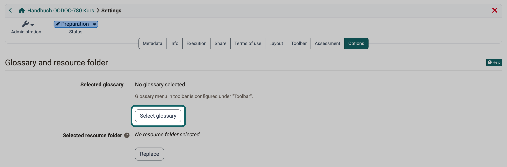
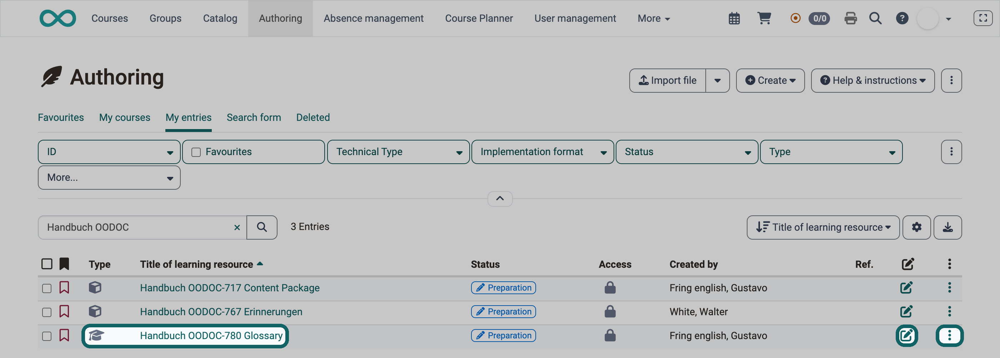
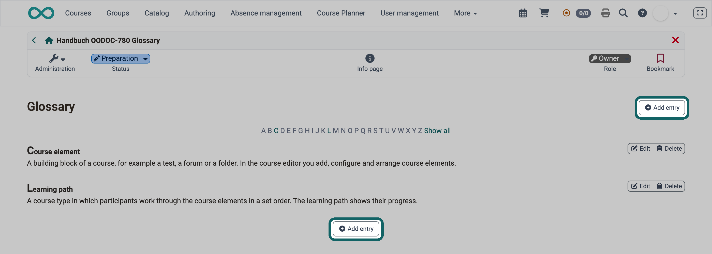
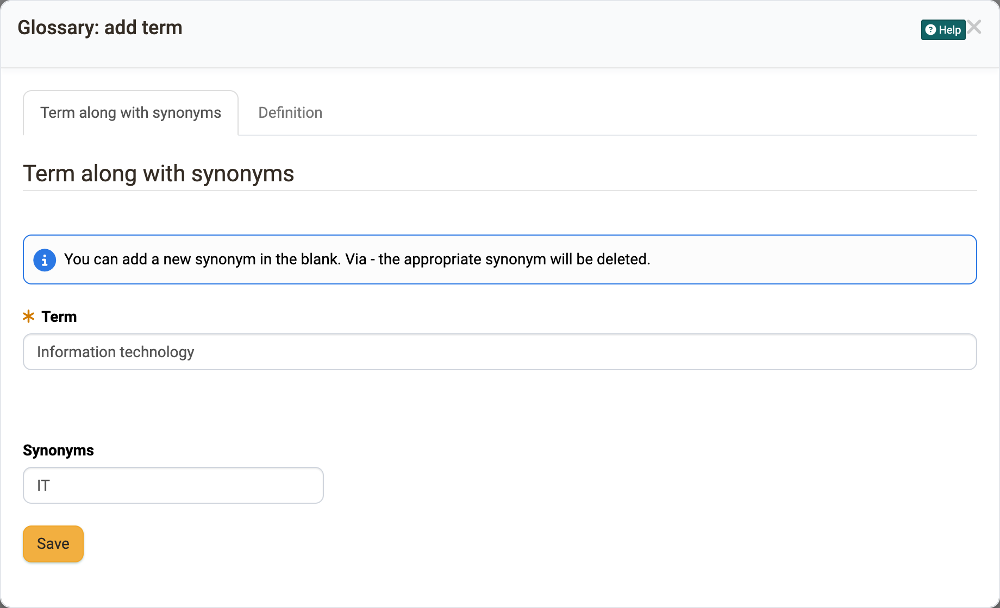
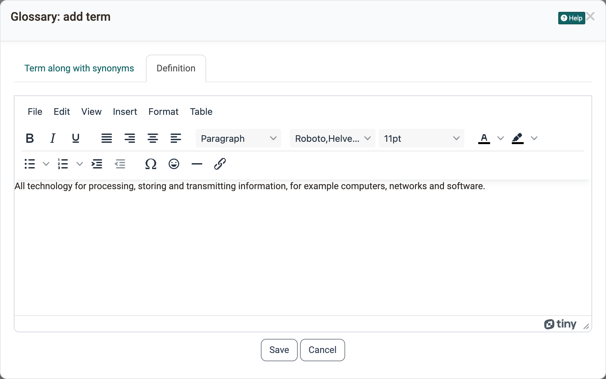
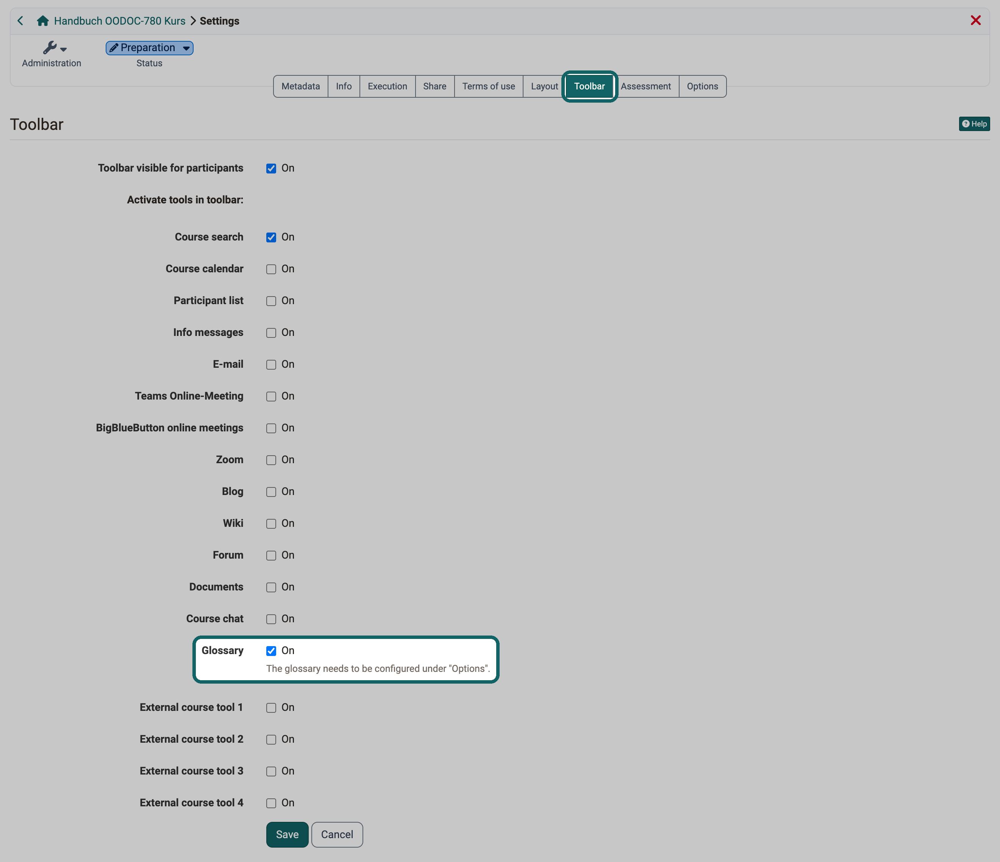

# Glossary - create {: #glossary_create}

## Where is a new glossary created? {: #where}

You create a glossary like other learning resources in the authoring area: 
`Authoring > Create > Glossary`

{ class="shadow lightbox" title="Authoring area page · 2026.11.09" }

You can also create a glossary directly in the course, under `Course > Administration > Settings > Tab "Options"`. The button "Select glossary" opens a window in which you select an existing glossary or create a new glossary.

{ class="shadow lightbox" title="Options tab in the course settings · 2026.11.09" }

!!! note "Note"

    In the authoring area you create as many glossaries as you like. You embed one glossary per course.

[To the top of the page ^](#glossary_create)

---

## Create glossary entries {: #create_entries}

``1.`` Open the glossary in the authoring area: with a click on the title, on the edit icon or in the three-dot menu of the row.

{ class="shadow lightbox" title="List in the authoring area · 2026.11.09" }

``2.`` Click on one of the two buttons "Add entry".

{ class="shadow lightbox" title="Glossary page · 2026.11.09" }

``3.`` Enter the term. You can add synonyms, for example the synonym "IT" for the term "information technology".

``4.`` Save the term. After that, the "Definition" tab can be opened.

{ class="shadow lightbox" title="Add term dialog · 2026.11.09" }

``5.`` In the "Definition" tab you enter the explanation of the term. You can change or delete entered terms later.

{ class="shadow lightbox" title="Add term dialog · 2026.11.09" }

Learners can also fill in the content of a glossary. How to give all users write permission is described on the page [Glossary: Administration](Glossary_administration.md#tab_write_permissions).

### Writing permission for selected users {: #write_selected_users}

If only certain persons are to edit the glossary, for example some participants of a course, you grant the write permission via the members management of the course. Create a group there and add the persons as participants of the group. Then, in the "Rights" area of the members management, tick the right "Glossary tool" for the participants of the group. After that, the persons of the group add and change glossary entries. What the right enables is described in the section [Glossary tool](Members_management.md#right_glossary_tool).

!!! info "Important"

    The owners of a course are not automatically the owners of the "Glossary" learning resource. In the course, they edit the integrated glossary nevertheless: they open it via the "Glossary" tool in the course toolbar and create, change and delete entries there.

    If you open the glossary as a learning resource instead, for example in the authoring area, only the owners of the "Glossary" learning resource edit the entries. If further course owners are to work there as well, enter them as owners of the "Glossary" learning resource.

[To the top of the page ^](#glossary_create)

---

## Design glossary {: #design}

You edit the definitions in a simple editor. Besides text, it offers for example

* Font selection
* Indentation
* Tables
* links
* etc.

Whether the glossary groups the terms by initial letter with an alphabetical index is set in the settings of the glossary, see [Glossary: Administration](Glossary_administration.md#tab_register).

[To the top of the page ^](#glossary_create)

---

## Integrate glossary {: #integrate}

You usually embed a glossary in a course. Participants then see the terms explained in the course. You can also use a glossary standalone and offer it, for example, as an offer of its own in the catalog.

System administrators do not need to switch on the glossary function separately.

``1.`` Select the glossary with the button "Select glossary", under `Course > Administration > Settings > Tab "Options"`.

{ class="shadow lightbox" title="Options tab in the course settings · 2026.11.09" }

``2.`` So that participants see the glossary in the course toolbar, switch it on there as a tool: checkbox "Glossary" under `Course > Administration > Settings > Tab "Toolbar"`.

{ class="shadow lightbox" title="Toolbar tab in the course settings · 2026.11.09" }

!!! note "Note"

    You embed one glossary per course. Several glossaries can exist in the authoring area, so that different courses use different glossaries.

If you want to embed a different glossary in your course, select it under `Course > Administration > Settings > Tab "Options"` with "Select glossary". If you no longer use a glossary, remove it there with "Delete selection".

---

## Further information {: #further_information}

**Mentioned on this page** 
[Glossary: Administration >](Glossary_administration.md) 
[Members management >](Members_management.md)

**Further reading** 
[Usage of a glossary >](../learningresources/Glossary_usage.md)

[To the top of the page ^](#glossary_create)

