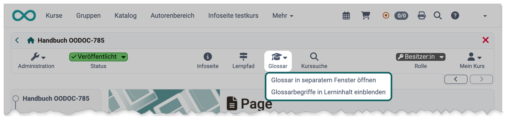
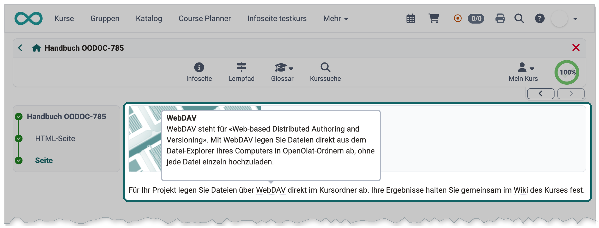
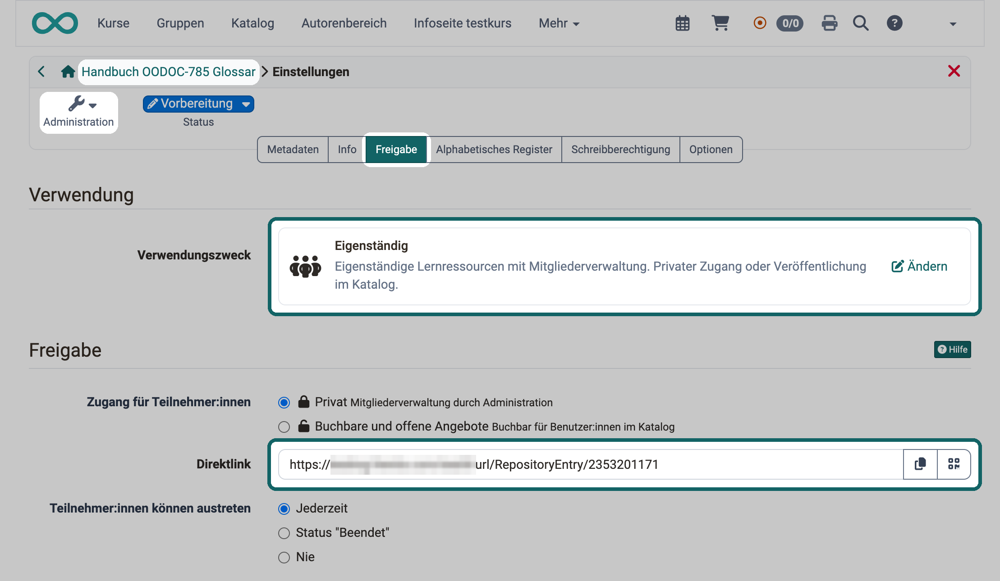
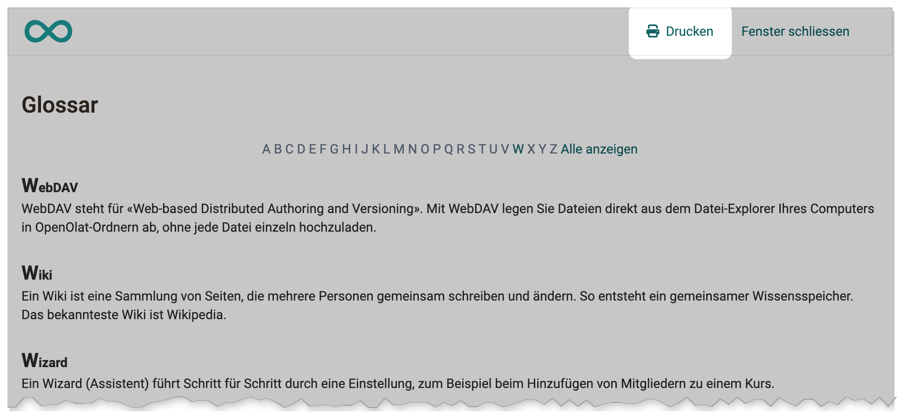

# Glossar - Verwendung {: #glossary_usage}

Ein Glossar erklärt die Fachbegriffe eines Kurses. Teilnehmende schlagen einen Begriff im Glossar nach oder lesen seine Erklärung direkt im Lerninhalt, ohne den Kurs zu verlassen.

## Wo kann ein Glossar aufgerufen werden? {: #glossary_call}

### Aufruf in der Toolbar {: #glossary_call_in_toolbar}

Ist ein Glossar in den Kurs eingebunden und als Werkzeug eingeschaltet, erscheint in der Kurstoolbar das Menü "Glossar". Einbinden und einschalten können es alle, welche die Kurseinstellungen öffnen, siehe [Glossar einbinden](Glossary_create.de.md#integrate). Als Teilnehmer:in nutzen Sie das Menü ohne eigene Einstellung.

Mit "Glossar in separatem Fenster öffnen" lesen Sie alle Begriffe in einem eigenen Fenster. Mit "Glossarbegriffe in Lerninhalt einblenden" zeigt OpenOlat die Erklärung eines Begriffs im Lerninhalt, sobald Sie mit der Maus auf den Begriff zeigen. Die Wahl gilt nur für Sie und bleibt in diesem Kurs gespeichert, auch über das Abmelden hinaus. Danach heisst derselbe Eintrag "Glossarbegriffe von Lerninhalt ausblenden", damit schalten Sie die Erklärungen wieder aus.

{ class="shadow lightbox" title="Kurstoolbar mit geöffnetem Menü Glossar · 2026.11.18" }

[Zum Seitenanfang ^](#glossary_usage)

---

### Nutzung im Lerninhalt {: #glossary_call_in_HTML}

Stossen Sie im Lerninhalt des Kurses auf einen Fachbegriff, erklärt ihn das Glossar direkt an dieser Stelle. Wählen Sie dafür in der Kurstoolbar im Menü "Glossar" den Eintrag "Glossarbegriffe in Lerninhalt einblenden". Danach unterstreicht OpenOlat jeden Begriff aus dem Glossar mit einer feinen Punktlinie, etwa auf einer HTML-Seite, im Kursbaustein "Seite" oder im Wiki. Zeigen Sie mit der Maus auf den Begriff, erscheint seine Erklärung aus dem Glossar. Das gilt auch für die Beschreibung und die Beiträge im Kursbaustein "Forum" und für die Beschreibung auf der Startseite des Kursbausteins "Test". In den Fragen eines gestarteten Tests unterstreicht OpenOlat keine Begriffe, solange im Kursbaustein "Test" im Tab "Optionen" die Einstellung "Nur Modul anzeigen, LMS ausblenden" gesetzt ist. So ist der Kursbaustein voreingestellt.

{ class="shadow lightbox" title="Kursbaustein Seite in einem Kurs · 2026.11.18" }

[Zum Seitenanfang ^](#glossary_usage)

---

### Separates Glossar (Lernressource "Eigenständig") [:octicons-tag-16:{ title="ab Release 18.2 (OO-7277)" }](https://track.frentix.com/issue/OO-7277) {: #glossary_call_as_stand_alone}

Ein Glossar nutzen Sie auch ohne Kurs, wenn Sie im Tab "Freigabe" den Verwendungszweck "Eigenständig" wählen. Das Glossar erscheint dann zum Beispiel im Katalog als eigenes Angebot.

Den Link auf das Glossar finden Sie im Feld "Direktlink" unter: 
`Glossar > Administration > Einstellungen > Tab "Freigabe"` 
Mit "In Zwischenablage kopieren" übernehmen Sie den Link in eine E-Mail oder auf eine Webseite. Mit "QR-Code anzeigen" geben Sie ihn als QR-Code weiter, siehe [Links kopieren und als QR-Code weitergeben](../basic_concepts/Navigation.de.md#url_field).

{ class="shadow lightbox" title="Tab Freigabe in den Einstellungen eines Glossars · 2026.11.27" }

[Zum Seitenanfang ^](#glossary_usage)

---

### Aufruf durch Gäste {: #glossary_call_by_guests}

Ein Glossar steht auch Personen ohne OpenOlat-Konto offen, wenn Sie es für Gäste freigeben. Gäste sind anonyme Benutzer:innen, die in der [Benutzerverwaltung](../../manual_admin/usermanagement/index.de.md) nicht erscheinen.

Die Systemadministrator:innen schalten den Gastlogin für die OpenOlat-Instanz ein und legen fest, welche OpenOlat-Bereiche Gäste sehen. Als Besitzer:in des Glossars geben Sie es danach für Gäste frei, unter: 
`Glossar > Administration > Einstellungen > Tab "Freigabe"` 
Wählen Sie dort den Verwendungszweck "Eigenständig" wie beim [separaten Glossar](#glossary_call_as_stand_alone), setzen Sie den "Zugang für Teilnehmer:innen" auf "Buchbare und offene Angebote" und fügen Sie im Abschnitt "Angebot" ein Angebot der Art "Gastzugang" hinzu. Den Link für Gäste zeigt das Angebot danach im Feld "Externer Link - Gast". Schicken Sie ihn den Gästen, oder sie finden das Glossar im Katalog, sofern die Systemadministrator:innen ihnen den Katalog zeigen. Mehr dazu unter [Rollen und Rechte: Gastzugang](../basic_concepts/guest_access.de.md).

[Zum Seitenanfang ^](#glossary_usage)

---

### Ausdruck des Glossars {: #print}

Für eine Fassung auf Papier drucken Sie das Glossar aus. Öffnen Sie es dazu in der Kurstoolbar im Menü "Glossar" mit "Glossar in separatem Fenster öffnen". Im neuen Fenster klicken Sie oben rechts auf "Drucken".

{ class="shadow lightbox" title="Glossar in separatem Fenster · 2026.11.18" }

[Zum Seitenanfang ^](#glossary_usage)

---

## Weiterführende Informationen {: #further_information}

**Auf dieser Seite erwähnt** 
[Glossar erstellen >](Glossary_create.de.md) 
[Navigation >](../basic_concepts/Navigation.de.md) 
[Benutzerverwaltung >](../../manual_admin/usermanagement/index.de.md) 
[Rollen und Rechte: Gastzugang >](../basic_concepts/guest_access.de.md)

**Weiterführend** 
[Glossar: Administration >](Glossary_administration.de.md) 
[Zugangskonfiguration / Freigabe >](Access_configuration.de.md)

[Zum Seitenanfang ^](#glossary_usage)

