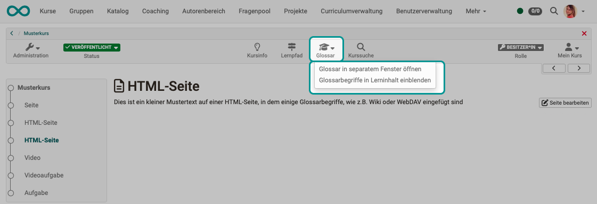
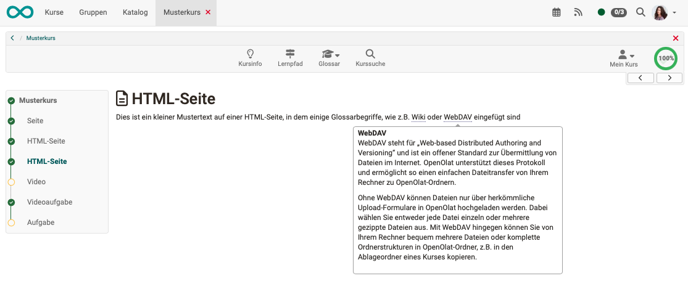
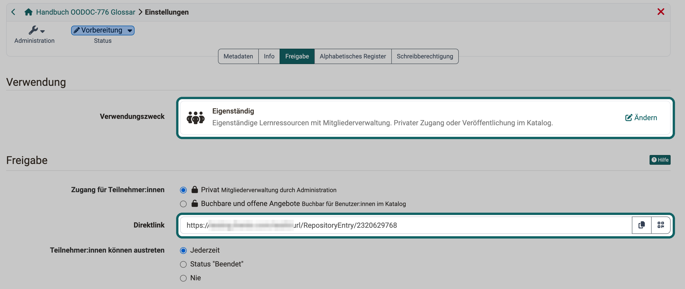
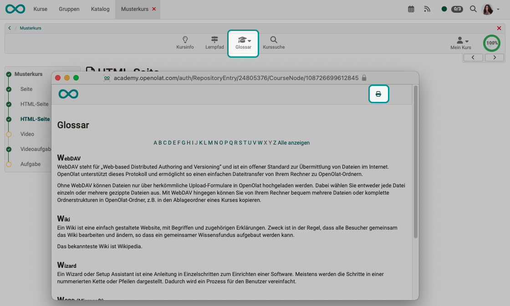

# Glossar - Verwendung {: #glossary_usage}

Ein Glossar erklärt die Fachbegriffe eines Kurses. Teilnehmende schlagen einen Begriff im Glossar nach oder lesen seine Erklärung direkt im Lerninhalt, ohne den Kurs zu verlassen.

## Wo kann ein Glossar aufgerufen werden? {: #glossary_call}

### Aufruf in der Toolbar {: #glossary_call_in_toolbar}

Haben die Kursbesitzer:innen ein Glossar in den Kurs eingebunden und als Werkzeug eingeschaltet, erscheint in der Kurstoolbar das Menü "Glossar", siehe [Glossar einbinden](Glossary_create.de.md#integrate).

Mit "Glossar in separatem Fenster öffnen" lesen Sie alle Begriffe in einem eigenen Fenster. Mit "Glossarbegriffe in Lerninhalt einblenden" zeigt OpenOlat die Erklärung eines Begriffs im Lerninhalt, sobald Sie mit der Maus auf den Begriff zeigen.

{ class="shadow lightbox" title="Kurstoolbar mit geöffnetem Menü Glossar" }

[Zum Seitenanfang ^](#glossary_usage)

---

### Nutzung in HTML-Seiten {: #glossary_call_in_HTML}

Steht ein Begriff aus dem Glossar im Lerninhalt des Kurses, etwa auf einer HTML-Seite oder im Wiki, unterstreicht OpenOlat ihn mit einer feinen Punktlinie. Zeigen Sie mit der Maus auf den Begriff, erscheint seine Erklärung aus dem Glossar.

{ class="shadow lightbox" title="HTML-Seite in einem Kurs" }

[Zum Seitenanfang ^](#glossary_usage)

---

### Separates Glossar (Lernressource "Eigenständig") [:octicons-tag-16:{ title="ab Release 18.2 (OO-7277)" }](https://track.frentix.com/issue/OO-7277) {: #glossary_call_as_stand_alone}

Ein Glossar nutzen Sie auch ohne Kurs, wenn Sie im Tab "Freigabe" den Verwendungszweck "Eigenständig" wählen. Das Glossar erscheint dann zum Beispiel im Katalog als eigenes Angebot.

Den Link auf das Glossar finden Sie im Feld "Direktlink" unter: 
`Glossar > Administration > Einstellungen > Tab "Freigabe"` 
Mit "In Zwischenablage kopieren" übernehmen Sie den Link in eine E-Mail oder auf eine Webseite. Mit "QR-Code anzeigen" geben Sie ihn als QR-Code weiter, siehe [Links kopieren und als QR-Code weitergeben](../basic_concepts/Navigation.de.md#url_field).

{ class="shadow lightbox" title="Tab Freigabe in den Einstellungen eines Glossars · 2026.11.09" }

[Zum Seitenanfang ^](#glossary_usage)

---

### Aufruf durch Gäste {: #glossary_call_by_guests}

Ein Glossar steht auch Personen ohne OpenOlat-Konto offen, wenn Sie es für Gäste freigeben. Gäste sind anonyme Benutzer:innen, die in der [Benutzerverwaltung](../../manual_admin/usermanagement/index.de.md) nicht erscheinen.

Die Systemadministrator:innen schalten den Gastlogin für die OpenOlat-Instanz ein und legen fest, welche OpenOlat-Bereiche Gäste sehen. Im Glossar setzen Sie im Tab "Freigabe" den "Zugang für Teilnehmer:innen" auf "Buchbare und offene Angebote" und fügen ein Angebot der Art "Gastzugang" hinzu. Mehr dazu unter [Rollen und Rechte: Gastzugang](../basic_concepts/guest_access.de.md).

[Zum Seitenanfang ^](#glossary_usage)

---

### Ausdruck des Glossars {: #print}

Für eine Fassung auf Papier drucken Sie das Glossar aus. Öffnen Sie es dazu in der Kurstoolbar im Menü "Glossar" mit "Glossar in separatem Fenster öffnen". Im neuen Fenster klicken Sie oben rechts auf die Schaltfläche zum Drucken.

{ class="shadow lightbox" title="Glossar in separatem Fenster" }

[Zum Seitenanfang ^](#glossary_usage)

---

## Weiterführende Informationen {: #further_information}

**Auf dieser Seite erwähnt** 
[Glossar erstellen >](Glossary_create.de.md) 
[Navigation >](../basic_concepts/Navigation.de.md) 
[Benutzerverwaltung >](../../manual_admin/usermanagement/index.de.md) 
[Rollen und Rechte: Gastzugang >](../basic_concepts/guest_access.de.md)

**Weiterführend** 
[Glossar: Administration >](Glossary_administration.de.md) 
[Zugangskonfiguration / Freigabe >](Access_configuration.de.md)

[Zum Seitenanfang ^](#glossary_usage)

