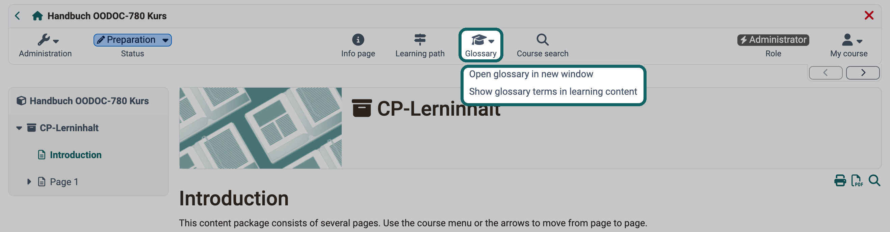
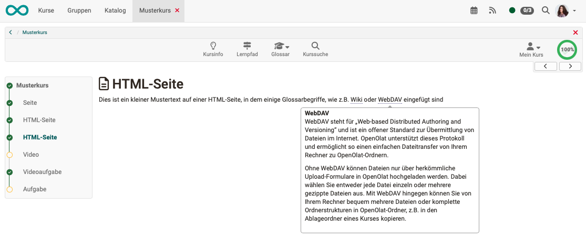
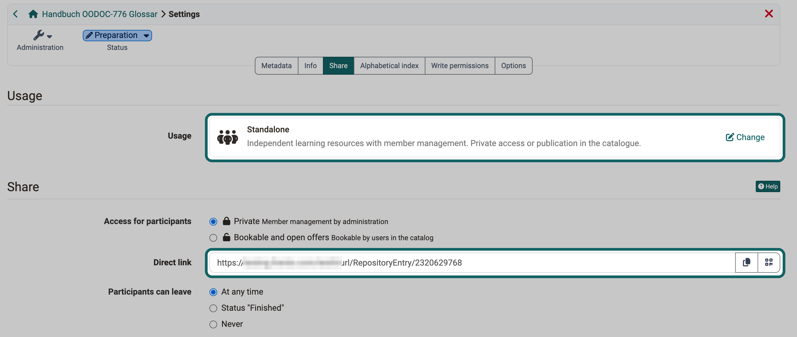
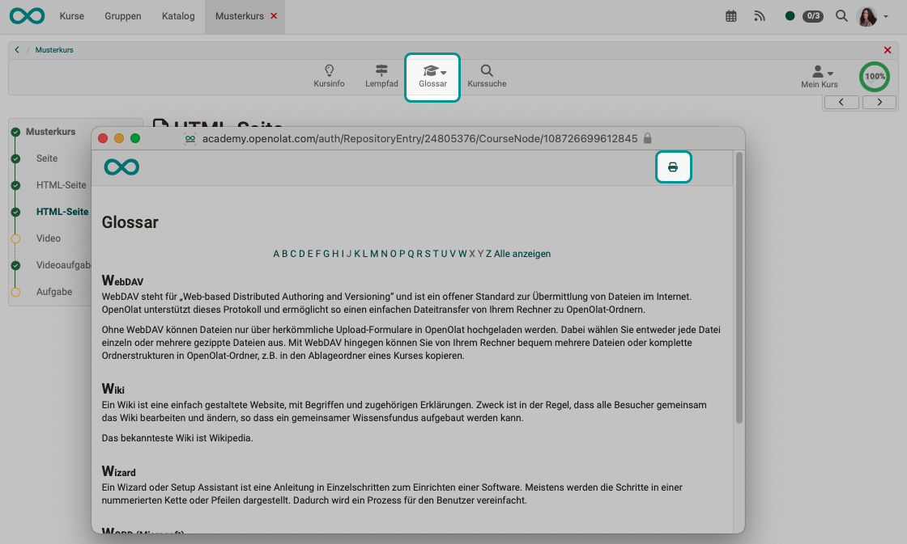

# Glossary - Usage {: #glossary_usage}

A glossary explains the technical terms of a course. Participants look up a term in the glossary or read its explanation directly in the learning content, without leaving the course.

## Where can a glossary be called up? {: #glossary_call}

### Course tool {: #glossary_call_in_toolbar}

If the course owners have integrated a glossary into the course and switched it on as a tool, the menu "Glossary" appears in the course toolbar, see [Integrate glossary](Glossary_create.md#integrate).

With "Open glossary in new window" you read all terms in a separate window. With "Show glossary terms in learning content" OpenOlat shows the explanation of a term in the learning content as soon as you point at the term with the mouse.

{ class="shadow lightbox" title="Course toolbar with the Glossary menu opened · 2026.11.09" }

[To the top of the page ^](#glossary_usage)

---

### Use in HTML pages {: #glossary_call_in_HTML}

If a term from the glossary appears in the learning content of the course, for example on an HTML page or in the wiki, OpenOlat underlines it with a fine dotted line. If you point at the term with the mouse, its explanation from the glossary appears.

{ class="shadow lightbox" title="HTML page in a course" }

[To the top of the page ^](#glossary_usage)

---

### Separate glossary (learning resource "Standalone") [:octicons-tag-16:{ title="from Release 18.2 (OO-7277)" }](https://track.frentix.com/issue/OO-7277) {: #glossary_call_as_stand_alone}

You also use a glossary without a course if you select the usage "Standalone" in the tab "Share". The glossary then appears, for example, in the catalog as an offer of its own.

You find the link to the glossary in the field "Direct link" under: 
`Glossary > Administration > Settings > Tab "Share"` 
With "Copy to clipboard" you take the link into an e-mail or onto a web page. With "Show QR code" you pass it on as a QR code, see [Copy links and pass them on as a QR code](../basic_concepts/Navigation.md#url_field).

{ class="shadow lightbox" title="Tab Share in the settings of a glossary · 2026.11.09" }

[To the top of the page ^](#glossary_usage)

---

### Call by guests {: #glossary_call_by_guests}

A glossary is also open to persons without an OpenOlat account if you share it for guests. Guests are anonymous users who do not appear in the [user management](../../manual_admin/usermanagement/index.md).

The system administrators switch on the guest login for the OpenOlat instance and determine which OpenOlat areas guests see. In the glossary, set "Access for participants" in the tab "Share" to "Bookable and open offers" and add an offer of the type "Guest". More on this under [Roles and Rights: Guest access](../basic_concepts/guest_access.md).

[To the top of the page ^](#glossary_usage)

---

### Printout of the glossary {: #print}

For a version on paper, you print the glossary. To do so, open it in the course toolbar in the menu "Glossary" with "Open glossary in new window". In the new window, click the print button at the top right.

{ class="shadow lightbox" title="Glossary in a separate window" }

[To the top of the page ^](#glossary_usage)

---

## Further information {: #further_information}

**Mentioned on this page** 
[Glossary - create >](Glossary_create.md) 
[Navigation >](../basic_concepts/Navigation.md) 
[User management >](../../manual_admin/usermanagement/index.md) 
[Roles and Rights: Guest access >](../basic_concepts/guest_access.md)

**Further reading** 
[Glossary: Administration >](Glossary_administration.md) 
[Access configuration >](Access_configuration.md)

[To the top of the page ^](#glossary_usage)

