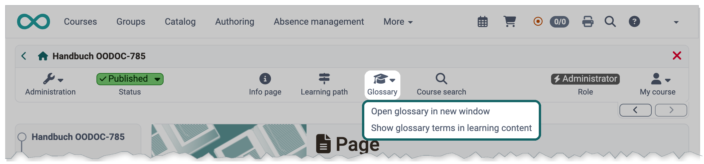
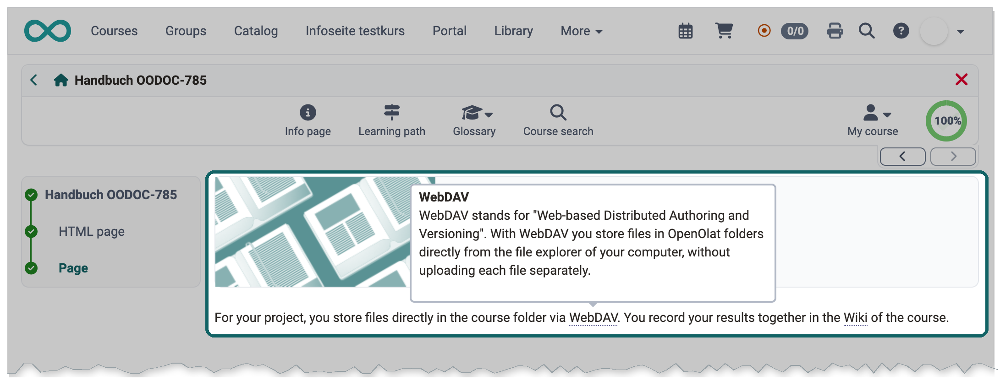
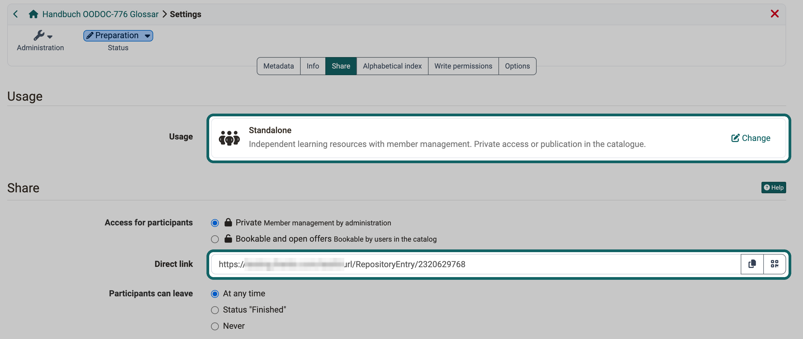
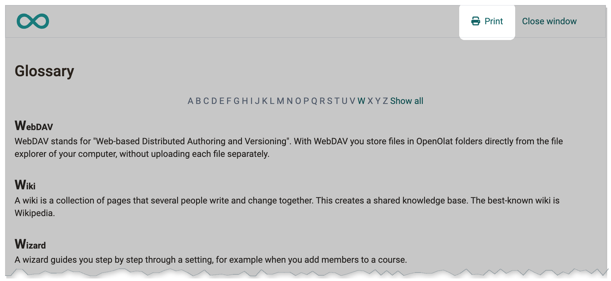

# Glossary - Usage {: #glossary_usage}

A glossary explains the technical terms of a course. Participants look up a term in the glossary or read its explanation directly in the learning content, without leaving the course.

## Where can a glossary be called up? {: #glossary_call}

### Call in the toolbar {: #glossary_call_in_toolbar}

If a glossary is integrated into the course and switched on as a tool, the menu "Glossary" appears in the course toolbar. Everyone who opens the course settings can integrate and switch it on, see [Integrate glossary](Glossary_create.md#integrate). As a participant, you use the menu without any setting of your own.

With "Open glossary in new window" you read all terms in a separate window. With "Show glossary terms in learning content" OpenOlat shows the explanation of a term in the learning content as soon as you point at the term with the mouse. The choice applies only to you and stays saved in this course, also after you log out. The same entry is then called "Hide glossary terms of learning content"; with it you switch the explanations off again.

{ class="shadow lightbox" title="Course toolbar with the Glossary menu opened · 2026.11.18" }

[To the top of the page ^](#glossary_usage)

---

### Use in the learning content {: #glossary_call_in_HTML}

If you come across a technical term in the learning content of the course, the glossary explains it right there. To do so, select the entry "Show glossary terms in learning content" in the menu "Glossary" of the course toolbar. OpenOlat then underlines every term from the glossary with a fine dotted line, for example on an HTML page, in the course element "Page" or in the wiki. If you point at the term with the mouse, its explanation from the glossary appears. This also applies to the description and the posts in the course element "Forum" and to the description on the start page of the course element "Test". In the questions of a started test, OpenOlat underlines no terms as long as the setting "Display only module, hide LMS" is selected in the course element "Test" in the tab "Options". This is the default setting of the course element.

{ class="shadow lightbox" title="Course element Page in a course · 2026.11.18" }

[To the top of the page ^](#glossary_usage)

---

### Separate glossary (learning resource "Standalone") [:octicons-tag-16:{ title="from Release 18.2 (OO-7277)" }](https://track.frentix.com/issue/OO-7277) {: #glossary_call_as_stand_alone}

You also use a glossary without a course if you select the usage "Standalone" in the tab "Share". The glossary then appears, for example, in the catalog as an offer of its own.

You find the link to the glossary in the field "Direct link" under: 
`Glossary > Administration > Settings > Tab "Share"` 
With "Copy to clipboard" you take the link into an e-mail or onto a web page. With "Show QR code" you pass it on as a QR code, see [Copy links and pass them on as a QR code](../basic_concepts/Navigation.md#url_field).

{ class="shadow lightbox" title="Tab Share in the settings of a glossary · 2026.11.09" }

[To the top of the page ^](#glossary_usage)

---

### Call by guests {: #glossary_call_by_guests}

A glossary is also open to persons without an OpenOlat account if you share it for guests. Guests are anonymous users who do not appear in the [user management](../../manual_admin/usermanagement/index.md).

The system administrators switch on the guest login for the OpenOlat instance and determine which OpenOlat areas guests see. As the owner of the glossary, you then share it with guests under: 
`Glossary > Administration > Settings > Tab "Share"` 
Select the usage "Standalone" there as for the [separate glossary](#glossary_call_as_stand_alone), set "Access for participants" to "Bookable and open offers" and add an offer of the type "Guest" in the section "Offer". The offer then shows the link for guests in the field "External link - Guest". Send it to the guests, or they find the glossary in the catalog if the system administrators show them the catalog. More on this under [Roles and Rights: Guest access](../basic_concepts/guest_access.md).

[To the top of the page ^](#glossary_usage)

---

### Printout of the glossary {: #print}

For a version on paper, you print the glossary. To do so, open it in the course toolbar in the menu "Glossary" with "Open glossary in new window". In the new window, click "Print" at the top right.

{ class="shadow lightbox" title="Glossary in a separate window · 2026.11.18" }

[To the top of the page ^](#glossary_usage)

---

## Further information {: #further_information}

**Mentioned on this page** 
[Glossary - create >](Glossary_create.md) 
[Navigation >](../basic_concepts/Navigation.md) 
[User management >](../../manual_admin/usermanagement/index.md) 
[Roles and Rights: Guest access >](../basic_concepts/guest_access.md)

**Further reading** 
[Glossary: Administration >](Glossary_administration.md) 
[Access configuration >](Access_configuration.md)

[To the top of the page ^](#glossary_usage)

