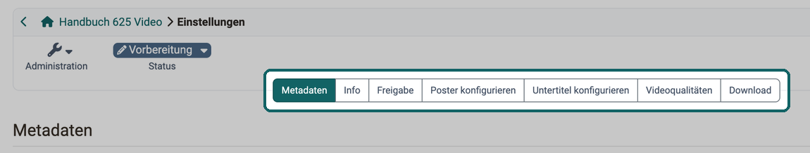
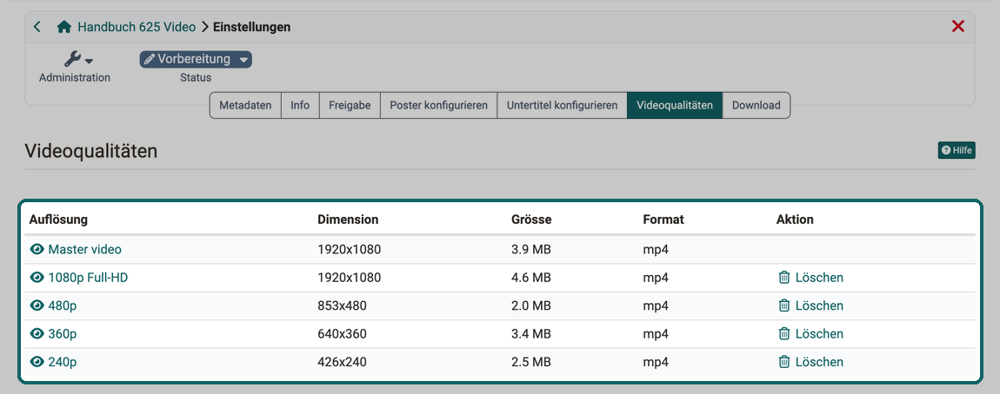
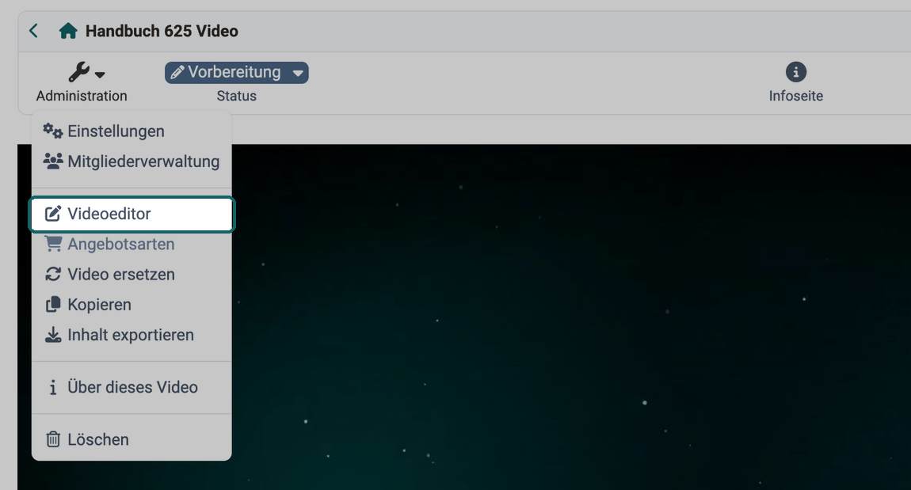
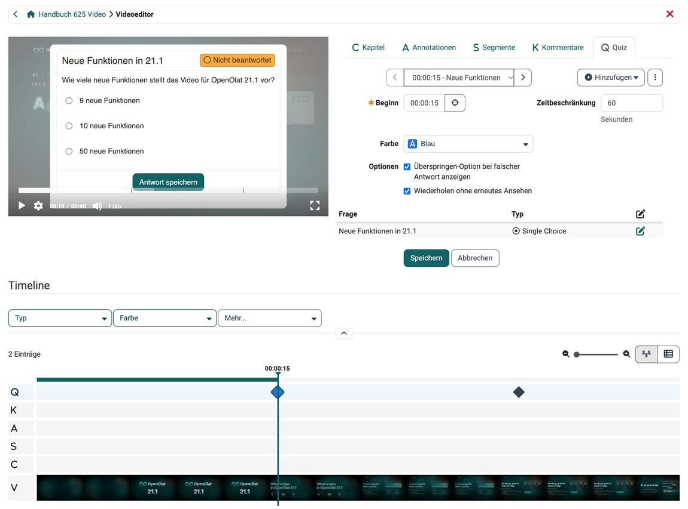
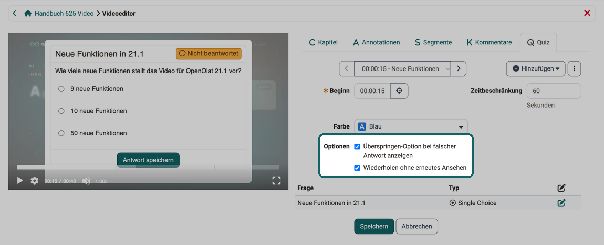
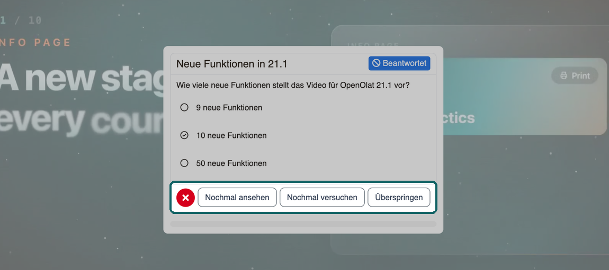

# Lernressource: Video {: #learning_resource_video}

:fontawesome-solid-film:

Mit der Lernressource Video stellen Sie ein Video einmal in OpenOlat bereit und binden es danach in beliebig viele Kurse ein, oder Sie bieten es unabhängig von Kursen an. Die Lernressource besteht nicht nur aus der Videodatei: Sie hat eine eigene Infoseite, ein eigenes Menü "Administration" und eigene Freigabeeinstellungen. Im Videoeditor gestalten Sie das Video zudem interaktiv aus, zum Beispiel mit Annotationen oder Quizfragen.

Sie erstellen die Lernressource im Autorenbereich: Mit "Datei importieren" laden Sie eine MP4-Datei hoch, mit "Per URL einbinden" binden Sie ein externes Video ein, etwa von YouTube oder Vimeo. Die Schritte beschreibt der Abschnitt [Lernressourcen importieren](../area_modules/authoring_new_course.de.md#lernressourcen-importieren). Danach finden Sie das Video im Autorenbereich im Tab "Meine Einträge".

{ class="shadow lightbox" title="Autorenbereich, Tab Meine Einträge" }

Technische Hinweise zum Hochladen und Organisieren von Videos finden Sie auf der Seite [Video hochladen](../basic_concepts/Video_Upload.de.md).

[Zum Seitenanfang ^](#learning_resource_video)

---

## Menü "Administration" der Lernressource Video {: #video_administration}

Im Menü "Administration" verwalten Sie die Lernressource Video: ihre Einstellungen, ihre Mitglieder, die interaktiven Elemente und die Videodatei selbst. Das Menü sehen Besitzer:innen der Lernressource, Lernressourcenverwalter:innen und Administrator:innen. Es enthält diese Einträge:

* **Einstellungen**: siehe [Menü "Einstellungen"](#video_settings).
* [Mitgliederverwaltung](../learningresources/Members_management.de.md): Vor allem wichtig, wenn Sie die Lernressource Video unabhängig von Kursen anbieten. Ist das Video in einen Kurs eingebunden, verwalten Sie hier keine Mitglieder, sondern nur weitere Besitzer:innen der Lernressource.
* **Videoeditor**: siehe [Menü "Videoeditor"](#video_editor).
* [Angebotsarten](../learningresources/Offer_Types.de.md): Führt zu den Buchungsaufträgen.
* **Video ersetzen**: Lädt eine neue Videodatei in die bestehende Lernressource, etwa für eine aktualisierte Fassung. Der Link zur Lernressource und alle Einbindungen bleiben erhalten, angezeigt wird danach das neue Video. Sind für das Video bereits Untertitel vorhanden und ist der frentix Cloud-Transcodingservice aktiv, fragt OpenOlat beim Ersetzen, ob neue Untertitel generiert werden sollen (siehe [Tab "Untertitel konfigurieren"](#video_subtitles)).
* **Kopieren**: Erstellt eine Kopie der Lernressource mit allen Elementen, die Sie im Videoeditor angelegt haben.
* **Inhalt exportieren**: Erstellt eine ZIP-Datei der Lernressource. Sie können die Datei lokal speichern, in eine andere OpenOlat-Instanz importieren oder als Sicherung aufbewahren.
* **Über dieses Video**: Zeigt in einem Dialog technische Angaben zur Lernressource.
* **Löschen**

[Zum Seitenanfang ^](#learning_resource_video)

---

## Menü "Einstellungen" der Lernressource Video {: #video_settings}

In den Einstellungen legen Sie fest, wie das Video beschrieben, freigegeben und angezeigt wird. Sie öffnen die Einstellungen über `Video > Administration > Einstellungen`. Welche Tabs erscheinen, hängt vom Video ab: "Videoqualitäten" fehlt bei Videos, die über "Per URL einbinden" hinzugefügt wurden, "Download" erscheint nur bei Videos im Format MP4 und "Katalog" nur bei aktivem Katalog 1.0.

{ class="shadow lightbox" title="Einstellungen einer Video-Lernressource · 2026.10.20" }

### Tab "Metadaten"

Im Tab "Metadaten" finden Sie allgemeine Angaben zum Video wie Erstelldatum und Dateigrösse. Wie bei anderen Lernressourcen hinterlegen Sie hier ausserdem Angaben zu Autor:innen, Fachbereichen, Hauptsprache, Zeitaufwand und Lizenz.

!!! note "Hinweis für YouTube Videos"

    Binden Sie ein YouTube-Video über "Per URL einbinden" ein, übernimmt OpenOlat auch Metadaten des YouTube-Videos, etwa den Titel und ein Startbild.

### Tab "Info"

Im Tab "Info" tragen Sie eine Beschreibung, einen Teaser und ein Kennzeichen ein, die auf der Infoseite des Videos erscheinen. Binden Sie die Lernressource im Kursbaustein "Video" ein, können Sie Titel und Beschreibung zusätzlich direkt beim Video im Kurs einblenden. Wie Sie die Lernressource Video in einen Kurs einbinden, beschreibt die Seite [Kursbaustein "Video"](Course_Element_Video.de.md).

Wie Sie die Infoseite einrichten, beschreibt der Abschnitt [Infoseite einrichten](../learningresources/Course_Settings_Info.de.md#configure_info).

!!! tip "Tipp"

    Die Lernressource ist bereits ein Video, ein zusätzlicher Teaser-Film ist deshalb meist überflüssig. Sinnvoll ist er etwa als kurze Zusammenfassung eines längeren Videos. Sichtbar ist der Teaser-Film nur, wenn Sie die Lernressource Video eigenständig anbieten und nicht in einen Kurs einbinden. Mehr dazu im Tab "Freigabe".

### Tab "Freigabe"

Im Tab "Freigabe" legen Sie fest, ob die Lernressource Video in einen Kurs eingebunden oder eigenständig verwendet wird. Wählen Sie beim "Verwendungszweck" die Option "Eigenständig", legen Sie zusätzlich fest, wie Personen das Video buchen können. Mehr dazu auf der Seite [Kurseinstellungen - Tab Freigabe](../learningresources/Course_Settings_Share.de.md).

Ist die [Video Collection](../area_modules/Video_Collection.de.md) in Ihrer Instanz aktiviert, legen Sie hier auch fest, ob die Lernressource Video dort erscheint.

### Tab "Katalog"

Der Tab "Katalog" erscheint nur, wenn der [Katalog 1.0](../area_modules/catalog1.0.de.md) in der OpenOlat-Instanz aktiviert ist. Dort tragen Sie die Lernressource in den Katalog ein.

### Tab "Poster konfigurieren"

Im Tab "Poster konfigurieren" legen Sie fest, mit welchem Vorschaubild das Video im Kursbereich, im Katalog, auf der Seite der Video Collection, auf der Infoseite, im Autorenbereich und im Kurs erscheint.

Mit "Poster ersetzen" wählen Sie eines von mehreren Standbildern aus dem Video, mit "Poster hochladen" laden Sie ein eigenes Bild als Poster hoch. Ist kein Poster gewählt, erscheint das Standbild vom Beginn des Videos.

!!! tip "Tipp"

    Laden Sie ein Bild im Format JPG hoch, das dieselben Abmessungen in Pixel hat wie das Originalvideo. Die Abmessungen des Videos finden Sie im Tab "Metadaten".

### Tab "Untertitel konfigurieren" {: #video_subtitles}

Mit Untertiteln bleibt das Video auch ohne Ton verständlich. Sie laden Untertitel manuell hoch oder lassen sie bei aktivem frentix Cloud-Transcodingservice automatisch generieren (siehe [Automatische Untertitelgenerierung](#video_subtitles_auto)).

Erstellen Sie die Untertiteldatei ausserhalb von OpenOlat. Im Tab "Untertitel konfigurieren" laden Sie die VTT-Datei hoch und wählen die passende Sprache.

Einem Video können Untertitel in mehreren Sprachen zugewiesen werden. OpenOlat unterstützt das [WebVTT-Format](https://w3c.github.io/webvtt/) (siehe auch [Wikipedia](https://en.wikipedia.org/wiki/WebVTT)), daher muss die Datei mit der Endung .vtt gespeichert sein. Dieses Format ist mit den meisten gängigen Video-Playern kompatibel.

#### Darauf sollten Sie achten:

!!! note "Hinweis"

    In der ersten Zeile des VTT-Dokuments muss das Schlüsselwort WEBVTT stehen, gefolgt von einer leeren Zeile.

Vor jeder Untertitelzeile wird eine Zeitangabe benötigt, die im folgenden Format vorliegen muss:

!!! note "Hinweis"

    hh\:mm\:ss.msec 

    Beispiel: 00:00:20.396 (Zeitangabe 0 Stunden, 0 Minuten, 20.396 Sekunden)

    Millisekunden müssen bis auf die 3. Nachkomma-Stelle genau angegeben werden.

!!! warning "Achtung"

    Die Trennzeichen der Zeitangaben sind Doppelpunkt und Punkt (siehe Beispiel oben). Es dürfen keine Kommata verwendet werden.

Das folgende Beispiel zeigt den Anfang einer typischen VTT-Datei:

!!! note "Hinweis"

    WEBVTT

    00:00:00.000 --> 00:00:04.000 
    Where did he go?

    00:00:03.000 --> 00:00:06.500 
    I think he went down this lane.

    00:00:04.000 --> 00:00:06.500 
    What are you waiting for?

Hochgeladene Untertitel erscheinen in einer Tabelle, dort können Sie sie auch löschen.

#### Automatische Untertitelgenerierung [:octicons-tag-16:{ title="ab Release 20.2.6 (OO-9347)" }](https://track.frentix.com/issue/OO-9347){:target="_blank"} {: #video_subtitles_auto}

Ist der frentix Cloud-Transcodingservice für die OpenOlat-Instanz aktiviert, erstellt der Service beim Transcodieren eines hochgeladenen Videos automatisch eine Untertiteldatei (Transkript) im WebVTT-Format. Dabei gilt:

* Die Sprache des Videos wird automatisch erkannt und dem Untertitel zugewiesen.
* Existiert für die erkannte Sprache bereits eine Untertiteldatei, bleibt diese unverändert erhalten. Der automatisch generierte Untertitel überschreibt keine bestehenden Dateien.
* Automatisch generierte Untertitel erscheinen wie manuell hochgeladene in der Untertitel-Tabelle und können dort auch wieder gelöscht werden.

!!! info "Wichtig"

    Die automatische Untertitelgenerierung ist Teil des frentix Cloud-Transcodingservice und nicht in der Standard-Distribution von OpenOlat enthalten. Bei Interesse wenden Sie sich an frentix: [contact@frentix.com](mailto:contact@frentix.com)

#### Untertitel beim Ersetzen eines Videos [:octicons-tag-16:{ title="ab Release 20.2.6 (OO-9347)" }](https://track.frentix.com/issue/OO-9347){:target="_blank"}

Laden Sie über `Video > Administration > Video ersetzen` eine neue Videodatei hoch und existieren bereits Untertitel, fragt OpenOlat bei aktivem Cloud-Transcodingservice im Dialog "Untertitel generieren?", ob für das neue Video ein neuer Untertitel generiert werden soll.

* **Ja**: Die bestehenden Untertiteldateien werden gelöscht und für das neue Video werden automatisch neue Untertitel generiert.
* **Nein**: Die bestehenden Untertiteldateien bleiben erhalten.

#### Untertitel im Video anzeigen

OpenOlat spielt Videos zunächst ohne Untertitel ab. Sind Untertitel vorhanden, zeigt der Videoplayer unten rechts dieses Symbol:
{ class=size16 }.

CC steht für den amerikanischen Ausdruck "[Closed captions](https://de.wikipedia.org/wiki/Untertitel#Technische_Ausf.C3.BChrungen)" (Wikipedia): Die Untertitel bleiben ausgeblendet, bis die Teilnehmenden sie einschalten. Fahren Sie mit dem Mauszeiger über das Symbol, klappt die Liste der vorhandenen Untertitel auf. Die aktuelle Auswahl ist eingefärbt.

{ class="shadow lightbox" title="Untertitelauswahl im Videoplayer" }

### Tab "Videoqualitäten" {: #video_quality}

Im Tab "Videoqualitäten" sehen Sie, in welchen Auflösungen das Video vorliegt. Nach dem Hochladen erstellt OpenOlat das Video in mehreren Auflösungen, das kann eine Weile dauern. Welche Auflösungen entstehen, legt die System-Administration fest unter: 
`Administration > Module > Video`

Mit "Transkodieren" erstellen Sie eine ausstehende Auflösung, mit "Löschen" entfernen Sie eine Auflösung, die Sie nicht brauchen.

{ class="shadow lightbox" title="Tab Videoqualitäten in den Einstellungen · 2026.10.20" }

Im Videoplayer wählen Sie die Auflösung über das Zahnrad-Symbol "Source Chooser".

{ class="shadow lightbox" title="Videoplayer einer Video-Lernressource" }

!!! info "Wichtig"

    Für Videos, die über "Per URL einbinden" hinzugefügt wurden, erscheint der Tab "Videoqualitäten" nicht.

### Tab "Download" [:octicons-tag-16:{ title="ab Release 16.0 (OO-5471)" }](https://track.frentix.com/issue/OO-5471){:target="_blank"}

Im Tab "Download" legen Sie fest, ob Teilnehmende das Video herunterladen dürfen.

!!! info "Wichtig"

    Der Tab "Download" erscheint nur für Videos im Format MP4. Für YouTube- oder Vimeo-Videos, die über "Per URL einbinden" hinzugefügt wurden, fehlt er.

[Zum Seitenanfang ^](#learning_resource_video)

---

## Menü "Videoeditor" [:octicons-tag-16:{ title="ab Release 21.1 (OO-9780)" }](https://track.frentix.com/issue/OO-9780){:target="_blank"} {: #video_editor}

Im Videoeditor ergänzen Sie das Video mit interaktiven Elementen, die beim Abspielen an ihrer Stelle im Video erscheinen. Sie öffnen ihn über `Video > Administration > Videoeditor`.

{ class="shadow lightbox" title="Menü Administration einer Video-Lernressource · 2026.10.20" }

{ class="shadow lightbox" title="Aufbau des Videoeditors · 2026.10.20" }

Der Videoeditor umfasst drei Bearbeitungsbereiche:

* Konfigurationsbereich (rechts oben)
* Timeline (unten)
* Vorschaubereich (links oben)

Im Konfigurationsbereich stehen die Tabs "Kapitel", "Annotationen", "Segmente", "Kommentare" und "Quiz".

### Videoeditor: Kapitel [:octicons-tag-16:{ title="ab Release 11.1 (OO-2246)" }](https://track.frentix.com/issue/OO-2246){:target="_blank"} {: #video_chapter}

Mit Kapiteln springen die Teilnehmenden direkt an eine Stelle im Video, was sich vor allem bei längeren Videos lohnt. Sie legen ein Kapitel im Tab "Kapitel" mit "Hinzufügen" an.

Legen Sie unter "Beginn" den Zeitpunkt fest, an dem das Kapitel beginnt, und geben Sie unter "Text" seinen Namen ein.

Wenn Sie vorher in der Timeline an eine Stelle springen und dann auf "Hinzufügen" klicken, übernimmt OpenOlat diese Stelle als Beginn.

Kapitel lassen sich danach bearbeiten und wieder löschen. Sie erscheinen auch in der Timeline.

{ class="shadow lightbox" title="Videoeditor, Tab Kapitel" }

### Videoeditor: Annotationen :octicons-tag-16:{ title="ab Release 17.2 (OO-6344)" } {: #video_annotation}

Mit Annotationen blenden Sie an einer beliebigen Stelle im Video einen Text ein, etwa um eine wichtige Stelle hervorzuheben oder eine Literaturangabe zu ergänzen. Neben Text sind auch Links möglich, zum Beispiel auf weiterführende Informationen.

Wählen Sie in der Timeline die Stelle, an der die Annotation erscheinen soll, und klicken Sie auf "Hinzufügen". Es öffnet sich die Konfiguration der Annotation.

Geben Sie den Text ein, legen Sie unter "Dauer" fest, wie lange die Annotation erscheint, und wählen Sie unter "Farbe" eine Farbe für die Kennzeichnung im linken Bereich. Mit dem Stift-Symbol passen Sie Position und Grösse des Annotationsfelds an. Sie können das Feld auch mit der Maus an eine andere Stelle ziehen. Speichern Sie die Einstellungen.

{ class="shadow lightbox" title="Videoeditor, Tab Annotationen" }

Sie können beliebig viele Annotationen hinzufügen und über die Pfeile zwischen ihnen wechseln. Über das Symbol mit den drei Punkten löschen Sie eine Annotation wieder.

### Videoeditor: Segmente :octicons-tag-16:{ title="ab Release 17.2 (OO-6598)" } {: #video_segments}

Mit Segmenten teilen Sie das Video in Abschnitte und ordnen jedem Abschnitt einen Begriff zu, etwa eine Phase oder ein Thema. Die Segmente blenden Sie in den Kursbausteinen "Video" und "Videoaufgabe" ein und arbeiten dort mit ihnen.

#### Segmente erstellen

Im Videoeditor wählen Sie den Tab "Segmente" und klicken auf "Hinzufügen". Es öffnet sich die Konfiguration des Segments.

{ class="shadow lightbox" title="Videoeditor, Tab Segmente" }

Legen Sie jedes Segment mit "Hinzufügen" an und geben Sie ihm einen Zeitraum und einen "Begriff". Segmente dürfen sich zeitlich nicht überschneiden, und jedem Segment ist genau ein Begriff zugeordnet.

Sie können auch zuerst alle Begriffe erfassen und sie danach den Zeiträumen im Video zuordnen:

* Klicken Sie auf "Begriffe".

{ class="shadow lightbox" title="Konfiguration eines Segments" }

* Fügen Sie über das Plus-Symbol alle Begriffe ein, am besten in der Reihenfolge, in der sie im Video vorkommen. So ordnen Sie sie später leichter zu.

{ class="shadow lightbox" title="Dialog Begriffe bearbeiten" }

Oder Sie springen in der Timeline jeweils zur gewünschten Stelle und legen dort das Segment mit dem passenden Begriff an:

* Springen Sie in der Timeline zur gewünschten Stelle und klicken Sie auf "Hinzufügen".
* Fügen Sie einen Begriff für diesen Beginn hinzu oder wählen Sie einen aus der Liste. Legen Sie die Dauer fest und speichern Sie.
* Springen Sie zur nächsten Stelle und klicken Sie wieder auf "Hinzufügen".

Die Segmente erscheinen in der Timeline in einer eigenen Spur. Von dort rufen Sie ein Segment rasch zur Bearbeitung auf.

{ class="shadow lightbox" title="Timeline im Videoeditor" }

!!! tip "Tipps"

    * Benutzen Sie den Abspielknopf des Videos um Ihre Arbeit zu kontrollieren.
    * Sie können ein Segment in der Timeline anklicken und gelangen dadurch direkt zur Bearbeitung dieses Segments.

Segmente kommen vor allem im Kursbaustein "Videoaufgabe" zum Einsatz. Einige Beispiele:

* Sie ordnen einen zentralen Begriff einem Zeitraum im Video zu. Die Teilnehmenden suchen später im Kurs die Stelle, an der dieser Aspekt vorkommt.
* Sie kennzeichnen die Phasen eines Prozesses als Segmente. Die Teilnehmenden bestimmen dann die passenden Abschnitte im Video. Ähnlich funktioniert die Zuordnung von Theorien.
* In einem Beobachtungsvideo, etwa einer Kindergarten-Szene oder eines Bewerbungsgesprächs, erkennen die Teilnehmenden typische Aspekte oder Fehler.

### Videoeditor: Kommentare :octicons-tag-16:{ title="ab Release 17.2 (OO-6766)" } {: #video_comments}

Mit Kommentaren heben Sie an einer bestimmten Stelle im Video Kernaussagen hervor, ergänzen Informationen oder bereiten auf den folgenden Abschnitt vor. Jeder Kommentar trägt den Namen der Person, die ihn erstellt hat.

Beim Abspielen hält das Video an der Stelle des Kommentars an. Weiter geht es erst, wenn die Person den Kommentar schliesst oder erneut auf die Abspieltaste klickt. Darin unterscheiden sich Kommentare von Annotationen.

Einen Kommentar legen Sie als Text oder als Video an. Einen Video-Kommentar nehmen Sie direkt in OpenOlat mit der Webcam auf, importieren ihn als Datei oder binden ihn über eine URL ein. So entsteht an dieser Stelle ein "Video im Video".

{ class="shadow lightbox" title="Videoeditor, Tab Kommentare" }

### Videoeditor: Quiz [:octicons-tag-16:{ title="ab Release 21.1 (OO-9750)" }](https://track.frentix.com/issue/OO-9750){:target="_blank"} {: #video_quiz}

Mit Quizfragen halten Sie das Video an einer Stelle an und regen die Teilnehmenden zum Nachdenken über das Gesehene an. Sie legen eine Quizfrage im Tab "Quiz" mit "Hinzufügen" an. Zur Wahl stehen 12 Fragetypen. Nach der Wahl des Fragetyps öffnet sich der Editor der Quizfrage: Geben Sie dort die Frage und die Antworten ein und speichern Sie.

Welche Tabs der Editor zeigt, hängt vom Fragetyp ab.

!!! note "Hinweis"

    Weitere Informationen zu den unterschiedlichen Fragetypen im Kapitel "[Test Fragetypen](../learningresources/Test_question_types.de.md)".

Eine Frage aus dem Fragenpool übernehmen Sie mit "Fragen aus Pool importieren" im Menü hinter dem Symbol mit den drei Punkten neben "Hinzufügen"; danach konfigurieren Sie sie wie eine neu erstellte Quizfrage.

Nach der Eingabe gelangen Sie wieder in den Videoeditor und konfigurieren die Quizfrage für das Video. Legen Sie hier fest:

* **"Beginn"**: den Zeitpunkt, an dem die Quizfrage im Video erscheint. Das Video hält an dieser Stelle an.
* **"Zeitbeschränkung"**: wie viele Sekunden die Teilnehmenden für die Antwort haben. Ohne Eintrag gibt es keine Zeitbeschränkung.
* **"Farbe"**: mit welcher Farbe die Quizfrage gekennzeichnet und angezeigt wird.
* **"Optionen"**: welche Schaltflächen die Teilnehmenden nach einer falschen Antwort zusätzlich erhalten. Die Optionen halten niemanden an der Quizfrage fest: Wer im Video vorspult, kommt weiterhin an ihr vorbei. Verhindern lässt sich das nur für Teilnehmende im [Kursbaustein "Video"](Course_Element_Video.de.md) mit der Einstellung "Vorspulen bei erster Betrachtung einschränken".
    * **"Überspringen-Option bei falscher Antwort anzeigen"**: Die Schaltfläche "Überspringen" erscheint. Die Teilnehmenden kommen ohne richtige Antwort weiter.
    * **"Wiederholen ohne erneutes Ansehen"**: Die Schaltfläche "Nochmal versuchen" erscheint. Die Quizfrage wird zurückgesetzt und kann sofort erneut beantwortet werden, ohne dass das Video nochmals läuft.

{ class="shadow lightbox" title="Videoeditor, Tab Quiz · 2026.10.20" }

OpenOlat wertet eine Quizfrage im Video direkt bei der Antwort aus, aber nur danach, ob sie richtig oder falsch beantwortet ist. Die zu einer Frage hinterlegten Punkte spielen im Video keine Rolle, deshalb zeigt die Tabelle der Quizfragen nur die Spalten "Frage" und "Typ". Es gibt auch keine Gesamtauswertung am Ende des Videos. Verwenden Sie dieselbe Frage etwa in einem Test, zählen dort die Punkte.

Wird eine Quizfrage richtig beantwortet, erscheint die Schaltfläche "Weiter" und das Video läuft weiter. Wird sie falsch beantwortet oder läuft die Zeitbeschränkung ab, bevor eine Antwort gespeichert ist, erscheinen je nach Konfiguration bis zu drei Schaltflächen:

* **"Nochmal ansehen"**: Das Video springt zur vorangehenden Quizfrage zurück und läuft von dort weiter. Gibt es keine vorangehende Quizfrage, springt es an den Anfang des Videos. Die Schaltfläche fehlt, wenn die Quizfrage bei 00:00 liegt.
* **"Nochmal versuchen"**: nur mit der Option "Wiederholen ohne erneutes Ansehen". Die Zeitbeschränkung beginnt von vorn.
* **"Überspringen"**: nur mit der Option "Überspringen-Option bei falscher Antwort anzeigen". Das Video läuft weiter.

{ class="shadow lightbox" title="Quizfrage im Video nach einer falschen Antwort · 2026.10.20" }

Liegt eine Quizfrage bei 00:00 und sind beide Optionen ausgeschaltet, erscheint nach einer falschen Antwort keine Schaltfläche. Setzen Sie die Quizfrage deshalb nach 00:00 oder schalten Sie mindestens eine der beiden Optionen ein.

!!! note "Hinweis"

    Die Quizfragen dienen in erster Linie zur Aktivierung und kurzen Reflexion. Sie eignen sich nicht für komplexe Prüfverfahren. Für eine bewertete Prüfung setzen Sie den [Kursbaustein "Test"](Course_Element_Test.de.md) ein.

[Zum Seitenanfang ^](#learning_resource_video)

---

## Weiterführende Informationen {: #further_information}

**Auf dieser Seite erwähnt** 
[Autorenbereich - Kurse und Lernressourcen erstellen >](../area_modules/authoring_new_course.de.md) 
[Video hochladen >](../basic_concepts/Video_Upload.de.md) 
[Mitgliederverwaltung >](../learningresources/Members_management.de.md) 
[Angebotsarten >](../learningresources/Offer_Types.de.md) 
[Kursbaustein "Video" >](Course_Element_Video.de.md) 
[Kurseinstellungen - Tab Info >](../learningresources/Course_Settings_Info.de.md) 
[Kurseinstellungen - Tab Freigabe >](../learningresources/Course_Settings_Share.de.md) 
[Video Collection >](../area_modules/Video_Collection.de.md) 
[Katalog 1.0 >](../area_modules/catalog1.0.de.md) 
[WebVTT: The Web Video Text Tracks Format >](https://w3c.github.io/webvtt/) 
[WebVTT (Wikipedia) >](https://en.wikipedia.org/wiki/WebVTT) 
[Untertitel (Wikipedia) >](https://de.wikipedia.org/wiki/Untertitel) 
[Test Fragetypen >](../learningresources/Test_question_types.de.md) 
[Kursbaustein "Test" >](Course_Element_Test.de.md)

**Weiterführend** 
[Kursbaustein "Videoaufgabe" >](Course_Element_Video_Task.de.md) 
[Toolbar: Infoseite >](Info_page.de.md)

[Zum Seitenanfang ^](#learning_resource_video)