# Learning resource: Video {: #learning_resource_video}

:fontawesome-solid-film:

With the Video learning resource, you make a video available in OpenOlat once and then embed it in as many courses as you like, or you offer it independently of courses. The learning resource is more than the video file: it has its own info page, its own "Administration" menu and its own sharing settings. In the video editor, you can also make the video interactive, for example with annotations or quiz questions.

You create the learning resource in the authoring area: with "Import file" you upload an MP4 file, with "Embed via URL" you embed an external video, for example from YouTube or Vimeo. The steps are described in the section [Import learning resources](../area_modules/authoring_new_course.md#import-learning-resources). You then find the video in the authoring area in the "My entries" tab.

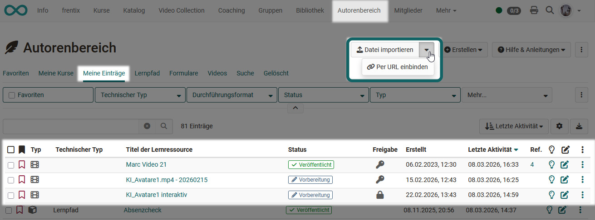{ class="shadow lightbox" title="Authoring area, tab My entries" }

For technical information on uploading and organizing videos, see the page [Video Upload](../basic_concepts/Video_Upload.md).

[To the top of the page ^](#learning_resource_video)

---

## "Administration" menu of the Video learning resource {: #video_administration}

In the "Administration" menu, you manage the Video learning resource: its settings, its members, the interactive elements and the video file itself. Owners of the learning resource, learning resource managers and administrators see the menu. It contains these entries:

* **Settings**: see ["Settings" menu](#video_settings).
* [Members management](../learningresources/Members_management.md): Mainly relevant if you offer the Video learning resource independently of courses. If the video is embedded in a course, you do not manage members here, only additional owners of the learning resource.
* **Video editor**: see ["Video editor" menu](#video_editor).
* [Offer types](../learningresources/Offer_Types.md): Links to the booking orders.
* **Replace Video**: Uploads a new video file to the existing learning resource, for example for an updated version. The link to the learning resource and all embeddings remain intact, and the new video is shown from then on. If subtitles already exist for the video and the frentix cloud transcoding service is active, OpenOlat asks when replacing the video whether new subtitles should be generated (see [Tab "Subtitle configuration"](#video_subtitles)).
* **Copy**: Creates a copy of the learning resource with all elements you created in the video editor.
* **Export content**: Creates a ZIP file of the learning resource. You can save the file locally, import it into another OpenOlat instance or keep it as a backup.
* **About this video**: Shows technical details of the learning resource in a dialog.
* **Delete**

[To the top of the page ^](#learning_resource_video)

---

## "Settings" menu for the Video learning resource {: #video_settings}

In the settings, you define how the video is described, shared and displayed. You open the settings via `Video > Administration > Settings`. Which tabs appear depends on the video: "Video quality" is missing for videos added via "Embed via URL", "Download" appears only for videos in MP4 format, and "Catalog" only if Catalog 1.0 is active.

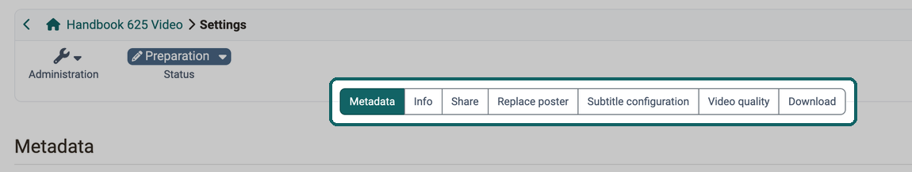{ class="shadow lightbox" title="Settings of a video learning resource · 2026.10.20" }

### Tab "Metadata"

In the "Metadata" tab, you will find general information about the video, such as the creation date and file size. As with other learning resources, you can also enter information about the authors, departments, primary language, duration and license here.

!!! note "Note for YouTube videos"

    If you embed a YouTube video via "Embed via URL", OpenOlat also imports metadata of the YouTube video, such as the title and a thumbnail.

### Tab "Info"

On the "Info" tab, you enter a description, a teaser and a reference, which appear on the info page of the video. If you embed the learning resource in the "Video" course element, you can also display the title and description directly next to the video in the course. How to embed the Video learning resource in a course is described on the page [Course Element "Video"](Course_Element_Video.md).

How to set up the info page is described in the section [Set up info page](../learningresources/Course_Settings_Info.md#configure_info).

!!! tip "Tip"

    The learning resource is already a video, so an additional teaser movie is usually unnecessary. It can be useful, for example, as a short summary of a longer video. The teaser movie is only visible if you offer the Video learning resource as a standalone resource and do not embed it in a course. For more information, see the "Share" tab.

### Tab "Share"

On the "Share" tab, you specify whether the Video learning resource is embedded in a course or used as a standalone resource. If you select the option "Standalone" under "Usage", you also define how people can book the video. For more information, see the page [Course settings - Tab Share](../learningresources/Course_Settings_Share.md).

If the [Video Collection](../area_modules/Video_Collection.md) is enabled in your instance, you also specify here whether the Video learning resource appears there.

### Tab "Catalog"

The "Catalog" tab appears only if [Catalog 1.0](../area_modules/catalog1.0.md) is enabled in the OpenOlat instance. There you add the learning resource to the catalog.

### Tab "Configure poster"

On the "Configure poster" tab, you specify which thumbnail image is used to display the video in the course area, in the catalog, on the Video Collection page, on the info page, in the authoring area and in the course.

With "Replace poster" you choose one of several still images from the video, with "Upload poster" you upload your own image as the poster. If no poster is selected, the still image from the beginning of the video appears.

!!! tip "Tip"

    Upload an image in JPG format that has the same pixel dimensions as the original video. You can find the dimensions of the video in the "Metadata" tab.

### Tab "Subtitle configuration" {: #video_subtitles}

With subtitles, the video remains understandable even without sound. You upload subtitles manually or, if the frentix cloud transcoding service is active, have them generated automatically (see [Automatic subtitle generation](#video_subtitles_auto)).

Create the subtitle file outside of OpenOlat. In the "Subtitle configuration" tab, upload the VTT file and select the appropriate language.

A video can have subtitles in multiple languages. OpenOlat supports the [WebVTT format](https://w3c.github.io/webvtt/) (see also [Wikipedia](https://en.wikipedia.org/wiki/WebVTT)), so the file must be saved with the .vtt extension. This format is compatible with most common video players.

#### Here's what you should look out for:

!!! note "Note"

    The first line of the VTT document must contain the keyword WEBVTT, followed by a blank line.

A timestamp is required before each subtitle line, and it must be in the following format:

!!! note "Note"

    hh\:mm\:ss.msec 

    Example: 00:00:20.396 (Time: 0 hours, 0 minutes, 20.396 seconds)

    Milliseconds must be specified to the third decimal place.

!!! warning "Attention"

    The separators for time entries are a colon and a period (see the example above). Commas must not be used.

The following example shows the beginning of a typical VTT file:

!!! note "Note"

    WEBVTT

    00:00:00.000 --> 00:00:04.000 
    Where did he go?

    00:00:03.000 --> 00:00:06.500 
    I think he went down this lane.

    00:00:04.000 --> 00:00:06.500 
    What are you waiting for?

Uploaded subtitles appear in a table, where you can also delete them.

#### Automatic subtitle generation [:octicons-tag-16:{ title="from Release 20.2.6 (OO-9347)" }](https://track.frentix.com/issue/OO-9347){:target="_blank"} {: #video_subtitles_auto}

If the frentix cloud transcoding service is activated for the OpenOlat instance, the service automatically creates a subtitle file (transcript) in WebVTT format when transcoding an uploaded video. The following applies:

* The language of the video is detected automatically and assigned to the subtitle.
* If a subtitle file already exists for the detected language, it remains unchanged. Automatically generated subtitles do not overwrite any existing files.
* Automatically generated subtitles appear in the subtitles table just like manually uploaded ones and can also be deleted there.

!!! info "Important"

    Automatic subtitle generation is part of the frentix cloud transcoding service and is not included in the standard distribution of OpenOlat. If you are interested, please contact frentix: [contact@frentix.com](mailto:contact@frentix.com)

#### Subtitles when replacing a video [:octicons-tag-16:{ title="from Release 20.2.6 (OO-9347)" }](https://track.frentix.com/issue/OO-9347){:target="_blank"}

If a new video file is uploaded via the "Replace Video" administration menu and subtitles already exist, OpenOlat asks in the dialog "Generate subtitle?" whether a new subtitle should be generated for the replaced video, provided the cloud transcoding service is active.

* **Yes**: The existing subtitle files are deleted and new subtitles are automatically generated for the new video.
* **No**: The existing subtitle files are kept.

#### Show subtitles in the video

OpenOlat first plays videos without subtitles. If subtitles are available, the video player shows this icon at the bottom right:
{ class=size16 }.

CC stands for the American term "[Closed captions](https://de.wikipedia.org/wiki/Untertitel#Technische_Ausf.C3.BChrungen)" (Wikipedia): the subtitles stay hidden until participants turn them on. When you hover your mouse pointer over the icon, the list of available subtitles unfolds. The current selection is highlighted.

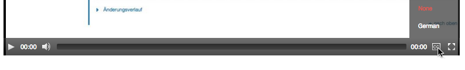{ class="shadow lightbox" title="Subtitle selection in the video player" }

### Tab "Video quality" {: #video_quality}

In the "Video quality" tab, you can see the resolutions in which the video is available. After the upload, OpenOlat creates the video in several resolutions, which can take a while. Which resolutions are created is defined by the system administration under: 
`Administration > Modules > Video`

With "Transcode" you create a pending resolution, with "Delete" you remove a resolution you do not need.

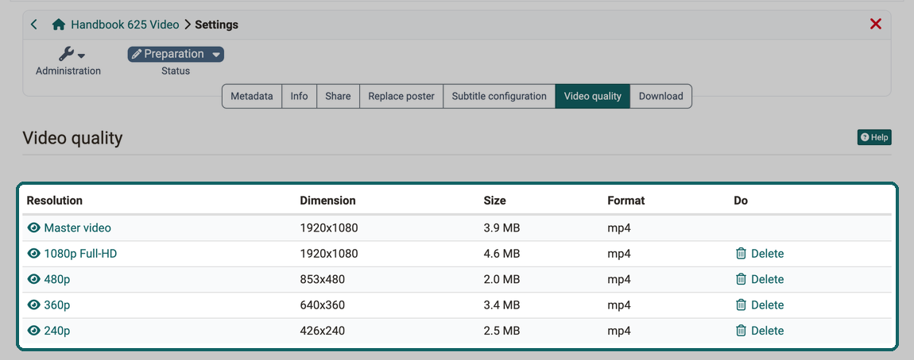{ class="shadow lightbox" title="Video quality tab in the settings · 2026.10.20" }

In the video player, you select the resolution using the gear icon "Source Chooser".

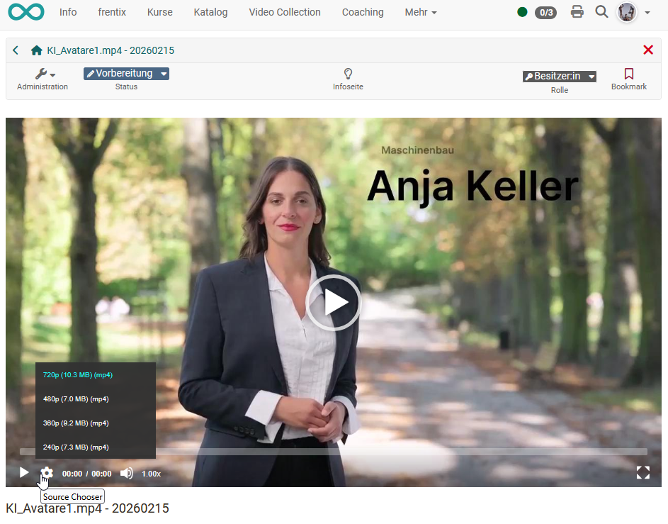{ class="shadow lightbox" title="Video player of a video learning resource" }

!!! info "Important"

    For videos added via "Embed via URL", the "Video quality" tab does not appear.

### Tab "Download" [:octicons-tag-16:{ title="from Release 16.0 (OO-5471)" }](https://track.frentix.com/issue/OO-5471){:target="_blank"}

In the "Download" tab, you specify whether participants are allowed to download the video.

!!! info "Important"

    The "Download" tab appears only for videos in MP4 format. It is missing for YouTube or Vimeo videos added via "Embed via URL".

[To the top of the page ^](#learning_resource_video)

---

## Menu "Video editor" [:octicons-tag-16:{ title="from Release 21.1 (OO-9780)" }](https://track.frentix.com/issue/OO-9780){:target="_blank"} {: #video_editor}

In the video editor, you add interactive elements to the video, which appear at their point in the video during playback. You open it via `Video > Administration > Video editor`.

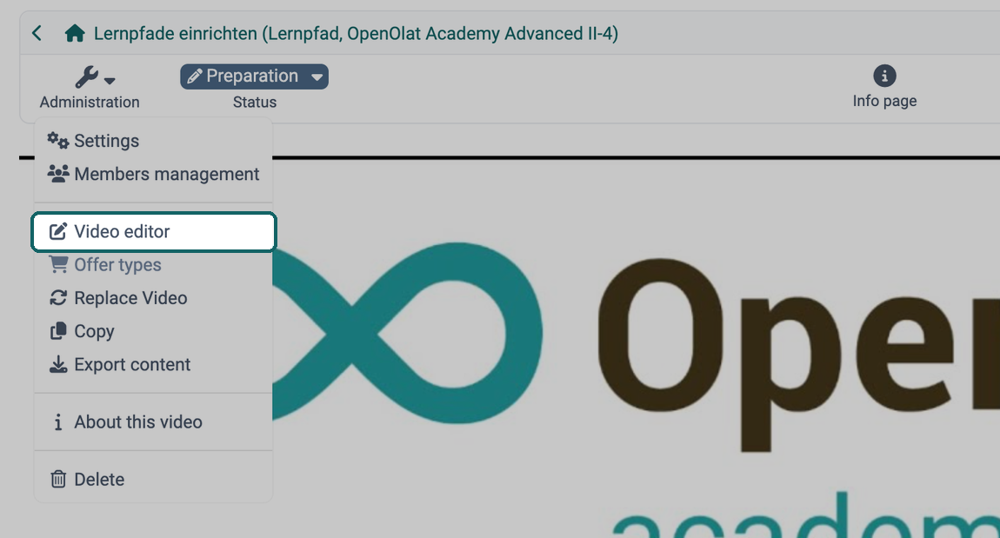{ class="shadow lightbox" title="Administration menu of a video learning resource · 2026.09.28" }

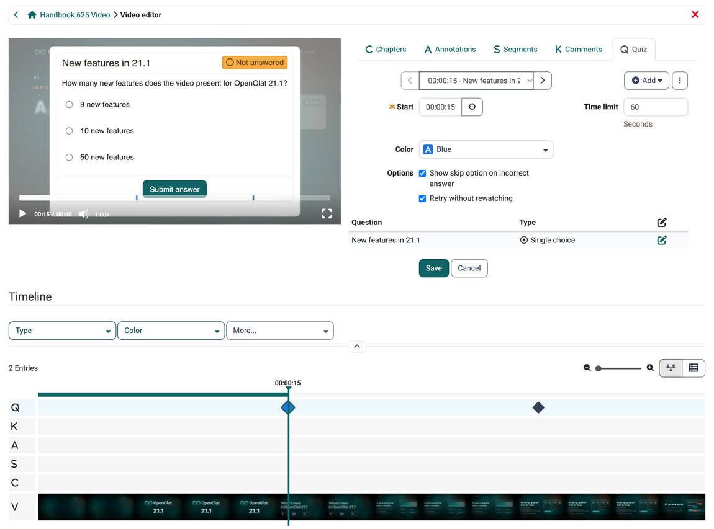{ class="shadow lightbox" title="Layout of the video editor · 2026.10.20" }

The video editor includes three editing areas:

* Configuration area (top right)
* Timeline (bottom)
* Preview area (top left)

The configuration area contains the tabs "Chapters", "Annotations", "Segments", "Comments" and "Quiz".

### Video editor: Chapters [:octicons-tag-16:{ title="from Release 11.1 (OO-2246)" }](https://track.frentix.com/issue/OO-2246){:target="_blank"} {: #video_chapter}

With chapters, participants jump directly to a point in the video, which is particularly useful for longer videos. You create a chapter on the "Chapters" tab with "Add".

Under "Start", set the point in time at which the chapter begins, and enter its name under "Text".

If you first jump to a point in the timeline and then click "Add", OpenOlat uses this point as the start.

Chapters can then be edited and deleted again. They also appear in the timeline.

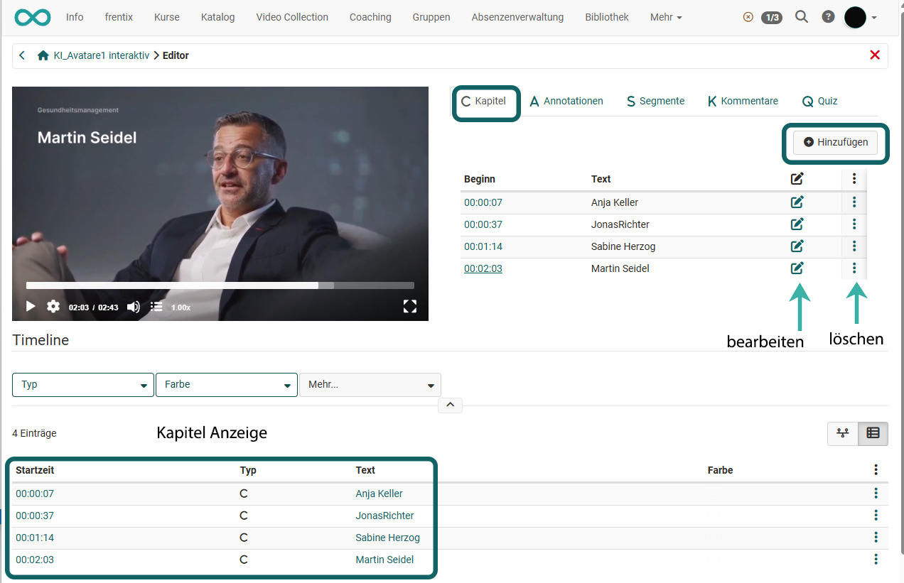{ class="shadow lightbox" title="Video editor, Chapters tab" }

### Video editor: Annotations :octicons-tag-16:{ title="from Release 17.2 (OO-6344)" } {: #video_annotation}

With annotations, you display a text at any point in the video, for example to highlight an important point or to add a reference. In addition to text, links are also possible, for example to further information.

Select the point in the timeline where the annotation should appear and click "Add". The configuration of the annotation opens.

Enter the text, set under "Duration" how long the annotation appears, and choose a color under "Color" to mark it in the left area. Use the pencil icon to adjust the position and size of the annotation field. You can also drag the field to another position with the mouse. Save the settings.

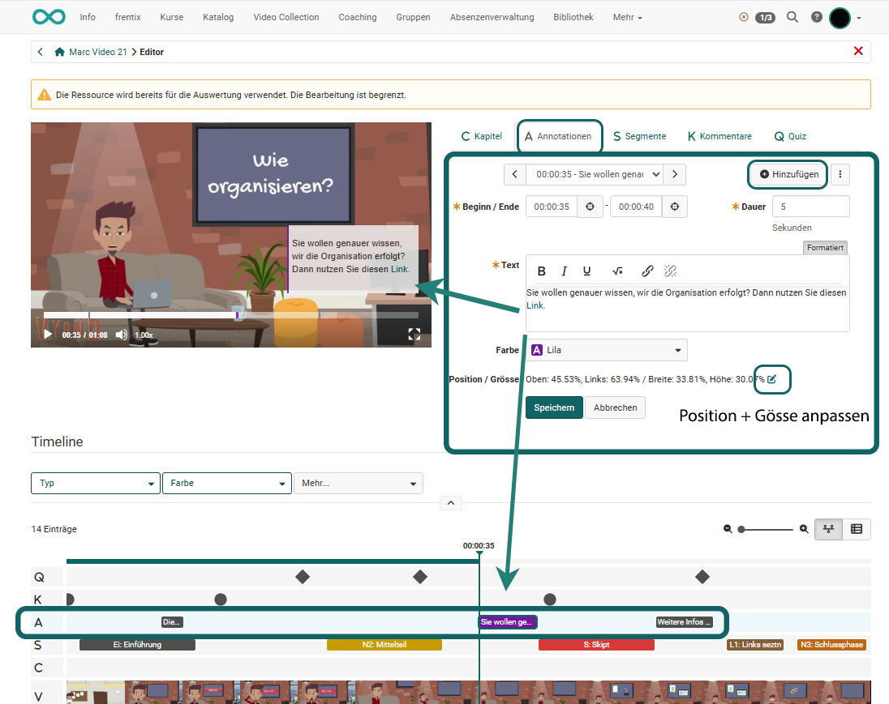{ class="shadow lightbox" title="Video editor, Annotations tab" }

You can add as many annotations as you like and switch between them using the arrows. You delete an annotation again via the icon with the three dots.

### Video editor: Segments :octicons-tag-16:{ title="from Release 17.2 (OO-6598)" } {: #video_segments}

With segments, you divide the video into sections and assign a term to each section, for example a phase or a topic. You display the segments in the "Video" and "Video task" course elements and work with them there.

#### Create segments

In the video editor, select the "Segments" tab and click "Add". The configuration of the segment opens.

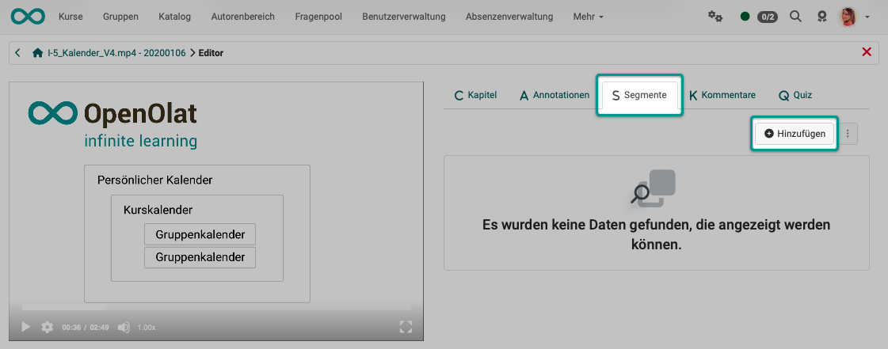{ class="shadow lightbox" title="Video editor, Segments tab" }

Create each segment with "Add" and give it a time span and a "Term". Segments must not overlap in time, and each segment has exactly one term.

You can also first enter all terms and then assign them to the time spans in the video:

* Click "Terms".

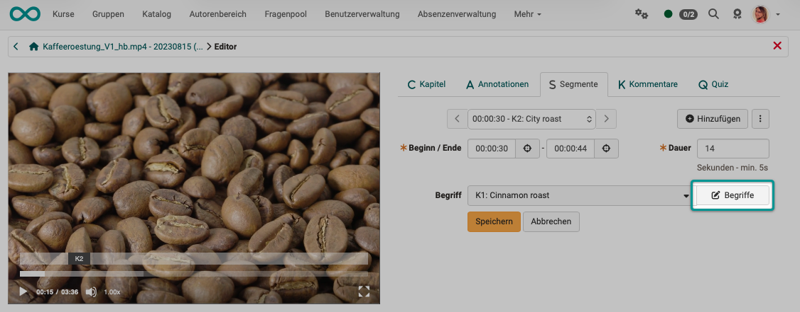{ class="shadow lightbox" title="Configuration of a segment" }

* Add all terms using the plus icon, ideally in the order in which they occur in the video. This makes it easier to assign them later.

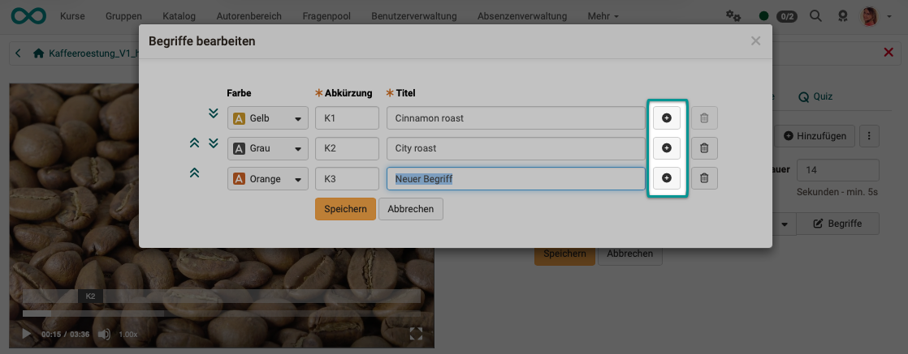{ class="shadow lightbox" title="Dialog Edit terms" }

Or you jump to the desired point in the timeline each time and create the segment with the appropriate term there:

* Jump to the desired point in the timeline and click "Add".
* Add a term for this start or select one from the list. Set the duration and save.
* Jump to the next point and click "Add" again.

The segments appear in their own track in the timeline. From there, you quickly open a segment for editing.

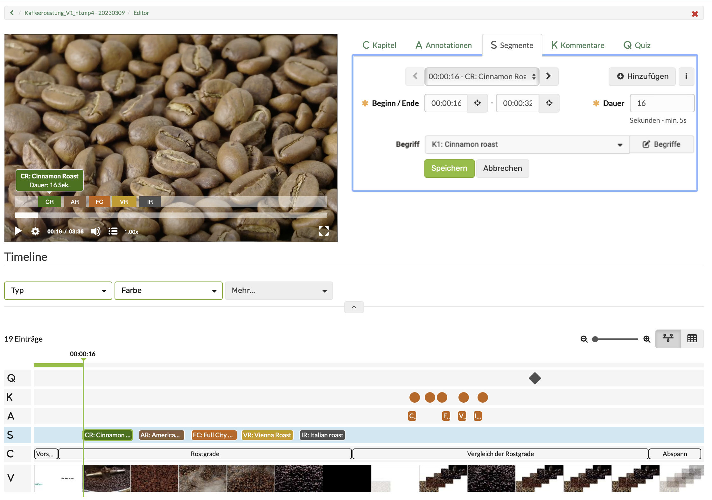{ class="shadow lightbox" title="Timeline in the video editor" }

!!! tip "Hints"

    * Use the play button on the video to check your work.
    * You can click on a segment in the timeline to go directly to the editing screen for that segment.

Segments are mainly used in the "Video task" course element. Some examples:

* You assign a key concept to a time span in the video. Later in the course, the participants look for the point where this aspect occurs.
* You mark the phases of a process as segments. The participants then identify the corresponding sections in the video. Matching theories works in a similar way.
* In an observation video, for example of a kindergarten scene or a job interview, the participants identify typical aspects or mistakes.

### Video editor: Comments :octicons-tag-16:{ title="from Release 17.2 (OO-6766)" } {: #video_comments}

With comments, you highlight key statements at a specific point in the video, add information or prepare for the following section. Each comment carries the name of the person who created it.

During playback, the video stops at the point of the comment. It only continues when the person closes the comment or clicks the play button again. This is how comments differ from annotations.

You create a comment as text or as a video. You record a video comment directly in OpenOlat with the webcam, import it as a file or embed it via a URL. This creates a "video within a video" at that point.

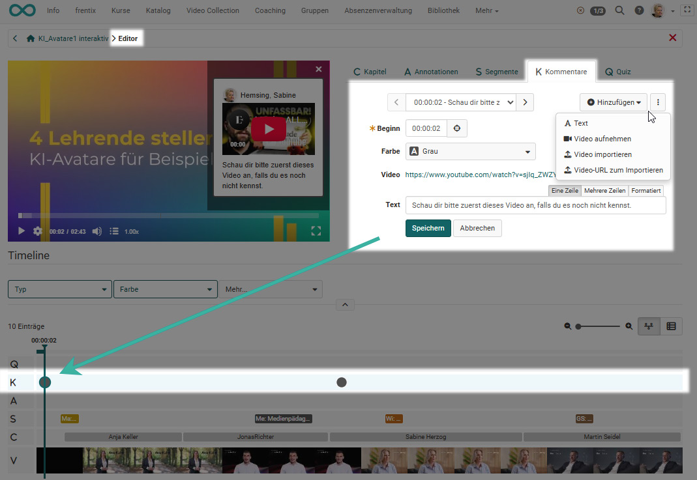{ class="shadow lightbox" title="Video editor, Comments tab" }

### Video editor: Quiz [:octicons-tag-16:{ title="from Release 21.1 (OO-9750)" }](https://track.frentix.com/issue/OO-9750){:target="_blank"} {: #video_quiz}

With quiz questions, you stop the video at a point and encourage participants to reflect on what they have seen. You create a quiz question on the "Quiz" tab with "Add". There are 12 question types to choose from. After you select the question type, the editor of the quiz question opens: enter the question and the answers there and save.

Which tabs the editor shows depends on the question type.

!!! note "Note"

    For more information on the different question types, see the chapter "[Test Question Types](../learningresources/Test_question_types.md)".

You take over a question from the question pool with "Import questions from pool" in the menu behind the icon with the three dots next to "Add"; you then configure it like a newly created quiz question.

After entering the information, you return to the video editor and configure the quiz question for the video. Here, define:

* **"Start"**: the point in the video at which the quiz question appears. The video stops at this point.
* **"Time limit"**: how many seconds participants have to answer. Without an entry, there is no time limit.
* **"Color"**: the color used to highlight and display the quiz question.
* **"Options"**: which additional buttons participants get after an incorrect answer. The options do not hold anyone at the quiz question: whoever fast-forwards in the video still gets past it. This can only be prevented for participants in the ["Video" course element](Course_Element_Video.md) with the setting "Restrict fast forwarding on first watch".
    * **"Show skip option on incorrect answer"**: The "Skip" button appears. Participants can continue without a correct answer.
    * **"Retry without rewatching"**: The "Try again" button appears. The quiz question is reset and can be answered again right away, without the video playing again.

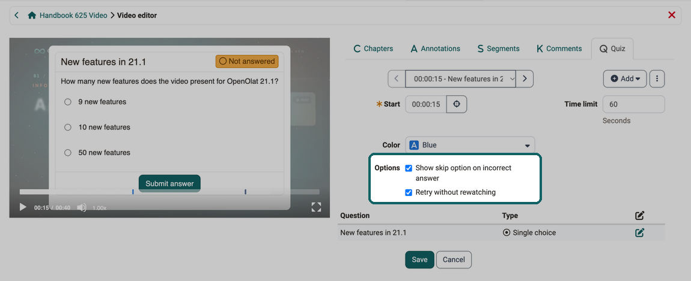{ class="shadow lightbox" title="Video editor, Quiz tab · 2026.10.20" }

OpenOlat evaluates a quiz question in the video immediately when it is answered, but only to determine whether the answer is correct or incorrect. The points assigned to a question play no role in the video, so the table of quiz questions shows only the columns "Question" and "Type". There is also no overall score at the end of the video. If you use the same question in a test, for example, the points count there.

If a quiz question is answered correctly, the "Continue" button appears and the video continues. If it is answered incorrectly, or if the time limit runs out before an answer is submitted, up to three buttons appear, depending on the configuration:

* **"Watch again"**: The video jumps back to the previous quiz question and continues from there. If there is no previous quiz question, it jumps to the beginning of the video. The button is missing if the quiz question is at 00:00.
* **"Try again"**: only with the option "Retry without rewatching". The time limit starts again.
* **"Skip"**: only with the option "Show skip option on incorrect answer". The video continues.

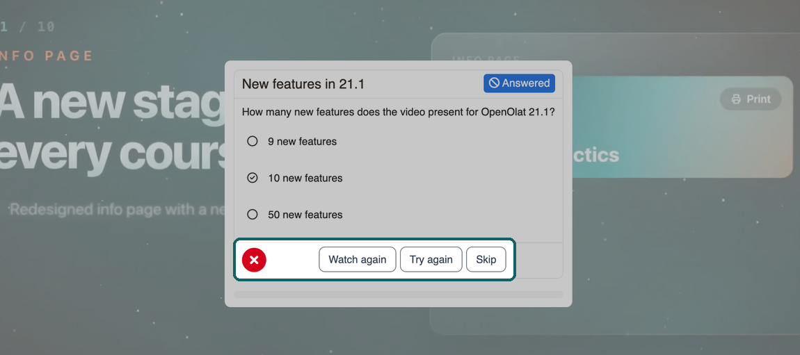{ class="shadow lightbox" title="Quiz question in the video after an incorrect answer · 2026.10.20" }

If a quiz question is at 00:00 and both options are switched off, no button appears after an incorrect answer. Therefore, place the quiz question after 00:00 or switch on at least one of the two options.

!!! note "Note"

    The quiz questions are primarily intended to engage participants and encourage brief reflection. They are not suitable for complex assessment procedures. For a graded assessment, use the [Course Element "Test"](Course_Element_Test.md).

[To the top of the page ^](#learning_resource_video)

---

## Further information {: #further_information}

**Mentioned on this page** 
[Authoring - Create courses and learning resources >](../area_modules/authoring_new_course.md) 
[Video Upload >](../basic_concepts/Video_Upload.md) 
[Members management >](../learningresources/Members_management.md) 
[Offer types >](../learningresources/Offer_Types.md) 
[Course Element "Video" >](Course_Element_Video.md) 
[Course Settings - Tab Info >](../learningresources/Course_Settings_Info.md) 
[Course settings - Tab Share >](../learningresources/Course_Settings_Share.md) 
[Video Collection >](../area_modules/Video_Collection.md) 
[Catalog 1.0 >](../area_modules/catalog1.0.md) 
[WebVTT: The Web Video Text Tracks Format >](https://w3c.github.io/webvtt/) 
[WebVTT (Wikipedia) >](https://en.wikipedia.org/wiki/WebVTT) 
[Untertitel (Wikipedia) >](https://de.wikipedia.org/wiki/Untertitel) 
[Test question types >](../learningresources/Test_question_types.md) 
[Course Element "Test" >](Course_Element_Test.md)

**Further reading** 
[Course Element "Video task" >](Course_Element_Video_Task.md) 
[Toolbar: Info page >](Info_page.md)

[To the top of the page ^](#learning_resource_video)
