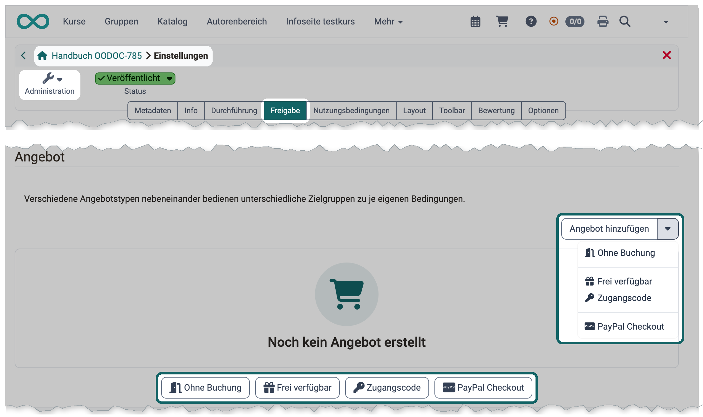
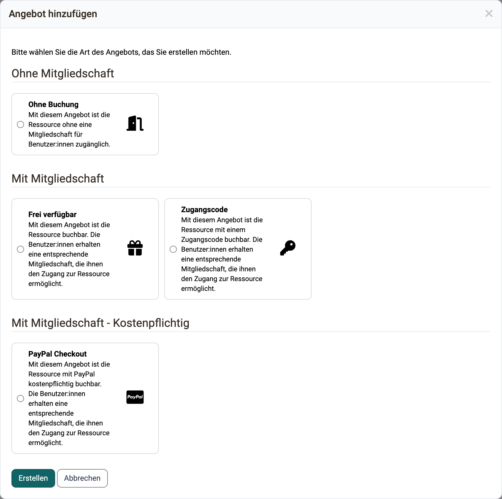
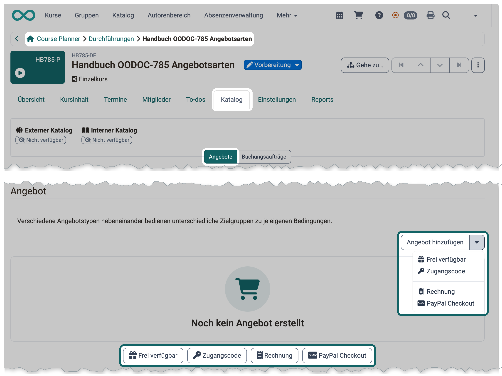
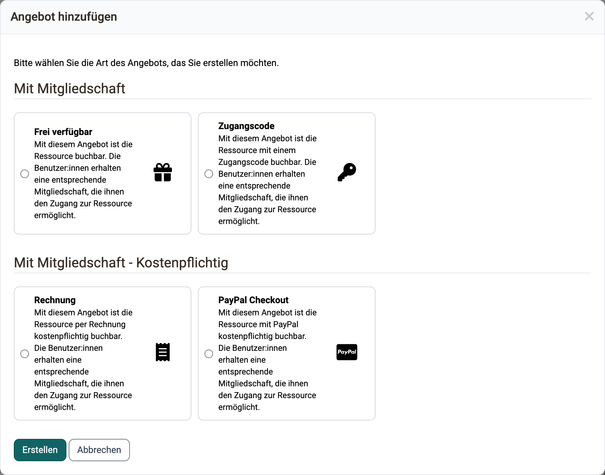

# Angebotsarten {: #offer_types}

Um einen Kurs oder eine andere Lernressource im Katalog anzubieten, braucht es ein Angebot. Die Angebotsart legt fest, wie Benutzer:innen Zugang erhalten: ohne Buchung, mit einer freien Buchung, mit einem Zugangscode oder kostenpflichtig.

Angebote für einen Kurs erstellen Sie unter: 
`Kurs > Administration > Einstellungen > Tab "Freigabe" > Bereich "Angebot"`

Jede Buchung, die über ein Angebot eingeht, führt OpenOlat als Buchungsauftrag mit ihrem Status. Die Buchungsaufträge eines Kurses sehen Sie unter `Kurs > Administration > Angebotsarten`. Der Menüeintrag "Angebotsarten" erscheint, sobald der Kurs ein Angebot hat und "Zugang für Teilnehmer:innen" auf "Buchbare und offene Angebote" steht.

Durchführungen sind Angebote, die Sie im Course Planner planen und verwalten. Für sie gelten eigene Angebotsarten, siehe [Angebotsarten für Durchführungen](#offer_types_implementations).

## Die Angebotsarten

Diese Angebotsarten stehen zur Wahl:

|                       | Mitgliedstatus  |                                 | verfügbar in |
| --------------------- | --------------- |-------------------------------- | --- |
| <b>Ohne Buchung</b>    | ohne  |Mit diesem Angebot ist die Ressource ohne eine Mitgliedschaft für Benutzer:innen zugänglich. | Eigenständiger Kurs |
| <b>Frei verfügbar</b>  | Mitgliedschaft | Mit diesem Angebot ist die Ressource buchbar. Die Benutzer:innen erhalten eine entsprechende Mitgliedschaft, die ihnen den Zugang zur Ressource ermöglicht. | Eigenständiger Kurs und Durchführung |
| <b>Zugangscode</b> | Mitgliedschaft | Mit diesem Angebot ist die Ressource mit einem Zugangscode buchbar. Die Benutzer:innen erhalten eine entsprechende Mitgliedschaft, die ihnen den Zugang zur Ressource ermöglicht. | Eigenständiger Kurs und Durchführung |
| <b>PayPal Checkout</b> | Mitgliedschaft | Mit diesem Angebot ist die Ressource mit PayPal kostenpflichtig buchbar. Die Benutzer:innen erhalten eine entsprechende Mitgliedschaft, die ihnen den Zugang zur Ressource ermöglicht. Beim Erstellen eines Angebots steht diese Angebotsart nur Personen mit der Rolle Autor:in, Lernressourcenverwalter:in oder Administrator:in zur Wahl. | Eigenständiger Kurs und Durchführung |
| <b>Rechnung</b> | Mitgliedschaft | Mit diesem Angebot ist die Ressource per Rechnung kostenpflichtig buchbar. Die Benutzer:innen erhalten eine entsprechende Mitgliedschaft, die ihnen den Zugang zur Ressource ermöglicht. | Durchführung |

[zum Seitenanfang ^](#offer_types)

---

## Angebotsarten für einzelne Kurse

Ein einzelner Kurs ist ein Kurs mit dem Verwendungszweck "Eigenständig", in der Tabelle oben "Eigenständiger Kurs". Für ihn stehen "Ohne Buchung", "Frei verfügbar", "Zugangscode" und "PayPal Checkout" zur Wahl. Voraussetzung ist, dass im Tab "Freigabe" der "Zugang für Teilnehmer:innen" auf "Buchbare und offene Angebote" steht. Die Angebotsart wählen Sie im Menü neben "Angebot hinzufügen" oder im Dialog, den ein Klick auf "Angebot hinzufügen" öffnet. Der Dialog gruppiert die Angebotsarten nach Mitgliedschaft. Hat der Kurs noch kein Angebot, stehen dieselben Angebotsarten auch als Buttons darunter.

In einem herkömmlichen Kurs, also keinem Lernpfadkurs, steht zusätzlich die Angebotsart "Gastzugang" zur Wahl. Damit öffnen Sie den Kurs für Gäste ohne Registrierung, siehe [Rollen und Rechte: Gastzugang](../basic_concepts/guest_access.de.md).

{ class="shadow lightbox" title="Bereich Angebot im Tab Freigabe eines Kurses · 2026.11.18" }

{ class="shadow lightbox" title="Dialog Angebot hinzufügen eines Kurses · 2026.11.18" }

[zum Seitenanfang ^](#offer_types)

---

## Angebotsarten für Durchführungen (im Course Planner) [:octicons-tag-16:{ title="ab Release 20.0 (OO-8236)" }](https://track.frentix.com/issue/OO-8236) {: #offer_types_implementations}

Für eine Durchführung stehen "Frei verfügbar", "Zugangscode", "Rechnung" und "PayPal Checkout" zur Wahl. Die Angebote einer Durchführung erstellen Sie unter: 
`Course Planner > Durchführungen > "Ihre Durchführung" > Tab "Katalog" > Button "Angebote"` 
"PayPal Checkout" steht dort beim Erstellen nur Personen zur Wahl, die die Rolle Autor:in, Lernressourcenverwalter:in oder Administrator:in haben. Wie Sie eine Durchführung im Katalog anbieten, beschreibt [Course Planner: Durchführungen](../area_modules/Course_Planner_Implementations.de.md#tab_catalog).

{ class="shadow lightbox" title="Bereich Angebot im Tab Katalog einer Durchführung im Course Planner · 2026.11.18" }

{ class="shadow lightbox" title="Dialog Angebot hinzufügen einer Durchführung · 2026.11.18" }

[zum Seitenanfang ^](#offer_types)

---

## Weiterführende Informationen {: #further_information}

[Rollen und Rechte: Gastzugang >](../basic_concepts/guest_access.de.md) 
[Course Planner: Durchführungen >](../area_modules/Course_Planner_Implementations.de.md) 
[Katalog 2.0: Übersicht >](../area_modules/catalog2.0/index.de.md) 
[Katalog 2.0 - Angebote >](../area_modules/catalog2.0_angebote.de.md) 
[Angebotskonzepte >](../basic_concepts/Offer_Concepts.de.md)

[zum Seitenanfang ^](#offer_types)
