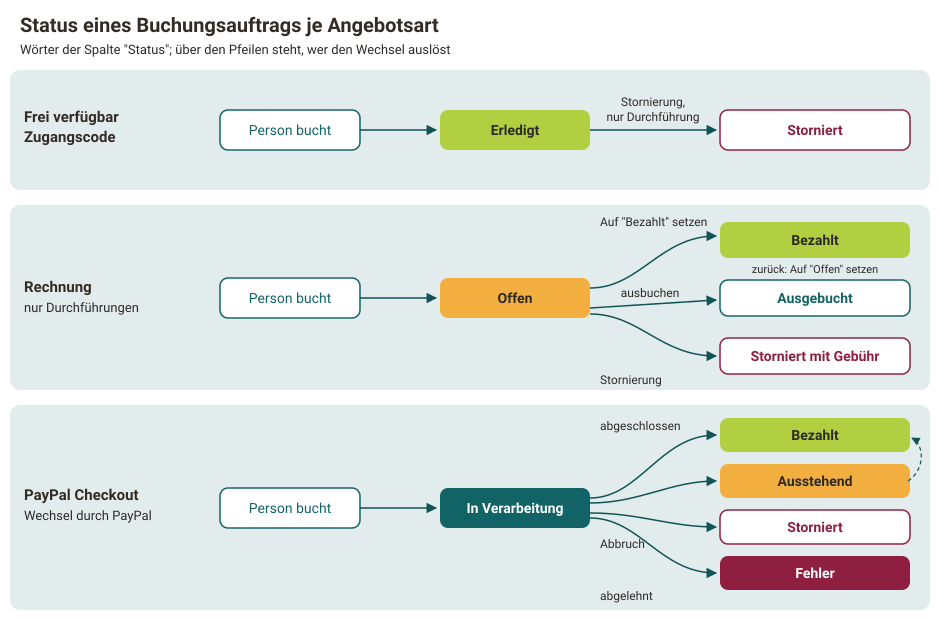

# Angebotsarten {: #offer_types}

Wer einen Kurs oder eine andere Lernressource über ein Angebot im Katalog anbietet, will wissen, wer sie gebucht hat. Jede Buchung über ein Angebot führt OpenOlat als Buchungsauftrag. Der Menüpunkt "Angebotsarten" der Administration zeigt die Buchungsaufträge der Lernressource, jeden mit seinem [Status](#order_status): 
`Kurs > Administration > Angebotsarten`

Trotz seines Namens listet der Menüpunkt nicht die Angebotsarten auf, sondern die Buchungsaufträge. Über welche Angebotsart eine Buchung eingegangen ist, zeigt die Spalte "Angebotstyp". Welche Angebotsarten es gibt und wo sie zur Wahl stehen, beschreibt [Angebotskonzepte: Die Angebotsarten](../basic_concepts/Offer_Concepts.de.md#offer_types).

Denselben Menüpunkt zeigt auch die Administration anderer Lernressourcen, etwa der Lernressourcen "CP-Lerninhalt", "SCORM 1.2", "Video" und "Podcast". Auch diese Lernressourcen haben in ihren Einstellungen den Tab "Freigabe" mit "Zugang für Teilnehmer:innen" und dem Abschnitt "Angebot", siehe [Zugangskonfiguration / Freigabe](Access_configuration.de.md#offer).

[zum Seitenanfang ^](#offer_types)

---

## Wann erscheint der Menüpunkt? {: #menu_visibility}

Im Kurs erscheint der Menüpunkt "Angebotsarten", sobald zwei Bedingungen erfüllt sind:

* Im Tab "Freigabe" steht "Zugang für Teilnehmer:innen" auf "Buchbare und offene Angebote".
* Die Lernressource hat ein Angebot mit Buchung, also "Frei verfügbar", "Zugangscode" oder "PayPal Checkout". Im Dialog "Angebot hinzufügen" stehen diese Angebotsarten unter "Mit Mitgliedschaft" und "Mit Mitgliedschaft - Kostenpflichtig". Der Menüpunkt erscheint dann schon vor der ersten Buchung. Angebote "Ohne Buchung" und "Gastzugang" erzeugen keine Buchungsaufträge und lassen den Menüpunkt deshalb nicht erscheinen.

Nach dem Speichern von Freigabe und Angebot erscheint der Menüpunkt, sobald Sie den Kurs erneut öffnen. Schliessen Sie dafür den Kurs oben in der Hauptnavigation, wo sein Titel steht, und öffnen Sie ihn wieder. Dann steht "Angebotsarten" im Menü "Administration".

Öffnen können den Menüpunkt Besitzer:innen der Lernressource, Lernressourcenverwalter:innen und Administrator:innen, siehe [Rollen und Rechte](../basic_concepts/Roles/index.de.md). In den anderen Lernressourcen, etwa "CP-Lerninhalt" oder "Video", sehen diese Personen den Menüpunkt immer. Anklicken lässt er sich dort erst, wenn beide Bedingungen erfüllt sind und Sie die Lernressource danach erneut geöffnet haben.

Die Angebote eines Kurses erstellen Sie unter: 
`Kurs > Administration > Einstellungen > Tab "Freigabe" > Abschnitt "Angebot" > Button "Angebot hinzufügen"`

[zum Seitenanfang ^](#offer_types)

---

## Status der Buchungsaufträge {: #order_status}

Sehen Sie in einer Liste mit Buchungsaufträgen einen Status, erfahren Sie hier, wie weit die Buchung ist und ob Sie noch etwas tun müssen. Welche Status ein Buchungsauftrag durchläuft, hängt von der Angebotsart ab, über die gebucht wurde. Dieselben Wörter stehen in jeder Liste mit Buchungsaufträgen: im Menüpunkt "Angebotsarten", in der Mitgliederverwaltung, bei Gruppen, im Course Planner, in der System-Administration, in den eigenen Buchungsaufträgen des persönlichen Menüs, im Coaching und in der Spalte "Buchungsstatus" des [Reports Buchungsaufträge](../area_modules/Reports_BookingOrders.de.md).

Die Spalte "Was tun" richtet sich an die Personen, die Buchungen verwalten. Als Teilnehmer:in lesen Sie in der Spalte "Bedeutung", wie weit Ihre eigene Buchung ist.

{ class="shadow lightbox" title="Status eines Buchungsauftrags je Angebotsart · 2026.11.20" }

| Status | Bedeutung | Was tun |
|---|---|---|
| "Erledigt" | Die Buchung über "Frei verfügbar" oder "Zugangscode" ist abgeschlossen. Eine Zahlung ist bei diesen Angebotsarten nicht vorgesehen. | Nichts. |
| "Offen" | Eine Buchung über "Rechnung" ist eingegangen, die Zahlung ist noch nicht verbucht. Die Angebotsart "Rechnung" gibt es nur bei Durchführungen im Course Planner. | Die Rechnung stellt Ihre Buchhaltung, etwa anhand der Excel-Datei aus "Buchungsaufträge herunterladen". Nach dem Zahlungseingang setzen Sie den Auftrag mit «Auf "Bezahlt" setzen» auf "Bezahlt". Vorher passen Sie bei Bedarf mit "Preis ändern" den Preis und mit "Rechnungsadresse ändern" die Adresse an. |
| "Bezahlt" | Die Zahlung ist verbucht. Bei "Rechnung" hat jemand den Auftrag von Hand auf "Bezahlt" gesetzt, bei "PayPal Checkout" hat PayPal die Zahlung gemeldet. Setzt jemand eine Buchung über "PayPal Checkout" von Hand auf "Bezahlt", ändert das nur den Status, nicht den Zugang der Person. | Nichts. Haben Sie eine Buchung über "Rechnung" irrtümlich auf "Bezahlt" gesetzt, nehmen Sie das mit «Auf "Offen" setzen» zurück. |
| "In Verarbeitung" | Nur bei "PayPal Checkout": Die Person zahlt gerade bei PayPal. | Abwarten. |
| "Ausstehend" | Nur bei "PayPal Checkout": PayPal hat die Zahlung noch nicht abgeschlossen, etwa weil PayPal sie noch prüft. Die Person hat noch keinen Zugang. | Abwarten. Den Zugang erhält die Person, sobald PayPal die Zahlung abschliesst. |
| "Akzeptiert aber ausstehend" | Nur bei "PayPal Checkout": PayPal hat die Zahlung noch nicht abgeschlossen, OpenOlat hat der Person den Zugang aber schon gegeben. Das geschieht, wenn Systemadministrator:innen in der Konfiguration von PayPal Checkout ausstehende Transaktionen akzeptieren, siehe [Ausstehende Transaktionen](../../manual_admin/administration/Payment_PayPal.de.md#further_settings). | Abwarten. Bleibt der Status, prüfen Sie die Zahlung in Ihrem PayPal-Konto. |
| "Achtung" | Nur bei Zahlung über PayPal: Die Zahlung ist nicht abgeschlossen, und die Rückmeldung von PayPal passt zu keinem der übrigen Status. | Prüfen Sie die Zahlung in Ihrem PayPal-Konto. |
| "Fehler" | PayPal hat die Zahlung beim Bezahlen abgelehnt. Die Person erhält über diese Buchung keinen Zugang. Hatte sie ihn schon, entzieht OpenOlat ihn wieder. | Klären Sie mit der Person, ob sie erneut bucht. |
| "Storniert" | Die Buchung ist aufgehoben. Bei einer Durchführung storniert die Person selbst mit "Buchung stornieren" auf der Infoseite, wenn das Angebot es erlaubt (siehe [Angebotskonzepte: Stornierung](../basic_concepts/Offer_Concepts.de.md#offer_cancellation)), oder die Verwaltung der Durchführung storniert im Tab "Mitglieder". Bei "PayPal Checkout" entsteht der Status auch, wenn die Person die Zahlung bei PayPal abbricht. Verlässt eine Person einen Kurs oder wird sie ausgetragen, bleibt der Status ihres Buchungsauftrags unverändert. | Nichts. |
| "Storniert mit Gebühr" | Nur bei "Rechnung": Die Buchung ist storniert, und eine Stornogebühr ist fällig. | Stellen Sie die Gebühr in Rechnung. Bei Bedarf passen Sie sie mit "Stornogebühr ändern" an. |
| "Ausgebucht" | Nur bei "Rechnung": Die Forderung ist abgeschrieben und wird nicht mehr eingefordert. Die Mitgliedschaft der Person bleibt bestehen. "Ausgebucht" heisst hier nicht, dass keine Plätze mehr frei sind. | Nichts. |

Den Status "Ausgebucht" setzen Sie bei einem Auftrag im Status "Offen" mit "Buchungsauftrag ausbuchen". OpenOlat bestätigt dabei: «Es wird nur der Buchungsauftrag ausgebucht! Die Mitgliedschaft der/s Teilnehmenden bleibt bestehen.»

Der Status des Buchungsauftrags sagt nichts darüber, ob die Person schon Mitglied ist. Hat sie über ein Angebot mit der Mitgliedschaft "Mit Bestätigung" gebucht, siehe [Angebotskonzepte: Weitere Randbedingungen für Angebote](../basic_concepts/Offer_Concepts.de.md#further_boundary_conditions), bleibt ihre Mitgliedschaft ausstehend, bis jemand sie bestätigt, auch wenn der Buchungsauftrag "Erledigt" oder "Bezahlt" zeigt. Bestätigt wird im Course Planner im [Tab Mitglieder](../area_modules/Course_Planner_Implementations.de.md#tab_members) oder im Coaching unter [Ausstehende Mitgliedschaften genehmigen](../area_modules/Coaching_People.de.md#linemanager_educationmanager_confirm_membership).

### Reiter und Filter {: #order_status_tabs}

Die Reiter über der Liste fassen die Status zusammen:

* **Offen** zeigt alle Buchungsaufträge, deren Zahlung noch läuft: "Offen", "In Verarbeitung", "Ausstehend", "Akzeptiert aber ausstehend" und "Achtung". Hier finden Sie die Buchungen, die noch nicht bezahlt sind.
* **Erledigt** zeigt nur Buchungen ohne Zahlung, also über "Frei verfügbar" oder "Zugangscode".
* **Bezahlt** zeigt nur bezahlte Buchungen über "Rechnung" oder "PayPal Checkout". Eine bezahlte Rechnungsbuchung finden Sie deshalb unter "Bezahlt", nicht unter "Erledigt".
* **Storniert** zeigt "Storniert" und "Storniert mit Gebühr".
* **Fehler** zeigt die Buchungen, deren Zahlung PayPal abgelehnt hat.

"Ausgebucht" hat keinen eigenen Reiter. Diese Buchungsaufträge finden Sie unter "Alle" oder mit dem Filter "Status".

Der Filter "Status" nennt die Status zum Teil anders als die Spalte. "In Zahlungsprozess" fasst die Status mit laufender Zahlung zusammen, also "Offen", "In Verarbeitung", "Ausstehend", "Akzeptiert aber ausstehend" und "Achtung". Der Filterwert "Neu" gehört wie "In Zahlungsprozess" zum Reiter "Offen"; als eigenen Status zeigt die Spalte ihn nicht. Die übrigen Filterwerte heissen wie in der Spalte: "Erledigt", "Bezahlt", "Storniert", "Ausgebucht" und "Fehler".

### Status von Hand ändern {: #order_status_change}

Die meisten Status setzt OpenOlat selbst, beim Buchen oder auf die Rückmeldung von PayPal. Von Hand ändern Sie den Status vor allem bei Buchungen über "Rechnung" im Course Planner: im Menü am Ende einer Zeile oder für mehrere markierte Aufträge auf einmal, siehe [Tab Katalog > Buchungsaufträge](../area_modules/Course_Planner_Implementations.de.md#tab_catalog_booking_orders).

Ausserhalb des Course Planners gibt es nur eine Änderung: In der Detailansicht eines Buchungsauftrags, dessen Zahlung noch läuft, steht der Button «Auf "Bezahlt" setzen». Die Detailansicht klappen Sie mit dem Plus am Anfang der Zeile auf. Diesen Button zeigen der Menüpunkt "Angebotsarten" und die Buchungsaufträge einer Gruppe. In der Mitgliederverwaltung zeigt ihn OpenOlat Besitzer:innen, Lernressourcenverwalter:innen, Administrator:innen und Personen mit dem Recht zur Mitgliederverwaltung; Principals sehen die Buchungsaufträge dort nur zum Lesen. Im Kurs gibt es laufende Zahlungen nur bei "PayPal Checkout", weil "Rechnung" Durchführungen vorbehalten ist. Die System-Administration, das Coaching und die eigenen Buchungsaufträge im persönlichen Menü zeigen die Status nur zum Lesen.

[zum Seitenanfang ^](#offer_types)

---

## Weiterführende Informationen {: #further_information}

**Auf dieser Seite erwähnt** 
[Angebotskonzepte >](../basic_concepts/Offer_Concepts.de.md) 
[Zugangskonfiguration / Freigabe >](Access_configuration.de.md) 
[Rollen und Rechte: Welche Rollen gibt es? >](../basic_concepts/Roles/index.de.md) 
[Reports: Buchungsaufträge >](../area_modules/Reports_BookingOrders.de.md) 
[PayPal Konfiguration >](../../manual_admin/administration/Payment_PayPal.de.md) 
[Course Planner: Durchführungen >](../area_modules/Course_Planner_Implementations.de.md) 
[Coaching - Personen >](../area_modules/Coaching_People.de.md)

**Weiterführend** 
[Persönliche Werkzeuge: Buchungsaufträge >](../personal_menu/Bookings.de.md) 
[Bezahlungsmodule: Rechnung >](../../manual_admin/administration/Payment_Invoice.de.md)

[zum Seitenanfang ^](#offer_types)
