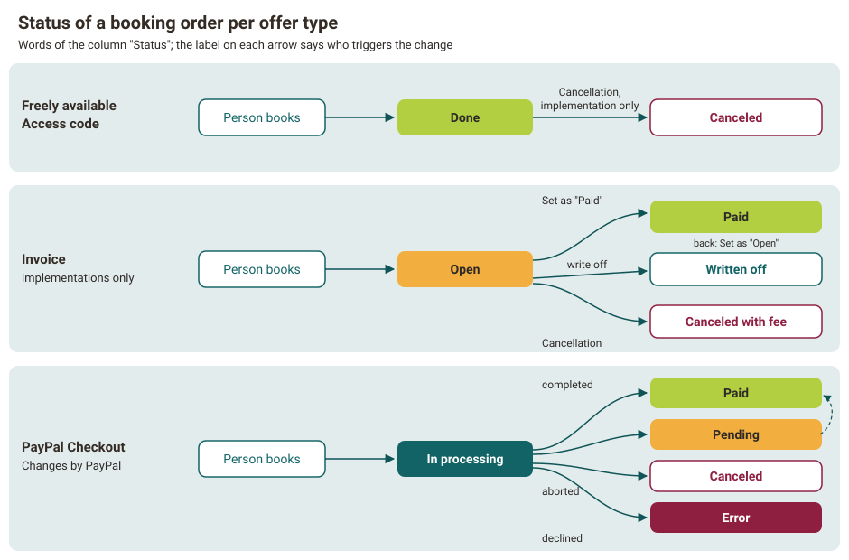

# Offer types {: #offer_types}

Whoever offers a course or another learning resource through an offer in the catalog wants to know who booked it. OpenOlat lists every booking through an offer as a booking order. The menu item "Offer types" of the administration shows the booking orders of the learning resource, each with its [status](#order_status): 
`Course > Administration > Offer types`

Despite its name, the menu item does not list the offer types but the booking orders. The column "Offer type" shows through which offer type a booking came in. Which offer types exist and where they are available is described in [Offer concepts: Offer types](../basic_concepts/Offer_Concepts.md#offer_types).

The administration of other learning resources shows the same menu item, for example of the learning resources "CP learning content", "SCORM 1.2", "Video" and "Podcast". These learning resources also have the tab "Share" with "Access for participants" and the section "Offer" in their settings, see [Access configuration](Access_configuration.md#offer).

[To the top of the page ^](#offer_types)

---

## When does the menu item appear? {: #menu_visibility}

In a course, the menu item "Offer types" appears as soon as two conditions are met:

* In the tab "Share", "Access for participants" is set to "Bookable and open offers".
* The learning resource has an offer with booking, that is "Freely available", "Access code" or "PayPal Checkout". In the dialog "Add offer", these offer types are listed under "With membership" and "With membership - Chargeable". The menu item then appears even before the first booking. Offers "Without booking" and "Guest" create no booking orders and therefore do not make the menu item appear.

After you have saved the share settings and the offer, the menu item appears as soon as you open the course again. To do so, close the course at the top in the main navigation, where its title is shown, and open it again. Then "Offer types" is listed in the menu "Administration".

The menu item can be opened by owners of the learning resource, learning resource managers and administrators, see [Roles and Rights](../basic_concepts/Roles/index.md). In the other learning resources, for example "CP learning content" or "Video", these persons always see the menu item. There it can only be clicked once both conditions are met and you have opened the learning resource again afterwards.

You create the offers of a course under: 
`Course > Administration > Settings > Tab "Share" > Section "Offer" > Button "Add offer"`

[To the top of the page ^](#offer_types)

---

## Status of booking orders {: #order_status}

When you see a status in a list of booking orders, this section tells you how far the booking has got and whether you still have to do something. Which statuses a booking order goes through depends on the offer type through which it was booked. The same words appear in every list of booking orders: in the menu item "Offer types", in the members management, in groups, in the Course Planner, in the system administration, in your own booking orders in the personal menu, in coaching and in the column "Booking status" of the [Booking orders report](../area_modules/Reports_BookingOrders.md).

The column "What to do" is addressed to the persons who manage bookings. As a participant, the column "Meaning" tells you how far your own booking has got.

{ class="shadow lightbox" title="Status of a booking order per offer type · 2026.11.20" }

| Status | Meaning | What to do |
|---|---|---|
| "Done" | The booking via "Freely available" or "Access code" is completed. No payment is intended for these offer types. | Nothing. |
| "Open" | A booking via "Invoice" has come in, the payment has not been recorded yet. The offer type "Invoice" exists only for implementations in the Course Planner. | Your accounting issues the invoice, for example based on the Excel file from "Export booking orders". After the payment has been received, you set the order to "Paid" with «Set as "Paid"». Before that, adjust the price with "Change price" and the address with "Change billing address" if needed. |
| "Paid" | The payment has been recorded. With "Invoice", someone has set the order to "Paid" manually; with "PayPal Checkout", PayPal has reported the payment. If someone sets a booking via "PayPal Checkout" to "Paid" manually, this changes only the status, not the person's access. | Nothing. If you have set a booking via "Invoice" to "Paid" by mistake, undo it with «Set as "Open"». |
| "In processing" | Only with "PayPal Checkout": The person is currently paying at PayPal. | Wait. |
| "Pending" | Only with "PayPal Checkout": PayPal has not completed the payment yet, for example because PayPal is still checking it. The person does not have access yet. | Wait. The person receives access as soon as PayPal completes the payment. |
| "Accepted but pending" | Only with "PayPal Checkout": PayPal has not completed the payment yet, but OpenOlat has already given the person access. This happens when system administrators accept pending transactions in the configuration of PayPal Checkout, see [Pending transactions](../../manual_admin/administration/Payment_PayPal.md#further_settings). | Wait. If the status remains, check the payment in your PayPal account. |
| "Warning" | Only with payment via PayPal: The payment is not completed, and the response from PayPal matches none of the other statuses. | Check the payment in your PayPal account. |
| "Error" | PayPal declined the payment during checkout. The person does not receive access through this booking. If the person already had access, OpenOlat revokes it. | Clarify with the person whether they book again. |
| "Canceled" | The booking has been canceled. For an implementation, the person cancels with "Cancel booking" on the info page if the offer allows it (see [Offer concepts: Cancellation](../basic_concepts/Offer_Concepts.md#offer_cancellation)), or the management of the implementation cancels in the tab "Members". With "PayPal Checkout", the status also arises when the person aborts the payment at PayPal. If a person leaves a course or is removed from it, the status of their booking order stays unchanged. | Nothing. |
| "Canceled with fee" | Only with "Invoice": The booking is canceled, and a cancellation fee is due. | Invoice the fee. If needed, adjust it with "Change cancellation fee". |
| "Written off" | Only with "Invoice": The claim has been written off and is no longer collected. The person's membership remains. | Nothing. |

You set the status "Written off" for an order with the status "Open" with "Write off booking order". OpenOlat confirms: «Only the booking order will be written off! The participant's membership remains valid.»

The status of the booking order does not tell whether the person is already a member. If the person booked through an offer with the membership "With confirmation", see [Offer concepts: Further conditions for offers](../basic_concepts/Offer_Concepts.md#further_boundary_conditions), their membership remains pending until someone confirms it, even if the booking order shows "Done" or "Paid". Memberships are confirmed in the Course Planner in the [Tab Members](../area_modules/Course_Planner_Implementations.md#tab_members) or in coaching under [Confirm pending memberships](../area_modules/Coaching_People.md#linemanager_educationmanager_confirm_membership).

### Tabs and filters {: #order_status_tabs}

The tabs above the list group the statuses:

* **Open** shows all booking orders whose payment is still in progress: "Open", "In processing", "Pending", "Accepted but pending" and "Warning". Here you find the bookings that are not paid yet.
* **Done** shows only bookings without payment, that is via "Freely available" or "Access code".
* **Paid** shows only paid bookings via "Invoice" or "PayPal Checkout". You therefore find a paid invoice booking under "Paid", not under "Done".
* **Canceled** shows "Canceled" and "Canceled with fee".
* **Error** shows the bookings whose payment PayPal declined.

"Written off" has no tab of its own. You find these booking orders under "All" or with the filter "Status".

The filter "Status" partly names the statuses differently from the column. "In payment process" combines the statuses with a payment in progress, that is "Open", "In processing", "Pending", "Accepted but pending" and "Warning". The filter value "New" belongs, like "In payment process", to the tab "Open"; the column does not show it as a status of its own. The other filter values have the same names as in the column: "Done", "Paid", "Canceled", "Written off" and "Error".

### Change the status manually {: #order_status_change}

OpenOlat sets most statuses itself, when booking or on the response from PayPal. You change the status manually mainly for bookings via "Invoice" in the Course Planner: in the menu at the end of a row or for several selected orders at once, see [Tab Catalog > Booking orders](../area_modules/Course_Planner_Implementations.md#tab_catalog_booking_orders).

Outside the Course Planner there is only one change: in the detail view of a booking order whose payment is still in progress, there is the button «Set as "Paid"». You open the detail view with the plus at the beginning of the row. The menu item "Offer types" and the booking orders of a group show this button. In the members management, OpenOlat shows it to owners, learning resource managers, administrators and persons with the right to manage members; principals see the booking orders there read-only. In a course, payments in progress exist only with "PayPal Checkout", because "Invoice" is reserved for implementations. The system administration, coaching and your own booking orders in the personal menu show the statuses read-only.

[To the top of the page ^](#offer_types)

---

## Further information {: #further_information}

**Mentioned on this page** 
[Offer concepts >](../basic_concepts/Offer_Concepts.md) 
[Access configuration >](Access_configuration.md) 
[Roles and Rights: Which roles are available? >](../basic_concepts/Roles/index.md) 
[Reports: Booking orders >](../area_modules/Reports_BookingOrders.md) 
[PayPal Configuration >](../../manual_admin/administration/Payment_PayPal.md) 
[Course Planner: Implementations >](../area_modules/Course_Planner_Implementations.md) 
[Coaching - People >](../area_modules/Coaching_People.md)

**Further reading** 
[User tools: Booking orders >](../personal_menu/Bookings.md) 
[Payment modules: Invoice >](../../manual_admin/administration/Payment_Invoice.md)

[To the top of the page ^](#offer_types)
