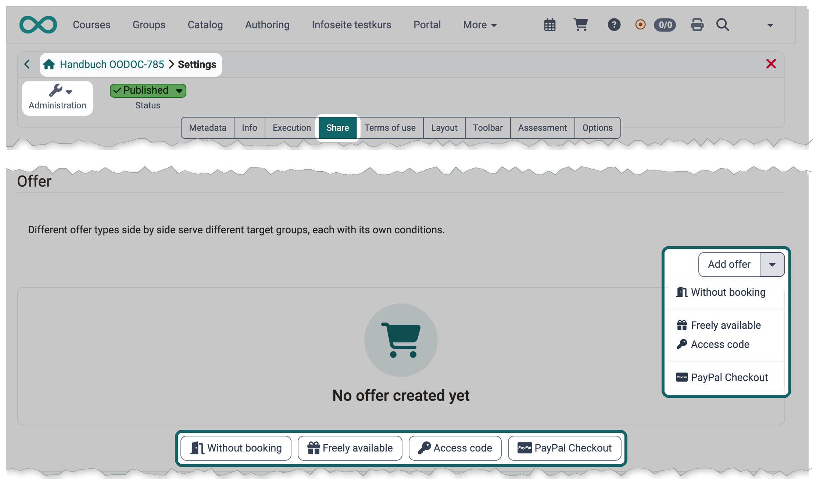
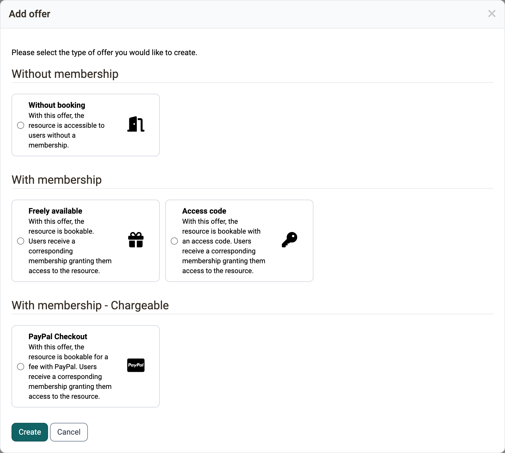
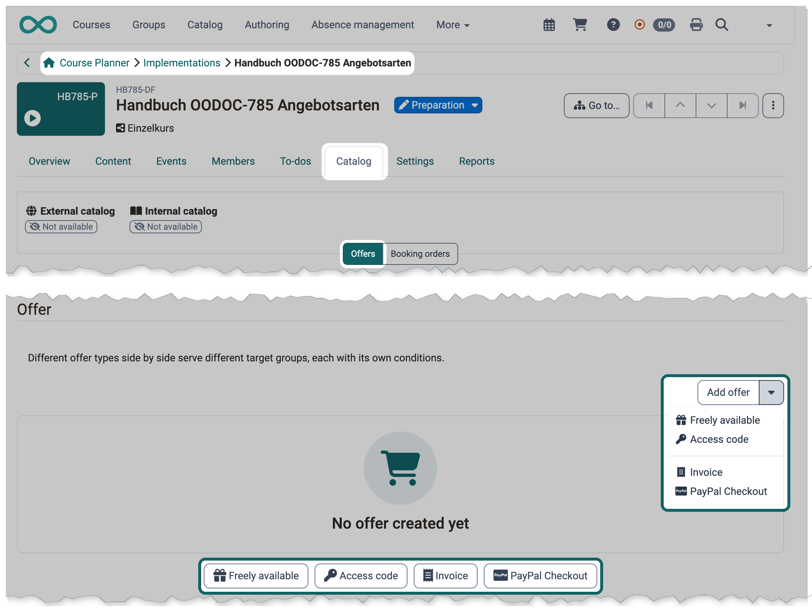
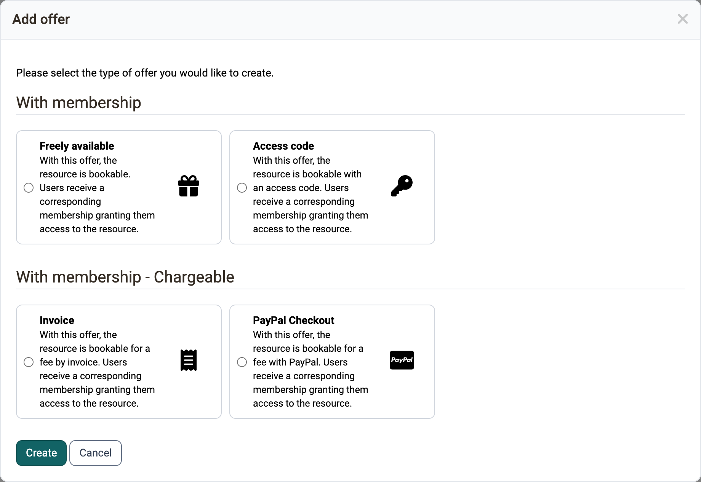

# Offer types {: #offer_types}

In order to offer a course or other learning resource in the catalog, an offer is required. The offer type determines how users get access: without booking, with a free booking, with an access code or for a fee.

You create offers for a course under: 
`Course > Administration > Settings > Tab "Share" > Area "Offer"`

OpenOlat lists every booking that comes in through an offer as a booking order with its status. You see the booking orders of a course under `Course > Administration > Offer types`. The menu entry "Offer types" appears as soon as the course has an offer and "Access for participants" is set to "Bookable and open offers".

Implementations are offers that you plan and manage in the Course Planner. Their own offer types apply to them, see [Offer types for implementations](#offer_types_implementations).

## The offer types

The following offer types are available:

|                       | Member status  |                                 | available in |
| --------------------- | --------------- |-------------------------------- | --- |
| <b>Without booking</b>    | without  | With this offer, the resource is accessible to users without a membership. | Standalone course |
| <b>Freely available</b>  | Membership | The resource can be booked with this offer. Users receive a corresponding membership that gives them access to the resource. | Standalone course and implementation |
| <b>Access code</b> | Membership | With this offer, the resource is available with an access code. Users receive a corresponding membership that gives them access to the resource. | Standalone course and implementation |
| <b>PayPal Checkout</b> | Membership | With this offer, the resource can be booked with PayPal for a fee. The users receive a corresponding membership that gives them access to the resource. When creating an offer, this offer type is only available to persons with the role author, learning resource manager or administrator. | Standalone course and implementation |
| <b>Invoice</b> | Membership | With this offer, the resource can be booked by invoice. The users receive a corresponding membership that gives them access to the resource. | Implementation |

[To the top of the page ^](#offer_types)

---

## Offer types for single courses

A single course is a course with the usage "Standalone", in the table above "Standalone course". For it, "Without booking", "Freely available", "Access code" and "PayPal Checkout" are available. The prerequisite is that "Access for participants" in the tab "Share" is set to "Bookable and open offers". You choose the offer type in the menu next to "Add offer" or in the dialog that a click on "Add offer" opens. The dialog groups the offer types by membership. If the course does not have an offer yet, the same offer types are also available as buttons below.

In a conventional course, that is not a learning path course, the offer type "Guest" is also available. With it, you open the course to guests without registration, see [Roles and Rights: Guest access](../basic_concepts/guest_access.md).

{ class="shadow lightbox" title="Offer area in the Share tab of a course · 2026.11.18" }

{ class="shadow lightbox" title="Add offer dialog of a course · 2026.11.18" }

[To the top of the page ^](#offer_types)

---

## Offer types for implementations (in the Course Planner) [:octicons-tag-16:{ title="from Release 20.0 (OO-8236)" }](https://track.frentix.com/issue/OO-8236) {: #offer_types_implementations}

For an implementation, "Freely available", "Access code", "Invoice" and "PayPal Checkout" are available. You create the offers of an implementation under: 
`Course Planner > Implementations > "your implementation" > Tab "Catalog" > Button "Offers"` 
When creating an offer there, "PayPal Checkout" is only available to persons with the role author, learning resource manager or administrator. How you offer an implementation in the catalog is described in [Course Planner: Implementations](../area_modules/Course_Planner_Implementations.md#tab_catalog).

{ class="shadow lightbox" title="Offer area in the Catalog tab of an implementation in the Course Planner · 2026.11.18" }

{ class="shadow lightbox" title="Add offer dialog of an implementation · 2026.11.18" }

[To the top of the page ^](#offer_types)

---

## Further information {: #further_information}

[Roles and Rights: Guest access >](../basic_concepts/guest_access.md) 
[Course Planner: Implementations >](../area_modules/Course_Planner_Implementations.md) 
[Catalog 2.0: Overview >](../area_modules/catalog2.0/index.md) 
[Catalog 2.0 - Offers >](../area_modules/catalog2.0_angebote.md) 
[Offer concepts >](../basic_concepts/Offer_Concepts.md)

[To the top of the page ^](#offer_types)
