# Portfolioaufgabe: kommentieren und bewerten {: #portfolio_comment_grading}

Haben Lernende eine Portfolioaufgabe bearbeitet und zumindest Teile publiziert, können die Mappen bzw. Einträge von anderen Personen kommentiert und je nach Einstellung auch bewertet werden. Im Folgenden wird das entsprechende Vorgehen beschrieben.

## Portfolioaufgabe kommentieren [:octicons-tag-16:{ title="ab Release 11.0 (OO-2311)" }](https://track.frentix.com/issue/OO-2311) {: #comment}

Ob die Möglichkeit zum Kommentieren und Bewerten eines Portfolios besteht, bestimmt der Ersteller der Portfoliomappe oder des Eintrags. Nur wenn die Mappe oder der Eintrag freigegeben wurde, können andere darauf zugreifen. 

### 1. Portfolio öffnen {: #comment_open}

Öffnen Sie das persönliche Menü und dort Ihr Portfolio. 

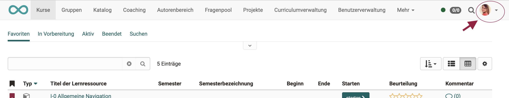{ class="shadow lightbox" title="Ansicht Kursübersicht" }

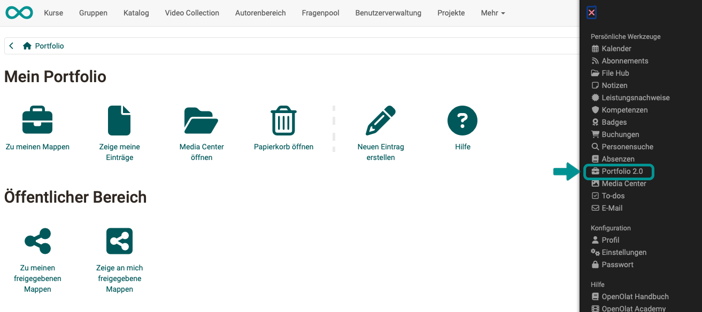{ class="shadow lightbox" title="Persönliches Menü" }

### 2. "Zeige an mich freigegebene Mappen" wählen {: #comment_open_shared_binders}

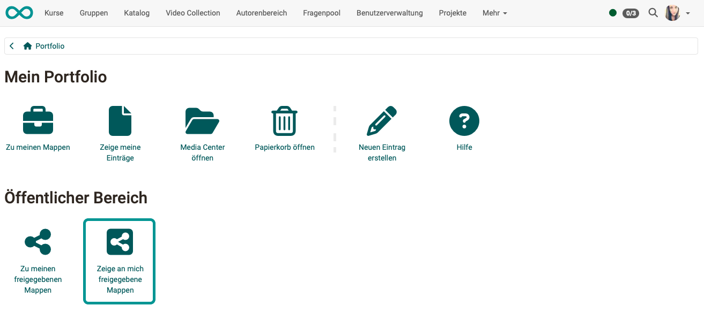{ class="shadow lightbox" title="Seite Mein Portfolio" }

### 3. Eintrag wählen {: #comment_choose_entry}

Wählen Sie im Tab "Einträge / To do" einen der Einträge aus.

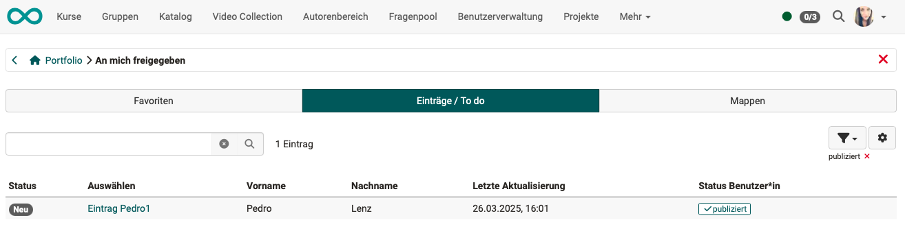{ class="shadow lightbox" title="Seite An mich freigegeben" }

### 4. Portfolioeintrag/Bearbeitung ansehen {: #comment_view_entry}

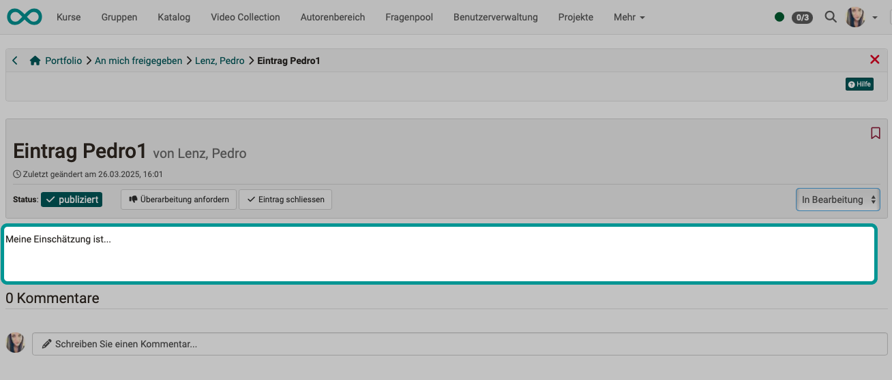{ class="shadow lightbox" title="Seite Eintrag Pedro1 im Bereich An mich freigegeben" }

### 5. Kommentartext einfügen {: #comment_add}

Fügen Sie Ihren Kommentar im vorgesehenen Feld hinzu. (Bei einem längeren Portfolioeintrag müssen Sie eventuell nach unten scrollen, um das Kommentarfeld zu sehen.) 

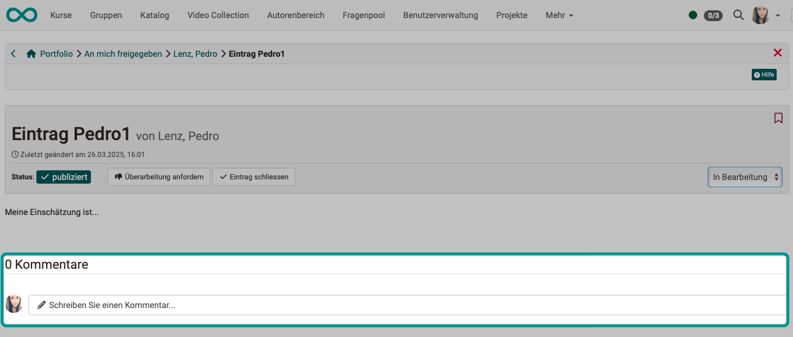{ class="shadow lightbox" title="Seite Eintrag Pedro1" }

### 6. Kommentar speichern {: #comment_save}

Die Ergänzung eines Kommentars wird automatisch gespeichert.

Ein abgegebener Kommentar bleibt für alle Beteiligten lesbar, auch wenn das Konto der kommentierenden Person später gelöscht wird. Text, angehängte Dateien und die Antworten darauf bleiben unverändert am Eintrag stehen. An die Stelle des Namens tritt die Bezeichnung "Unbekannte:r Benutzer:in", ohne Link auf eine Visitenkarte. Die Kommentare verschwinden erst, wenn der Eintrag, der Bereich, die Mappe oder der Kurs gelöscht wird. [:octicons-tag-16:{ title="ab Release 20.3.10 (OO-9632)" }](https://track.frentix.com/issue/OO-9632)

Mehr zum Löschen eines Kontos finden Sie hier: 
[Benutzer:in löschen >](../../manual_admin/usermanagement/Delete_User.de.md)

### 7. Eintrag schliessen {: #comment_close_entry}

Als **Betreuer:in** haben Sie zusätzlich den Button "Eintrag schliessen".
Schliessen Betreuer:innen einen Portfolioeintrag, wird er auch für andere Benutzer:innen, die den Eintrag kommentieren können, als geschlossen angezeigt und kann nicht mehr von ihnen kommentiert werden.

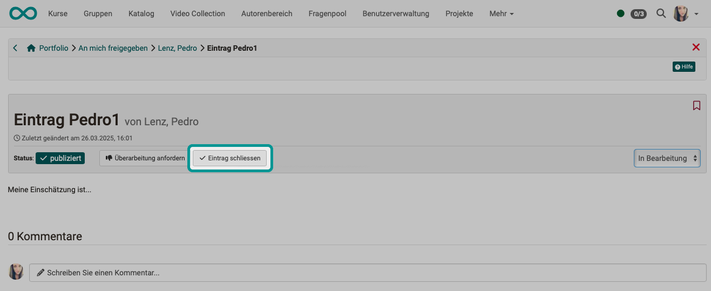{ class="shadow lightbox" title="Seite Eintrag Pedro1" }

### 8. Geschlossenen Eintrag wieder öffnen {: #comment_reopen}

Einen geschlossenen Eintrag (nicht mehr kommentierbar) können Sie als **Betreuer:in** mit dem Button "Neu eröffnen" wieder für die Ergänzung von Kommentaren frei geben.

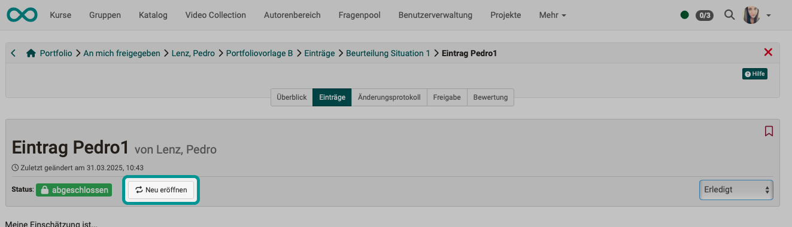{ class="shadow lightbox" title="Tab Einträge der Mappe Portfoliovorlage B" }

### 9. Status der Begutachtung eines Eintrags {: #comment_status}

Für Betreuer:innen steht am rechten Rand ein Auswahlbutton zur Verfügung.
Dort können sie einen Status für die eigene Begutachtung setzen.
Als Status der Begutachtung kann gesetzt werden:

- Neu (muss noch begutachtet/kommentiert werden)
- in Bearbeitung
- Erledigt (Begutachtung/Kommentierung wurde gemacht)

Der **Status der Begutachtung**, der mit dem Auswahlbutton am rechten Rand eingestellt wird, hat nichts mit dem **Bearbeitungsstatus** zu tun, der links ersichtlich ist (Entwurf, publiziert, in Überarbeitung). 

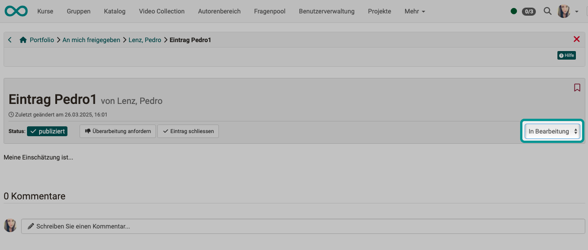{ class="shadow lightbox" title="Seite Eintrag Pedro1" }

Der **Status der Begutachtung/Kommentierung** durch einen/eine Betreuer:in wird im Tab Überblick grau hinterlegt angezeigt, zusätzlich zum **Status der Bearbeitung** durch den/die Erstellerin. 

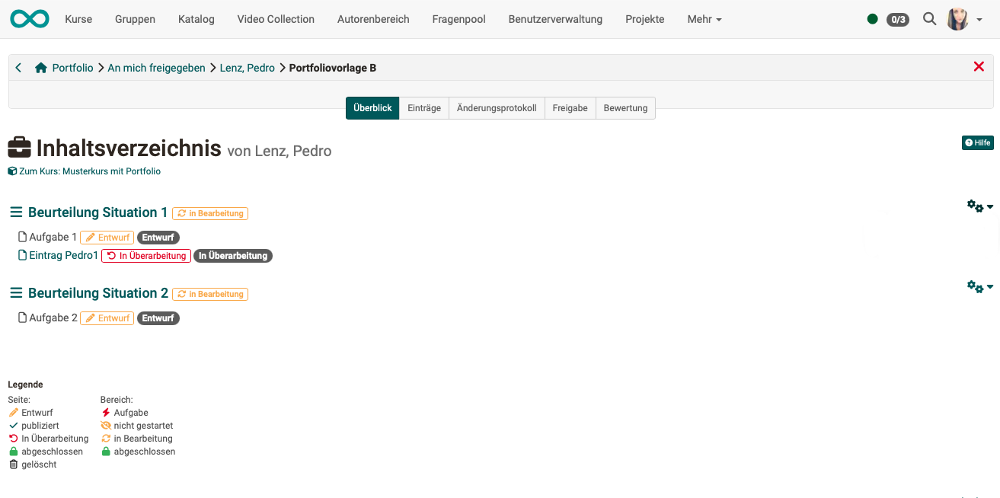{ class="shadow lightbox" title="Tab Überblick der Mappe Portfoliovorlage B" }

[Zum Seitenanfang ^](#portfolio_comment_grading)

---

## Portfolioaufgabe überarbeiten lassen [:octicons-tag-16:{ title="ab Release 11.0 (OO-2310)" }](https://track.frentix.com/issue/OO-2310) {: #rework}

### 1. Portfolio öffnen {: #rework_open} 

Öffnen Sie das persönliche Menü und dort Ihr Portfolio. 
[Siehe oben ^](#comment_open)

### 2. "Zeige an mich freigegebene Mappen" wählen {: #rework_open_shared_binders} 

[Siehe oben ^](#comment_open_shared_binders)

### 3. Eintrag wählen {: #rework_choose_entry} 

Wählen Sie im Tab "Einträge / To do" einen der Einträge aus. 
[Siehe oben ^](#comment_choose_entry)

### 4. Portfolioeintrag/Bearbeitung ansehen {: #rework_view_entry} 

[Siehe oben ^](#comment_view_entry)

### 5. "Überarbeitung anfordern" anklicken {: #rework_request_rework} 

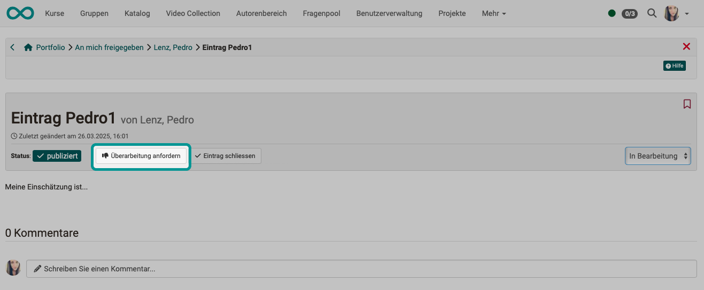{ class="shadow lightbox" title="Seite Eintrag Pedro1" }

Sowohl der Person, die den Kommentar abgegeben hat, wie auch dem/der Ersteller:in wird nun der Status "In Überarbeitung" angezeigt.  

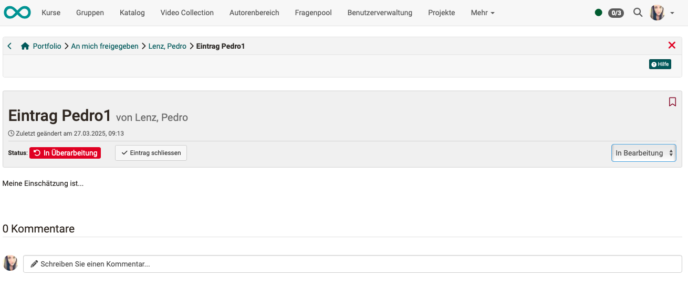{ class="shadow lightbox" title="Seite Eintrag Pedro1" }

[Zum Seitenanfang ^](#portfolio_comment_grading)

---

## Portfolioaufgabe bewerten [:octicons-tag-16:{ title="ab Release 11.0 (OO-2309)" }](https://track.frentix.com/issue/OO-2309) {: #grading}

!!! info "Wichtig"

    Unterscheiden Sie das Kommentieren und Begutachten eines Portfolioeintrags von der Bewertung durch Betreuer:innen. 

!!! info "Wichtig"

    Eine Bewertung geben Sie jeweils für eine Mappe ab, nicht für einzelne Einträge in dieser Mappe.

### 1. Portfolio öffnen {: #grading_open} 

Öffnen Sie das persönliche Menü und dort Ihr Portfolio. 
[Siehe oben ^](#comment_open)

### 2. "Zeige an mich freigegebene Mappen" wählen {: #grading_open_shared_binders} 

[Siehe oben ^](#comment_open_shared_binders)

### 3. Mappe auswählen {: #grading_choose_binder} 

Klicken Sie auf den Tab "Mappen" und wählen Sie die gewünschte Mappe zur Bewertung aus.  

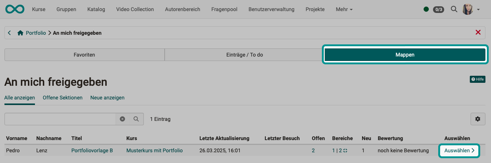{ class="shadow lightbox" title="Seite An mich freigegeben" }

### 4. Tab "Bewertung" wählen {: #grading_tab_grading} 

Wählen Sie den Tab "Bewertung".

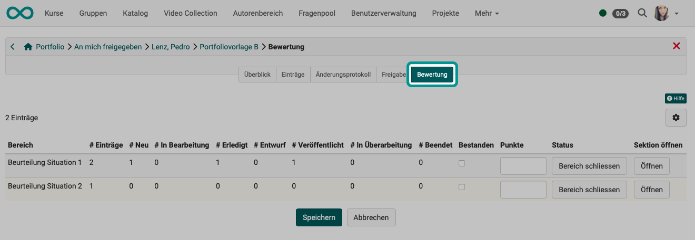{ class="shadow lightbox" title="Mappe Portfoliovorlage B mit Bereichsübersicht" }

### 5. Begutachtung der Bereiche prüfen {: #grading_check_sections} 

Überprüfen Sie, ob für Ihre Beurteilung alle Einträge in den Bereichen der Mappe kommentiert, erledigt und veröffentlicht sind. 

Bei Bedarf können Sie mit dem kleinen Zahnrad rechts oben über der Tabelle Spalten ein- oder ausblenden.

Mit Klick auf "Öffnen" in der Spalte "Sektion öffnen" können Sie direkt zum Tab "Überblick" springen.

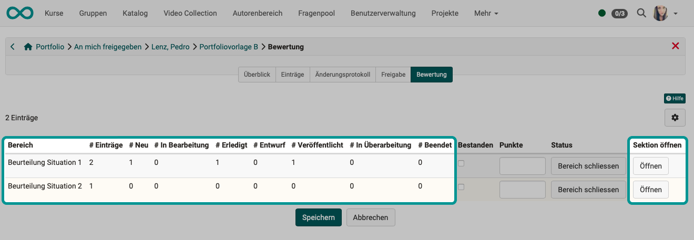{ class="shadow lightbox" title="Tab Bewertung der Mappe Portfoliovorlage B" }

### 6. Punkte vergeben und "Bestanden" {: #grading_give_points} 

Tragen Sie Punkte für die Bereiche in der gewählten Mappe ein und setzen Sie ggf. den Haken bei "Bestanden".

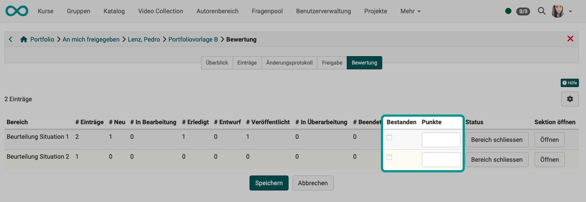{ class="shadow lightbox" title="Tab Bewertung der Mappe Portfoliovorlage B" }

### 7. Bewertung abschliessen {: #grading_close} 

Mit "Bereich schliessen" schliessen Sie die Bewertung komplett ab. Vergessen Sie nicht, zum Schluss noch zu speichern.

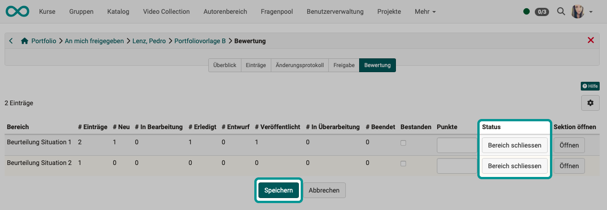{ class="shadow lightbox" title="Tab Bewertung der Mappe Portfoliovorlage B" }

Dem User wird nun der Status "Bestanden" oder "Nicht bestanden" und die eingetragene Punktzahl angezeigt.  

!!! info "Wichtig"

    Wird die Portfoliomappe aus einem Kursbaustein aufgerufen, beachten Sie bitte, dass die konkreten Bewertungsmöglichkeiten von den Einstellungen im Kurseditor abhängig sind. Je nach Voreinstellungen im Tab "Bewertung" des Kursbausteins Portfolioaufgabe können Punkte vergeben und/oder "Bestanden" angekreuzt werden oder nicht. 

!!! info "Wichtig"

    Wenn ein Bereich in der Bewertung geschlossen wird, kann der gesamte Bereich von Benutzer:innen nicht mehr bearbeitet werden.

[Zum Seitenanfang ^](#portfolio_comment_grading)

---

## Weiterführende Informationen {: #further_information}

[Benutzer:in löschen >](../../manual_admin/usermanagement/Delete_User.de.md) 
[Kursbaustein "Portfolioaufgabe" >](Course_Element_Portfolio_Task.de.md) 
[Allgemeines zum Portfolio >](../area_modules/Portfolio_General_Information.de.md) 
[Persönliche Werkzeuge: Portfolio 2.0 >](../personal_menu/Portfolio/index.de.md)

[Zum Seitenanfang ^](#portfolio_comment_grading)

