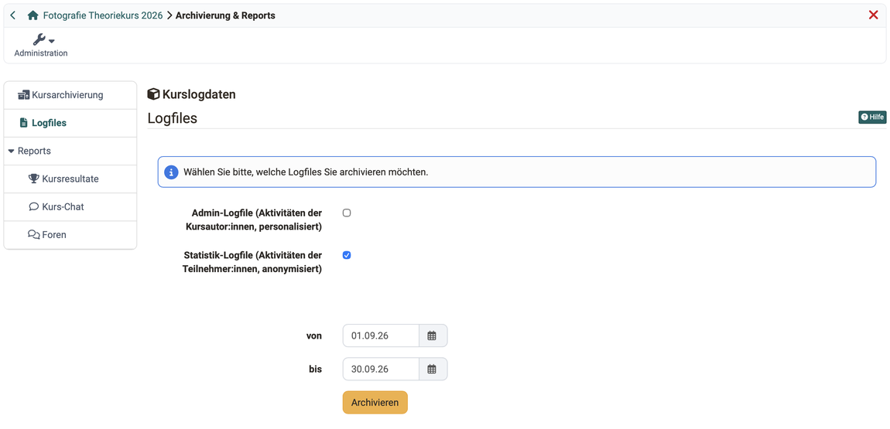
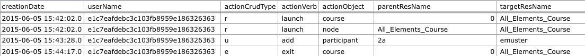

# Aufzeichnung der Kursaktivitäten {: #record_of_course_activities}

Wer nachvollziehen will, wie ein Kurs genutzt wird, wertet die Logfiles aus: OpenOlat zeichnet darin die Kursaktivitäten der Teilnehmenden und der Kursautor:innen auf.

Innerhalb eines Kurses archivieren Sie die Logfiles im Werkzeug [Archivierung & Reports](Course_Archiving/index.de.md) [:octicons-tag-16:{ title="ab Release 21.0 (OO-9620)" }](https://track.frentix.com/issue/OO-9620) unter: 
`Kurs > Administration > Archivierung & Reports > Logfiles`

Zur Auswahl stehen:

* Admin-Logfile mit personalisierten Daten der Kursautor:innen
* Statistik-Logfile mit pseudonymisierten Daten der Teilnehmenden
* Teilnehmer:innen-Logfile mit detaillierten, personalisierten Daten der Teilnehmenden

Logfiles archivieren können Besitzer:innen des Kurses sowie Lernressourcenverwalter:innen und Administrator:innen der Organisation, zu welcher der Kurs gehört. Besitzer:innen und Lernressourcenverwalter:innen wählen zwischen Admin-Logfile und Statistik-Logfile. Das Kursrecht "Datenarchivierung" öffnet das Werkzeug Archivierung & Reports, nicht aber die Logfiles. Wer nur über dieses Kursrecht verfügt, sieht unter Logfiles die Meldung "Sie sind nicht berechtigt, diese Logfiles zu archivieren."

Mit den Feldern "von" und "bis" begrenzen Sie die Logfiles auf einen Zeitraum, beide Felder sind optional. Der Zeitraum schliesst den Tag im Feld "bis" ein. Mit "Archivieren" erstellt OpenOlat die gewählten Logfiles und benachrichtigt Sie per E-Mail, sobald die ZIP-Datei bereitliegt. Das Bild zeigt die Auswahl, wie Besitzer:innen sie sehen.

{ class="shadow lightbox" title="Logfiles im Werkzeug Archivierung & Reports · 2026.10.02" }

!!! info "Datenschutz"

    Aus Datenschutzgründen ist das Teilnehmer:innen-Logfile mit den personalisierten Daten der Teilnehmenden nur für Administrator:innen der Organisation verfügbar, zu welcher der Kurs gehört.

OpenOlat legt die gewählten Logfiles als ZIP-Datei (z.B. _CourseLogFiles_2010-01-28_14-55-55.zip_) in den [persönlichen Dateien](../personal_menu/File_Hub.de.md#personal_files) im Ordner `private/archive/"Kurstitel"` ab. Die ZIP-Datei enthält dann die ausgewählten Dateien _course_statistic_log.xlsx_, _course_admin_log.xlsx_ und _course_user_log.xlsx_.

In der Datei _course_statistic_log.xlsx_ erhält jede:r Teilnehmer:in statt des Namens eine Kennung aus 32 Zeichen (z.B. `e1c7eafdebc3c103fb8959e186326363`), die innerhalb eines Kurses gleich bleibt. Sie können so die Aktivitäten von Teilnehmer:in X im Kurs Y verfolgen, jedoch keine Vergleiche mit den Aktivitäten im Kurs Z machen, da Teilnehmer:in X im Kurs Z eine andere Kennung erhält. Die Kennung ist ein Pseudonym: Zusammen mit anderen Angaben, etwa dem Zeitpunkt eines Forumsbeitrags, lässt sie sich einer Person zuordnen. Behandeln Sie die Datei deshalb wie personenbezogene Daten.

Die Tabelle fasst die möglichen Einträge der Logfile-Spalten "actionCrudType" (Datenbankoperation), "actionVerb" (Aktion) und "actionObject" (bearbeitetes Kursobjekt) alphabetisch zusammen:

actionCrudType| actionVerb| actionObject
---|---|---
c | add | calendar, chat, course, cpgetfile
r | copy | editor, efficency
u | denied | feed, feeditem, file, folder, forummessage, forumthread
d | do | glossary, gotonode, groupmanagement, group, grouparea, groupareaempty
e | edit | help
|  | exit | layout
|  | hide | node
|  | launch | owner
|  | lock | participant, publisher
|  | move | quota
|  | open | resource, rights, rightsempty
|  | remove | sharedfolder, spgetfile
|  | view | testattempts, testcomment, testid, testscore, testsuccess, tools, toolsempty
|  |  | waitingperson

Die Spalte "actionCrudType" fasst die Aktionen zu grundlegenden Datenbankoperationen zusammen. Für die Auswertung genügt meist die Spalte "actionVerb", die diese Operationen weiter aufschlüsselt. Die Werte der Spalte "actionCrudType" bedeuten:

* c = create (erstellen)
* r = retrieve (lesen, holen)
* u = update (verändern)
* d = delete (entfernen)
* e = exit (beenden)

Die Spalte "actionVerb" zeigt, welche Aktion die Person aus der Spalte "userName" mit dem Kursobjekt ausgeführt hat. Die Spalte "actionObject" nennt dieses Kursobjekt, also das Objekt, das aus Sicht der Datenbank verändert wurde. Die Spalten "parentResName" und "targetResName" nennen das übergeordnete Objekt und das Objekt, auf das die Aktion zielt.

{ class="shadow lightbox" title="Statistik-Logfile course_statistic_log.xlsx" }

Ein Beispiel ist die dritte Zeile im Bild:

`u / add / participant / [Gruppenname] / [Benutzername]`

Sie bedeutet, mit der Datenbankoperation update:

`Füge Benutzer [Benutzername] zu [Gruppe] hinzu`

## Weiterführende Informationen {: #further_information}

[Kursadministration - Archivierung & Reports >](Course_Archiving/index.de.md) 
[Persönliche Werkzeuge: File Hub >](../personal_menu/File_Hub.de.md) 
[Mitgliederverwaltung >](../learningresources/Members_management.de.md)

[Zum Seitenanfang ^](#record_of_course_activities)

