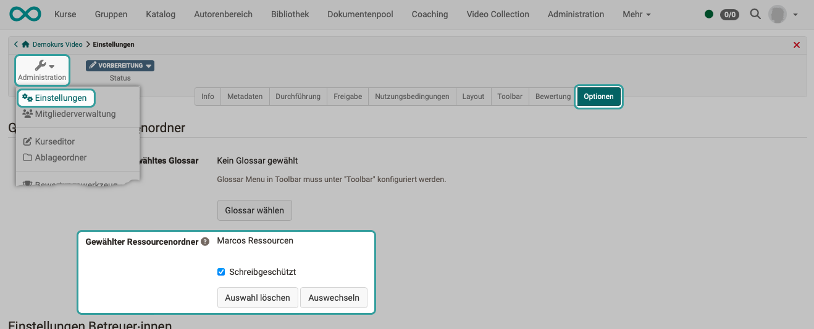
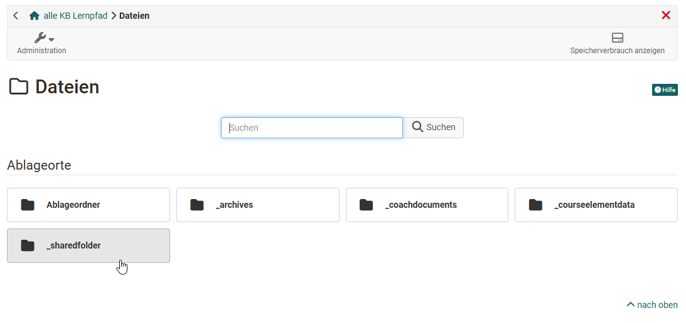
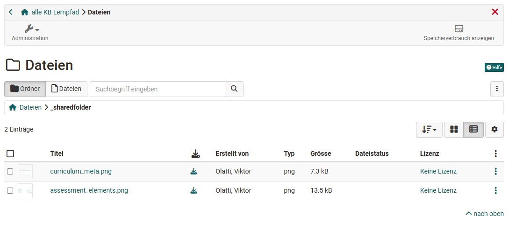

# Ressourcenordner {: #resource_folder}

Mit einem Ressourcenordner legen Sie Dateien an einer Stelle ab und nutzen sie in mehreren Kursen, zusätzlich zu den Dateien des einzelnen Kurses. Ressourcenordner sind in OpenOlat Lernressourcen, die Sie im Autorenbereich erstellen und eigenständig oder verknüpft mit Kursen verwenden.

## Steckbrief

Name | Ressourcenordner
---------|----------
Icon | :o_icon_o_FileResource-SHAREDFOLDER_icon:
Verfügbar seit | Release 7.1 oder früher
Zweck | Dateien zentral ablegen und in mehreren Kursen nutzen
Im Kurs | `Kurs > Administration > Einstellungen > Optionen`, ein Ressourcenordner je Kurs

## Ressourcenordner im Kurs verwenden

Mit einem Ressourcenordner organisieren Sie Dateien zentral, zum Beispiel Inhalte, Informationen und Grafiken, und nutzen sie in mehreren Kursen.

Den Ressourcenordner verbinden Sie in den Kurseinstellungen mit dem Kurs: Wählen Sie unter `Kurs > Administration > Einstellungen > Optionen` den gewünschten Ressourcenordner aus oder erstellen Sie einen neuen. Pro Kurs kann nur ein Ressourcenordner verknüpft werden.

Bei der Einbindung gibt es zwei Varianten: schreibgeschützt oder ohne Schreibschutz.

{ class="shadow lightbox" title="Tab Optionen in den Kurseinstellungen" }

- **Schreibgeschützt**: Die Dateien werden nur referenziert. Im Kurs lassen sie sich weder verändern noch löschen oder ergänzen. So nutzen alle verknüpften Kurse stets dieselben Dateien im selben Stand.
- **Ohne Schreibschutz**: Kursbesitzer:innen ändern und löschen Dateien oder fügen neue hinzu. Diese Anpassungen gelten direkt im Ressourcenordner und damit in allen verknüpften Kursen, auch wenn die betreffenden Personen keine Besitzer:innen des Ressourcenordners sind.

Überlegen Sie daher sorgfältig, ob der Schreibschutz aufgehoben werden soll.

### Hier findet man die Dateien des Ressourcenordners

Ist ein Ressourcenordner mit dem Kurs verbunden, erscheint er unter `Kurs > Administration > Dateien` als Ordner "_sharedfolder" mit allen Dateien des Ressourcenordners.

{ class="shadow lightbox" title="Seite Dateien eines Kurses" }

{ class="shadow lightbox" title="Ordner _sharedfolder auf der Seite Dateien eines Kurses" }

In der Standardeinstellung sind die Dateien des Ressourcenordners schreibgeschützt und können nicht verändert werden.

### Zugriff auf die Dateien

Ist der Ressourcenordner mit dem Kurs verbunden, nutzen Sie seine Dateien in den Kursbausteinen wie die Dateien des Ablageordners. Mit dem Kursbaustein [Ordner](Course_Element_Folder.de.md) zeigen Sie Teilnehmenden einen Ordner aus dem Ressourcenordner direkt im Kurs.

So nutzen Sie zentrale Dateien zum Beispiel für ein einheitliches Kurslayout, stellen Dokumente über den Kursbaustein "Dokument" bereit oder binden Bilder in den Kursbaustein "HTML-Seite" ein. Überall, wo Sie im Kurs Dateien aus dem Ablageordner wählen, steht daneben auch der Ordner "_sharedfolder" mit den Dateien des verknüpften Ressourcenordners bereit.

## Kursunabhängige Nutzung

Um den Ressourcenordner eigenständig zu verwenden, wählen Sie unter `Ressourcenordner > Administration > Einstellungen > Freigabe` den Verwendungszweck "Eigenständig" und richten ein Angebot ein, zum Beispiel ein Angebot für Gäste oder eine Buchung mit Zugangscode. Zusätzlich setzen Sie den Ressourcenordner auf den Status "Veröffentlicht". Bei einer Verbindung mit einem Kurs ist das nicht nötig.

Mehr dazu auf der Seite [Zugangskonfiguration / Freigabe](../learningresources/Access_configuration.de.md).

!!! note "Hinweis"

    Eine weitere Möglichkeit der unabhängigen Nutzung bietet [WebDAV](../basic_concepts/Using_WebDAV.de.md). In der WebDAV-Ansicht erscheinen neben Kursen und Gruppen im Ordner "sharedfolders" auch die Ressourcenordner: zum Bearbeiten jene, bei denen Sie Besitzer:in oder Betreuer:in sind, schreibgeschützt jene, bei denen Sie Teilnehmer:in sind.

## Weiterführende Informationen {: #further_information}

[Kursbaustein "Ordner" >](Course_Element_Folder.de.md) 
[Zugangskonfiguration / Freigabe >](../learningresources/Access_configuration.de.md) 
[Einsatz von WebDAV >](../basic_concepts/Using_WebDAV.de.md) 
[Kurseinstellungen - Tab Optionen >](Course_Settings_Options.de.md) 
[Wie kann ich dieselben Dateien in mehreren Kursen einsetzen? >](../../manual_how-to/multiple_use/multiple_use.de.md) 
[Ablageordner >](Storage_folder.de.md)

[Zum Seitenanfang ^](#resource_folder)
