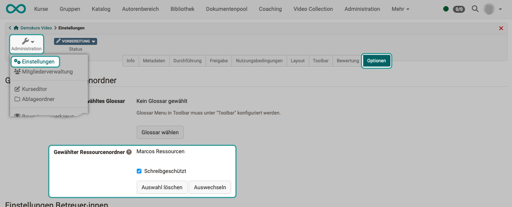
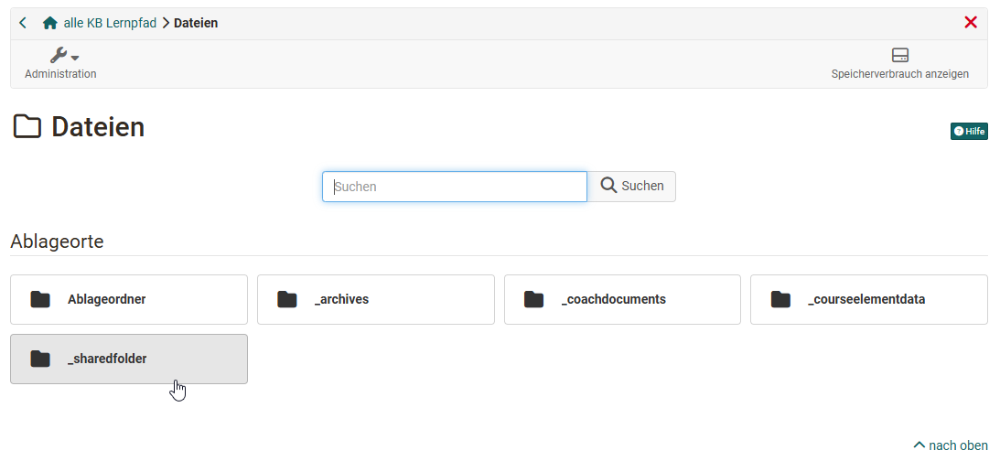
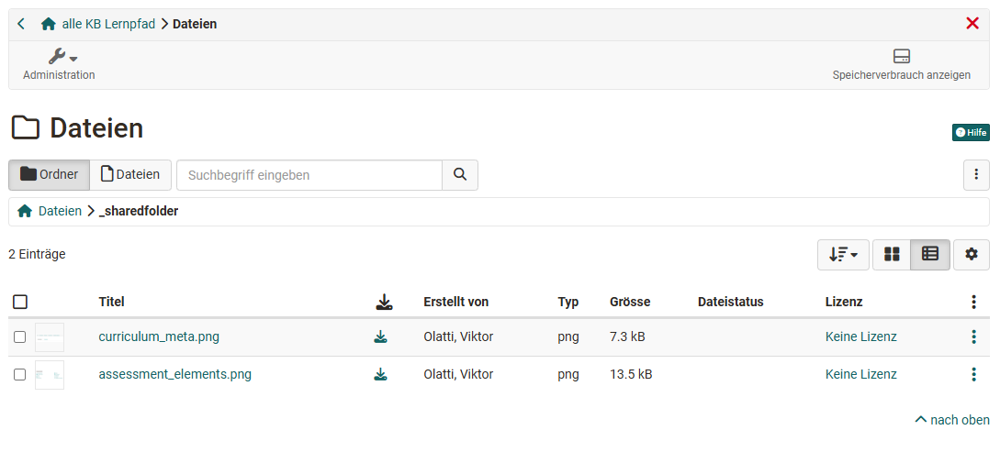

# Resource folder {: #resource_folder}

Resource folders are learning resources in OpenOlat and are created in the authoring area. They can be used standalone or linked to courses. 

To use cross-course files for course creation in addition to normal course files, a resource folder should be used.

## Using a resource folder in a course

A resource folder lets you centrally organize files (e.g. content, information, graphics) and use them in several courses.

To link a resource folder to a course, select the desired resource folder or create a new one under `Course > Administration > Settings > Options`. Only one resource folder can be linked per course.

There are two ways to embed it: read-only or without write protection.

{ class="shadow lightbox" title="Options tab in the course settings" }

**Read only**: The files are only referenced. Within the course, they can neither be changed, deleted, nor added to. This ensures that all courses always use the same up-to-date files.

**Without write protection**: Course owners can change, delete, or add files. These changes are applied directly in the resource folder and therefore affect all linked courses, even if the persons involved are not owners of the resource folder.

Therefore, consider carefully whether write protection should be removed.

### Where to find the files of the resource folder
Once a resource folder is linked to the course, it appears under `Course > Administration > Files` as "_sharedfolder" with all the files stored in the resource folder. 

{ class="shadow lightbox" title="Files page of a course" }

{ class="shadow lightbox" title="Folder _sharedfolder on the Files page of a course" }

By default, the files of the resource folder are read-only and cannot be changed.

### Accessing the files
The files of the resource folder can be used just like all other files in a course's storage folder, and can also be linked to different course elements. 

For example, central files could be used for a consistent course layout, or documents could be provided via the Document course element, or images could be integrated in the "HTML page" course element, and so on. Whenever there is access to the storage folder within the course, the documents of the linked resource folder can also be used via "_sharedfolder". 

## Using it independently of a course
To use the resource folder standalone, select the usage "Standalone" under `Resource folder > Administration > Settings > Share` and configure the sharing further, e.g. free for guests or with a password. The resource folder must then also be published. This is not necessary when linked to a course.

For more detailed information, see ["Access configuration/Share"](../learningresources/Access_configuration.md).

!!! note "Note"

    Another way to use it independently is via [WebDAV](../basic_concepts/Using_WebDAV.md). In the WebDAV view, in addition to courses and groups, the shared folders of which you are an owner are also displayed.

## Further information {: #further_information}

[Access configuration >](../learningresources/Access_configuration.md) 
[Using WebDAV >](../basic_concepts/Using_WebDAV.md) 
[Course Settings - Tab Options >](Course_Settings_Options.md) 
[How can I use the same files in several courses? >](../../manual_how-to/multiple_use/multiple_use.md) 
[Storage folder >](Storage_folder.md)

[To the top of the page ^](#resource_folder)
