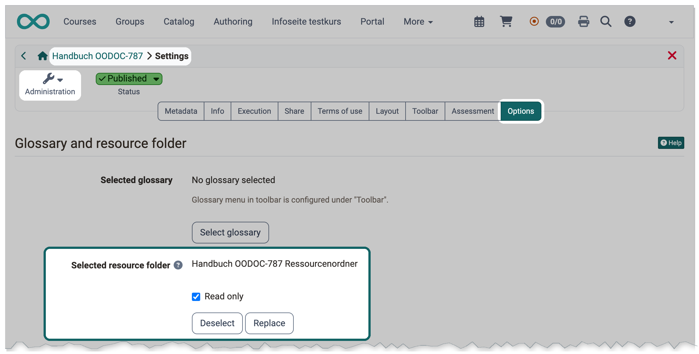
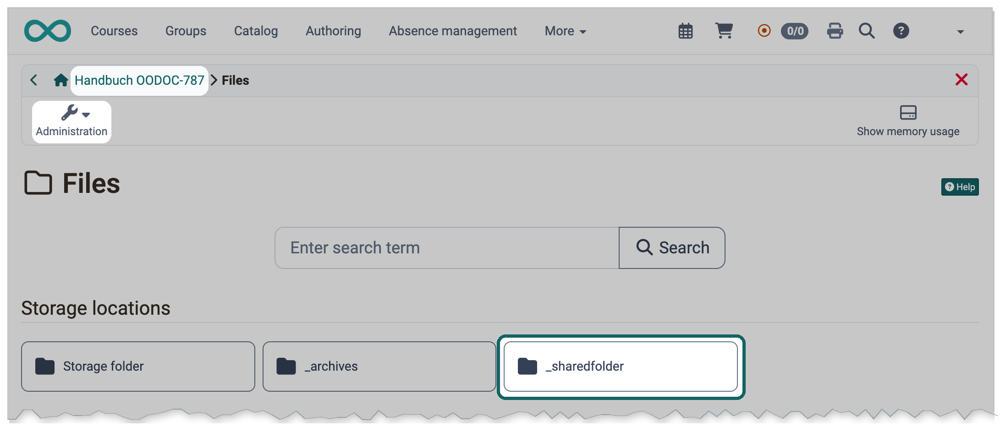
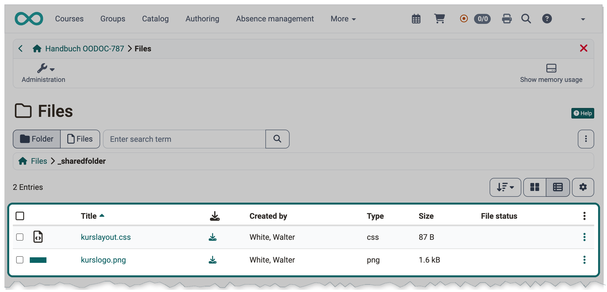

# Resource folder {: #resource_folder}

With a resource folder, you store files in one place and use them in several courses, in addition to the files of the individual course. In OpenOlat, resource folders are learning resources that you create in the authoring area and use standalone or linked to courses.

## Profile

Name | Resource folder
---------|----------
Icon | :o_icon_o_FileResource-SHAREDFOLDER_icon:
Available since | Release 7.1 or earlier
Purpose | Store files centrally and use them in several courses
In the course | `Course > Administration > Settings > Options`, one resource folder per course

## Using a resource folder in a course

With a resource folder, you organize files centrally, for example content, information and graphics, and use them in several courses.

As a course owner, you link the resource folder to the course in the course settings: under `Course > Administration > Settings > Options`, click "Replace" and select the desired resource folder or create a new one. Its title then appears under "Selected resource folder", and with "Save" you apply the selection. Only one resource folder can be linked per course.

With the checkbox "Read only", you choose between two ways to embed it: read-only or without write protection.

{ class="shadow lightbox" title="Options tab in the course settings · 2026.11.18" }

- **Read only**: Within the course, the files of the resource folder can neither be changed, deleted, nor added to. This way, all linked courses always use the same files in the same state.
- **Without write protection**: Course owners change and delete files or add new ones, under `Course > Administration > Files` in the folder "_sharedfolder". These changes apply directly in the resource folder and therefore in all linked courses, even if the persons involved are not owners of the resource folder.

Therefore, consider carefully whether write protection should be removed.

### Where to find the files of the resource folder

If a resource folder is linked to the course, it appears under `Course > Administration > Files` as the folder "_sharedfolder" with all files of the resource folder.

{ class="shadow lightbox" title="Files page of a course · 2026.11.18" }

{ class="shadow lightbox" title="Folder _sharedfolder on the Files page of a course · 2026.11.18" }

By default, the files of the resource folder are read-only and cannot be changed.

### Accessing the files

If the resource folder is linked to the course, you use its files in the course elements like the files of the storage folder. With the ["Folder" course element](Course_Element_Folder.md), you show participants a folder from the resource folder directly in the course.

For example, you use central files for a consistent course layout, provide documents via the "Document" course element or embed images in the "HTML page" course element. Wherever you select files from the storage folder in the course, the folder "_sharedfolder" with the files of the linked resource folder is also available next to it.

## Using it independently of a course

To use the resource folder standalone, select the usage "Standalone" under `Resource folder > Administration > Settings > Share` and set up an offer, for example an offer for guests or a booking with an access code. In addition, set the resource folder to the status "Published". This is not necessary when linked to a course.

For more information, see the page [Access configuration](../learningresources/Access_configuration.md).

!!! note "Note"

    Another way to use it independently is [WebDAV](../basic_concepts/Using_WebDAV.md). In the WebDAV view, in addition to courses and groups, the resource folders appear in the folder "sharedfolders": for editing those of which you are an owner or coach, read-only those of which you are a participant.

## Further information {: #further_information}

[Course Element "Folder" >](Course_Element_Folder.md) 
[Access configuration >](../learningresources/Access_configuration.md) 
[Using WebDAV >](../basic_concepts/Using_WebDAV.md) 
[Course Settings - Tab Options >](Course_Settings_Options.md) 
[How can I use the same files in several courses? >](../../manual_how-to/multiple_use/multiple_use.md) 
[Storage folder >](Storage_folder.md)

[To the top of the page ^](#resource_folder)
