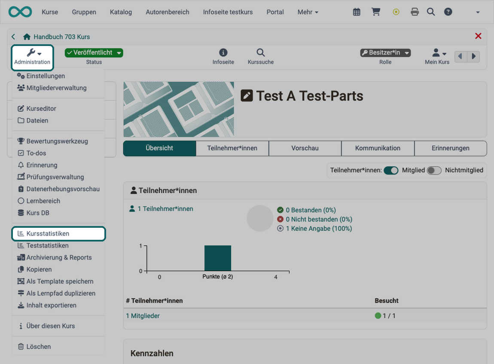

# Kursstatistiken {: #course_statistics}

{ class="shadow lightbox" title="Menü Administration eines Kurses · 2026.10.07" }

Mit den Kursstatistiken sehen Sie, wie oft und wann die Kursbausteine Ihres Kurses aufgerufen werden. Sie erhalten die Daten als Tabelle und als Grafik. Die Tabelle laden Sie als Excel-Datei herunter, zum Beispiel für die Weiterverarbeitung.

Sie öffnen die Kursstatistiken in der Kurs-Administration unter: `Kurs > Administration > Kursstatistiken`

Zugang zu den Kursstatistiken haben die Besitzer:innen des Kurses. Betreuer:innen und weitere Mitglieder sehen den Menüpunkt nur, wenn ihnen das Recht "Statistiken" erteilt wurde, siehe [Vergabe zusätzlicher Rechte](Members_management.de.md#additional_rights).

Für das Total der Kurszugriffe zählen die Klicks der Benutzer:innen auf einen Kursbaustein, nicht die Klicks auf den Inhalt eines Kursbausteins. Wählt eine Person zum Beispiel dreimal das Wiki in der Kursnavigation, zählt die Statistik drei Klicks. Klickt sie im Wiki selbst auf einen Link, zählt die Statistik keinen Klick.

Wie oft eine einzelne Datei in einem Ordner heruntergeladen wurde, zeigen die Kursstatistiken nicht. Dafür gibt es das Feld "Anzahl Ansichten" in den [Metadaten](../basic_concepts/Search_General/index.de.md#metadata) der Datei.

Sie erstellen Statistiken pro Stunde, pro Tag, pro Wochentag und pro Woche. Bei Statistiken pro Tag und pro Woche wählen Sie zusätzlich die Zeitspanne, für welche die Statistik die Kurszugriffe zeigt. Wählen Sie einen Kursbaustein in der Tabelle an, zeigt die Grafik die Zugriffe auf diesen Kursbaustein. Wählen Sie in der Zeile "Total" die Anzahl Klicks an, zeigt die Grafik die Zugriffe verteilt auf die Kursbausteine.

[Zum Seitenanfang ^](#course_statistics)

---

## Weiterführende Informationen {: #further_information}

**Auf dieser Seite erwähnt** 
[Mitgliederverwaltung >](Members_management.de.md) 
[Allgemeines zur Suche >](../basic_concepts/Search_General/index.de.md)

**Weiterführend** 
[Teststatistiken >](Statistics_Test.de.md) 
[Fragebogen Statistiken >](Statistics_Survey.de.md) 
[Kurs-Administration: Archivierung & Reports >](Course_Archiving/index.de.md)

[Zum Seitenanfang ^](#course_statistics)

