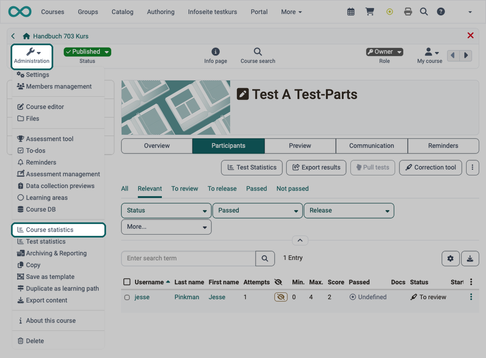

# Course statistics {: #course_statistics}

{ class="shadow lightbox" title="Administration menu of a course · 2026.10.07" }

With the course statistics you see how often and when the course elements of your course are accessed. You receive the data as a table and as a chart. You download the table as an Excel file, for example for further processing.

You open the course statistics in the course administration under: `Course > Administration > Course statistics`

The owners of the course have access to the course statistics. Coaches and other members only see the menu item if they have been granted the right "Statistics", see [Assignment of additional rights](Members_management.md#additional_rights).

For the total of course accesses, the clicks of users on a course element count, not the clicks on the content of a course element. If a person selects the wiki in the course navigation three times, for example, the statistics count three clicks. If the person clicks on a link within the wiki itself, the statistics count no click.

How often a single file in a folder was downloaded is not shown in the course statistics. For this, there is the field "Number of views" in the [metadata](../basic_concepts/Search_General.md#metadata) of the file.

You create statistics per hour, per day, per weekday and per week. For statistics per day and per week, you also choose the period for which the statistics show the course accesses. If you select a course element in the table, the chart shows the accesses to this course element. If you select the number of clicks in the row "Total", the chart shows the accesses distributed across the course elements.

[To the top of the page ^](#course_statistics)

---

## Further information {: #further_information}

**Mentioned on this page** 
[Members management >](Members_management.md) 
[General information on the search >](../basic_concepts/Search_General.md)

**Further reading** 
[Test statistics >](Statistics_Test.md) 
[Survey statistics >](Statistics_Survey.md) 
[Course administration - Archiving & Reports >](Course_Archiving.md)

[To the top of the page ^](#course_statistics)

