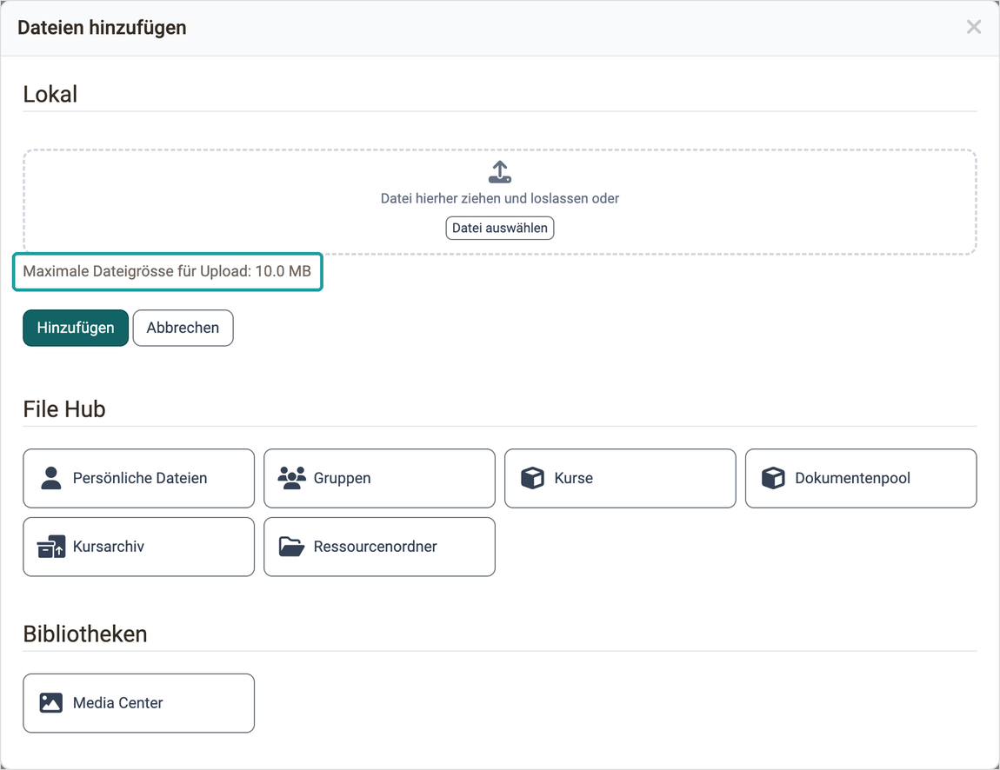
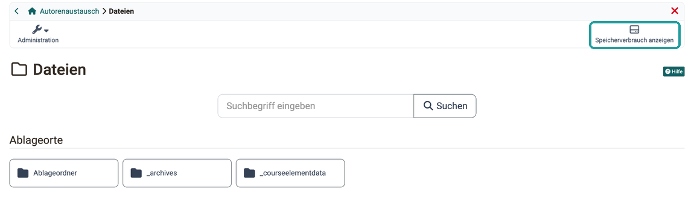

# Ablageordner {: #storage_folder}

Im "Ablageordner" eines Kurses legen Kursbesitzer:innen die Dateien ab, die sie im Kurs verwenden. So liegen die Dateien an einem Ort bereit, und Sie binden sie über Kursbausteine in den Kurs ein. Hierzu zählen zum Beispiel HTML-Seiten und Grafiken, die der Kursbaustein "HTML-Seite" anzeigt, und die Dateien eines Kursbausteins "Ordner", der die Option "Ordner aus Ablageordner des Kurses verwenden" nutzt. Sie öffnen den Ablageordner über `Kurs > Administration > Dateien > Ablageordner`. Diesen Weg sehen Kursbesitzer:innen, Administrator:innen, Lernressourcenverwalter:innen und Personen mit dem Kursrecht "Kurseditor".

Teilnehmende sehen die Dateien des Ablageordners dort, wo ein [Kursbaustein](Course_Elements/index.de.md) oder das Werkzeug "Dokumente" sie bereitstellt. Jeder Kurs hat seinen eigenen Ablageordner.

{ class="shadow lightbox" title="Ablageordner eines Kurses" }

Im Ablageordner können Sie Dateien hochladen, herunterladen, löschen, verschieben, kopieren, per E-Mail versenden, suchen, zippen, entzippen und neu erstellen. Mit "Ordner" und "Dateien" wechseln Sie zwischen der Ordneransicht und der Dateiansicht: Die Dateiansicht listet die Dateien aller Unterordner, ohne die Ordner selbst. Gelöschte Dateien und Ordner liegen im "Papierkorb", bis OpenOlat sie nach einer festgelegten Anzahl Tage endgültig löscht. Wie viele Tage das sind, zeigt die Ansicht "Papierkorb". Dort stellen Sie gelöschte Dateien und Ordner auch wieder her. Standardmässig erstellen Sie in OpenOlat HTML-Dokumente. Haben Administrator:innen in der System-Administration weitere Dokumenteneditoren aktiviert, erstellen Sie auch andere Dateiformate: `Administration > Externe Werkzeuge > Dokumenteneditoren`. Mit OnlyOffice zum Beispiel auch Word-, Excel- und PowerPoint-Dateien.

Beim Hochladen gelten zwei Grenzen: die maximale Dateigrösse je Datei und das Speicherlimit des ganzen Ablageordners, die [Quota](#storage_usage_edit_quota). Beide gelten auch, wenn Sie Dateien per [WebDAV](../basic_concepts/Using_WebDAV.de.md) in den Ablageordner hochladen. Die maximale Dateigrösse zeigt der Dialog "Dateien hinzufügen", den Sie über das Dropdown-Menü neben "Dateien hochladen" öffnen. Im Dialog laden Sie unter "Lokal" Dateien von Ihrem Gerät hoch oder übernehmen Dateien aus dem "[File Hub](../personal_menu/File_Hub.de.md)", der Ihre Dateien aus persönlichen Ordnern, Gruppen, Kursen und Ressourcenordnern zusammenführt, und aus Ihrem "[Media Center](../basic_concepts/Media_Center_Concept/index.de.md)". Den belegten Speicher und das Speicherlimit des Ablageordners sehen Sie unter der Dateiliste.

{ class="shadow lightbox" title="Dialog Dateien hinzufügen im Ablageordner" }

Mit "Ordner erstellen" im selben Dropdown-Menü legen Sie Unterordner an und gliedern so die Dateien des Kurses.

## Speicherverbrauch [:octicons-tag-16:{ title="ab Release 18.0.2 (OO-6938)" }](https://track.frentix.com/issue/OO-6938){:target="_blank"} {: #storage_usage}

Wird ein Kurs gross oder geht ein Upload nicht mehr durch, zeigt die Auswertung Speicherverbrauch, welche Ordner und Kursbausteine wie viel Speicher belegen und wo eine Quota die Grenze setzt. Eine Quota ist das Speicherlimit eines Ordners. So sehen Sie, wo Sie aufräumen können und ob Sie mehr Platz anfordern müssen.

Die Auswertung unterscheidet die internen Ressourcen des Kurses, also seine Ordner und Kursbausteine, von den eingebundenen Lernressourcen wie einem Test oder einem Video. Die eingebundenen Lernressourcen nennt OpenOlat externe Ressourcen.

Sie öffnen die Auswertung im Bereich "Dateien" mit dem Button :o_icon_o_icon_hdd: "Speicherverbrauch anzeigen" oben rechts: 
`Kurs > Administration > Dateien > Speicherverbrauch anzeigen`

{ class="shadow lightbox" title="Bereich Dateien der Kurs-Administration" }

Die Seite "Speicherverbrauch Ressourcen" zeigt oben die Werte "Gesamtgrösse", "Interne Grösse" und "Anzahl Dateien" des Kurses, dazu ein Kreisdiagramm mit dem Anteil der Ressourcen mit und ohne Quota. Darunter listet eine Tabelle den Ablageordner und die Kursbausteine in der Struktur des Kurses. Über das Suchfeld finden Sie eine Zeile nach Name oder Typ, "Alle öffnen" und "Alle schliessen" klappen die Struktur auf und zu. Je Zeile stehen der Typ, die Anzahl Dateien, die Grösse, die Quota und in der Spalte "Aktuell verwendet" ein Balken, wie viel der Quota belegt ist. Ab 80 Prozent hebt OpenOlat den Balken farbig hervor. Mit "Anzeigen" öffnen Sie den Ordner oder den Kursbaustein der Zeile. Die Tabelle lässt sich als Excel-Datei exportieren.

{ class="shadow lightbox" title="Seite Speicherverbrauch Ressourcen eines Kurses" }

Drei Filter grenzen die Tabelle ein:

* "Alle": alle Ordner und Kursbausteine des Kurses, auch solche ohne Dateien.
* "Intern mit Quota": die Ordner mit eigener Quota. Das sind der Ablageordner, "Unterlagen Betreuer:innen" und "Dokumente (Toolbar)" sowie die Kursbausteine "Ordner" und "Teilnehmer:innen Ordner".
* "Intern ohne Quota": die Kursbausteine, die Speicher belegen, aber keine eigene Quota haben. Das sind "Forum", "Dateidiskussion", "Aufgabe", "Gruppenaufgabe", "Seite" und "Themenbörse".

Verwendet ein Kursbaustein "Ordner" als Ablageort einen Ordner aus dem Ablageordner, erscheint er nicht als eigene Zeile. Dasselbe gilt für "Unterlagen Betreuer:innen" und "Dokumente (Toolbar)", wenn sie einen Ordner aus dem Ablageordner nutzen. Die Dateien zählen dann zum Ablageordner und fallen unter dessen Quota. Beim Kursbaustein "Teilnehmer:innen Ordner" zeigt die Tabelle je Teilnehmer:in den Abgabeordner und den Rückgabeordner. Die Quota gilt für jeden dieser Ordner einzeln.

### Quota anpassen {: #storage_usage_edit_quota}

Die Aktion "Quota anpassen" steht nur in den Zeilen mit eigener Quota: beim Ablageordner, bei "Unterlagen Betreuer:innen" und "Dokumente (Toolbar)" sowie bei den Kursbausteinen "Ordner" und "Teilnehmer:innen Ordner". Die Kursbausteine "Forum", "Dateidiskussion", "Aufgabe", "Gruppenaufgabe", "Seite" und "Themenbörse" zählen ihren Verbrauch, haben aber keine Quota, die sich anpassen lässt.

Ändern können die Quota [Administrator:innen, Systemadministrator:innen und Lernressourcenverwalter:innen](../basic_concepts/Roles/index.de.md#org) der Organisation, der der Kurs angehört. Alle anderen sehen im Dialog "Quota anpassen" die aktuellen Werte, aber keinen Button zum Speichern. Brauchen Sie für einen Ordner mehr Platz, wenden Sie sich an eine dieser Personen.

Weitere Wege, den Speicherbedarf zu senken, beschreibt die Anleitung ["Mit welchen Massnahmen kann ich den Speicherverbrauch reduzieren?"](../../manual_how-to/reduce_storage_consumption/reduce_storage_consumption.de.md).

## Automatisch angelegte Ordner [:octicons-tag-16:{ title="ab Release 19.0 (OO-7700)" }](https://track.frentix.com/issue/OO-7700)

Welche Ordner OpenOlat für einen Kurs zusätzlich anlegt, sehen Sie unter `Kurs > Administration > Dateien`. Dort stehen sie je nach Kurskonfiguration neben dem Ablageordner:

* **_courseelementdata**: Wird angelegt, sobald der Kurs mindestens einen Kursbaustein "Ordner" oder "Teilnehmer:innen Ordner" enthält. In diesem Ordner liegen die Ordner aller Kursbausteine "[Ordner](../learningresources/Course_Element_Folder.de.md)" und "[Teilnehmer:innen Ordner](../learningresources/Course_Element_Participant_Folder.de.md)" eines Kurses. Sie erscheinen hier automatisch, sobald der Kursbaustein im Kurseditor angelegt ist, und lassen sich hier auch bearbeiten.
* **_sharedfolder**: Wird angelegt, wenn der Kurs mit einem [Ressourcenordner](../learningresources/Resource_Folder.de.md) verknüpft wird. Der zugewiesene Ressourcenordner kann hier eingesehen, standardmässig jedoch nicht editiert werden. Soll eine Bearbeitung hier möglich sein, deaktivieren Sie in den Kurseinstellungen beim gewählten Ressourcenordner die Option "Schreibgeschützt": `Kurs > Administration > Einstellungen > Optionen`.
* **_documents**: Wird angelegt, wenn im Kurs das Werkzeug "[Dokumente](Course_Settings_Toolbar.de.md#documents)" aktiviert ist und als "Ablageort" der "Automatisch generierte Ordner" gewählt ist. Hier liegen die Dateien, die über das Werkzeug "Dokumente" zentral zum Download bereitstehen.
* **_coachdocuments**: Wird angelegt, wenn im Kurs der Ordner "Unterlagen Betreuer:innen" aktiviert ist und als "Ablageort" der "Automatisch generierte Ordner" gewählt ist. Beides legen Sie unter `Kurs > Administration > Einstellungen > Optionen` fest. Hier liegen die Dateien, die nur Betreuer:innen und Kursbesitzer:innen sehen. [:octicons-tag-16:{ title="ab Release 16.0 (OO-5566)" }](https://track.frentix.com/issue/OO-5566)

## Verbindung von Ablageordner und dem Kursbaustein "HTML-Seite"

Eine Datei aus dem Ablageordner, zum Beispiel eine HTML- oder PDF-Datei, zeigen Sie mit dem Kursbaustein "[HTML-Seite](Course_Element_HTML_Page.de.md)" im Kurs an. Verweist die HTML-Datei auf Grafiken oder andere Dateien im Ablageordner, aktivieren Sie im Kursbaustein die Checkbox "Link in gesamten Ablageordner erlauben": 
`Kurs > Administration > Kurseditor > "Titel des Kursbausteins" > Tab "Seiteninhalt"` 
Dann darf die HTML-Datei auf jede Datei im Ablageordner verlinken, und die verknüpften Grafiken erscheinen auf der Seite.

Mit aktivierter Checkbox ist für alle, welche die HTML-Seite öffnen, der Pfad zu den übrigen Dateien im Ablageordner sichtbar. Über diesen Pfad können auch Teilnehmende Dateien aufrufen, die der Kurs sonst nirgends bereitstellt.

## Weiterführende Informationen {: #further_information}

**Auf dieser Seite erwähnt** 
[Kursbausteine im Überblick >](Course_Elements/index.de.md) 
[Einsatz von WebDAV >](../basic_concepts/Using_WebDAV.de.md) 
[Persönliche Werkzeuge: File Hub >](../personal_menu/File_Hub.de.md) 
[Media Center: Konzept >](../basic_concepts/Media_Center_Concept/index.de.md) 
[Rollen und Rechte: Welche Rollen gibt es? >](../basic_concepts/Roles/index.de.md) 
[Mit welchen Massnahmen kann ich den Speicherverbrauch reduzieren? >](../../manual_how-to/reduce_storage_consumption/reduce_storage_consumption.de.md) 
[Kursbaustein "Ordner" >](Course_Element_Folder.de.md) 
[Kursbaustein "Teilnehmer:innen Ordner" >](Course_Element_Participant_Folder.de.md) 
[Ressourcenordner >](Resource_Folder.de.md) 
[Toolbar >](Course_Settings_Toolbar.de.md) 
[Kursbaustein "HTML-Seite" >](Course_Element_HTML_Page.de.md)

**Weiterführend** 
[Ordnerkonzept >](../basic_concepts/Folder_Concept.de.md)

[Zum Seitenanfang ^](#storage_folder)
