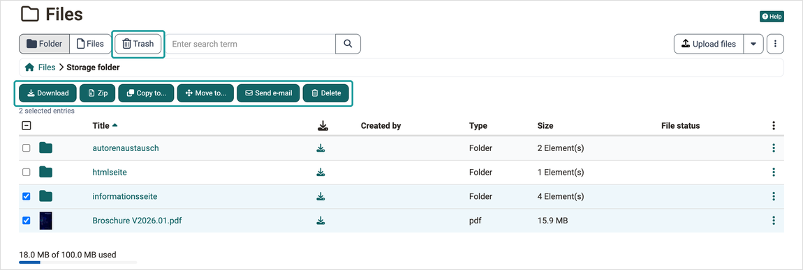
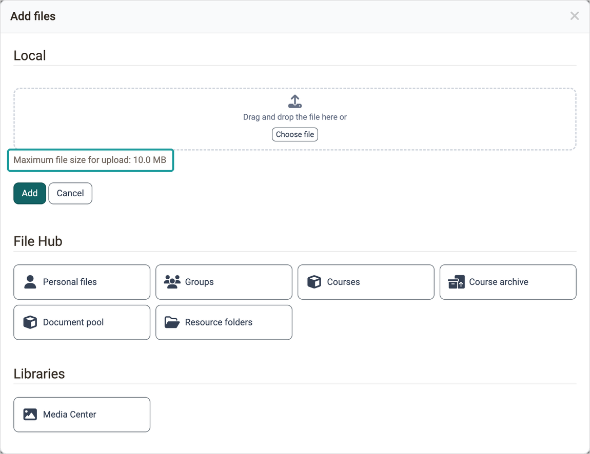
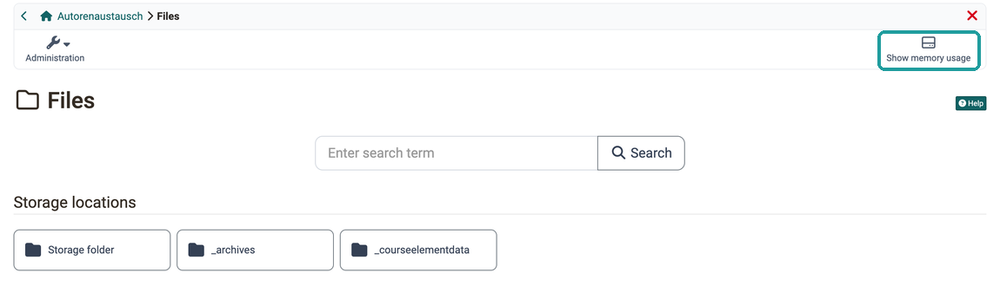
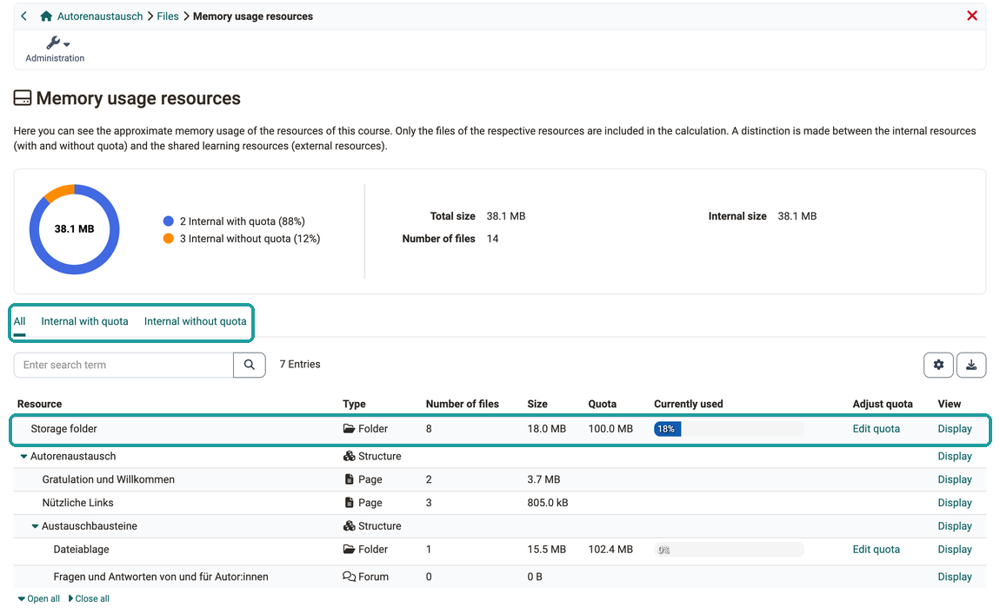

# Storage folder {: #storage_folder}

In the "Storage folder" of a course, course owners store the files they use in the course. This keeps the files ready in one place, and you integrate them into the course via course elements. This includes, for example, HTML pages and graphics that the course element "HTML page" displays, and the files of a course element "Folder" that uses the option "Choose folder from course storage". You open the storage folder via `Course > Administration > Files > Storage folder`. This path is visible to course owners, administrators, learning resource managers and persons with the course right "Course editor".

Participants see the files of the storage folder where a [course element](Course_Elements/index.md) or the "Documents" tool provides them. Each course has its own storage folder.

{ class="shadow lightbox" title="Storage folder of a course" }

In the storage folder you can upload, download, delete, move, copy, send by e-mail, search, zip, unzip and create files. With "Folder" and "Files" you switch between the folder view and the files view: the files view lists the files of all subfolders, without the folders themselves. Deleted files and folders remain in the "Trash" until OpenOlat permanently deletes them after a defined number of days. The "Trash" view shows how many days that is. There you also restore deleted files and folders. By default, you create HTML documents in OpenOlat. If administrators have activated further document editors in the system administration, you also create other file formats: `Administration > External tools > Document editors`. With OnlyOffice, for example, also Word, Excel and PowerPoint files.

Two limits apply when uploading: the maximum file size per file and the storage limit of the whole storage folder, the [quota](#storage_usage_edit_quota). Both also apply when you upload files via [WebDAV](../basic_concepts/Using_WebDAV.md) to the storage folder. The maximum file size is shown in the "Add files" dialog, which you open via the dropdown menu next to "Upload files". In the dialog, you upload files from your device under "Local" or take over files from the "[File Hub](../personal_menu/File_Hub.md)", which brings together your files from personal folders, groups, courses and resource folders, and from your "[Media Center](../basic_concepts/Media_Center_Concept/index.md)". The used space and the storage limit of the storage folder are shown below the file list.

{ class="shadow lightbox" title="Add files dialog in the storage folder" }

With "Create folder" in the same dropdown menu, you create subfolders and thus structure the files of the course.

## Storage usage [:octicons-tag-16:{ title="from Release 18.0.2 (OO-6938)" }](https://track.frentix.com/issue/OO-6938){:target="_blank"} {: #storage_usage}

When a course grows large or an upload no longer goes through, the storage usage evaluation shows which folders and course elements occupy how much storage and where a quota sets the limit. A quota is the storage limit of a folder. This shows you where you can clean up and whether you need to request more space.

The evaluation distinguishes the internal resources of the course, that is its folders and course elements, from the embedded learning resources such as a test or a video. OpenOlat calls the embedded learning resources external resources.

You open the evaluation in the "Files" area with the :o_icon_o_icon_hdd: "Show memory usage" button at the top right: 
`Course > Administration > Files > Show memory usage`

{ class="shadow lightbox" title="Files area of the course administration" }

The storage usage page, titled "Memory usage resources" on screen, shows the values "Total size", "Internal size" and "Number of files" of the course at the top, together with a pie chart showing the share of resources with and without quota. Below, a table lists the storage folder and the course elements in the structure of the course. The search field finds a row by name or type, "Open all" and "Close all" expand and collapse the structure. Each row shows the type, the number of files, the size, the quota and, in the "Currently used" column, a bar showing how much of the quota is occupied. From 80 percent, OpenOlat highlights the bar in color. "Display" opens the folder or the course element of the row. The table can be exported as an Excel file.

{ class="shadow lightbox" title="Memory usage resources page of a course" }

Three filters narrow down the table:

* "All": all folders and course elements of the course, including those without files.
* "Internal with quota": the folders with their own quota. These are the storage folder, "Coach files" and "Documents (Toolbar)" as well as the course elements "Folder" and "Participant folder".
* "Internal without quota": the course elements that occupy storage but have no quota of their own. These are "Forum", "File dialog", "Task", "Group task", "Page" and "Topic broker".

If a "Folder" course element uses a folder from the storage folder as its file destination, it does not appear as a separate row. The same applies to "Coach files" and "Documents (Toolbar)" when they use a folder from the storage folder. The files then count towards the storage folder and fall under its quota. For the "Participant folder" course element, the table shows the drop box and the return box for each participant. The quota applies to each of these folders individually.

### Edit quota {: #storage_usage_edit_quota}

The "Edit quota" action only appears in rows with their own quota: for the storage folder, for "Coach files" and "Documents (Toolbar)" as well as for the course elements "Folder" and "Participant folder". The course elements "Forum", "File dialog", "Task", "Group task", "Page" and "Topic broker" count their usage but have no quota that can be adjusted.

The quota can be changed by [administrators, system administrators and learning resource managers](../basic_concepts/Roles/index.md#org) of the organisation the course belongs to. Everyone else sees the current values in the "Edit quota" dialog, but no button to save. If you need more space for a folder, contact one of these persons.

The guide ["What measures can I take to reduce storage space consumption?"](../../manual_how-to/reduce_storage_consumption/reduce_storage_consumption.md) describes further ways to reduce storage requirements.

## Automatically generated folders [:octicons-tag-16:{ title="from Release 19.0 (OO-7700)" }](https://track.frentix.com/issue/OO-7700)

The additional folders OpenOlat creates for a course are shown under `Course > Administration > Files`. Depending on the course configuration, they appear next to the storage folder:

* **_courseelementdata**: Generated as soon as the course contains at least one course element "Folder" or "Participant folder". This folder contains the folders of all course elements "[Folder](../learningresources/Course_Element_Folder.md)" and "[Participant folder](../learningresources/Course_Element_Participant_Folder.md)" of a course. They appear here automatically as soon as the course element has been created in the course editor, and can be edited here as well.
* **_sharedfolder**: Generated when the course is connected to a [resource folder](../learningresources/Resource_Folder.md). The linked resource folder can be viewed here, but cannot be edited by default. To enable editing here, deactivate the option "Read only" for the selected resource folder in the course settings: `Course > Administration > Settings > Options`.
* **_documents**: Generated when the course tool "[Documents](Course_Settings_Toolbar.md#documents)" is enabled and "Automatically generated folder" is selected as "File destination". It contains the files that are provided for central download via the "Documents" tool.
* **_coachdocuments**: Generated when the folder "Coach files" is enabled in the course and "Automatically generated folder" is selected as "File destination". You define both under `Course > Administration > Settings > Options`. It contains the files that only coaches and course owners see. [:octicons-tag-16:{ title="from Release 16.0 (OO-5566)" }](https://track.frentix.com/issue/OO-5566)

## Link course element "HTML page" to storage folder

You display a file from the storage folder, for example an HTML or PDF file, in the course with the course element "[HTML page](Course_Element_HTML_Page.md)". If the HTML file refers to graphics or other files in the storage folder, activate the checkbox "Allow links in the entire storage folder" in the course element: 
`Course > Administration > Course editor > "Title of the course element" > Tab "Page content"` 
The HTML file may then link to any file in the storage folder, and the linked graphics appear on the page.

With the checkbox activated, the path to the other files in the storage folder is visible to everyone who opens the HTML page. Via this path, participants can also call up files that the course does not provide anywhere else.

## Further information {: #further_information}

**Mentioned on this page** 
[Course elements at a glance >](Course_Elements/index.md) 
[Using WebDAV >](../basic_concepts/Using_WebDAV.md) 
[User tools: File Hub >](../personal_menu/File_Hub.md) 
[Media Center Concept >](../basic_concepts/Media_Center_Concept/index.md) 
[Roles and Rights: Which roles are available? >](../basic_concepts/Roles/index.md) 
[What measures can I take to reduce storage space consumption? >](../../manual_how-to/reduce_storage_consumption/reduce_storage_consumption.md) 
[Course Element "Folder" >](Course_Element_Folder.md) 
[Course Element "Participant folder" >](Course_Element_Participant_Folder.md) 
[Resource folder >](Resource_Folder.md) 
[Toolbar >](Course_Settings_Toolbar.md) 
[Course Element "HTML page" >](Course_Element_HTML_Page.md)

**Further reading** 
[Folder concept >](../basic_concepts/Folder_Concept.md)

[To the top of the page ^](#storage_folder)
