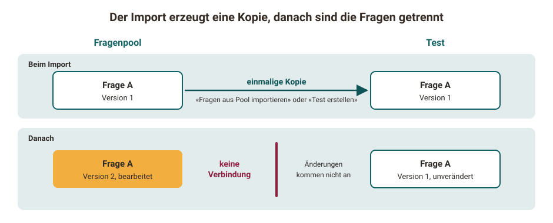

# Tests erstellen {: #create_tests}

Dieses Kapitel erklärt, wie Autor:innen in OpenOlat Tests erstellen, welche Fragetypen zur Verfügung stehen und welche Einstellungen bereitstehen. Darüber hinaus erfahren Sie, wie Sie Tests und Selbsttests in Kurse einbinden und nutzen und wie Sie Testergebnisse auswerten und bereitstellen.

OpenOlat speichert Tests im standardisierten Format QTI 2.1. QTI steht für "Question & Test Interoperability", ein Datenformat für Online-Tests. Tests in diesem Format lassen sich auch in anderen LMS und Systemen nutzen, die den Standard unterstützen. [IMS](http://www.imsglobal.org/ "IMS") entwickelt solche offenen Standards für den E-Learning-Bereich.

In OpenOlat gehören Tests zu den "Lernressourcen". Sie erstellen eine Lernressource separat und binden sie in Online-Kurse ein. So verwenden Sie zum Beispiel dieselbe Lernressource "Test (QTI 2.1)" in mehreren Kursen.

[Zum Seitenanfang ^](#create_tests)

---

## Was ist ein Test? {: #definition_test}

Mit Tests kontrollieren Sie Leistungen, prüfen den aktuellen Wissensstand oder führen eine Online-Klausur durch. Sie setzen Tests zu Beginn, während oder am Ende eines Kurses ein, oder auch unabhängig von Kursen.

Formative Tests erfassen einen Lernzwischenstand. Mit automatischem oder manuellem Feedback verbessern sich die Teilnehmenden im Verlauf des Lernens.

Summative Tests stehen am Ende eines Lernprozesses oder einer Veranstaltung. Sie prüfen, ob die geplanten Lernziele erreicht sind. Ein Beispiel dafür sind scharfe Prüfungen oder Online-Klausuren.

Tests erstellen Sie mit dem [OpenOlat-Testeditor](../Test_editor_QTI_2.1/index.de.md) als Test im Format QTI 2.1. Dabei bestimmen Sie die Länge des Tests, die [Fragetypen](../Test_question_types.de.md) und weitere Einstellungen.

OpenOlat schickt die Antworten an den Server und wertet sie erst dort aus. Die Lösungen stehen deshalb nicht im Quellcode des Tests oder Selbsttests, den Teilnehmende im Browser sehen.

Wenn Sie einen Test in Ihren Kurs einbinden, entscheiden Sie, ob Sie ihn als Selbsttest, also zu Übungszwecken, oder als Prüfungstest ("scharfer" Test) einsetzen. Im ersten Fall verwenden Sie den Kursbaustein "Selbsttest", im zweiten Fall den Kursbaustein "Test". OpenOlat speichert Selbsttestresultate anonymisiert und Prüfungstestresultate personalisiert. Bei Selbsttests sehen Betreuer:innen nicht, welche Resultate einzelne Teilnehmende erzielt haben.

Je nach Lehrszenario ist auch für Übungszwecke der Kursbaustein "Test" sinnvoll: immer dann, wenn Betreuer:innen wissen möchten, wie sich einzelne Teilnehmende entwickeln, oder wenn sie schwächere Kursmitglieder erkennen und gezielt unterstützen wollen. Prüfen Sie deshalb für jedes Lehrszenario, welcher Kursbaustein passt.

[Zum Seitenanfang ^](#create_tests)

---

## Wie kommen die Fragen in einen Test? {: #create_questions_in_tests}

Die Fragen eines Tests erstellen Sie direkt in der Lernressource Test, oder Sie erstellen sie im [Fragenpool](../../area_modules/Question_Bank/index.de.md) und OpenOlat kopiert sie aus dem Fragenpool in den Test. Im Kapitel [Wie gehe ich vor, wenn ich einen Test erstelle?](../../../manual_how-to/test_creation_procedure/test_creation_procedure.de.md) erfahren Sie, wie Sie einen Test Schritt für Schritt erstellen.

!!! warning "Kopie, keine Verknüpfung"

    Fragen aus dem Fragenpool kommen als Kopie in den Test. Frage im Fragenpool und Frage im Test sind danach zwei getrennte Fragen. Ändern Sie die Frage im Fragenpool, bleibt die Frage im Test unverändert, und umgekehrt. Woher eine Frage stammt, sehen Sie im Testeditor im Tab "Fragenpool". Soll der Test die geänderte Fassung verwenden, entfernen Sie die Frage im Test und importieren Sie sie neu aus dem Fragenpool, solange der Test noch nicht durchgeführt wurde.

{ class="shadow lightbox" title="Frage aus dem Fragenpool als Kopie im Test · 2026.11.09" }

Aus dem Fragenpool kommen Fragen auf zwei Wegen in einen Test:

* **Testeditor:** In einem bestehenden Test wählen Sie `Elemente hinzufügen > Fragen aus Pool importieren`, siehe [Fragen aus dem Fragenpool verwenden](../Test_editor_QTI_2.1/index.de.md#questions_from_pool).
* **Fragenpool:** Mit dem Button "Test erstellen" legt OpenOlat aus den ausgewählten Fragen einen neuen Test an, siehe [Test erstellen](../../area_modules/Question_bank_possible_operations.de.md#learning_resource_test).

OpenOlat kopiert die Frage zum Zeitpunkt des Imports. Eine Frage aus dem Fragenpool ist im Testeditor zunächst schreibgeschützt, solange sie dieselbe ID trägt wie die Frage im Fragenpool. Der Tab "Fragenpool" zeigt ihre Herkunft: "ID", "Master ID", "Autor:innen", "Kopiert am" und "Version".

Möchten Sie die Frage im Test bearbeiten, klicken Sie im Tab "Fragenpool" auf "Kopie erstellen und bearbeiten". Die Frage erhält eine neue ID, die bisherige ID steht danach unter "Master ID". Über die "Master ID" öffnen Sie weiterhin die Originalfrage im Fragenpool.

Auch der umgekehrte Weg erzeugt eine Kopie: Mit [Zum Pool exportieren](../Test_export.de.md#export_to_pool) legt OpenOlat im Fragenpool eine neue Frage mit eigener ID an.

Liegt Ihnen ein Test als Datei im Format IMS QTI aus einem anderen LMS vor, importieren Sie ihn als Lernressource. Wie Sie dabei vorgehen, beschreibt der Abschnitt [Lernressourcen importieren](../../area_modules/authoring_new_course.de.md#lernressourcen-importieren).

!!! info "Wichtig"

    Beim Import wird die Testdatei auf ein gültiges QTI-2.1-Paket geprüft. Fehlerhaft erzeugte Pakete, zum Beispiel aus externen Tools, werden mit einer Fehlermeldung abgelehnt. [:octicons-tag-16:{ title="ab Release 20.3.2 (OO-9454)" }](https://track.frentix.com/issue/OO-9454)

[Zum Seitenanfang ^](#create_tests)

---

## Weiterführende Informationen {: #further_information}

[Von QTI 1.2 zu QTI 2.1 >](../Changing_from_QTI_1.2_to_QTI_2.1.de.md) 
[Wie gehe ich vor, wenn ich einen Test erstelle? >](../../../manual_how-to/test_creation_procedure/test_creation_procedure.de.md) 
[Testeditor >](../Test_editor_QTI_2.1/index.de.md) 
[Test Fragetypen >](../Test_question_types.de.md) 
[Testfragen konfigurieren >](../Configure_test_questions.de.md) 
[Test konfigurieren >](../Configure_tests.de.md) 
[Test: Administration >](../Test_administration/index.de.md) 
[Test: Einstellungen >](../Test_settings.de.md) 
[Tests auf Kursebene >](../Tests_at_course_level.de.md) 
[Tests exportieren >](../Test_export.de.md)

[Zum Seitenanfang ^](#create_tests)