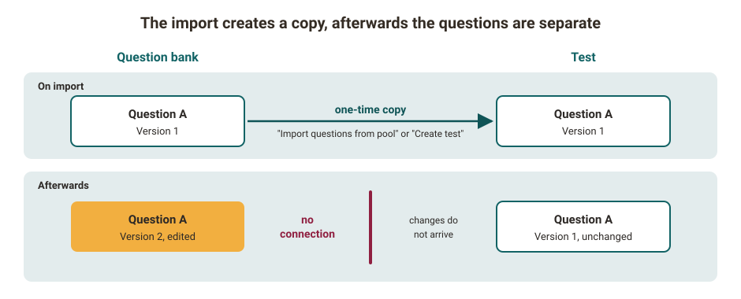

# Creating Tests {: #create_tests}

This chapter explains how authors create tests in OpenOlat, which question types are available and which settings exist. In addition, you learn how to integrate and use tests and self-tests in courses and how to assess and provide test results.

OpenOlat saves tests in the standardized format QTI 2.1. QTI stands for "Question & Test Interoperability", a data format for online tests. Tests in this format can also be used in other LMS and systems that support the standard. [IMS](http://www.imsglobal.org/ "IMS") develops such open standards for the e-learning sector.

In OpenOlat, tests are part of the "learning resources". You create a learning resource separately and integrate it into online courses. For example, you use the same learning resource "Test (QTI 2.1)" in multiple courses.

[To the top of the page ^](#create_tests)

---

## What is a test? {: #definition_test}

With tests you monitor performance, check the current level of knowledge or hold an online exam. You use tests at the beginning, during or at the end of a course, or independently of courses.

Formative tests capture interim learning progress. With automatic or manual feedback, participants improve while they learn.

Summative tests come at the end of a learning process or course. They check whether the planned learning objectives have been achieved. Examples of this are "live" exams or online exams.

You create tests with the [OpenOlat test editor](../Test_editor_QTI_2.1/index.md) as tests in the QTI 2.1 format. You specify the length of the test, the [question types](../Test_question_types.md) and further settings.

OpenOlat sends the answers to the server and assesses them only there. The solutions are therefore not in the source code of the test or self-test that participants see in the browser.

When you integrate a test into your course, you decide whether you use it as a self-test, i.e. for practice purposes, or as an exam test ("live" test). In the first case, use the "Self-test" course element; in the second case, use the "Test" course element. OpenOlat stores self-test results anonymized and exam test results personalized. In the case of self-tests, coaches do not see the results achieved by individual participants.

Depending on the teaching scenario, the "Test" course element also makes sense for practice purposes: whenever coaches want to know how individual participants are progressing, or when they want to identify weaker course members and support them in a targeted way. Therefore, check for each teaching scenario which course element fits.

[To the top of the page ^](#create_tests)

---

## How do the questions get into a test? {: #create_questions_in_tests}

You create the questions of a test directly in the learning resource Test, or you create them in the [question bank](../../area_modules/Question_Bank/index.md) and OpenOlat copies them from the question bank into the test. In the chapter [How do I proceed when I create a test?](../../../manual_how-to/test_creation_procedure/test_creation_procedure.md), you learn how to create a test step by step.

!!! warning "Copy, not a link"

    Questions from the question bank come into the test as a copy. Afterwards, the question in the question bank and the question in the test are two separate questions. If you change the question in the question bank, the question in the test remains unchanged, and vice versa. You see where a question comes from in the test editor in the "Question bank" tab. If the test is to use the changed version, remove the question from the test and import it again from the question bank, as long as the test has not yet been carried out.

{ class="shadow lightbox" title="Question from the question bank as a copy in the test · 2026.11.09" }

Questions come from the question bank into a test in two ways:

* **Test editor:** In an existing test, select `Add elements > Import questions from pool`, see [Using questions from the question bank](../Test_editor_QTI_2.1/index.md#questions_from_pool).
* **Question bank:** With the "Create test" button, OpenOlat creates a new test from the selected questions, see [Create test](../../area_modules/Question_bank_possible_operations.md#learning_resource_test).

OpenOlat copies the question at the time of the import. A question from the question bank is initially read-only in the test editor as long as it carries the same ID as the question in the question bank. The "Question bank" tab shows its origin: "ID", "Master ID", "Authors", "Copied at" and "Version".

If you want to edit the question in the test, click "make a copy and edit" in the "Question bank" tab. The question receives a new ID, and the previous ID is then shown under "Master ID". Via the "Master ID" you still open the original question in the question bank.

The reverse direction also creates a copy: with [Export to pool](../Test_export.md#export_to_pool), OpenOlat creates a new question with its own ID in the question bank.

If you have a test as a file in IMS QTI format from another LMS, import it as a learning resource. How to proceed is described in the section [Import learning resources](../../area_modules/authoring_new_course.md#import-learning-resources).

!!! info "Important"

    During import, the test file is checked for a valid QTI 2.1 package. Incorrectly generated packages, for example from external tools, are rejected with an error message. [:octicons-tag-16:{ title="from Release 20.3.2 (OO-9454)" }](https://track.frentix.com/issue/OO-9454)

[To the top of the page ^](#create_tests)

---

## Further information {: #further_information}

[Changing from QTI 1.2 to QTI 2.1 >](../Changing_from_QTI_1.2_to_QTI_2.1.md) 
[How do I proceed when I create a test? >](../../../manual_how-to/test_creation_procedure/test_creation_procedure.md) 
[Test editor >](../Test_editor_QTI_2.1/index.md) 
[Test question types >](../Test_question_types.md) 
[Configure test questions >](../Configure_test_questions.md) 
[Configure tests >](../Configure_tests.md) 
[Test: Administration >](../Test_administration/index.md) 
[Test: Settings >](../Test_settings.md) 
[Tests at course level >](../Tests_at_course_level.md) 
[Export tests >](../Test_export.md)

[To the top of the page ^](#create_tests)