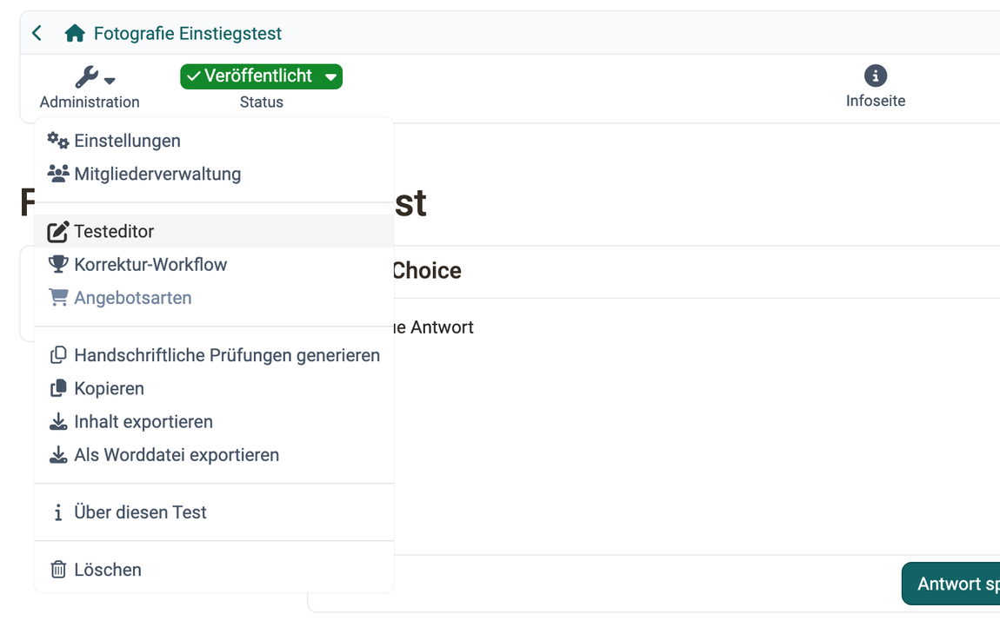

# Test: Administration {: #test_administration}

Im Bereich `Test > Administration` finden Sie, ähnlich wie bei anderen Lernressourcen, weitere Menüs. Hier konfigurieren Sie den Test näher. Besonders wichtig sind dabei die Menüs "Einstellungen" und "Testeditor". Den Bereich sehen Besitzer:innen der Lernressource, Lernressourcenverwalter:innen und Administrator:innen. Bei einem eigenständigen Test sehen ihn auch Betreuer:innen, darin die Einträge "Bewertungswerkzeug" und "Test Statistik".

{ class="shadow lightbox" title="Menü Administration einer veröffentlichten Test-Lernressource · 2026.09.28" }

Den Test als Ganzes konfigurieren Sie grösstenteils in den "Einstellungen", besonders im Tab "Optionen". Die Felder beschreibt die Seite [Test: Einstellungen](../Test_settings.de.md).

Das Menü "Mitgliederverwaltung" brauchen Sie vor allem, wenn der Test kursunabhängig verwendet werden soll. Sonst verwalten Sie die Test-Teilnehmenden über den verbundenen Kurs.

Der Eintrag "Testeditor" öffnet den Testeditor. Dort legen Sie die Fragen und den Aufbau des Tests an. Wie der Eintrag zum Editor bei anderen Lernressourcen heisst, steht unter [Eintrag zum Editor](../Detailed_View_of_Learning_Resources.de.md#editor_entry). [:octicons-tag-16:{ title="ab Release 21.1 (OO-9780)" }](https://track.frentix.com/issue/OO-9780){:target="_blank"}

!!! note "Testeditor QTI 2.1"
    Übersicht zum Testeditor. 
    [Testeditor](../Test_editor_QTI_2.1/index.de.md)

Das "Bewertungswerkzeug" des Tests erscheint nur, wenn der Test kursunabhängig verwendet werden soll: `Test > Administration > Einstellungen > Tab "Freigabe"`, Verwendungszweck "Eigenständig".

Im Menü "Korrektur-Workflow" fügen Sie dem Test Korrektor:innen hinzu, siehe [Test: Korrektur-Workflow](../Test_correction_workflow.de.md).

Das Menü "Test Statistik" erscheint nur bei eigenständigen Tests. Läuft der Test in einem Kurs, finden Sie die Statistik im Menü Administration des Kurses: `Kurs > Administration > Teststatistiken`.

Das Menü "Angebotsarten" ist nur aktiv, wenn der Test buchbar konfiguriert wurde.

Ist in der System-Administration der PDF-Dienst eingeschaltet, führt Sie unter "Handschriftliche Prüfungen generieren" ein Assistent in mehreren Schritten vom Online-Test zu druckfertigen Prüfungsbogen, siehe [Test: Handschriftliche Prüfungen generieren](../Test_handwritten_exams.de.md).

Mit den Menüs "Kopieren", "Inhalt exportieren" und "Als Worddatei exportieren" kopieren oder speichern Sie den Test.

"Über diesen Test" öffnet ein Fenster mit den technischen Angaben zum Test wie ID, Typ und externer Link.

"Löschen" löscht die Lernressource Test. Sie finden sie anschliessend im Autorenbereich im Tab "Gelöscht".

Eigene Seiten haben diese Einträge des Menüs "Administration": 
[Test: Einstellungen](../Test_settings.de.md) 
[Testeditor](../Test_editor_QTI_2.1/index.de.md) 
[Test: Korrektur-Workflow](../Test_correction_workflow.de.md) 
[Test: Handschriftliche Prüfungen generieren](../Test_handwritten_exams.de.md)

[Zum Seitenanfang ^](#test_administration)

---

## Als Worddatei exportieren {: #export_word}

Wer den Test vor der Durchführung gegenlesen lassen will, lädt ihn mit "Als Worddatei exportieren" als zip-Datei mit zwei Word-Dokumenten herunter, eines mit und eines ohne Lösungen, siehe [Tests exportieren](../Test_export.de.md#word).

[Zum Seitenanfang ^](#test_administration)

---

## Weiterführende Informationen {: #further_information}

[Wie gehe ich vor, wenn ich einen Test erstelle? >](../../../manual_how-to/test_creation_procedure/test_creation_procedure.de.md) 
[Tests auf Kursebene >](../Tests_at_course_level.de.md) 
[Bewertungswerkzeug - Übersicht >](../Assessment_tool_overview/index.de.md)

[Zum Seitenanfang ^](#test_administration)
