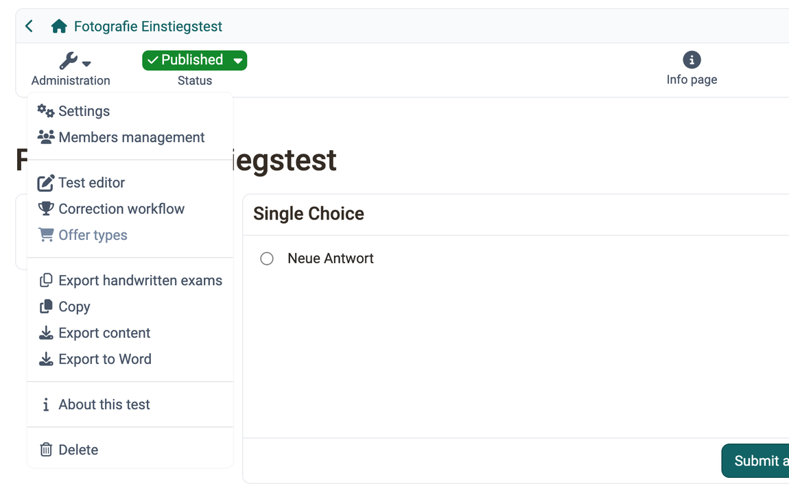

# Test: Administration {: #test_administration}

In the `Test > Administration` area you will find further menus, similar to other learning resources. Here you can configure the test in more detail. The "Settings" and "Test editor" menus are particularly important. Owners of the learning resource, learning resource managers and administrators see this area. For a standalone test, coaches also see it, with the entries "Assessment tool" and "Test statistics".

{ class="shadow lightbox" title="Administration menu of a published test learning resource · 2026.09.28" }

You configure the test as a whole largely in the "Settings", particularly in the "Options" tab. The fields are described on the page [Test: Settings](../Test_settings.md).

You need the "Members management" menu mainly if the test is to be used independently of the course. Otherwise you manage the test participants via the linked course.

The "Test editor" entry opens the test editor. There you create the questions and the structure of the test. What the editor entry is called for other learning resources is described under [Editor entry](../Detailed_View_of_Learning_Resources.md#editor_entry). [:octicons-tag-16:{ title="from Release 21.1 (OO-9780)" }](https://track.frentix.com/issue/OO-9780){:target="_blank"}

!!! note "Test editor QTI 2.1"
    Overview of the test editor. 
    [Test editor](../Test_editor_QTI_2.1/index.md)

The "Assessment tool" of the test only appears if the test is to be used independently of the course: `Test > Administration > Settings > Tab "Share"`, usage "Standalone".

In the "Correction workflow" menu you add correctors to the test, see [Test: Correction workflow](../Test_correction_workflow.md).

The "Test statistics" menu only appears for standalone tests. If the test runs in a course, you find the statistics in the Administration menu of the course: `Course > Administration > Test statistics`.

The "Offer types" menu is only active if the test has been configured as bookable.

Under "Export handwritten exams" a wizard takes you in several steps from the online test to print-ready exam sheets, see [Test: Export handwritten exams](../Test_handwritten_exams.md). The entry only appears if the PDF generator is switched on. You find it in the system administration under: `Administration > External tools > PDF generator`.

With the "Copy", "Export content" and "Export to Word" menus you copy or save the test.

"About this test" opens a window with the technical details of the test such as ID, type and external link.

"Delete" deletes the test learning resource. You then find it in the authoring area in the "Deleted" tab.

These entries of the "Administration" menu have their own pages: 
[Test: Settings](../Test_settings.md) 
[Test editor](../Test_editor_QTI_2.1/index.md) 
[Test: Correction workflow](../Test_correction_workflow.md) 
[Test: Export handwritten exams](../Test_handwritten_exams.md)

[To the top of the page ^](#test_administration)

---

## Export to Word {: #export_word}

With "Export to Word" you download the test in zip format with two Word files. One file contains only the questions, the other also contains the solutions. Both contain all the important information about the test, including the score, so that you can use the documents directly.

[To the top of the page ^](#test_administration)

---

## Further information {: #further_information}

[How do I proceed when I create a test? >](../../../manual_how-to/test_creation_procedure/test_creation_procedure.md) 
[Tests at course level >](../Tests_at_course_level.md) 
[Assessment tool - overview >](../Assessment_tool_overview/index.md)

[To the top of the page ^](#test_administration)
