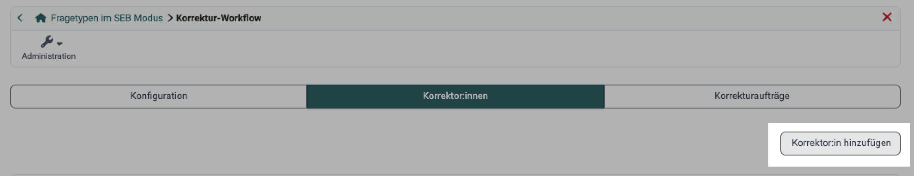
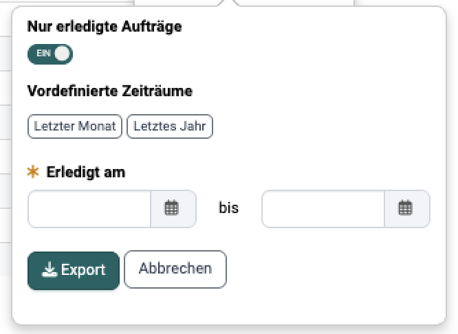
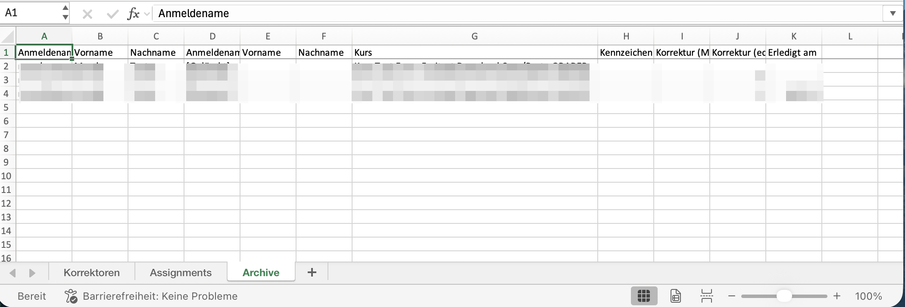

# Test: Korrektur-Workflow [:octicons-tag-16:{ title="ab Release 15.0 (OO-4442)" }](https://track.frentix.com/issue/OO-4442) {: #correction-workflow}

Um einem Test weitere, auch kursübergreifende, Korrektor:innen hinzufügen zu können, muss unter `Test > Administration > Korrektur-Workflow` der Korrektur-Workflow eingeschaltet werden. Anschliessend können die Korrektor:innen hinzugefügt, Korrekturaufträge vergeben und weitere Einstellungen vorgenommen werden. Den Eintrag "Korrektur-Workflow" sehen Besitzer:innen der Lernressource, Lernressourcenverwalter:innen und Administrator:innen. Die übrigen Einträge des Menüs beschreibt die Seite [Test: Administration](Test_administration/index.de.md).

Der Korrektur-Workflow betrifft nur die manuelle Korrektur eines Tests: wer korrigiert, ob anonym korrigiert wird und in welchem Zeitraum. Die Korrektor:innen vergeben die Punkte, daraus entsteht die Bewertung. Was Bewertung, Korrektur und Einstufung unterscheidet, steht unter [Bewertung, Korrektur und Einstufung](../area_modules/Coaching_Assessment_Orders.de.md#assessment_terms).

[Zum Seitenanfang ^](#correction-workflow)

---

## Tab "Konfiguration" {: #tab_configuration}

Hier schalten Sie den Korrektur-Workflow ein. Anschliessend kann definiert werden ob die Prüflinge anonym oder mit sichtbarem Namen bewertet werden. Der Korrekturzeitraum gibt die maximale Zeit an, die der Korrektor:in zur Verfügung steht.

Die jeweiligen Korrektor:innen werden automatisch benachrichtigt, wenn neue Bearbeitungen des Tests vorliegen. Die Benachrichtigung kann entweder direkt nach Testabschluss oder einmal pro Tag verschickt werden. Hierfür kann ein passender Mailtext hinterlegt werden oder eine Vorlage ("Vorlage Sprache wählen") verwendet werden. Nach der ersten Mailbenachrichtigung können noch zwei Erinnerungsmails in selbst definierten Abständen (Tagen) verschickt werden.

[Zum Seitenanfang ^](#correction-workflow)

---

## Tab "Korrektor:innen" {: #tab_correctors}

{ class="shadow lightbox" title="Tab Korrektor:innen im Menü Korrektur-Workflow" }

Hier werden die Personen hinzugefügt, die einen Test korrigieren sollen. Dabei ist es egal, welche Rolle die Person in OpenOlat besitzt. Auch Personen mit der Rolle "Benutzer:in" können als Korrektor:in hinzugefügt werden. Über das Zeilenmenü einer Korrektor:in stehen weitere Aktionen bereit: "Zuweisungen anzeigen", "Korrektor:in kontaktieren", "Report herunterladen", "Deaktivieren" beziehungsweise "Aktivieren", "Abwesenheit erfassen" und "Entfernen".

Die eingetragenen Korrektor:innen finden ihre Aufträge unter `Coaching > Bewertungsaufträge` im Tab [Korrekturaufträge](../area_modules/Coaching_Assessment_Orders.de.md#tab_grading_assignments). Dafür braucht es zwei weitere Schritte: Am Kursbaustein Test steht die Korrektur auf "Manuell durch Korrektor:innen" (siehe [Test einrichten](Course_Element_Test/Test_Setup.de.md#section_correction)), und eine teilnehmende Person schliesst den Test ab. Erst damit ist der Auftrag erstellt.

Ist zu diesem Zeitpunkt keine Korrektor:in verfügbar, trägt der Auftrag den Status "Nicht zugeordnet" und wartet in der [Auftragsverwaltung](../area_modules/Coaching_Order_Management.de.md). Dort weisen ihn Lernressourcenverwalter:innen einer Person zu, und er erscheint in deren Liste.

[Zum Seitenanfang ^](#correction-workflow)

---

## Tab "Korrekturaufträge" {: #tab_assignments}

Hier kann der Bearbeitungsstand der Korrekturaufträge der unterschiedlichen Korrektor:innen angezeigt und nach verschiedenen Kriterien gefiltert werden.

[Zum Seitenanfang ^](#correction-workflow)

---

## Report / Excel-Export [:octicons-tag-16:{ title="ab Release 21.0 (OO-9569)" }](https://track.frentix.com/issue/OO-9569) {: #report_export}

Den Report ziehen Besitzer:innen der Test-Lernressource, Lernressourcenverwalter:innen und Administrator:innen, entweder hier oder kursübergreifend unter `Coaching > Auftragsverwaltung`. Korrektor:innen sehen ihre eigenen Aufträge unter `Coaching > Bewertungsaufträge` und laden dort keinen Report herunter.

Im Tab "Korrektor:innen" öffnen Sie im Zeilenmenü einer Korrektor:in den Eintrag "Report herunterladen". OpenOlat erzeugt daraus eine Excel-Datei mit dem Stand der Korrekturaufträge dieser Korrektor:in. Vor dem Download legen Sie den Umfang fest:

* Der Schalter "Nur erledigte Aufträge" ist eingeschaltet und beschränkt den Report auf abgeschlossene Korrekturaufträge. Schalten Sie ihn aus, umfasst der Report alle Korrekturaufträge ohne Einschränkung auf einen Zeitraum.
* Solange der Schalter eingeschaltet ist, grenzen Sie den Zeitraum über die "Vordefinierten Zeiträume" "Letzter Monat" und "Letztes Jahr" oder über das Pflichtfeld "Erledigt am" ein. Beide Datumsfelder müssen gefüllt sein.

{ class="shadow lightbox" title="Dialog zum Herunterladen des Reports" }

Im Tab "Korrekturaufträge" erzeugt der Button "Bericht" denselben Report über die dort angezeigten Korrekturaufträge.

Der Report weist zu jedem Korrekturauftrag den Status ("Nicht zugeordnet", "Zugeteilt", "Erledigt"), das "Fälligkeitsdatum", das Datum "Erledigt am" sowie die Kennzeichnung "Frist abgelaufen" aus.

Die erzeugte Excel-Datei enthält die Worksheets "Korrektoren", "Assignments" und "Archive". Das Worksheet "Archive" führt archivierte Korrekturauftrag-Einträge auf, deren Auftragsdatensatz inzwischen entfernt wurde (etwa weil ein Prüfling, eine Korrektor:in oder die Test-Lernressource gelöscht wurde), inklusive Korrekturzeit und dem Datum "Erledigt am" für die Abrechnung. [:octicons-tag-16:{ title="ab Release 21.0 (OO-6914)" }](https://track.frentix.com/issue/OO-6914)

{ class="shadow lightbox" title="Worksheet Archive der Excel-Datei" }

!!! note "Coaching Tool"
    Weitere Informationen zur kursübergreifenden Korrektur. 
    [Coaching Tool](../area_modules/Coaching/index.de.md)

[Zum Seitenanfang ^](#correction-workflow)

---

## Weiterführende Informationen {: #further_information}

**Auf dieser Seite erwähnt** 
[Test: Administration >](Test_administration/index.de.md) 
[Coaching - Bewertungsaufträge >](../area_modules/Coaching_Assessment_Orders.de.md) 
[Test einrichten >](Course_Element_Test/Test_Setup.de.md) 
[Coaching - Auftragsverwaltung >](../area_modules/Coaching_Order_Management.de.md) 
[Coaching - Übersicht >](../area_modules/Coaching/index.de.md)

**Weiterführend** 
[Wie bewerte ich einen Test? >](../../manual_how-to/assessing_tests/assessing_tests.de.md) 
[Wie macht man in OpenOlat eine anonyme Test-Korrektur? >](../../manual_how-to/assessing_tests_anonymously/assessing_tests_anonymously.de.md) 
[e-Assessment Administration: Test >](../../manual_admin/administration/e-Assessment_Test.de.md)

[Zum Seitenanfang ^](#correction-workflow)
