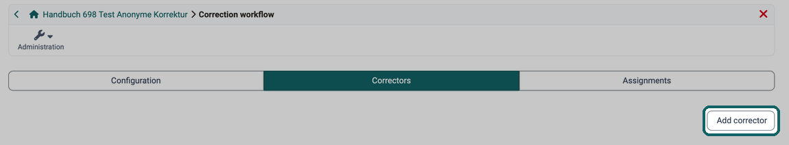
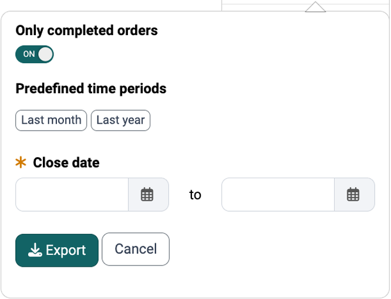
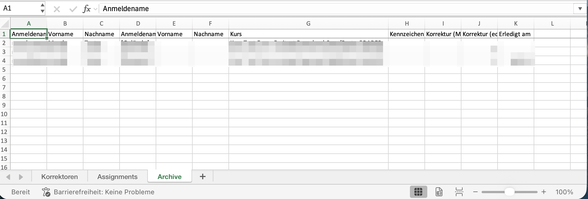

# Test: Correction workflow [:octicons-tag-16:{ title="from Release 15.0 (OO-4442)" }](https://track.frentix.com/issue/OO-4442) {: #correction-workflow}

To add additional correctors to a test, including correctors from other courses, you must switch on the correction workflow under `Test > Administration > Correction workflow`. You can then add correctors, assign grading assignments and make further settings. Owners of the learning resource, learning resource managers and administrators see the entry "Correction workflow". The other entries of the menu are described on the page [Test: Administration](Test_administration/index.md).

The correction workflow only concerns the manual correction of a test: who corrects, whether the correction is anonymous and in which period. The correctors award the points, and the assessment results from them. The difference between assessment, correction and levels/grading is explained under [Assessment, correction and levels/grading](../area_modules/Coaching_Assessment_Orders.md#assessment_terms).

[To the top of the page ^](#correction-workflow)

---

## Tab "Configuration" {: #tab_configuration}

Here you switch on the correction workflow. You can then define whether examinees are assessed anonymously or with a visible name. The correction period specifies the maximum time available to the corrector.

The respective correctors are automatically notified when new edits of the test are available. The notification can be sent either immediately after the test is completed or once a day. For this purpose, a suitable mail text can be stored or a template ("Choose language template") can be used. After the first mail notification, two reminder mails can be sent at user-defined intervals (days).

[To the top of the page ^](#correction-workflow)

---

## Tab "Correctors" {: #tab_correctors}

{ class="shadow lightbox" title="Correctors tab in the Correction workflow menu · 2026.10.02" }

Here you add the persons who are to correct a test. It does not matter which role the person has in OpenOlat. Persons with the role "User" can also be added as correctors. Via the row menu of a corrector, further actions are available: "Show assignments", "Send e-mail", "Download report", "Deactivate" or "Activate", "Set absence leave" and "Remove".

The entered correctors find their orders under `Coaching > Assessment orders` in the tab [Grading assignments](../area_modules/Coaching_Assessment_Orders.md#tab_grading_assignments). Two further steps are needed for this: at the course element Test the correction is set to "Manual by correctors" (see [Set up a test](Course_Element_Test/Test_Setup.md#section_correction)), and a participant completes the test. Only then is the order created.

If no corrector is available at that moment, the assignment carries the status "Unassigned" and waits in the [Order management](../area_modules/Coaching_Order_Management.md). There, learning resource managers assign it to a person, and it appears in their list.

[To the top of the page ^](#correction-workflow)

---

## Tab "Assignments" {: #tab_assignments}

Here the processing status of the grading assignments of the different correctors can be displayed and filtered according to various criteria.

[To the top of the page ^](#correction-workflow)

---

## Report / Excel export [:octicons-tag-16:{ title="from Release 21.0 (OO-9569)" }](https://track.frentix.com/issue/OO-9569) {: #report_export}

Owners of the test learning resource, learning resource managers and administrators pull the report either here or across courses under `Coaching > Order management`. Correctors see their own assignments under `Coaching > Assessment orders` and do not download a report there.

In the "Correctors" tab, open the "Download report" entry in the row menu of a corrector. OpenOlat generates an Excel file with the state of that corrector's grading assignments. Before the download, you define the scope:

* The "Only completed orders" switch is turned on and limits the report to completed grading assignments. If you turn it off, the report covers all grading assignments without a restriction to a period.
* As long as the switch is turned on, you narrow down the period with the "Predefined time periods" "Last month" and "Last year" or with the mandatory field "Close date". Both date fields must be filled in.

{ class="shadow lightbox" title="Dialog for downloading the report" }

In the "Assignments" tab, the "Report" button generates the same report for the grading assignments displayed there.

For each grading assignment, the report shows the status ("Unassigned", "Assigned", "Done"), the "Due date", the "Close date" and the "Missed deadline" flag.

The generated Excel file contains the worksheets "Correctors", "Assignments" and "Archive". The "Archive" worksheet lists archived grading assignment entries whose assignment record has since been removed (for example because an examinee, a corrector or the test learning resource was deleted), including the correction time and the "Close date" for remuneration. [:octicons-tag-16:{ title="from Release 21.0 (OO-6914)" }](https://track.frentix.com/issue/OO-6914)

{ class="shadow lightbox" title="Archive worksheet of the Excel file" }

!!! note "Coaching Tool"
    More information on cross-course correction. 
    [Coaching Tool](../area_modules/Coaching/index.md)

[To the top of the page ^](#correction-workflow)

---

## Further information {: #further_information}

**Mentioned on this page** 
[Test: Administration >](Test_administration/index.md) 
[Coaching - Assessment Orders >](../area_modules/Coaching_Assessment_Orders.md) 
[Set up a test >](Course_Element_Test/Test_Setup.md) 
[Coaching - Order management >](../area_modules/Coaching_Order_Management.md) 
[Coaching - Overview >](../area_modules/Coaching/index.md)

**Further reading** 
[How do I assess a test? >](../../manual_how-to/assessing_tests/assessing_tests.md) 
[How do I correct a test anonymously in OpenOlat? >](../../manual_how-to/assessing_tests_anonymously/assessing_tests_anonymously.md) 
[e-Assessment Administration: Test >](../../manual_admin/administration/e-Assessment_Test.md)

[To the top of the page ^](#correction-workflow)
