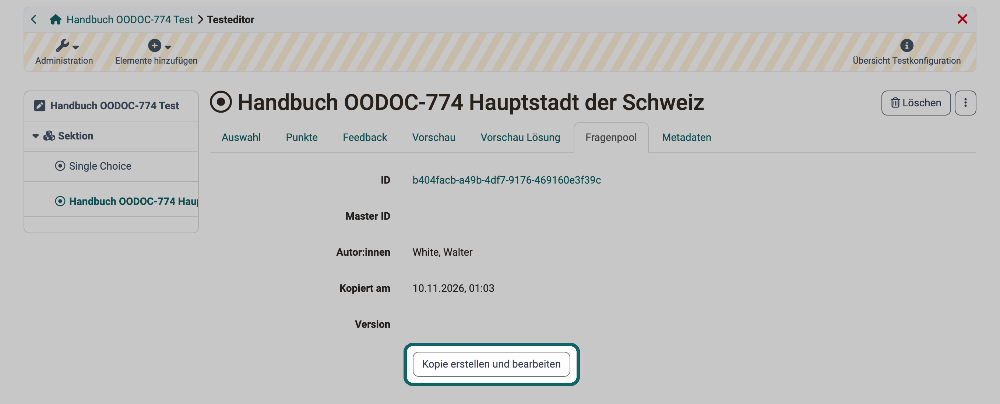

# Testeditor {: #test_editor}

Im Testeditor bauen Sie einen Test auf: Sie legen Sektionen an, erstellen Fragen oder übernehmen sie aus dem Fragenpool und konfigurieren Test und Fragen. Besitzer:innen des Tests, Administrator:innen und Lernressourcenverwalter:innen öffnen ihn unter: 
`Test > Administration > Testeditor`

OpenOlat speichert Tests im Format QTI 2.1. Dadurch verwenden Sie einen Test in verschiedenen OpenOlat-Kursen und auch in anderen LMS, welche dieselbe Version des Formats IMS QTI unterstützen. Eine detaillierte Beschreibung der Spezifikation finden Sie auf der Webseite von [IMS](https://www.imsglobal.org/question/qtiv2p1/imsqti_implv2p1.html).

Wie Sie Schritt für Schritt einen Test erstellen, zeigt die Anleitung [Wie gehe ich vor, wenn ich einen Test erstelle?](../../../manual_how-to/test_creation_procedure/test_creation_procedure.de.md)

## Fragen aus dem Fragenpool verwenden {: #questions_from_pool}

Fragen, die schon im Fragenpool liegen, müssen Sie im Test nicht neu erstellen. Sie holen sie im Testeditor über: 
`Elemente hinzufügen > Fragen aus Pool importieren`

Den Eintrag zeigt der Testeditor, wenn der Fragenpool in Ihrer OpenOlat-Instanz eingeschaltet ist und der Test noch nicht durchgeführt wurde. OpenOlat fügt die ausgewählten Fragen in die Sektion ein, die Sie im Menübaum links ausgewählt haben. Ist dort eine Frage ausgewählt, fügt OpenOlat die neuen Fragen in deren Sektion ein.

OpenOlat kopiert die Fragen in den Test. Frage im Fragenpool und Frage im Test sind danach zwei getrennte Fragen, Änderungen im Fragenpool erreichen den Test nicht. Mehr dazu, mit einer Grafik, unter [Wie kommen die Fragen in einen Test?](../Test/index.de.md#create_questions_in_tests)

Eine importierte Frage ist im Testeditor zunächst schreibgeschützt, solange sie dieselbe ID trägt wie die Frage im Fragenpool. Ihre Herkunft zeigt der Tab "Fragenpool" mit den Angaben "ID", "Master ID", "Autor:innen", "Kopiert am" und "Version".

{ class="shadow lightbox" title="Tab Fragenpool im Testeditor · 2026.11.10" }

Möchten Sie die Frage im Test bearbeiten, klicken Sie im Tab "Fragenpool" auf "Kopie erstellen und bearbeiten". Die Frage erhält eine neue ID, die bisherige ID steht danach unter "Master ID", und Sie bearbeiten die Frage im Testeditor. Der Tab zeigt dann den Hinweis "Die Frage wurde vom Fragenpool kopiert. Sie können die Originalfrage unter Master ID finden." Ihre Änderungen bleiben im Test.

Soll eine Frage aus dem Test auch im Fragenpool verfügbar sein, übernehmen Sie sie mit [Zum Pool exportieren](../Test_export.de.md#export_to_pool). Auch dabei entsteht eine Kopie: OpenOlat legt im Fragenpool eine neue Frage mit eigener ID an.

Wie Sie im Fragenpool Fragen erstellen, suchen und freigeben, beschreibt die Übersicht [Fragenpool](../../area_modules/Question_Bank/index.de.md).

## Fragen und Test konfigurieren {: #configure}

Welche Fragetypen der Testeditor anbietet und wie Sie Fragen und Test einstellen, erfahren Sie auf diesen Seiten:

* [Test Fragetypen](../Test_question_types.de.md)
* [Test Fragen konfigurieren](../Configure_test_questions.de.md)
* [Test konfigurieren](../Configure_tests.de.md)

## Weiterführende Informationen {: #further_information}

[Fragenpool: Fragen importieren >](../../area_modules/Question_Bank_Import_Questions.de.md) 
[Test: Administration >](../Test_administration/index.de.md) 
[Test: Einstellungen >](../Test_settings.de.md)

[Zum Seitenanfang ^](#test_editor)
