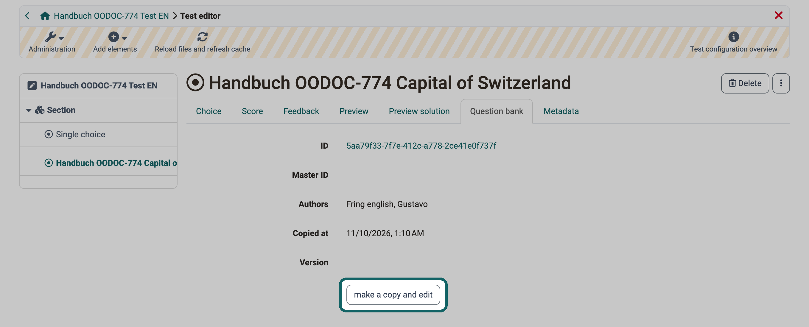

# Test editor {: #test_editor}

In the test editor you build a test: you create sections, create questions or take them from the question bank, and configure the test and its questions. Owners of the test, administrators and learning resource managers open it under: 
`Test > Administration > Test editor`

OpenOlat saves tests in the QTI 2.1 format. This lets you use a test in different OpenOlat courses and also in other LMS that support the same version of the IMS QTI format. A detailed description of the specification can be found on the [IMS](https://www.imsglobal.org/question/qtiv2p1/imsqti_implv2p1.html) website.

The guide [How do I proceed when I create a test?](../../../manual_how-to/test_creation_procedure/test_creation_procedure.md) shows how to create a test step by step.

## Using questions from the question bank {: #questions_from_pool}

Questions that are already in the question bank do not need to be created again in the test. You get them in the test editor via: 
`Add elements > Import questions from pool`

The test editor shows this entry if the question bank is switched on in your OpenOlat instance and the test has not yet been carried out. OpenOlat inserts the selected questions into the section you have selected in the menu tree on the left. If a question is selected there, OpenOlat inserts the new questions into its section.

OpenOlat copies the questions into the test. Afterwards, the question in the question bank and the question in the test are two separate questions, and changes in the question bank do not reach the test. More on this, with a diagram, under [How do the questions get into a test?](../Test/index.md#create_questions_in_tests)

An imported question is initially read-only in the test editor as long as it carries the same ID as the question in the question bank. The "Question bank" tab shows its origin with the details "ID", "Master ID", "Authors", "Copied at" and "Version".

{ class="shadow lightbox" title="Tab Question bank in the test editor · 2026.11.10" }

If you want to edit the question in the test, click "make a copy and edit" in the "Question bank" tab. The question receives a new ID, the previous ID is then shown under "Master ID", and you edit the question in the test editor. The tab then shows the note "The question was copied from the question bank. You can find the original question under the master id." Your changes stay in the test.

If a question from the test should also be available in the question bank, transfer it with [Export to pool](../Test_export.md#export_to_pool). This also creates a copy: OpenOlat creates a new question with its own ID in the question bank.

How to create, search and share questions in the question bank is described in the overview [Question bank](../../area_modules/Question_Bank/index.md).

## Configure questions and test {: #configure}

Which question types the test editor offers and how to set up questions and the test is explained on these pages:

* [Test question types](../Test_question_types.md)
* [Configure test questions](../Configure_test_questions.md)
* [Configure tests](../Configure_tests.md)

## Further information {: #further_information}

[Question bank: Import questions >](../../area_modules/Question_Bank_Import_Questions.md) 
[Test: Administration >](../Test_administration/index.md) 
[Test: Settings >](../Test_settings.md)

[To the top of the page ^](#test_editor)
