# Tests exportieren {: #test_export}

Wer einen Test sichern, weitergeben, gegenlesen lassen oder auswerten will, exportiert ihn aus OpenOlat. Was Sie exportieren, hängt davon ab, was Sie brauchen:

- **Kurs**: den ganzen Kurs mit seinen Tests, zum Beispiel einen Prüfungskurs, siehe [Kurs exportieren](#export_course).
- **Test-Lernressource**: den Test mit allen Fragen und seiner Konfiguration, als zip-Datei, als Word-Dokument oder als Prüfungsbogen auf Papier, siehe [Test-Lernressource exportieren](#export_learning_resource).
- **Fragen**: einzelne Fragen in den Fragenpool oder als Datei für ein anderes System, siehe [Einzelne Fragen exportieren](#export_questions).
- **Ergebnisse**: die Teststatistiken und die Resultate der Teilnehmenden, siehe [Testergebnisse exportieren](#export_results).

## Kurs exportieren {: #export_course}

Wer einen ganzen Kurs, zum Beispiel einen Prüfungskurs, sichern oder in einem anderen OpenOlat importieren will, exportiert ihn als zip-Datei. Den Export starten Sie unter: `Kurs > Administration > Inhalt exportieren`

Besitzer:innen des Kurses finden den Menüpunkt immer. Andere Autor:innen sehen ihn nur, wenn die Besitzer:innen das Exportieren im Tab "Freigabe" erlaubt haben, siehe [Zugangskonfiguration / Freigabe](Access_configuration.de.md).

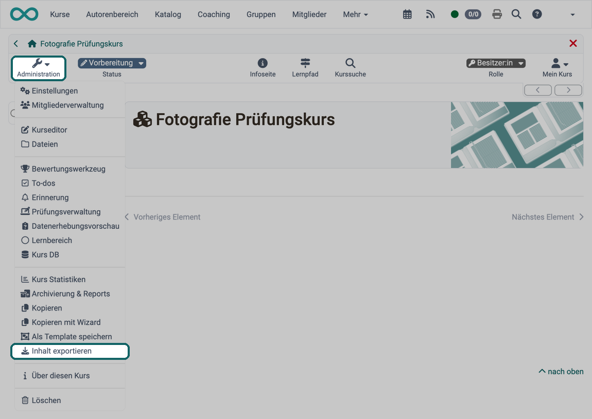{ class="shadow lightbox" title="Menü Administration eines Kurses · 2026.10.01" }

[Zum Seitenanfang ^](#test_export)

---

## Test-Lernressource exportieren {: #export_learning_resource}

Eine Test-Lernressource enthält alle Fragen eines Tests samt Konfiguration, zum Beispiel der Gesamtpunktzahl, und lässt sich in Kursbausteine "Test" einbinden. Wer den Test ohne Kurs sichern oder in einem anderen OpenOlat importieren will, exportiert die Test-Lernressource als zip-Datei. Den Export starten Sie in der Administration der Test-Lernressource unter: `Test > Administration > Inhalt exportieren`

Auch hier finden Besitzer:innen den Menüpunkt immer, andere Autor:innen nur, wenn das Exportieren im Tab "Freigabe" erlaubt ist.

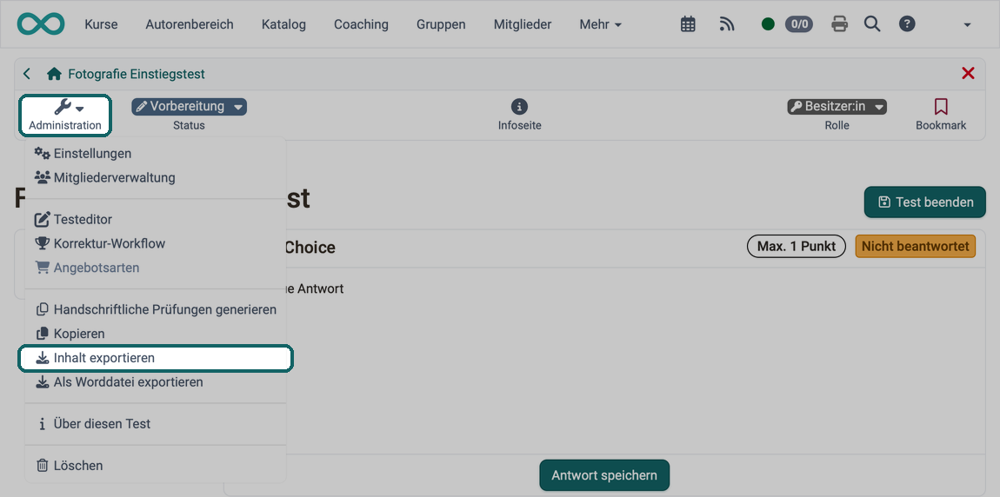{ class="shadow lightbox" title="Menü Administration einer Test-Lernressource · 2026.10.01" }

!!! tip "Tipp"

    Achten Sie darauf, ob Sie die Administration eines Kurses oder einer Test-Lernressource geöffnet haben. Im Kurs heisst der Eintrag zum Editor "Kurseditor", in der Test-Lernressource "Testeditor".

[Zum Seitenanfang ^](#test_export)

---

### Als Worddatei exportieren {: #word}

Wer einen Test vor der Durchführung gegenlesen lassen will, exportiert ihn als Word-Dokument. Darin lassen sich Ergänzungen und Korrekturen einfach notieren. Mit `Test > Administration > Als Worddatei exportieren` lädt OpenOlat eine zip-Datei mit zwei Word-Dokumenten herunter: das eine enthält nur die Fragen, das andere zusätzlich die Lösungen. Beide nennen den Titel des Tests, die Punkteschwelle für Bestanden, sofern der Test eine festlegt, die Sektionen und jede Frage mit Fragetyp und Punktzahl, jede Frage auf einer eigenen Seite. Der Menüpunkt steht Besitzer:innen der Test-Lernressource, Lernressourcenverwalter:innen und Administrator:innen zur Verfügung.

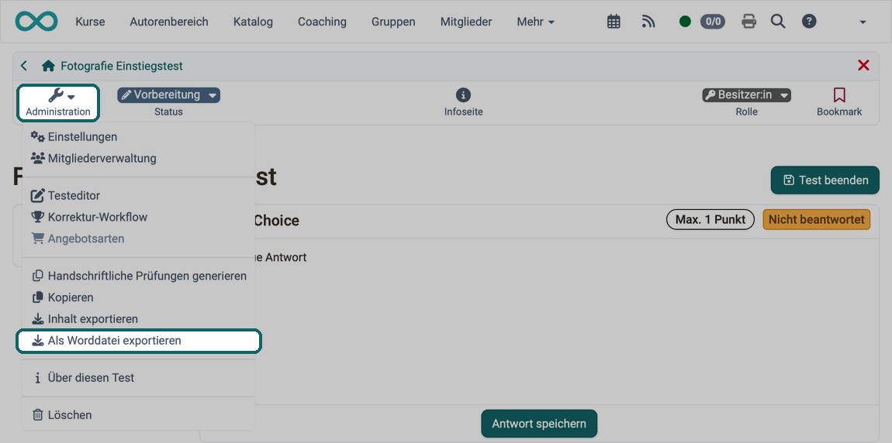{ class="shadow lightbox" title="Menü Administration einer Test-Lernressource · 2026.10.01" }

[Zum Seitenanfang ^](#test_export)

---

### Handschriftliche Prüfungen generieren [:octicons-tag-16:{ title="ab Release 16.1 (OO-5648)" }](https://track.frentix.com/issue/OO-5648) {: #handwritten_exams}

Wer einen Test auf Papier durchführt, erzeugt mit `Test > Administration > Handschriftliche Prüfungen generieren` druckfertige Prüfungsbogen mit Seriennummer, Lösungsblatt und auf Wunsch einem Deckblatt, siehe [Test: Handschriftliche Prüfungen generieren](Test_handwritten_exams.de.md).

[Zum Seitenanfang ^](#test_export)

---

## Einzelne Fragen exportieren {: #export_questions}

Wer eine Frage in weiteren Tests verwenden oder mit einem anderen System austauschen will, exportiert sie einzeln. Fragen in OpenOlat entsprechen dem QTI-Standard (Question and Test Interoperability). Deshalb lassen sie sich auch in andere LMS (Lernmanagementsysteme) übertragen, die diesen Standard verwenden. Umgekehrt importiert OpenOlat Fragen im QTI-Format.

### Zum Pool exportieren {: #export_to_pool}

Soll eine Frage aus einem Test auch im Fragenpool zur Verfügung stehen, übernehmen Sie sie aus dem Testeditor dorthin. Wählen Sie im Testeditor der Test-Lernressource die gewünschte Frage aus und klicken Sie auf das Icon mit den 3 Punkten rechts oben. Mit "Zum Pool exportieren" übernehmen Sie die Frage in den Fragenpool. Der Eintrag erscheint, wenn der Fragenpool in Ihrem OpenOlat eingeschaltet ist.

OpenOlat legt im Fragenpool eine neue Frage mit eigener ID an. Die Frage im Test und die Frage im Fragenpool sind danach unabhängig voneinander. Wie Fragen aus dem Fragenpool in einen Test kommen, steht unter [Wie kommen die Fragen in einen Test?](Test/index.de.md#create_questions_in_tests)

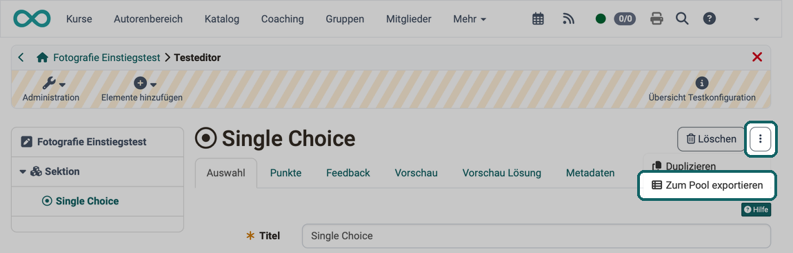{ class="shadow lightbox" title="Frage im Testeditor · 2026.10.01" }

!!! tip "Tipp"

    Auf diese Art exportieren Sie auch eine ganze Sektion mit allen ihren Fragen in den Fragenpool. Wählen Sie dazu links die Sektion aus und klicken Sie auf die 3 Punkte.

[Zum Seitenanfang ^](#test_export)

---

### Einzelne Frage aus dem Pool exportieren

Wer eine einzelne Frage weitergeben oder in einem anderen System verwenden will, exportiert sie aus dem Fragenpool als zip-Datei. Öffnen Sie die Frage im Fragenpool und wählen Sie unter dem Icon "Freigeben" den Eintrag "Export". Die zip-Datei lässt sich in einem anderen OpenOlat oder in einem anderen LMS importieren, das den QTI-Standard verwendet.

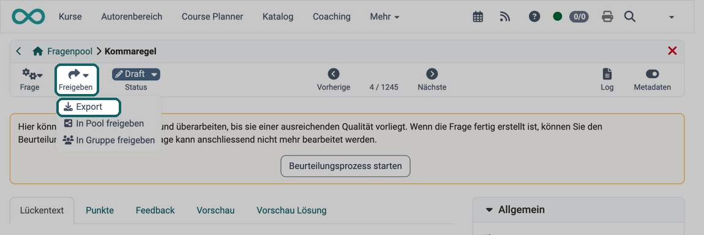{ class="shadow lightbox" title="Frage im Fragenpool · 2026.10.01" }

[Zum Seitenanfang ^](#test_export)

---

### Mehrere ausgewählte Einzelfragen aus dem Pool exportieren

Wer mehrere Fragen auf einmal weitergeben, offline prüfen oder archivieren will, exportiert sie gemeinsam. Wählen Sie die Fragen in der Liste des Fragenpools aus und klicken Sie über der Liste auf "Export".

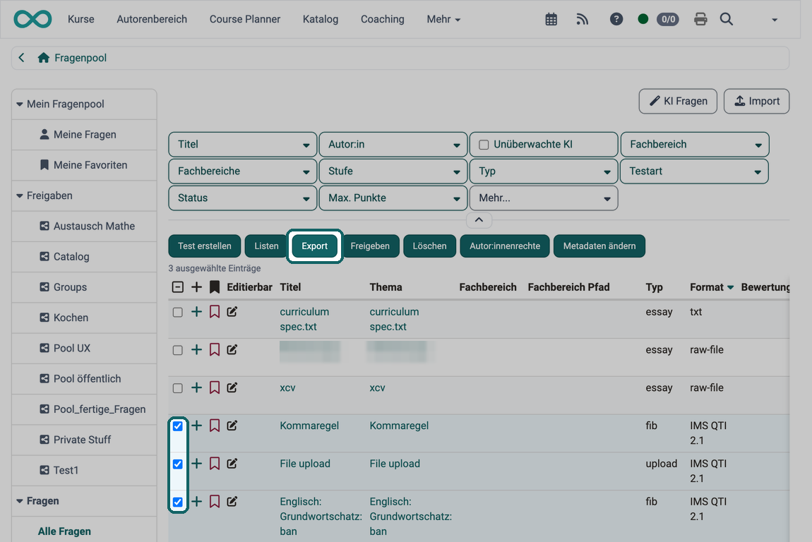{ class="shadow lightbox" title="Liste Alle Fragen im Fragenpool · 2026.10.01" }

Im Dialog "Export" wählen Sie im Schritt "Typ" das Format: eine Word-Datei für die offline Prüfung mit Korrekturblatt, eine QTI-2.1-Testdatei für den Austausch mit anderen kompatiblen LMS oder eine ZIP-Datei für den Austausch mit anderen OpenOlat-Systemen oder zur Archivierung. Word und QTI 2.1 stehen nur zur Wahl, wenn mindestens eine der ausgewählten Fragen im Format QTI 2.1 vorliegt; sonst bietet die Liste nur die ZIP-Datei an. Welche Fragen sich im gewählten Format exportieren lassen, zeigt der Schritt "Überprüfen" in der Spalte "Export möglich".

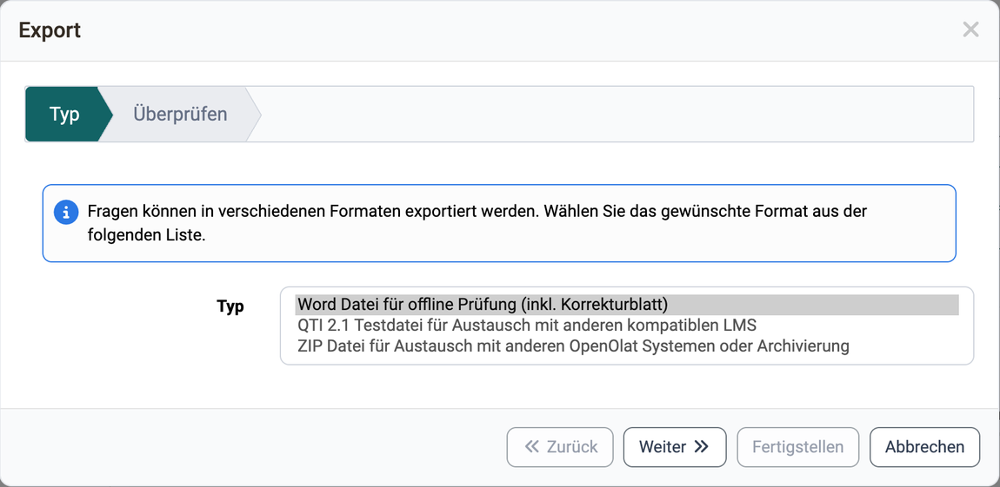{ class="shadow lightbox" title="Schritt Typ im Dialog Export · 2026.10.01" }

[Zum Seitenanfang ^](#test_export)

---

## Testergebnisse exportieren {: #export_results}

Die Ergebnisse eines Tests erhalten Sie auf zwei Wegen: Die Teststatistiken zeigen die Auswertung direkt in OpenOlat, der Export der Testresultate liefert die Resultate der Teilnehmenden als Datei zum Auswerten, Drucken oder Archivieren.

### Teststatistiken

Wer wissen will, wie ein Test ausgefallen ist, sieht in den Teststatistiken die Kennzahlen des ganzen Tests und jeder einzelnen Frage. Für einen einzelnen Test verwenden Sie den Button "Teststatistiken" im Kursbaustein "Test". Der Button steht Betreuer:innen und Besitzer:innen zur Verfügung. Sie finden ihn unter: `Kurs > Kursbaustein "Test" > Tab "Teilnehmer:innen" > Button "Teststatistiken"`

Die Auswertung aller Tests des Kurses finden Sie unter `Kurs > Administration > Teststatistiken`, siehe [Teststatistiken](Statistics_Test.de.md).

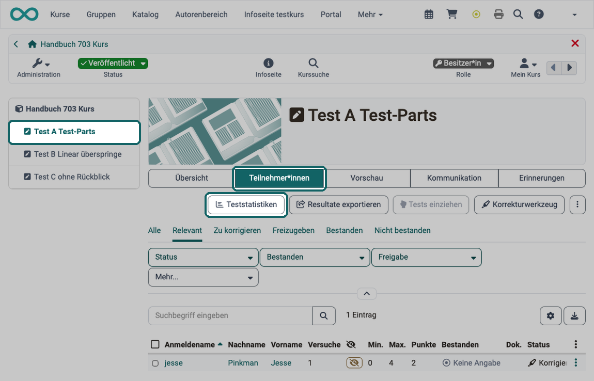{ class="shadow lightbox" title="Tab Teilnehmer:innen des Kursbausteins Test · 2026.10.07" }

Mit "Drucken" drucken Sie die Statistiken aus oder speichern sie über den Druckdialog als PDF-Datei. Mit "Rohdaten herunterladen" erhalten Sie die Rohdaten als Excel-Datei. Klappen Sie links die Sektionen des Tests auf, sehen Sie die detaillierte Statistik jeder einzelnen Frage.

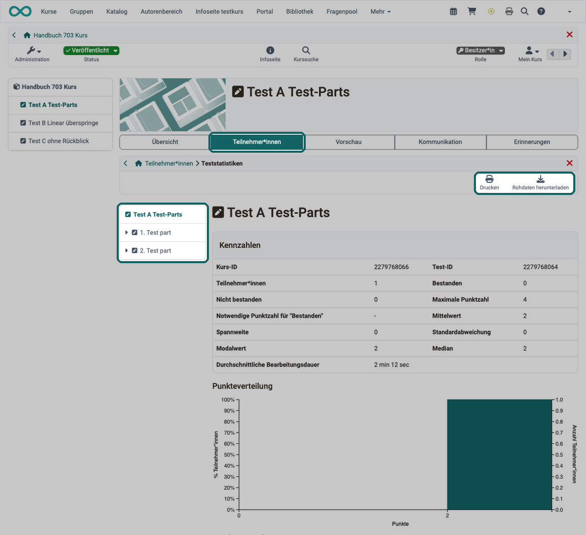{ class="shadow lightbox" title="Teststatistiken im Kursbaustein Test · 2026.10.07" }

### Testresultate der Teilnehmenden [:octicons-tag-16:{ title="ab Release 16.2 (OO-5974)" }](https://track.frentix.com/issue/OO-5974)

Wer die Resultate eines Tests auswerten, ausdrucken oder archivieren will, erhält mit dem Button "Resultate exportieren" eine zip-Datei mit sämtlichen Testresultaten aller Teilnehmenden im ausgewählten Kursbaustein. Der Button steht Betreuer:innen und Besitzer:innen zur Verfügung. Sie finden ihn unter: `Kurs > Kursbaustein "Test" > Tab "Teilnehmer:innen" > Button "Resultate exportieren"`

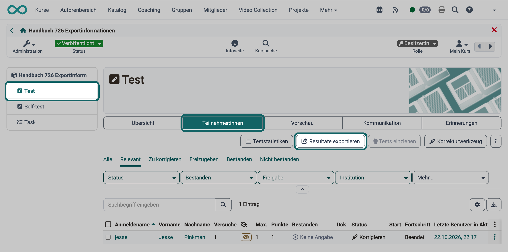{ class="shadow lightbox" title="Tab Teilnehmer:innen des Kursbausteins Test · 2026.10.22" }

Haben Sie in der Liste einzelne Teilnehmende ausgewählt, umfasst der Export nur deren Resultate.

Auf der Seite "Export Resultate" zeigt die Zeile "Anzahl Teilnehmer:innen", wie viele Personen der Export umfasst. Dort geben Sie der zip-Datei einen Namen und wählen unter "Export" die Variante für ihren Inhalt:

* **"Standard"**: Die zip-Datei enthält für jede:n Teilnehmer:in die detaillierten Testresultate als HTML-Dokument und eine Excel-Datei mit den Rohdaten.
* **"Erweitert – mit PDF"**: Die zip-Datei enthält dasselbe und zusätzlich für jede:n Teilnehmer:in eine PDF-Datei mit den detaillierten Resultaten. Diese Variante steht zur Wahl, wenn in der System-Administration der [PDF-Dienst](../../manual_admin/administration/External_Tools_-_Administration/index.de.md#pdf_generator) eingeschaltet ist.

OpenOlat schlägt einen Namen mit Variante und Datum vor, zum Beispiel "Resultate Test mit PDF - alle Teilnehmer:innen (01.10.2026)".

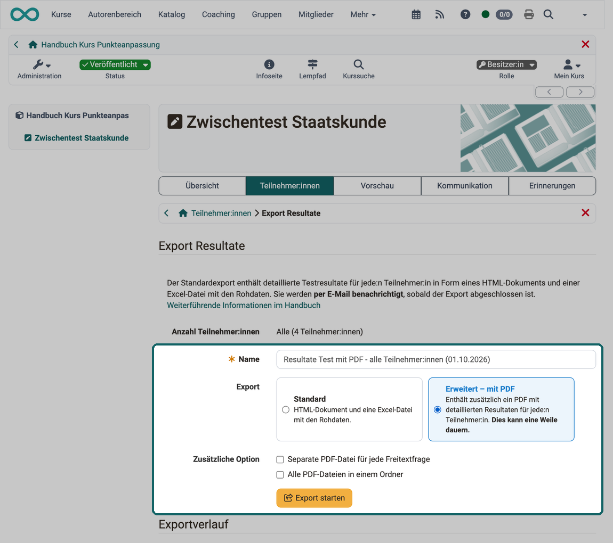{ class="shadow lightbox" title="Seite Export Resultate im Kursbaustein Test · 2026.10.01" }

Mit der Variante "Erweitert – mit PDF" erscheint darunter die "Zusätzliche Option" mit einem oder zwei Kontrollkästchen:

* **"Separate PDF-Datei für jede Freitextfrage"** steht zur Wahl, wenn der Test Freitextfragen enthält. Ist sie aktiviert, legt OpenOlat die Antwort jeder Freitextfrage zusätzlich als eigene PDF-Datei in die zip-Datei. [:octicons-tag-16:{ title="ab Release 19.1.27 (OO-8964)" }](https://track.frentix.com/issue/OO-8964)
* **"Alle PDF-Dateien in einem Ordner"** steht bei jedem Test zur Wahl. Ist sie aktiviert, liegen die PDF-Dateien mit den detaillierten Resultaten aller Teilnehmenden zusammen in einem Ordner der zip-Datei. Wie die Dateien heissen und wo sie liegen, steht unter [PDF-Dateien in der zip-Datei](#pdf_files).

Mit "Export starten" erzeugt OpenOlat die zip-Datei mit den Testresultaten. Sobald der Export abgeschlossen ist, benachrichtigt OpenOlat Sie per E-Mail.

Die erstellten zip-Dateien stehen darunter im "Exportverlauf", jeweils 10 Tage lang. Entpacken Sie die zip-Datei, um auf die einzelnen Dateien zuzugreifen.

#### PDF-Dateien in der zip-Datei [:octicons-tag-16:{ title="ab Release 21.1 (OO-9600)" }](https://track.frentix.com/issue/OO-9600) {: #pdf_files}

Wer exportierte Resultate druckt, ablegt oder weitergibt, erkennt am Dateinamen, zu welcher Person und zu welchem Test eine PDF-Datei gehört. Der Name setzt sich aus diesen Teilen zusammen, jeweils durch einen Unterstrich getrennt:

1. Nachname der Teilnehmer:in. Ist kein Nachname erfasst, steht dort "anonym".
2. Vorname der Teilnehmer:in.
3. Titel des Kursbausteins, gekürzt auf 25 Zeichen.
4. Titel der Test-Lernressource, gekürzt auf 25 Zeichen.
5. Eine Nummer, die den Testversuch eindeutig kennzeichnet.

Leerzeichen werden zu Unterstrichen, Umlaute werden umschrieben (aus "ü" wird "ue"), andere Sonderzeichen fallen weg. Ein Beispiel: `Langenegger_Simone_Test_Demo_Test_Demo_Master_13730.pdf`.

Wo die PDF-Dateien in der zip-Datei liegen, bestimmt die Option "Alle PDF-Dateien in einem Ordner":

* **Ausgeschaltet:** Jede PDF-Datei liegt im Ordner der Teilnehmer:in, dort im Unterordner des jeweiligen Versuchs. Die Resultate einer Person bleiben so beisammen.
* **Eingeschaltet:** Alle PDF-Dateien mit den detaillierten Resultaten liegen zusammen im Ordner "resultspdfs". So lassen sich die Resultate aller Teilnehmenden ohne Suchen in den Unterordnern drucken oder weitergeben.

In beiden Fällen bleiben die Ordner der Teilnehmenden mit HTML-Dokument und Rohdaten bestehen, und die Verweise in den HTML-Dokumenten der zip-Datei führen zur jeweiligen PDF-Datei. Die PDF-Dateien aus der Option "Separate PDF-Datei für jede Freitextfrage" bleiben immer im Ordner der Teilnehmer:in.

Die Option "Alle PDF-Dateien in einem Ordner" gibt es nur beim Export über den Button "Resultate exportieren". Die Kursarchivierung legt die PDF-Dateien immer im Ordner der Teilnehmer:in ab, mit demselben Aufbau des Dateinamens.

#### Punktespalten in der Excel-Datei [:octicons-tag-16:{ title="ab Release 21.1 (OO-9599)" }](https://track.frentix.com/issue/OO-9599) {: #score_columns}

Wer die Resultate auswertet, sieht in der Excel-Datei mit den Rohdaten, welcher Teil der Punkte aus der Antwort stammt und welcher aus einer nachträglichen Korrektur. Je Testversuch enthält die Datei diese Spalten:

* **Punkte**: das Ergebnis des Testversuchs.
* **Punkte (Auto)**: die Summe der automatisch errechneten Punkte.
* **Punkte (Anpassungen plus)**: die Summe aller Anpassungen, die Punkte dazugeben.
* **Punkte (Anpassungen minus)**: die Summe aller Anpassungen, die Punkte abziehen, als negativer Wert, zum Beispiel "-0.5".
* **Punkte (Manuell)**: die Summe der Punkte, die bei Fragen von Hand vergeben wurden.

Je Frage steht in der Spalte "Pkt" die Punktzahl der Frage. Bei automatisch korrigierten Fragen folgt die Spalte "Anpassung" mit dem Betrag, um den die Punkte angepasst wurden. Wie eine Anpassung entsteht, steht auf der Seite [Tests bewerten](../learningresources/Assessing_tests.de.md#adjust_score). Dieselbe Excel-Datei erhalten Sie in den Teststatistiken über "Rohdaten herunterladen".

#### Sheet "Exportinformationen" [:octicons-tag-16:{ title="ab Release 21.1.1 (OO-9812)" }](https://track.frentix.com/issue/OO-9812) {: #export_information}

Wer exportierte Rohdaten weiterverarbeitet oder ausserhalb von OpenOlat ablegt, erkennt am Sheet "Exportinformationen", aus welchem Kurs und welchem Kursbaustein die Datei stammt und wann und von wem sie erstellt wurde. Das Sheet steht als letztes Sheet in jeder Excel-Datei mit Testresultaten, gleich ob die Datei aus "Resultate exportieren", aus "Rohdaten herunterladen" in den [Teststatistiken](Statistics_Test.de.md) oder aus der [Kursarchivierung](Course_Archiving/index.de.md) stammt. Es hat die Spalten "Information" und "Wert" und diese Zeilen:

Zeile | Inhalt
---------|----------
URL | Link auf den Kursbaustein im Kurs. Über den Link gelangen Sie von der Datei direkt zum Test zurück.
OpenOlat Version | Version von OpenOlat, mit der die Datei erstellt wurde.
Kurstitel | Titel des Kurses.
Kurskennzeichen | Kennzeichen des Kurses. Hat der Kurs kein Kennzeichen, steht hier die ID des Kurses.
Kursbausteintitel | Titel des Kursbausteins.
Kursbaustein ID | Nummer des Kursbausteins. Dieselbe Nummer steht am Ende der URL. Sie bezeichnet den Kursbaustein eindeutig, auch wenn sich sein Titel später ändert.
Exportsprache | Sprache der Person, die den Export ausgelöst hat, als ausgeschriebener Name, zum Beispiel "German".
Exportiert | Datum und Uhrzeit des Exports.
Exportiert von | Name der Person, die den Export ausgelöst hat. Leer bleibt die Zeile in Archivdateien, die OpenOlat selbst anlegt, zum Beispiel beim Löschen der Testdaten im Kursbaustein mit "Alle Daten löschen".

Gehört der Test zu keinem Kurs, zum Beispiel in den Teststatistiken einer eigenständigen Test-Lernressource, beziehen sich "URL", "Kurstitel" und "Kurskennzeichen" auf die Test-Lernressource. Die Zeilen "Kursbausteintitel" und "Kursbaustein ID" fehlen dann.

!!! note "Hinweis"

    Testergebnisse exportieren Sie auch über die Archivierung des Kurses unter `Kurs > Administration > Archivierung & Reports`, siehe [Testergebnisse archivieren](../learningresources/Course_Element_Test/Test_Results.de.md#archive).

[Zum Seitenanfang ^](#test_export)

---

## Weiterführende Informationen {: #further_information}

**Auf dieser Seite erwähnt** 
[Zugangskonfiguration / Freigabe >](Access_configuration.de.md) 
[Test: Handschriftliche Prüfungen generieren >](Test_handwritten_exams.de.md) 
[Tests erstellen >](Test/index.de.md) 
[Teststatistiken >](Statistics_Test.de.md) 
[Externe Werkzeuge: Übersicht >](../../manual_admin/administration/External_Tools_-_Administration/index.de.md) 
[Tests bewerten >](../learningresources/Assessing_tests.de.md) 
[Kurs-Administration: Archivierung & Reports >](Course_Archiving/index.de.md) 
[Tests auswerten und verwalten >](../learningresources/Course_Element_Test/Test_Results.de.md)

**Weiterführend** 
[Kursbaustein "Test" >](../learningresources/Course_Element_Test/index.de.md) 
[Wie gehe ich vor, wenn ich einen Test erstelle? >](../../manual_how-to/test_creation_procedure/test_creation_procedure.de.md) 
[Testeditor >](Test_editor_QTI_2.1/index.de.md) 
[Test Fragetypen >](../learningresources/Test_question_types.de.md) 
[Testfragen konfigurieren >](Configure_test_questions.de.md) 
[Test konfigurieren >](Configure_tests.de.md) 
[Test: Einstellungen >](Test_settings.de.md)

[Zum Seitenanfang ^](#test_export)
