# Export tests {: #test_export}

Whoever wants to back up, pass on, have reviewed or evaluate a test exports it from OpenOlat. What you export depends on what you need:

- **Course**: the entire course with its tests, for example an exam course, see [Export course](#export_course).
- **Test learning resource**: the test with all questions and its configuration, as a zip file, as a Word document or as exam sheets on paper, see [Export test learning resource](#export_learning_resource).
- **Questions**: single questions to the question bank or as a file for another system, see [Export single questions](#export_questions).
- **Results**: the test statistics and the results of the participants, see [Export test results](#export_results).

## Export course {: #export_course}

Whoever wants to back up an entire course, for example an exam course, or import it into another OpenOlat exports it as a zip file. You start the export under: `Course > Administration > Export content`

Owners of the course always find the menu item. Other authors only see it if the owners have allowed exporting in the tab "Share", see [Access configuration](Access_configuration.md).

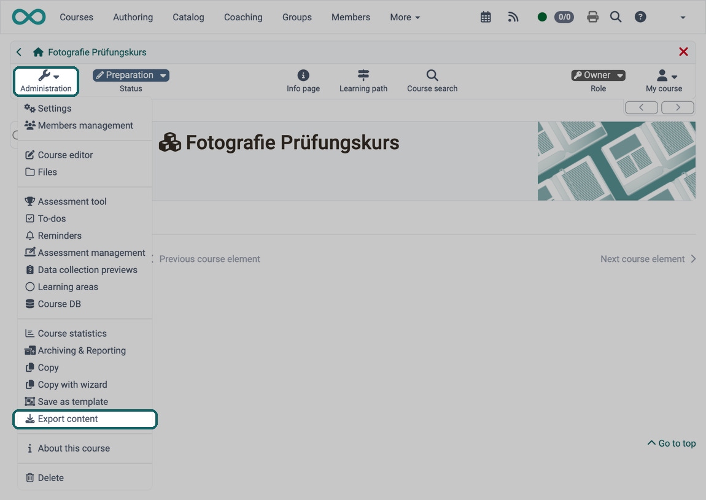{ class="shadow lightbox" title="Administration menu of a course · 2026.10.01" }

[To the top of the page ^](#test_export)

---

## Export test learning resource {: #export_learning_resource}

A test learning resource contains all questions of a test including its configuration, for example the total number of points, and can be integrated into "Test" course elements. Whoever wants to back up the test without a course or import it into another OpenOlat exports the test learning resource as a zip file. You start the export in the administration of the test learning resource under: `Test > Administration > Export content`

Here too, owners always find the menu item, other authors only if exporting is allowed in the tab "Share".

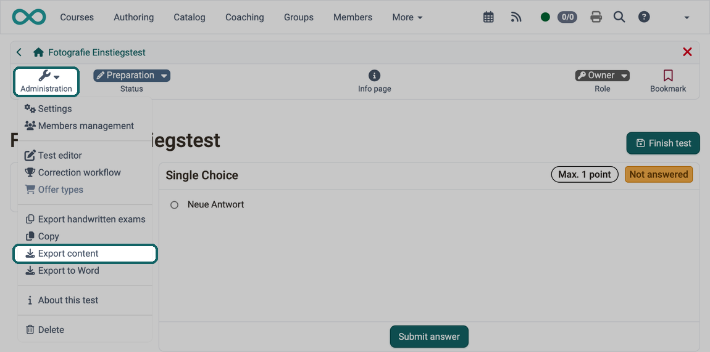{ class="shadow lightbox" title="Administration menu of a test learning resource · 2026.10.01" }

!!! tip "Tip"

    Please note whether you have opened the administration of a course or of a test learning resource. In the course, the editor entry is called "Course editor", in the test learning resource "Test editor".

[To the top of the page ^](#test_export)

---

### Export to Word {: #word}

Whoever wants to have a test reviewed before it is conducted exports it as a Word document. Additions and corrections can be easily noted in it. With `Test > Administration > Export to Word` OpenOlat downloads a zip file with two Word documents: one contains only the questions, the other also the solutions. Both state the title of the test, the passed cut value if the test defines one, the sections and every question with question type and score, each question on a page of its own. The menu item is available to owners of the test learning resource, learning resource managers and administrators.

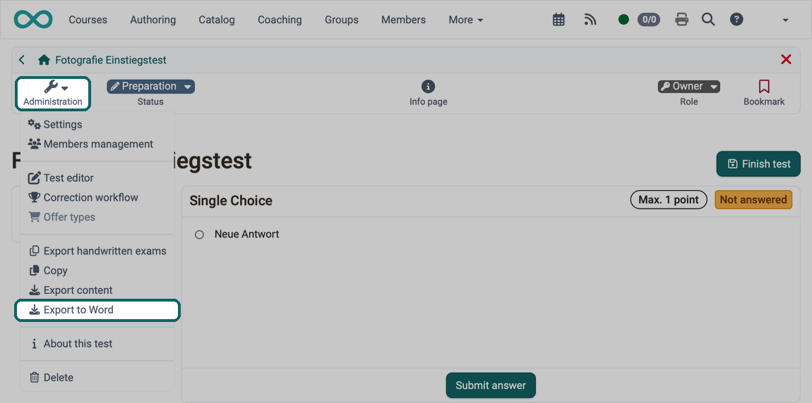{ class="shadow lightbox" title="Administration menu of a test learning resource · 2026.10.01" }

[To the top of the page ^](#test_export)

---

### Export handwritten exams [:octicons-tag-16:{ title="from Release 16.1 (OO-5648)" }](https://track.frentix.com/issue/OO-5648) {: #handwritten_exams}

Whoever conducts a test on paper creates print-ready exam sheets with serial number, solution sheet and, if desired, a cover sheet via `Test > Administration > Export handwritten exams`, see [Test: Export handwritten exams](Test_handwritten_exams.md).

[To the top of the page ^](#test_export)

---

## Export single questions {: #export_questions}

Whoever wants to use a question in further tests or exchange it with another system exports it individually. Questions in OpenOlat comply with the QTI standard (Question and Test Interoperability). This means they can also be transferred to other LMS (learning management systems) that use this standard. Conversely, OpenOlat imports questions in QTI format.

### Export to pool {: #export_to_pool}

If a question from a test should also be available in the question bank, transfer it there from the test editor. In the test editor of the test learning resource, select the desired question and click on the icon with the 3 dots in the upper right corner. With "Export to pool" you transfer the question to the question bank. The entry appears if the question bank is enabled in your OpenOlat.

OpenOlat creates a new question with its own ID in the question bank. The question in the test and the question in the question bank are then independent of each other. How questions get from the question bank into a test is described under [How do the questions get into a test?](Test/index.md#create_questions_in_tests)

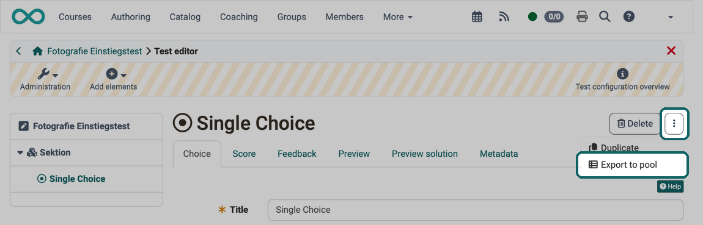{ class="shadow lightbox" title="Question in the test editor · 2026.10.01" }

!!! tip "Tip"

    This way, you also export an entire section with all its questions to the question bank. To do so, select the section on the left and click on the 3 dots.

[To the top of the page ^](#test_export)

---

### Export single questions from the pool

Whoever wants to pass on a single question or use it in another system exports it from the question bank as a zip file. Open the question in the question bank and select the entry "Export" under the icon "Share". The zip file can be imported into another OpenOlat or into another LMS that uses the QTI standard.

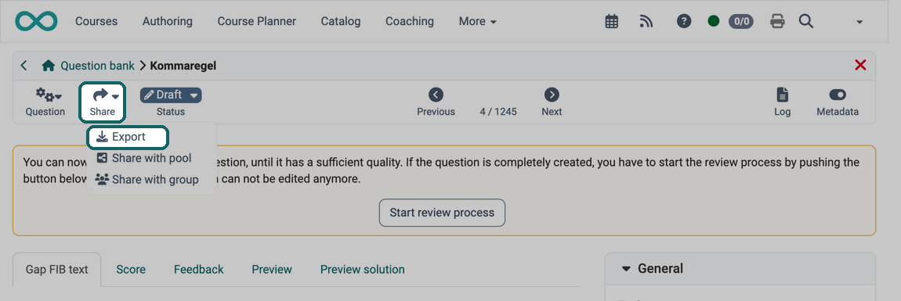{ class="shadow lightbox" title="Question in the question bank · 2026.10.01" }

[To the top of the page ^](#test_export)

---

### Export multiple selected single questions from the pool

Whoever wants to pass on, examine offline or archive several questions at once exports them together. Select the questions in the list of the question bank and click on "Export" above the list.

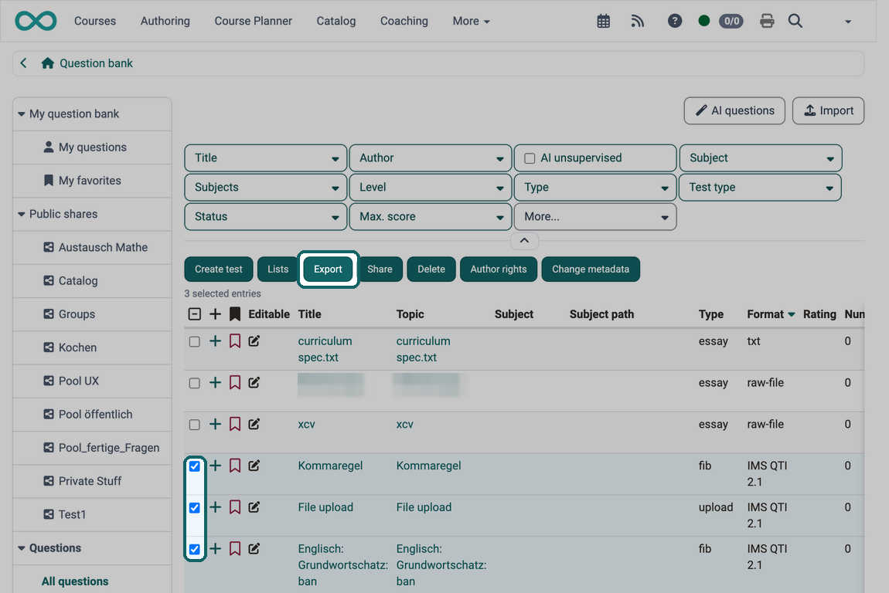{ class="shadow lightbox" title="List All questions in the question bank · 2026.10.01" }

In the dialog "Export" you choose the format in the step "Type": a Word file for offline exams including the master sheet, a QTI 2.1 test file for exchange with other compatible LMS or a ZIP file for exchange with other OpenOlat systems or for archiving. Word and QTI 2.1 can only be selected if at least one of the selected questions is in the format QTI 2.1; otherwise the list only offers the ZIP file. Which questions can be exported in the chosen format is shown in the step "Review" in the column "Can export".

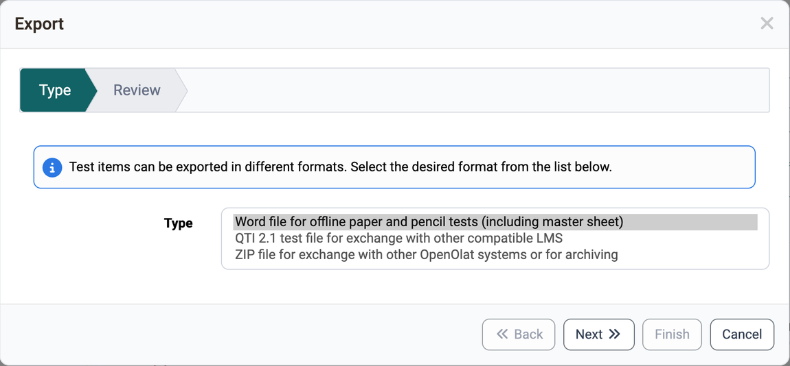{ class="shadow lightbox" title="Step Type in the dialog Export · 2026.10.01" }

[To the top of the page ^](#test_export)

---

## Export test results {: #export_results}

You receive the results of a test in two ways: The test statistics show the evaluation directly in OpenOlat, the export of the test results delivers the results of the participants as a file for evaluating, printing or archiving.

### Test Statistics

Whoever wants to know how a test turned out sees the key figures of the whole test and of each individual question in the test statistics. For a single test, use the button "Test Statistics" in the course element "Test". The button is available to coaches and owners. You find it under: `Course > Course element "Test" > Tab "Participants" > Button "Test Statistics"`

You find the evaluation of all tests of the course under `Course > Administration > Test statistics`, see [Test statistics](Statistics_Test.md).

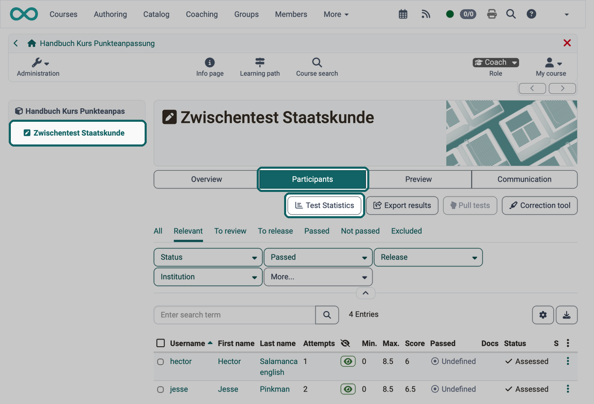{ class="shadow lightbox" title="Tab Participants of the Test course element · 2026.10.01" }

With "Print" you print out the statistics or save them as a PDF file via the print dialog. With "Download raw data" you receive the raw data as an Excel file. If you expand the sections of the test on the left, you see the detailed statistics of each individual question.

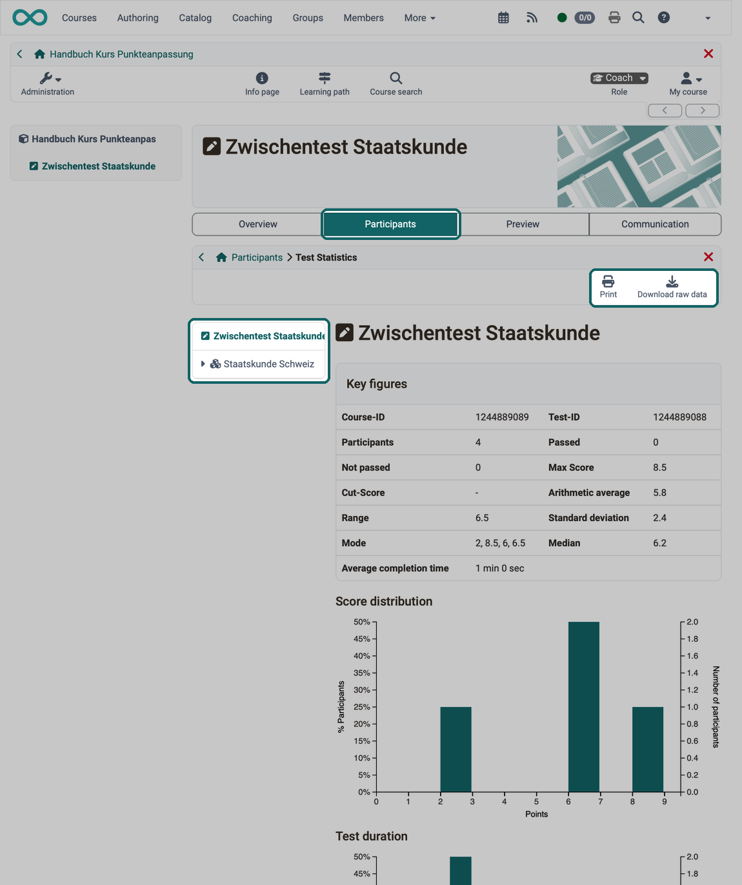{ class="shadow lightbox" title="Test Statistics in the Test course element · 2026.10.01" }

### Test results of participants [:octicons-tag-16:{ title="from Release 16.2 (OO-5974)" }](https://track.frentix.com/issue/OO-5974)

Whoever wants to evaluate, print or archive the results of a test receives a zip file with all test results of all participants in the selected course element via the button "Export results". The button is available to coaches and owners. You find it under: `Course > Course element "Test" > Tab "Participants" > Button "Export results"`

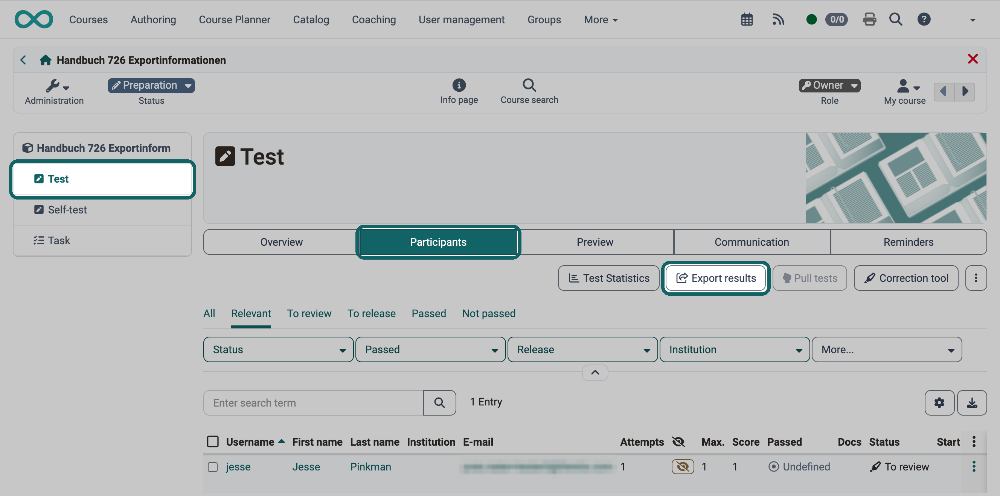{ class="shadow lightbox" title="Tab Participants of the Test course element · 2026.10.22" }

If you have selected individual participants in the list, the export only covers their results.

On the page "Export results", the row "Number of participants" shows how many persons the export covers. There you give the zip file a name and choose the variant for its contents under "Export":

* **"Standard"**: The zip file contains the detailed test results for each participant as an HTML document and an Excel file with the raw data.
* **"Advanced – with PDF"**: The zip file contains the same and additionally a PDF file with the detailed results for each participant. This variant can be selected if the [PDF Service](../../manual_admin/administration/External_Tools_-_Administration/index.md#pdf_generator) is enabled in the system administration.

OpenOlat suggests a name with variant and date, for example "Test results with PDF - all participants (10/1/2026)".

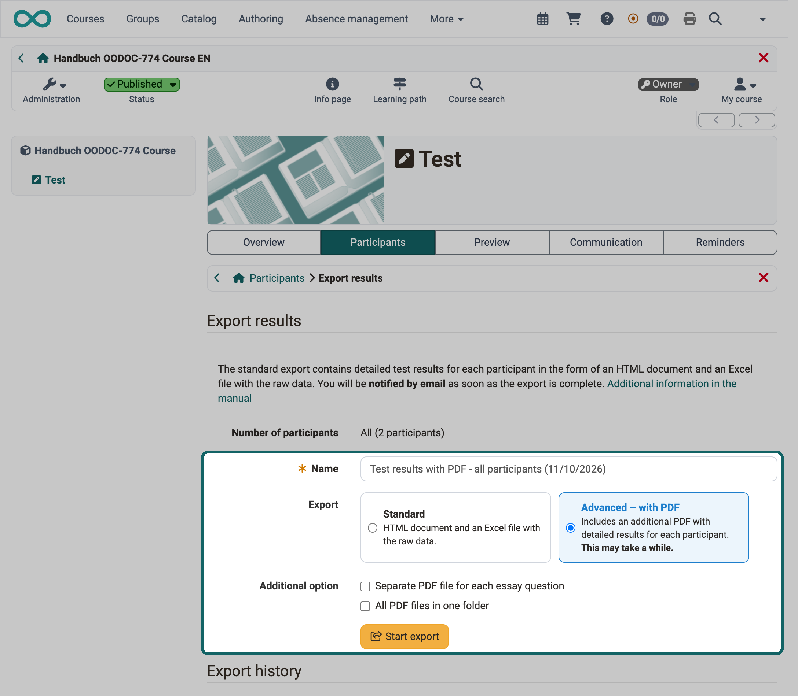{ class="shadow lightbox" title="Page Export results in the Test course element · 2026.11.10" }

With the variant "Advanced – with PDF", the "Additional option" with one or two checkboxes appears below:

* **"Separate PDF file for each essay question"** can be selected if the test contains essay questions. If it is activated, OpenOlat additionally places the answer to each essay question in the zip file as a separate PDF file. [:octicons-tag-16:{ title="from Release 19.1.27 (OO-8964)" }](https://track.frentix.com/issue/OO-8964)
* **"All PDF files in one folder"** can be selected for every test. If it is activated, the PDF files with the detailed results of all participants are placed together in one folder of the zip file. How the files are named and where they are located is described under [PDF files in the zip file](#pdf_files).

With "Start export" OpenOlat generates the zip file containing the test results. As soon as the export is complete, OpenOlat notifies you by email.

The created zip files are listed below in the "Export history", each for 10 days. Unzip the zip file to access the individual files.

#### PDF files in the zip file [:octicons-tag-16:{ title="from Release 21.1 (OO-9600)" }](https://track.frentix.com/issue/OO-9600) {: #pdf_files}

Whoever prints, files or passes on exported results can tell from the file name which person and which test a PDF file belongs to. The name is made up of these parts, each separated by an underscore:

1. Last name of the participant. If no last name is recorded, it reads "anonym".
2. First name of the participant.
3. Title of the course element, shortened to 25 characters.
4. Title of the test learning resource, shortened to 25 characters.
5. A number that uniquely identifies the test attempt.

Spaces become underscores, umlauts are transcribed ("ü" becomes "ue"), other special characters are dropped. An example: `Langenegger_Simone_Test_Demo_Test_Demo_Master_13730.pdf`.

Where the PDF files are located in the zip file is determined by the option "All PDF files in one folder":

* **Off:** Each PDF file is located in the folder of the participant, there in the subfolder of the respective attempt. The results of one person thus stay together.
* **On:** All PDF files with the detailed results are located together in the folder "resultspdfs". This way, the results of all participants can be printed or passed on without searching the subfolders.

In both cases, the folders of the participants with the HTML document and the raw data remain, and the links in the HTML documents of the zip file lead to the respective PDF file. The PDF files from the option "Separate PDF file for each essay question" always stay in the folder of the participant.

The option "All PDF files in one folder" is only available for the export via the "Export results" button. The course archiving always places the PDF files in the folder of the participant, with the same structure of the file name.

#### Score columns in the Excel file [:octicons-tag-16:{ title="from Release 21.1 (OO-9599)" }](https://track.frentix.com/issue/OO-9599) {: #score_columns}

Whoever evaluates the results sees in the Excel file with the raw data which part of the points comes from the answer and which from a later correction. For each test run, the file contains these columns:

* **Score**: the result of the test run.
* **Score (auto)**: the sum of the automatically calculated points.
* **Score (adjustments plus)**: the sum of all adjustments that add points.
* **Score (adjustments minus)**: the sum of all adjustments that deduct points, as a negative value, for example "-0.5".
* **Score (manual)**: the sum of the points awarded by hand for questions.

For each question, the column "Score" contains the score of the question. For automatically corrected questions, it is followed by the column "Adjustment" with the amount by which the points were adjusted. How an adjustment is made is described on the page [Assessing tests](../learningresources/Assessing_tests.md#adjust_score). You receive the same Excel file in the test statistics via "Download raw data".

#### Sheet "Export information" [:octicons-tag-16:{ title="from Release 21.1.1 (OO-9812)" }](https://track.frentix.com/issue/OO-9812) {: #export_information}

Whoever processes exported raw data further or stores it outside OpenOlat recognises from the sheet "Export information" which course and which course element the file comes from, and when and by whom it was created. The sheet is the last sheet in every Excel file with test results, whether the file comes from "Export results", from "Download raw data" in the [test statistics](Statistics_Test.md) or from the [course archiving](Course_Archiving/index.md). It has the columns "Information" and "Value" and these rows:

Row | Content
---------|----------
URL | Link to the course element in the course. The link takes you from the file directly back to the test.
OpenOlat Version | Version of OpenOlat with which the file was created.
Course title | Title of the course.
Course reference | Reference of the course. If the course has no reference, the ID of the course is shown here.
Course element title | Title of the course element.
Course element ID | Number of the course element. The same number is at the end of the URL. It identifies the course element unambiguously, even if its title changes later.
Export language | Language of the person who started the export, as a written-out name, for example "German".
Exported | Date and time of the export.
Exported by | Name of the person who started the export. The row stays empty in archive files that OpenOlat creates itself, for example when deleting the test data in the course element with "Delete all data".

If the test does not belong to a course, for example in the test statistics of a standalone test learning resource, "URL", "Course title" and "Course reference" refer to the test learning resource. The rows "Course element title" and "Course element ID" are then missing.

!!! note "Note"

    You also export test results via the archiving of the course under `Course > Administration > Archiving & Reporting`, see [Archiving test results](../learningresources/Course_Element_Test/Test_Results.md#archive).

[To the top of the page ^](#test_export)

---

## Further information {: #further_information}

**Mentioned on this page** 
[Access configuration >](Access_configuration.md) 
[Test: Export handwritten exams >](Test_handwritten_exams.md) 
[Creating Tests >](Test/index.md) 
[Test statistics >](Statistics_Test.md) 
[External Tools: Overview >](../../manual_admin/administration/External_Tools_-_Administration/index.md) 
[Assessing tests >](../learningresources/Assessing_tests.md) 
[Course administration - Archiving & Reports >](Course_Archiving/index.md) 
[Evaluate and manage tests >](../learningresources/Course_Element_Test/Test_Results.md)

**Further** 
[Course Element "Test" >](../learningresources/Course_Element_Test/index.md) 
[How do I proceed when I create a test? >](../../manual_how-to/test_creation_procedure/test_creation_procedure.md) 
[Test editor >](Test_editor_QTI_2.1/index.md) 
[Test question types >](../learningresources/Test_question_types.md) 
[Configure test questions >](Configure_test_questions.md) 
[Configure tests >](Configure_tests.md) 
[Test: Settings >](Test_settings.md)

[To the top of the page ^](#test_export)

