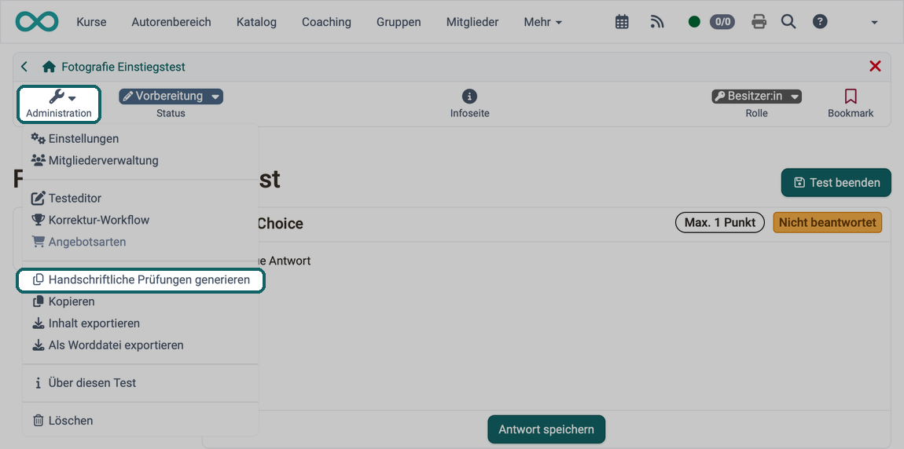
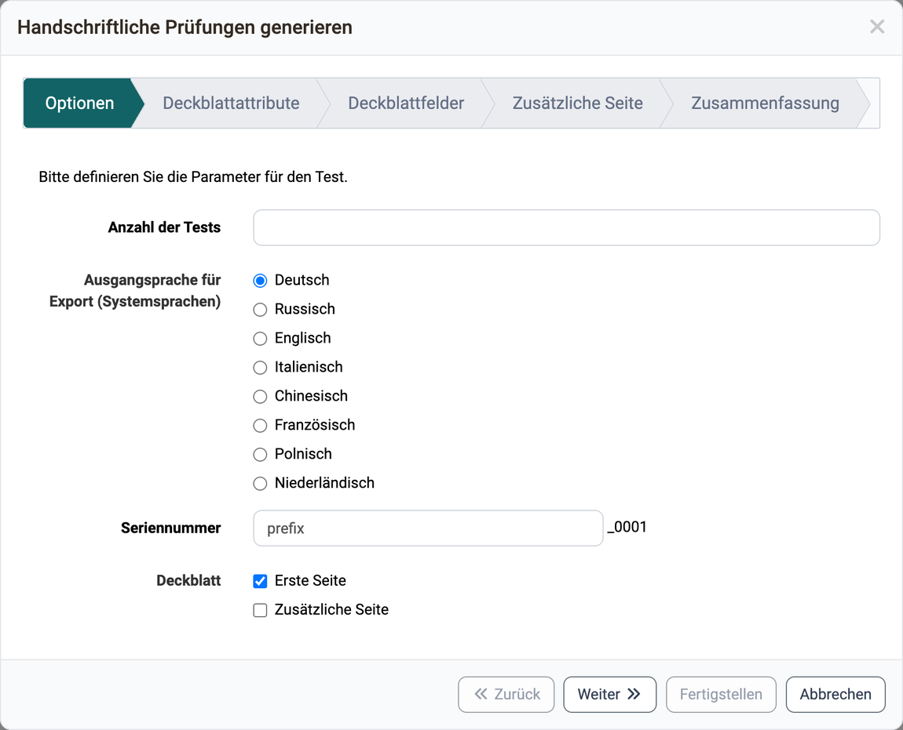
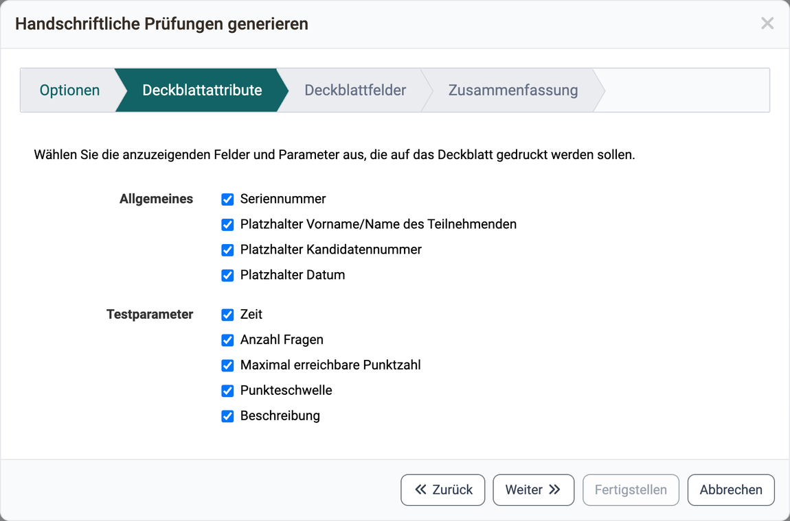
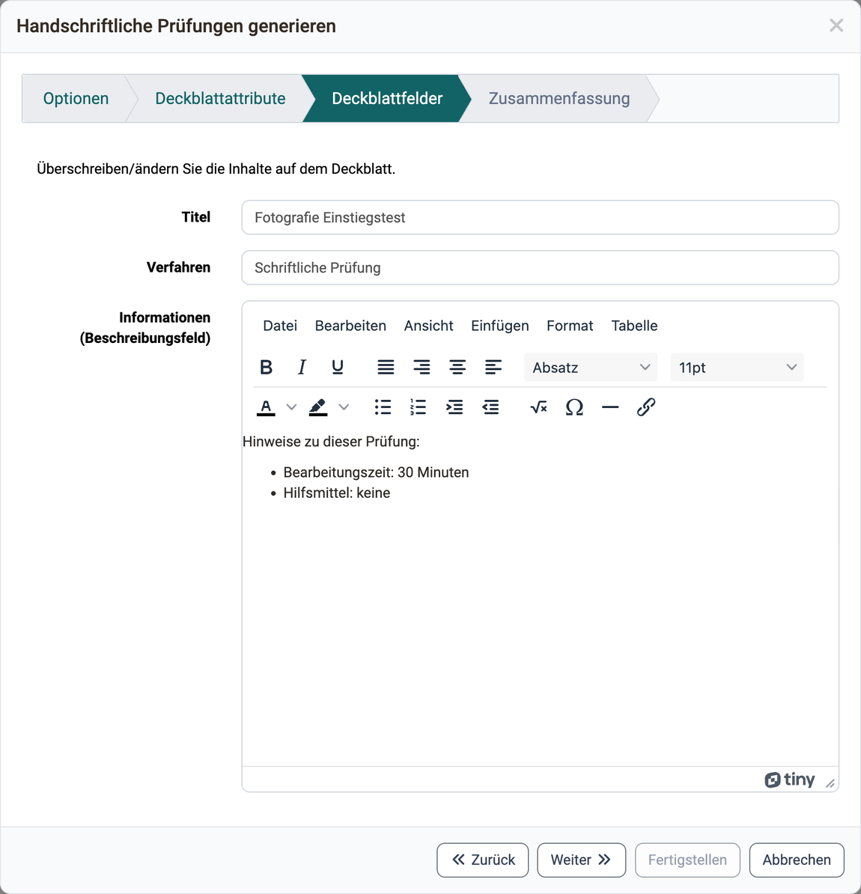
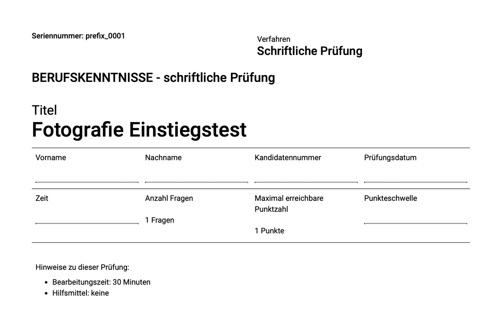

# Test: Handschriftliche Prüfungen generieren [:octicons-tag-16:{ title="ab Release 16.1 (OO-5648)" }](https://track.frentix.com/issue/OO-5648) {: #create_paper_pencil}

Wer einen Test auf Papier durchführt, erhält mit dem Assistenten "Handschriftliche Prüfungen generieren" druckfertige Prüfungsbogen: eine zip-Datei mit einer PDF-Datei je Prüfung und dem passenden Lösungsblatt. Jede Prüfung erhält eine eigene Seriennummer und auf Wunsch ein Deckblatt. So lässt sich jeder handschriftlich ausgefüllte Bogen nach der Prüfung eindeutig zuordnen.

OpenOlat stellt jede Prüfung so zusammen wie einen neuen Testversuch online. Zeigt eine Sektion nur eine Auswahl ihrer Fragen oder die Fragen in zufälliger Reihenfolge, unterscheiden sich die Prüfungen voneinander. Wie Sie das einstellen, steht unter [Test konfigurieren](Configure_tests.de.md#section).

## Assistent öffnen {: #open_wizard}

Den Assistenten öffnen Sie in der Administration der Test-Lernressource unter: `Test > Administration > Handschriftliche Prüfungen generieren`

Der Menüpunkt steht Besitzer:innen der Test-Lernressource, Lernressourcenverwalter:innen und Administrator:innen zur Verfügung. Er erscheint, wenn in der System-Administration der [PDF-Dienst](../../manual_admin/administration/External_Tools_-_Administration.de.md#pdf_generator) eingeschaltet ist: `Administration > Externe Werkzeuge > PDF Generator`. Die übrigen Einträge des Menüs beschreibt die Seite [Test: Administration](Test_administration/index.de.md).

{ class="shadow lightbox" title="Menü Administration einer Test-Lernressource · 2026.10.01" }

[Zum Seitenanfang ^](#create_paper_pencil)

---

## Schritte des Assistenten {: #wizard_steps}

Der Assistent führt in bis zu fünf Schritten zur zip-Datei. Welche Schritte erscheinen, bestimmen Sie im ersten Schritt unter "Deckblatt".

### Optionen {: #options}

"Anzahl der Tests" und "Seriennummer" sind Pflichtangaben. OpenOlat erzeugt so viele Prüfungen, wie Sie angeben, und hängt an die Seriennummer eine fortlaufende Nummer an: aus "prefix" wird "prefix_0001". Die Seriennummer ist zugleich der Name der PDF-Datei. Die Sprache der Prüfungsbogen wählen Sie unter "Ausgangsprache für Export (Systemsprachen)". Unter "Deckblatt" bestimmen Sie, ob jede Prüfung mit "Erste Seite" ein Deckblatt und mit "Zusätzliche Seite" eine weitere Seite erhält.

{ class="shadow lightbox" title="Schritt Optionen im Dialog Handschriftliche Prüfungen generieren · 2026.10.01" }

### Deckblattattribute {: #cover_attributes}

Dieser Schritt erscheint, wenn "Erste Seite" gewählt ist. Sie wählen aus, welche Angaben und Platzhalter das Deckblatt trägt.

{ class="shadow lightbox" title="Schritt Deckblattattribute im Dialog Handschriftliche Prüfungen generieren · 2026.10.01" }

### Deckblattfelder {: #cover_fields}

Dieser Schritt erscheint ebenfalls, wenn "Erste Seite" gewählt ist. Sie passen "Titel" und "Verfahren" an und schreiben unter "Informationen (Beschreibungsfeld)" einen Hinweistext für die Teilnehmenden. Das Feld übernimmt die Beschreibung der Test-Lernressource, Sie können sie hier für das Deckblatt ändern.

{ class="shadow lightbox" title="Schritt Deckblattfelder im Dialog Handschriftliche Prüfungen generieren · 2026.10.01" }

So sieht ein erzeugtes Deckblatt mit allen Angaben aus:

{ class="shadow lightbox" title="Erzeugtes Deckblatt einer handschriftlichen Prüfung · 2026.10.01" }

### Zusätzliche Seite {: #additional_sheet}

Dieser Schritt erscheint, wenn "Zusätzliche Seite" gewählt ist. Im Texteditor steht der Text, den die System-Administration für die zusätzliche Seite hinterlegt hat: `Administration > e-Assessment > Test > Tab "Prüfungsexport"`, siehe [e-Assessment Administration: Test](../../manual_admin/administration/e-Assessment_Test.de.md#tab_tests_export). Sie können den Text hier für diese Prüfungen anpassen.

### Zusammenfassung {: #summary}

Die Zusammenfassung zeigt alle Einstellungen: die Anzahl der Tests und Lösungsblätter, das Dateiformat, die Ausgabesprache, die Seriennummern, die vom Test mitgegebenen Parameter und die Angaben für das Deckblatt. Mit "Vorschau" und "Vorschau mit Lösungen" öffnen Sie eine Probe als PDF-Datei.

{ class="shadow lightbox" title="Schritt Zusammenfassung im Dialog Handschriftliche Prüfungen generieren · 2026.09.28" }

Nach "Fertigstellen" beginnt der Download der zip-Datei. Je nach Anzahl dauert er einige Minuten bis Stunden, und der Browser reagiert in dieser Zeit möglicherweise nicht. Die zip-Datei enthält im Ordner "tests" je Prüfung eine PDF-Datei mit der Seriennummer als Namen und im Ordner "solutions" das passende Lösungsblatt.

[Zum Seitenanfang ^](#create_paper_pencil)

---

## Weiterführende Informationen {: #further_information}

**Auf dieser Seite erwähnt** 
[Test konfigurieren >](Configure_tests.de.md) 
[Externe Werkzeuge: Übersicht >](../../manual_admin/administration/External_Tools_-_Administration.de.md) 
[Test: Administration >](Test_administration/index.de.md) 
[e-Assessment Administration: Test >](../../manual_admin/administration/e-Assessment_Test.de.md)

**Weiterführend** 
[Testeditor >](Test_editor_QTI_2.1/index.de.md) 
[Tests exportieren >](Test_export.de.md)

[Zum Seitenanfang ^](#create_paper_pencil)
